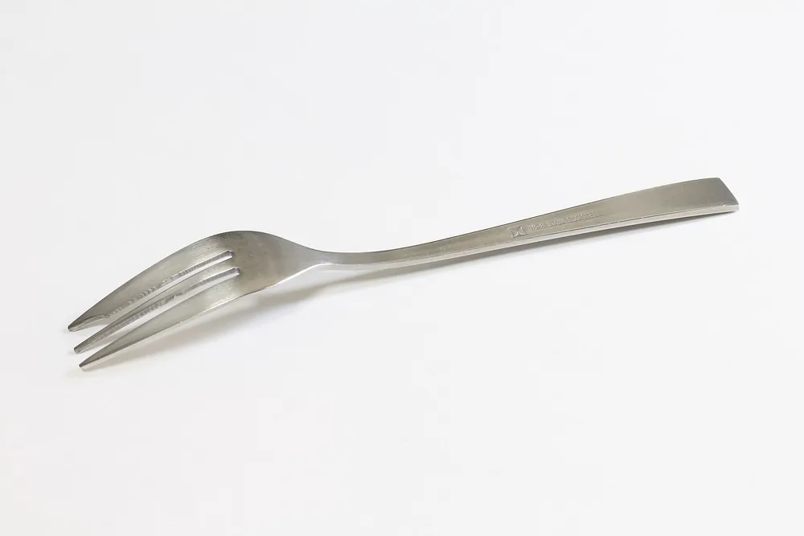

Для изготовления детали из стали 08Х18Н10 нужны требования к материалу, рабочей среде и готовому изделию. Состав проверяют по документу на марку и сертификату поставки, свойства — с учётом вида заготовки и её состояния. Замену на AISI 304 согласовывают отдельно: одного упоминания в таблице аналогов недостаточно.

## Когда 08Х18Н10 подходит для детали по чертежу

Пригодность 08Х18Н10 для детали оценивают по условиям её работы. Для этого нужны состав среды, температура, нагрузки, характер контакта с другими деталями и требования к поверхности. Если предусмотрена сварка, в оценку включают соединение. Пока исходных данных нет, выбор материала остаётся предварительным: название марки не заменяет проверку конструкции.

Для корпуса, втулки и зубчатого колеса нужны разные исходные данные. У корпуса важны герметичность и работа в среде. У трущейся пары — нагрузка, смазка и допустимый износ.

В чертеже фиксируют размеры, допуски, шероховатость и требования к швам. Для изделия с пищевым контактом отдельно определяют требования к материалам и обработке поверхности.

Решение о марке принимает ответственный за конструкцию.

<!-- inline-cta -->

## Расшифровка 08Х18Н10 и проверка состава

*Вилка из нержавеющей стали с содержанием хрома 18% и никеля 8%. Фото: [Yapparina](https://commons.wikimedia.org/wiki/File:18-8_stainless_steel_fork_1.jpg) · [CC0 1.0](https://creativecommons.org/publicdomain/zero/1.0/deed.en)*

Расшифровку марки и допустимое содержание элементов нужно проверять по конкретному документу, который распространяется на выбранный материал. В представленном блоке источников такой документ не указан: ссылка на главную страницу организации не подтверждает состав. Поэтому здесь нет численных пределов элементов и утверждений о том, какие значения обозначают цифры марки.

При закупке сравнивают требования к составу с результатами анализа поставленной плавки. Название марки в счёте и фактический состав в сертификате — разные сведения.

| Что проверить | С чем сравнить |
| --- | --- |
| Обозначение материала | Чертёж и заказ |
| Документ на марку | Обозначение и редакция документа в заказе |
| Содержание элементов | Таблица состава и примечания к ней |
| Результаты анализа плавки | Пределы, установленные для заказанного материала |
| Номер плавки или партии | Маркировка поставленной заготовки |

Если документ поставщика не позволяет установить соответствие, вопрос решают до передачи металла в обработку.

## Механические и физические свойства: какие значения сравнивать

Характеристики материала для расчёта и приёмки нужно сопровождать условиями, к которым они относятся. Для прочности и пластичности указывают вид продукции, размеры, состояние поставки и условия испытания. Справочная таблица без этих пояснений не позволяет проверить конкретную заготовку. В этой статье численные свойства не приведены: подтверждающих документов на выбранный полуфабрикат нет.

Для сравнения предложений поставщиков удобнее собрать сведения в одну таблицу.

| Показатель | Что должно сопровождать значение |
| --- | --- |
| Временное сопротивление | Вид продукции, состояние и условия испытания |
| Условный предел текучести | Принятое условное удлинение и условия испытания |
| Относительное удлинение | Тип образца и расчётная длина |
| Твёрдость | Метод измерения и состояние материала |
| Плотность | Источник и условия, для которых дано значение |
| Тепловое расширение | Температурный интервал и источник данных |

Значения для расчёта конструкции и требования приёмки стоит обозначать отдельно. Это помогает избежать ситуации, когда справочную величину принимают за гарантированное свойство поставки.

Массу заготовки рассчитывают как произведение плотности на объём. Для точного расчёта нужны обоснованная плотность и геометрия заготовки.

## AISI 304 и соседние марки: когда возможна замена

Замену 08Х18Н10 на AISI 304 нельзя обосновать одной строкой в таблице аналогов. Для решения нужны документы на оба материала и требования изделия. В представленных источниках нет конкретных таблиц состава и свойств, поэтому соответствие этих обозначений здесь не подтверждено. Его проверяют для выбранного вида продукции и состояния поставки.

Сначала сравнивают химический состав, механические свойства и предусмотренные испытания. Затем проверяют требования к сварке, поверхности и работе в заданной среде.

Совпадение части показателей ещё не закрывает вопрос замены.

Другую марку, включая материал с дополнительными легирующими элементами, оценивают тем же способом. Основание для согласования — сопоставление требований, а не сходство названий.

Согласованную замену отражают в документации на заказ. Иначе поставщик материала и изготовитель детали могут опираться на разные требования.

## Ограничения по коррозии, среде и температуре

Оценка работы детали в среде требует её состава, концентрации компонентов, температуры и режима контакта. Нужно различать постоянное погружение, периодическое смачивание и контакт с конденсатом. Для соединений дополнительно описывают зазоры и условия очистки. Без этих данных нельзя обосновать пригодность материала или назвать срок службы изделия.

В исходных материалах нет документа, который подтверждал бы допустимые среды и температуры для рассматриваемой поставки. Поэтому универсальные температурные пределы и обещания коррозионной стойкости здесь не приведены.

Температура сама по себе не описывает условия работы.

Для нагруженного узла нужны также усилия и продолжительность их действия. Для сварной конструкции — сведения о соединениях и обработке после сварки.

Расчёт или программа испытаний должны отвечать на вопрос о конкретном изделии. Испытание образца в других условиях не стоит использовать как гарантию срока службы детали.

## Как выбрать заготовку и маршрут изготовления

Заготовку для детали выбирают по геометрии, требованиям к материалу и доступному состоянию поставки. Для корпуса может рассматриваться лист или сварная заготовка, для втулки — пруток либо труба. Выбор проверяют по размерам, припускам и возможностям контроля. Документы на материал должны позволять связать поставку с заготовкой, которая пойдёт в работу.

Припуск назначают под конкретную операцию и схему закрепления. Одного обозначения марки для этого недостаточно.

Пример маршрута: входной контроль, подготовка заготовки, черновая обработка, промежуточный контроль, чистовая обработка и окончательная приёмка. Это схема планирования, а не описание выполненного заказа.

Для тонкостенной детали в маршрут включают проверку геометрии после снятия зажимного усилия. Если предусмотрены сварка или термообработка, заранее определяют место этих операций и последующего контроля.

Требования к исходным данным для [изготовления деталей по чертежам](/) включают редакцию чертежа, материал, количество и условия приёмки.

## Точение, фрезерование и сверление: как учитывать наклёп

При подготовке обработки 08Х18Н10 нужно проверить рекомендации производителя инструмента для выбранного материала и состояния заготовки. В исходном тексте нет конкретного руководства, которое подтверждало бы режимы или причины отдельных дефектов. Поэтому универсальные скорости и подачи здесь не указаны. Режим связывают с инструментом, операцией, закреплением и подачей смазочно-охлаждающей жидкости — СОЖ.

Наклёп и его влияние на следующий проход рассматривают при разработке технологии. Делать вывод о причине брака только по внешнему виду стружки недостаточно.

Если обработка идёт нестабильно, проверяют:

- состояние кромки и наличие налипшего материала;
- закрепление заготовки и вылет инструмента;
- соответствие режима рекомендациям производителя;
- отвод стружки;
- поступление СОЖ в зону резания;
- размеры и поверхность после прохода.

Диагностику начинают с наблюдаемого отклонения: вибрации, износа инструмента, повреждения поверхности или ухода размера. Затем проверяют возможные причины.

Сведения об операции собраны на странице [фрезерной обработки металла](/frezerovka.html). Конкретный инструмент и режим выбирают при подготовке производства.

## Термообработка и деформация: что меняется в свойствах

Термообработку детали из 08Х18Н10 следует описывать через цель и проверяемый результат. В документации нужны исходное состояние, режим обработки, требования к охлаждению и последующий контроль. В представленных источниках нет конкретного документа, подтверждающего режим для этой марки. Поэтому температура, выдержка и ожидаемое изменение свойств здесь не назначены.

Фраза «закалить деталь» оставляет слишком много неопределённости. В задании нужно назвать требуемое состояние материала и показатели, по которым примут результат.

Если маршрут включает деформацию, при выборе дальнейших операций учитывают её способ и степень. Свойства исходного проката нельзя автоматически считать характеристиками готовой детали.

После обработки отдельно проверяют геометрию.

Необходимость правки, повторного контроля или дополнительных испытаний определяют при разработке технологии. Обещать восстановление размеров одним нагревом без обоснования нельзя.

## Сварка, удаление заусенцев и восстановление поверхности

Для сварной детали нужно согласовать способ сварки, материалы соединения, присадку, последовательность операций и контроль. Обозначение основного металла не заменяет технологию соединения. Требования к поверхности после сварки также задают заранее: иначе изготовитель и заказчик могут по-разному понимать допустимый вид шва и прилегающих участков.

Очистку, травление и пассивацию не стоит записывать как взаимозаменяемые операции. Для каждой выбранной операции нужны цель, технология и критерий приёмки.

Составы растворов и режимы обработки без подтверждённой технологической документации здесь не приведены.

Отдельно определяют порядок работы с инструментом, абразивами и рабочими поверхностями. Это позволяет включить предотвращение загрязнений в маршрут, а не обсуждать его после появления дефекта.

Фотография очищенного шва показывает внешний вид. Она не подтверждает стойкость соединения в рабочей среде.

## Что проверить в сертификате и при приёмке детали

Приёмку материала и готовой детали разделяют. На входе проверяют соответствие поставки заказу и связь документов с заготовкой. После изготовления проверяют результат по чертежу: размеры, форму, шероховатость, швы и состояние поверхности. Сертификат на металл не содержит результатов контроля всех последующих операций и не заменяет приёмку изделия.

Состав сертификата сверяют с требованиями заказа. Важно установить марку, документ на продукцию, плавку или партию, состояние поставки и результаты предусмотренных испытаний.

Дополнительные испытания включают в заказ с указанием метода и критерия приёмки. Одного названия испытания недостаточно.

Для расчёта изготовления нужны:

- чертёж и номер редакции;
- количество деталей;
- материал, требования к заготовке и согласованные замены;
- рабочая среда, температура и нагрузки;
- требования к сварке и обработке поверхности;
- перечень документов и условия приёмки.

Передайте чертёж на расчёт вместе с условиями работы детали и требованиями к приёмке.

## Частые вопросы

Для заказа детали важно разделять выбор материала, согласование технологии и проверку результата. Ни сертификат на прокат, ни таблица аналогов не отвечают на все эти вопросы сразу. Ниже — ответы о замене марки, документах и режимах обработки. Они относятся к подготовке заказа; пригодность конкретного материала требует отдельного обоснования.

### Можно ли заменить 08Х18Н10 на AISI 304?

По представленным источникам такая замена не подтверждена. Нужны конкретные документы на оба материала, сравнение требований и согласование ответственного за конструкцию.

### Где взять состав и предел текучести 08Х18Н10?

Состав проверяют по документу на марку и сертификату плавки. Предел текучести ищут для выбранного вида продукции и состояния поставки, с указанием условий испытания. Подтверждённых значений в этой статье нет.

### Можно ли назначить режим резания только по марке стали?

Для выбора режима нужны также инструмент, операция, размеры, закрепление и условия охлаждения. Отправной точкой служат рекомендации производителя выбранного инструмента для соответствующего материала.

### Заменяет ли сертификат на металл приёмку готовой детали?

Нет. Сертификат относится к поставленному материалу. Размеры, поверхность, швы и другие требования к готовому изделию проверяют отдельно.

## Источники

В исходной статье приведены главные страницы организаций. Они не ведут на конкретные документы и не подтверждают состав, свойства или взаимозаменяемость марок. До публикации нужны ссылки на документы с указанием таблиц или разделов, которые подтверждают технические утверждения. По этой причине статья оставлена в черновике.

- [Росстандарт](https://www.rst.gov.ru/) — главная страница; документ с составом 08Х18Н10 не представлен.
- [ASTM International](https://www.astm.org/) — главная страница; документ для сопоставления с AISI 304 не представлен.
- [Sandvik Coromant](https://www.sandvik.coromant.com/) — главная страница; конкретное руководство по обработке не представлено.
