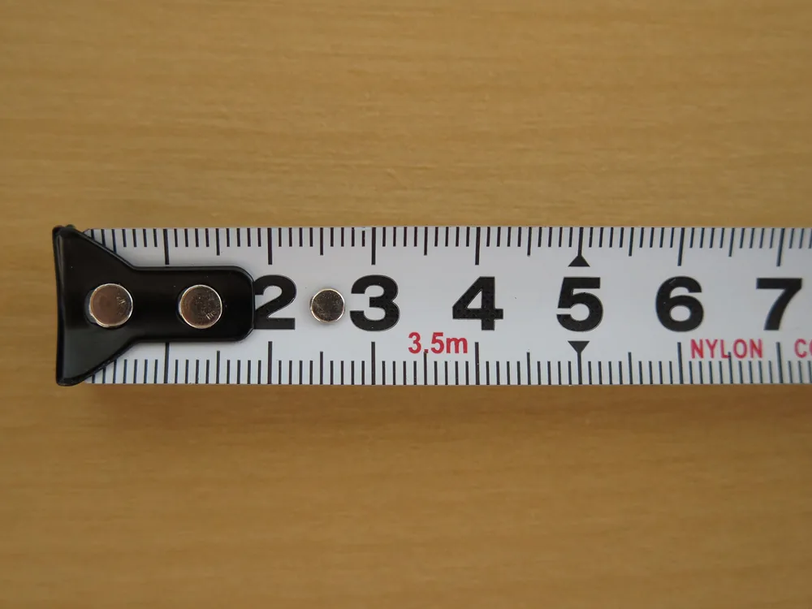
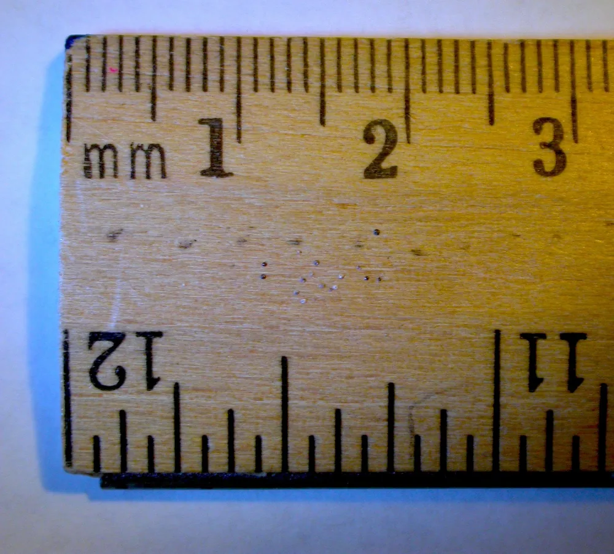

15 мм — это 1,5 см, или 1 см 5 мм. Чтобы перевести миллиметры в сантиметры, разделите число на 10: 15 ÷ 10 = 1,5. Для обратной проверки умножьте результат на 10 — получите исходные 15 мм.

## 15 мм — это 1,5 см, или 1 см 5 мм

В пятнадцати миллиметрах один целый сантиметр и ещё половина сантиметра. Десять миллиметров дают 1 см, оставшиеся пять — 0,5 см. Вместе получается 1,5 см. Записи «15 мм», «1,5 см» и «1 см 5 мм» обозначают одну длину. Выбор записи не меняет размер отрезка.

Округлять здесь нечего.

Соотношение единиц следует из десятичных приставок СИ. В таблице [SI prefixes Международного бюро мер и весов](https://www.bipm.org/en/measurement-units/si-prefixes) приставке «милли» соответствует множитель 10⁻³, а «санти» — 10⁻². Поэтому миллиметр составляет одну тысячную метра, сантиметр — одну сотую. В одном сантиметре десять миллиметров.

На шкале 15 мм находятся посередине между отметками 1 см и 2 см.

<!-- inline-cta -->

## Формула перевода миллиметров в сантиметры

*Участок измерительной ленты от начала до отметки 7 см. Фото: [Douglas Perkins](https://commons.wikimedia.org/wiki/File:Tape_measure_end.jpg) · [CC0 1.0](https://creativecommons.org/publicdomain/zero/1.0/deed.en)*

Чтобы получить сантиметры, число миллиметров делят на 10. Для обратного перевода число сантиметров умножают на 10. Например, 15 ÷ 10 = 1,5, а 1,5 × 10 = 15. Если проверка вернула исходное число с исходной единицей, расчёт сошёлся. Этот способ подходит и для целых, и для дробных значений длины.

**Длина в см = длина в мм ÷ 10.**

**Длина в мм = длина в см × 10.**

При делении на десять запятая сдвигается на один знак влево: 2,5 мм = 0,25 см. Обратное умножение возвращает 2,5 мм.

Для проверки расчёта:

1. Убедитесь, что переводите длину, а не площадь или объём.
2. Разделите число миллиметров на 10.
3. Подпишите результат единицей «см».
4. Умножьте полученное число на 10 и сравните с исходным.

Для площади и объёма нужны другие коэффициенты.

Квадратный сантиметр равен 100 мм². Поэтому площадь делят на 100: квадрат со стороной 15 мм занимает 225 мм², или 2,25 см². Проверка через стороны даёт тот же результат: 1,5 × 1,5 = 2,25 см².

Кубический сантиметр равен 1000 мм³. Куб с ребром 15 мм имеет объём 3375 мм³, или 3,375 см³. Здесь делят на 1000, поскольку переводят каждое из трёх измерений.

## Как найти 15 мм на линейке

На линейке с миллиметровой шкалой отрезок 15 мм идёт от нуля до середины между отметками 1 см и 2 см. Совместите начало отрезка с нулевой риской, найдите 1 см и отсчитайте ещё пять промежутков по миллиметру. Считайте именно промежутки между рисками: они задают длину.

Ориентир — нулевая риска, а не край линейки. Если между краем и нулём есть поле, измерение от края добавит его ширину к результату.

Когда начать от нуля неудобно, используйте разность показаний. Например, от отметки 20 мм до отметки 35 мм будет 35 − 20 = 15 мм. В сантиметрах это 3,5 − 2 = 1,5 см.

Оба показания должны быть в одной единице.

Смотрите на шкалу прямо сверху: при взгляде сбоку положение риски относительно края детали может казаться другим.

> Картинка линейки на экране помогает найти нужное деление. Для измерения предмета она подходит только после проверки масштаба: размер изображения зависит от настроек экрана и увеличения страницы.

## Таблица перевода: миллиметры, сантиметры, дециметры и метры

*Числа на линейке обозначают сантиметры, а миллиметровые деления не пронумерованы. Фото: [Biking Nikon Maui from Sort of near San Francisco](https://commons.wikimedia.org/wiki/File:Ruler_-_INCOMPETENT_MANUFACTURERS_%28408971482%29.jpg) · [CC BY 2.0](https://creativecommons.org/licenses/by/2.0)*

Отрезок 15 мм можно записать как 1,5 см, 0,15 дм или 0,015 м. Для перевода миллиметров в сантиметры число делят на 10, в дециметры — на 100, в метры — на 1000. Длина остаётся прежней. Меняется только единица и число, которым выражен размер.

| мм | см | дм | м |
|---:|---:|---:|---:|
| 5 | 0,5 | 0,05 | 0,005 |
| 10 | 1 | 0,1 | 0,01 |
| **15** | **1,5** | **0,15** | **0,015** |
| 20 | 2 | 0,2 | 0,02 |

Таблица помогает сравнивать размеры из разных записей. Например, нужно понять, что длиннее: 15 мм или 0,2 дм. Переводим второе значение в миллиметры: 0,2 × 100 = 20 мм. Значит, второй отрезок длиннее на 5 мм.

Подробнее о пересчёте других величин — в статье [«Единицы измерения и правила перевода»](/blog/edinicy-izmereniya).

## Почему 0,15 см, 15 см и 1,05 см — неверные ответы

Записи 0,15 см, 15 см и 1,05 см обозначают другие длины. Проверить их можно обратным переводом: умножить каждое число на 10 и получить миллиметры. Результаты составят 1,5 мм, 150 мм и 10,5 мм соответственно. Ни один из них не равен исходным пятнадцати миллиметрам.

| Ошибочный ответ | Какая это длина | Причина ошибки |
|---|---:|---|
| 0,15 см | 1,5 мм | Разделили на 100 вместо 10 |
| 15 см | 150 мм | Заменили единицу, сохранив число |
| 1,05 см | 10,5 мм | Записали 5 мм как 0,05 см вместо 0,5 см |

Пять миллиметров — половина сантиметра. Поэтому к целому сантиметру добавляется 0,5, а не 0,05: 1 + 0,5 = 1,5 см.

Отдельная ошибка — округлять значения до окончания расчёта. Если сложить три отрезка по 15 мм, получится 45 мм, или 4,5 см. Если сначала округлить каждый отрезок с 1,5 до 2 см, сумма составит 6 см. Расхождение — 15 мм.

Перевод единиц не требует такого округления.

## Как перевести размер детали вместе с допуском

В учебном примере 15 ± 0,1 мм на 10 делят и номинальный размер, и отклонения. Получается 1,5 ± 0,01 см. Нижний предел 14,9 мм превращается в 1,49 см, верхний предел 15,1 мм — в 1,51 см. Допуск, то есть разность предельных размеров, равен 0,2 мм, или 0,02 см.

Это пример расчёта, а не заявление о точности производства.

Если разделить только номинал, получится ошибочная запись 1,5 ± 0,1 см. При обратном переводе она даст 15 ± 1 мм. Интервал допустимых размеров станет шире в десять раз.

При несимметричных отклонениях пересчитывают каждое отдельно:

| Параметр учебного примера | В миллиметрах | В сантиметрах |
|---|---:|---:|
| Номинальный размер | 15 | 1,5 |
| Верхнее отклонение | +0,2 | +0,02 |
| Нижнее отклонение | −0,1 | −0,01 |
| Верхний предельный размер | 15,2 | 1,52 |
| Нижний предельный размер | 14,9 | 1,49 |

Знаки отклонений сохраняют. Замена минуса на плюс изменит нижний предел, хотя перевод единиц сам по себе не должен менять требования к размеру.

Допуск размера и погрешность измерения — разные понятия. Допуск задаёт разрешённый интервал размеров. Погрешность характеризует отклонение результата измерения от значения измеряемой величины. Подробнее об этом — в статье [«Абсолютная и относительная погрешность»](/blog/absolyutnaya-i-otnositelnaya-pogreshnost).

Для передачи в производство лучше сохранить исходные единицы чертежа. Дополнительный пересчёт в сантиметры можно использовать для собственной проверки, не подменяя им исходную запись.

Отправьте чертёж для расчёта [изготовления деталей](/), сохранив указанные в нём единицы и отклонения.

## Частые вопросы

### Сколько сантиметров в 15 миллиметрах?

В 15 миллиметрах 1,5 сантиметра: 15 ÷ 10 = 1,5. Другой вариант записи той же длины — 1 см 5 мм.

### Нужно ли округлять 1,5 см до целого сантиметра?

Нет, для перевода единиц округление не нужно. Значение 1,5 см точно равно 15 мм. Округление до 2 см увеличит записанный размер на 5 мм.

### Как сложить 15 мм с размером, записанным в сантиметрах?

Сначала приведите оба размера к одной единице. Например, 15 мм + 2 см = 15 мм + 20 мм = 35 мм. Через сантиметры получится тот же результат: 1,5 см + 2 см = 3,5 см.

## Источники

- [The International System of Units (SI), 9th edition — брошюра СИ](https://www.bipm.org/en/publications/si-brochure), Международное бюро мер и весов. Раздел 3, таблица 7: десятичные приставки СИ и соответствующие множители.
- [SI prefixes — таблица приставок СИ](https://www.bipm.org/en/measurement-units/si-prefixes), Международное бюро мер и весов. Строки deci, centi и milli задают множители 10⁻¹, 10⁻² и 10⁻³. Из их соотношения получены коэффициенты перевода в статье.
