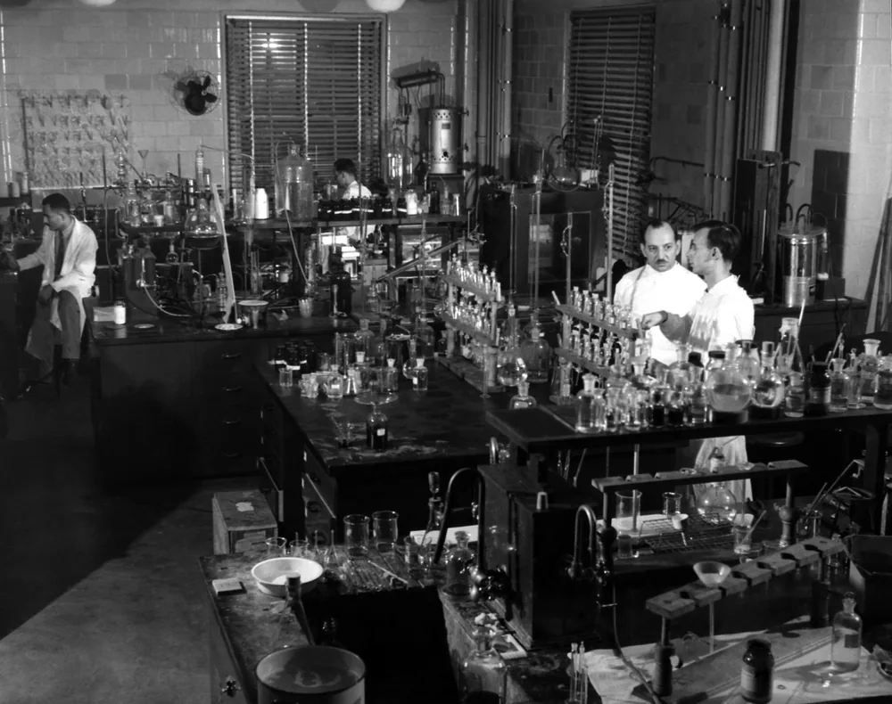

Перед специальной оценкой условий труда по 426-ФЗ подготовьте описание рабочих мест, оборудования и операций. Для металлообрабатывающего цеха полезно отдельно разобрать материалы, СОЖ, вентиляцию и перемещения работников. Ниже — рекомендации по подготовке документов; правовая часть статьи требует проверки по первоисточникам.

## Что должен сделать работодатель по 426-ФЗ

Подготовку производства к СОУТ начните с перечня рабочих мест и описания работы на каждом из них. Сопоставьте сведения отдела кадров, технолога и начальника цеха. Отдельно отметьте расхождения: оборудование заменили, работник обслуживает несколько станков, маршрут детали изменился. Такой перечень удобно использовать при обсуждении объёма работ с исполнителем оценки.

Документы подрядчика о его производстве храните отдельно от материалов по собственному цеху. Иначе в одной папке окажутся сведения о разных площадках, оборудовании и работниках.

Для внутреннего контроля назначьте ответственного за сбор документов. Зафиксируйте, кто отвечает на вопросы о технологии, режиме работы и оборудовании.

Это организационная подготовка. Перечень юридических обязанностей здесь не подтверждён: ссылки из исходной статьи не содержат конкретных документов и доказательных фрагментов.

## Какие редакции закона и методики проверять

*Лаборатория промышленной гигиены в Вашингтоне, где работал доктор Фредерик Голдман, 1943 год. Фото: [Roy Perry, Jr. / U.S. Public Health Service](https://commons.wikimedia.org/wiki/File:Industrial_Hygiene_Laboratory_interior_1943.png) · [Public domain](https://creativecommons.org/publicdomain/mark/1.0/)*

До согласования процедуры соберите отдельную папку правовых оснований. Для каждого используемого положения нужны текст документа, сведения о его действии и фрагмент, на котором основан вывод. Ссылка на главную страницу ведомства для этого не подходит. Она не позволяет проверить ни срок, ни состав документов, ни обязанность конкретного участника.

Не переносите ссылки на нормативные акты из старого договора без проверки самого документа. Пометка «актуальная редакция» тоже ничего не доказывает.

Неподтверждённые номера методик, сроки и ссылки на статьи из этого обзора удалены. До проверки первоисточников использовать его как правовую инструкцию нельзя.

<!-- inline-cta -->

## Кто организует оценку и как проверить исполнителя

Перед выбором исполнителя составьте вопросы о составе работ, участниках и документах на выходе. Попросите назвать организацию, экспертов и лабораторию, которые будут работать с вашей площадкой. Для каждой предложенной проверки уточните, какими сведениями подтверждается возможность её выполнить. Ответы сохраните вместе с предложением и проектом договора, чтобы позднее сопоставить обещанный и фактический объём.

Не ограничивайтесь рекламной презентацией.

Если исполнитель ссылается на реестр или аккредитацию, запросите идентификатор записи и проверьте её содержание. Отдельно сопоставьте заявленные измерения с представленными сведениями о лаборатории.

В проекте договора полезно описать:

- площадки и рабочие места, включённые в задание;
- исходные данные, которые передаёт предприятие;
- состав передаваемых результатов;
- порядок обсуждения замечаний к документам.

Юридические требования к участникам процедуры в этой версии статьи не установлены.

## Как подготовить рабочие места и документы

Для каждого рабочего места подготовьте описание операций, оборудования, материалов и режима работы. Укажите, где человек находится в течение смены и между какими участками перемещается. Сопоставьте описание с фактическим маршрутом на площадке. Если работник обслуживает несколько станков или совмещает операции, отразите это отдельно, без попытки свести работу к одной строке штатного расписания.

Одинаковые станки — повод сравнить места подробнее.

Например, возле одного станка есть местная вытяжка, а возле другого её нет. Могут различаться обрабатываемые материалы, СОЖ и ручные операции. Эти различия стоит передать исполнителю до обсуждения группировки рабочих мест.

Соберите технологические карты, сведения об оборудовании, документацию на материалы и СОЖ, схему вентиляции. Недостающие сведения пометьте прямо в перечне.

На схеме рабочего места покажите зону обслуживания, место хранения заготовок и контрольный стол. Добавьте маршруты перемещений. Так исполнителю будет проще задать вопросы по реальной работе.

## Какие факторы проверяют при металлообработке

Для обсуждения факторов подготовьте описание процесса: чем обрабатывают заготовку, какие вещества используют, какие операции выполняют вручную. Не назначайте перечень измерений только по названию профессии. Вместо готового вывода передайте исполнителю исходные сведения и вопросы. Таблица ниже помогает собрать такие данные; она не устанавливает наличие воздействия и не определяет класс условий труда.

| Участок или операция | Что описать | Какие материалы подготовить |
| --- | --- | --- |
| Точение | Режимы резания, подача СОЖ, загрузка заготовок, положение оператора | Технологическая карта, сведения о СОЖ, схема рабочего места |
| Фрезерование | Материалы, инструмент, укрытие рабочей зоны, ручные операции | Перечень материалов, описание оборудования и вентиляции |
| Сварка | Способ сварки, расходные материалы, расположение поста | Документация на материалы, описание вытяжки и операций |
| Шлифование | Обработка с СОЖ или без неё, зачистка, правка круга | Сведения об абразивах, СОЖ и оборудовании |

Условия проведения измерений обсудите заранее. Опишите обычную загрузку оборудования, перерывы, наладку и смену операций.

Различия между запланированным и фактическим режимом запишите. Не подменяйте их общим описанием «станок работает штатно».

## Как результаты СОУТ влияют на обязанности

Разбор результатов начните с сопоставления отчёта и исходного перечня рабочих мест. Проверьте, к какому месту относится каждая карта и какие документы обосновывают выводы. Затем составьте вопросы специалисту по охране труда о дальнейших действиях. Для каждого правового вывода запросите конкретное основание, прежде чем переносить его в кадровые документы или расчёты оплаты труда.

Перечень классов, подклассов и связанных с ними гарантий здесь не приводится: исходная статья не подтверждает эти положения фрагментами первоисточников.

Технические предложения удобно обсуждать отдельно от правовых последствий. Например, можно составить перечень вопросов о состоянии укрытий, вытяжки и организации ручной загрузки. Само предложение ещё не подтверждает необходимость конкретной меры.

Для каждого принятого решения зафиксируйте основание, ответственного и способ проверки исполнения.

## Что проверить в отчёте, ФГИС и декларации

Документы по оценке, сведения о передаче результатов во ФГИС СОУТ и материалы по декларации удобно учитывать отдельно. Для каждой позиции запишите, какой документ ожидается, кто его готовит и где хранится подтверждение. Применимость этих действий к вашему случаю должна опираться на проверенные нормы; этот обзор такого правового заключения не содержит.

При проверке комплекта полезно пройти следующие шаги:

1. Сопоставить названия и идентификаторы рабочих мест с исходным перечнем.
2. Проверить реквизиты предприятия и адрес площадки.
3. Найти документы, на которые ссылаются карты и выводы.
4. Зафиксировать расхождения и получить ответы исполнителя.

Наличие файла в папке не подтверждает выполнение всех действий по процедуре.

Не отмечайте передачу сведений или подачу документов как завершённую только со слов участника. Для внутреннего учёта сохраните доступное подтверждение и дату проверки.

## Как составить календарь обязанностей по СОУТ

Календарь составляйте после проверки конкретных сроков и событий, от которых они отсчитываются. В каждой строке укажите действие, основание, ответственного и подтверждение завершения. Если срок ещё не проверен, оставьте его незаполненным и назначьте проверку отдельной задачей. Предположение в календаре легко принять за установленное требование, особенно при передаче дел другому сотруднику.

Следующая таблица — заготовка для внутреннего учёта, а не перечень обязательных процедур.

| Позиция для проверки | Что выяснить | Что сохранить |
| --- | --- | --- |
| Следующая оценка | Основание, периодичность и точку отсчёта | Проверенную норму и расчёт даты |
| Ознакомление работников | Применимость, порядок и срок | Основание и подтверждение действия |
| Декларация | Основания подачи и дальнейшие действия | Проверенные требования и документы |
| Сведения во ФГИС СОУТ | Участника, порядок и срок передачи | Основание и подтверждение передачи |
| Публикация сведений | Применимость и состав информации | Основание и адрес размещения |

Внутреннюю дату подготовки документов отделяйте от срока, установленного нормой. У каждой даты должно быть понятное происхождение.

## Когда изменения требуют внеплановой оценки

После изменения производства подготовьте описание того, что было и что стало. Отдельно укажите оборудование, материалы, СОЖ, вентиляцию, операции и режим работы. Эти сведения передайте на проверку оснований для внеплановой оценки. Сам журнал изменений не заменяет правового решения, зато позволяет обсуждать конкретные обстоятельства, а не только факт покупки нового станка.

Не делайте вывод по названию оборудования.

При замене СОЖ сохраните документацию на прежний и новый состав. При переносе станка обновите схему рабочего места. При изменении технологии опишите новые операции и перемещения работника.

Не утверждайте заранее, что любое изменение обязательно требует новой оценки или позволяет её не проводить. В исходных источниках статьи основания для такого вывода не предъявлены.

Если часть операций передают подрядчику, обновите описание собственного процесса. Для планирования маршрута может пригодиться материал о том, [как организуют гибкое производство деталей](/blog/gibkoe-proizvodstvo-ot-odnoj-detali-do-serii).

## Что делать при ошибках и разногласиях

Расхождения в документах фиксируйте письменно: рабочее место, название документа, спорный фрагмент и сведения, с которыми он не совпадает. Направьте перечень исполнителю и сохраните ответ. Не редактируйте полученный отчёт как обычный внутренний файл: сначала выясните порядок исправления и согласуйте действия с участниками процедуры. Рабочие замечания храните отдельно от полученных оригиналов.

Одна ошибка — одно понятное описание.

Фраза «в отчёте всё неверно» не помогает разобраться. Лучше указать: в карте назван один станок, а на площадке установлен другой; в описании пропущена операция, включённая в технологическую карту.

Порядок обжалования, полномочия надзорных органов и ответственность в этой версии не раскрыты. Для них нужны конкретные правовые источники.

Документы по условиям труда и приёмке изготовленной детали храните раздельно. Вопросы размеров, материала и приёмки разобраны в статье о том, [что можно требовать по гарантии на деталь](/blog/garantiya-na-detal-po-chertezhu-chto-mozhno-trebovat).

Для расчёта [изготовления деталей по чертежам](/) пришлите чертёж с требованиями к материалу и приёмке.

## Частые вопросы

### Что подготовить до обращения к исполнителю СОУТ?

Соберите перечень рабочих мест, описание операций, сведения об оборудовании, материалах, СОЖ и вентиляции. Отдельно укажите перемещения работников и недавние изменения процесса. Пробелы в данных пометьте, чтобы обсудить их при подготовке задания.

### Достаточно ли отправить фотографии станков?

Дополните фотографии описанием операций и схемой рабочего места. На снимке может не быть видно маршрута работника, смены материалов или ручной загрузки. Подпишите, какое место и какой этап работы показаны.

### Как подготовить цех к дню измерений?

Заранее обсудите с исполнителем план работ и условия измерений. Передайте сведения о загрузке оборудования, наладке и перерывах. Если фактическая работа отличается от согласованного описания, сообщите об этом и зафиксируйте различия.

## Источники

Прямые ссылки на документы и подтверждающие фрагменты в исходной статье отсутствуют. Ниже — официальные площадки для поиска первоисточников; сами главные страницы не подтверждают правовые требования. До подбора и проверки конкретных документов статья не готова к публикации.

- [Официальное опубликование правовых актов](https://publication.pravo.gov.ru/) — площадка для поиска опубликованных документов.
- [Официальный интернет-портал правовой информации](https://pravo.gov.ru/) — площадка для проверки правовых источников.
- [Министерство труда и социальной защиты Российской Федерации](https://mintrud.gov.ru/) — официальный сайт ведомства.
