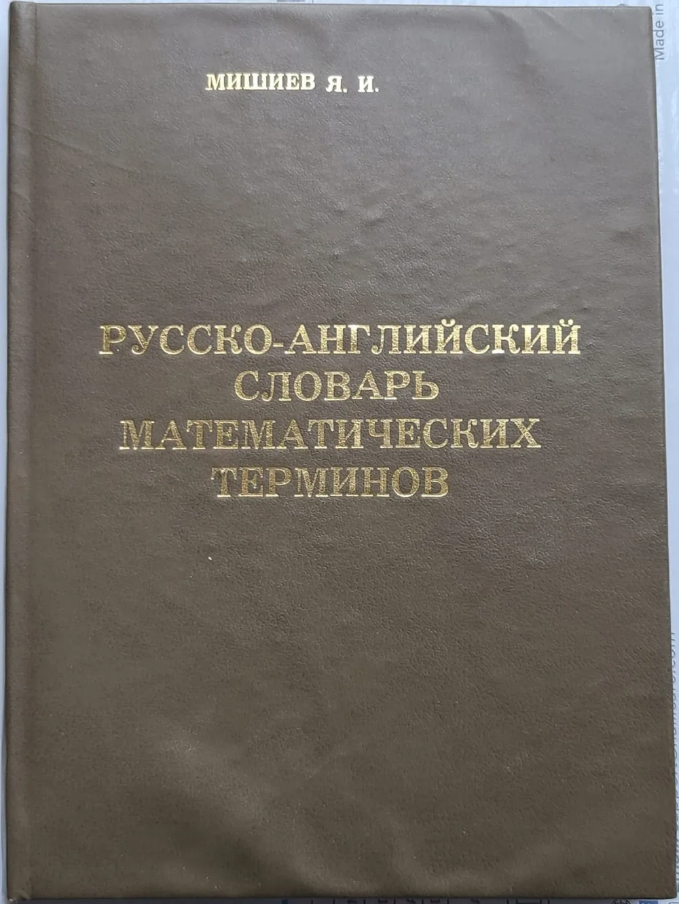

Эквивалент — это то, что равноценно другому объекту по определённому признаку или в заданных условиях. Полного совпадения свойств слово не подразумевает. В заказе на металлообработку похожее назначение материалов или деталей ещё не доказывает, что один вариант можно заменить другим.

## Эквивалент — равноценный по определённому признаку

Эквивалент — объект или величина, равноценные другому объекту по выбранному признаку. Таким признаком может быть функция, свойство или результат работы. Чтобы понять утверждение об эквивалентности, нужно знать, что сравнивают и для какой задачи. Совпадение по одному признаку не означает совпадения остальных свойств и не даёт общего разрешения на замену.

Представим две лампы, которые одинаково освещают стол. По освещённости они равноценны, но у них могут различаться размеры и цоколи. Для установки в светильник этих различий уже достаточно, чтобы потребовалась дополнительная проверка.

Равноценность всегда имеет границы.

В заказе на деталь этот принцип помогает отделить сходство назначения от допустимости замены. Фраза «предлагаем эквивалент» полезна только вместе с перечнем характеристик, по которым сравнили варианты.

<!-- inline-cta -->

## Как произносить и употреблять слово «эквивалент»

*Русско-английский словарь математических терминов, издание 1999 года. Фото: [Daughter of Yagutil Mishiev](https://commons.wikimedia.org/wiki/File:Book_%E2%80%9CRussian_English_Dictionary_of_Mathematical_Terms%E2%80%9D_by_Yagutil_Mishiev.jpg) · [Public domain](https://creativecommons.org/publicdomain/mark/1.0/)*

В слове «эквивале́нт» ударение падает на последний слог. Это неодушевлённое существительное мужского рода: нет эквивалента, к эквиваленту, об эквиваленте. В тексте полезно сразу называть объект и основание сравнения. Тогда читателю не приходится угадывать, о какой равноценности идёт речь: денежной оценке, свойствах материала или результате работы детали.

«Денежный эквивалент поставки» — сумма, в которую оценили поставку. «Эквивалент по коррозионной стойкости» — материал, который считают равноценным исходному по этому свойству в указанных условиях.

Само слово не подтверждает сделанного сравнения.

При переводе английского equivalent тоже нужен контекст. Для технического текста важно сохранить предмет сравнения и условия, при которых варианты считают равноценными.

## Чем эквивалент отличается от аналога и идентичного объекта

Эквивалент подчёркивает равноценность, аналог — сходство, а идентичный объект — полное совпадение в рассматриваемом отношении. В технической переписке этих слов недостаточно для решения о замене. Нужно перечислить характеристики, которые сравнили, и требования, которые должен выполнить предложенный вариант. Иначе участники заказа могут вкладывать в одну формулировку разный смысл.

Представим два сверла одинакового номинального диаметра. Они могут быть аналогами по назначению, но различаться материалом, геометрией и покрытием. Одинакового диаметра недостаточно, чтобы признать их равноценными для конкретной операции.

| Термин | Что подчёркивает | Что проверить перед заменой |
| --- | --- | --- |
| Эквивалент | Равноценность по выбранному признаку | Критерии и условия сравнения |
| Аналог | Сходство назначения, свойств или устройства | Соответствие требованиям задачи |
| Идентичный объект | Совпадение в рассматриваемом отношении | Какие характеристики охватывает утверждение |

Даже совпадение перечисленных характеристик не означает, что все прочие свойства одинаковы.

Пометка поставщика помогает начать проверку. Результат проверки она не заменяет.

## Почему в разных областях у эквивалента разные значения

*В лампе накаливания свет возникает при нагревании тонкой металлической или угольной нити. Фото: [Le hollandais volant](https://commons.wikimedia.org/wiki/File:Incandescent_light_bulb.jpg) · [CC BY 4.0](https://creativecommons.org/licenses/by/4.0)*

В разных областях слово «эквивалент» относится к разным предметам сравнения. Денежная оценка товара, химический расчёт и подбор материала решают разные задачи. Поэтому общее значение слова помогает понять идею равноценности, но не заменяет определение специального термина. Для каждого случая нужны собственные критерии и условия, за пределами которых сравнение теряет смысл.

Например, одинаковая денежная оценка двух заготовок ничего не говорит об их пригодности для одной детали. А совпадение назначения деталей не подтверждает совпадение размеров или свойств материала.

| Контекст | Что нужно уточнить |
| --- | --- |
| Денежная оценка | Валюту, состав поставки и условия оценки |
| Химический расчёт | Реакцию и принятую расчётную величину |
| Подбор материала | Свойства, состояние поставки и условия эксплуатации |
| Замена детали | Материал, геометрию и требования к приёмке |

Общее слово не делает критерии взаимозаменяемыми.

## Что означает денежный и всеобщий эквивалент

Денежный эквивалент — сумма, в которую оценили объект, работу или поставку. Такая оценка позволяет сопоставлять разные предложения в денежных единицах. Для сравнения важно сохранить одинаковые условия: валюту, комплект поставки и момент фиксации цены. Равенство сумм само по себе не означает, что товары одинаково подходят для задачи покупателя.

Допустим, две заготовки предложены по одной цене. В стоимость первой включена доставка, второй — только отпуск со склада. Без учёта этих условий сравнение предложений будет неполным.

Одинаковая сумма ещё не означает одинаковую покупку.

«Всеобщий эквивалент» — отдельное понятие политэкономии: через него выражают стоимость других товаров. В теории стоимости Маркса оно связано с объяснением денежной формы стоимости. Это специальный контекст, который не стоит переносить на техническую взаимозаменяемость материалов.

При пересчёте цены в другую валюту нужны курс и дата его применения. Без них запись о денежном эквиваленте оставляет неопределённость.

## Почему химический эквивалент зависит от реакции

Химический эквивалент связан с участием вещества в конкретной реакции. Это специальный термин, для которого недостаточно общего толкования «равноценная замена». В расчёте важно указать реакцию и определить, какие частицы участвуют в обмене. Без этого название вещества не даёт достаточного основания для выбора расчётного значения или применения формулы.

Здесь особенно легко смешать разные понятия: эквивалент, фактор эквивалентности и молярную массу эквивалента. Они связаны, но обозначают разные вещи.

Формула без определения величин не объясняет расчёт.

Для практического применения нужны уравнение реакции, определения используемых величин и источник методики. Перенос готового значения из другого примера без проверки условий может изменить смысл расчёта.

## Когда материал или деталь можно считать эквивалентными

Для оценки замены материала сначала нужен полный набор требований к детали. Его собирают из чертежа, технических требований и документов заказа. Затем предложенный материал сравнивают с исходным по характеристикам, важным для изготовления и эксплуатации. Таблица соответствия марок помогает найти кандидата, но сама по себе не подтверждает пригодность замены.

Представим заказ на втулку из указанной в чертеже нержавеющей стали. Поставщик предлагает другую марку с похожим назначением. Это повод сравнить документы, а не готовое решение.

Для такой проверки полезен перечень:

- Марка и требования к составу материала.
- Механические свойства и состояние поставки.
- Среда, температура и нагрузки при эксплуатации.
- Последующие операции: сварка, гибка, покрытие или термообработка.
- Документы и проверки, предусмотренные заказом.

Одинакового названия группы материалов недостаточно.

На примере нержавеющих сталей различия разобраны в статье [чем различаются AISI 304 и 316](/blog/aisi-304-i-316-raznica-vybor-nerzhaveyki). Само сравнение марок ещё не подтверждает их взаимозаменяемость в конкретной детали.

Для готовой детали к требованиям по материалу добавляют геометрию. В проверку входят заданные размеры, допуски, шероховатость и покрытие. Похожая форма не доказывает, что деталь подойдёт в узел.

## Как проверить и согласовать предлагаемую замену

Практический порядок проверки — описать изменение, сопоставить его с требованиями и зафиксировать решение до изготовления. Такой подход помогает избежать ситуации, когда готовая партия отличается от заказа, а критерии приёмки остались прежними. Порядок согласования и участников решения нужно определять по документам конкретного заказа, а не по одному слову «эквивалент».

Для работы с предложением поставщика подойдёт следующая последовательность:

1. Собрать требования из чертежа и документов заказа.
2. Описать изменение: марку, состояние поставки, размер или покрытие.
3. Сопоставить предложенный вариант с каждым требованием.
4. Зафиксировать принятое решение и согласованный вариант исполнения.
5. Указать, по каким характеристикам и документам будут принимать результат.

В записи важно сохранить не только итог, но и основание решения.

Например, проверка прочности не отвечает на вопрос о стойкости в рабочей среде. А название марки без состояния поставки оставляет часть характеристик за пределами сравнения.

Проверка изготовленной детали и согласование изменения решают разные задачи. Проверка показывает соответствие выбранным требованиям. Согласование фиксирует решение об изменении. Смежные понятия разобраны в материале [чем валидация отличается от верификации](/blog/chto-takoe-validaciya).

Стоимость тоже нужно сравнивать отдельно. В предложениях могут различаться материал, объём партии и состав операций. Подробнее об этом — на странице [от чего зависят цены на металлообработку](/ceny.html).

Для расчёта [изготовления деталей по чертежам](/) передайте чертёж, требования к материалу и сведения о согласованных заменах.

## Частые вопросы

### Чем в заявке отличаются слова «эквивалент» и «эквивалентность»?

Эквивалент — объект или величина, которые считают равноценными исходным. Эквивалентность — само отношение равноценности. В заявке полезно указать предложенный вариант и характеристики, по которым его сравнили с исходным.

### Какие синонимы слова «эквивалент» уместны в техническом задании?

В зависимости от контекста подходят слова «равноценный», «равнозначный» или «равносильный». Однако синоним не устраняет неопределённость. Для задания на деталь нужны конкретные характеристики и условия сравнения.

### Можно ли считать эквивалентом копию чертежа в другом формате файла?

Можно говорить об одинаковом содержании файлов, если сверка это подтвердила. Само расширение PDF или DWG ничего не доказывает. При проверке важно убедиться, что сохранены виды, размеры, обозначения и технические требования.

## Источники

Приведённые адреса ведут на общие страницы ресурсов. Они не заменяют ссылки на конкретные словарные статьи и определения специальных терминов.

- [Грамота.ру](https://gramota.ru/) — портал словарей и справочников русского языка.
- [Раздел произведений Карла Маркса](https://www.marxists.org/russkij/marx/index.htm) — архив Marxists Internet Archive; не прямая ссылка на фрагмент «Капитала».
- [IUPAC Gold Book](https://goldbook.iupac.org/) — справочник химической терминологии; не ссылка на отдельное определение.
