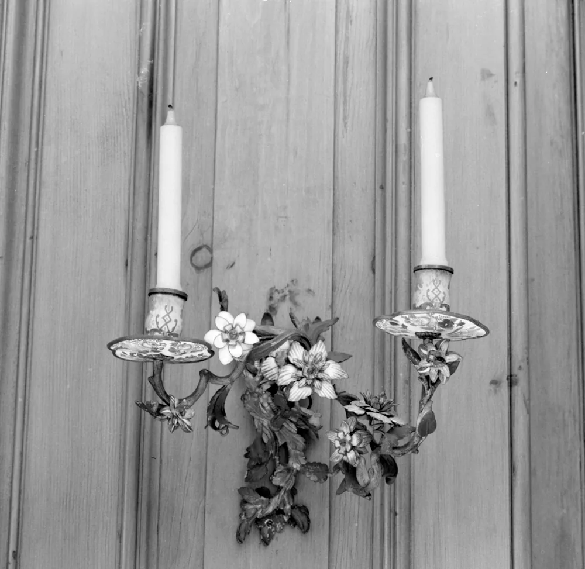
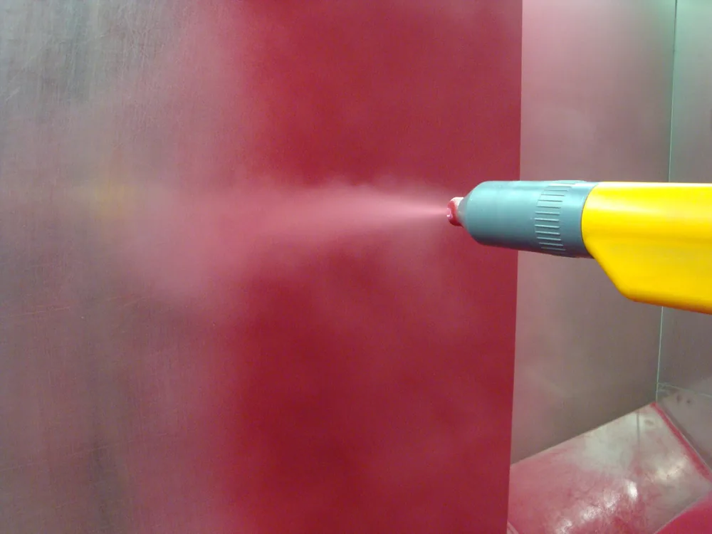

ЛКП — это лакокрасочное покрытие, которое образуется после нанесения и высыхания либо отверждения лакокрасочного материала. На металлических деталях оно помогает защищать основание от воздействия среды и задаёт цвет и внешний вид. Результат зависит от подготовки металла, выбранной системы и технологии нанесения.

## ЛКП — это готовое покрытие, а не краска в банке

Лакокрасочный материал — продукт для нанесения, а ЛКП — полученное из него покрытие на поверхности. Материал может быть жидким, пастообразным или порошковым. После нанесения он должен сформировать покрытие в предусмотренных для него условиях. Поэтому при заказе окраски важно описать и материал, и требования к готовому слою: его толщине, внешнему виду и сцеплению с основанием.

В банке находится материал. На корпусе или кронштейне проверяют уже покрытие.

Краски, эмали, грунты и лаки относятся к лакокрасочным материалам. Они могут выполнять разные задачи и входить в одну систему окраски. При этом отдельный лак или грунт нужен не каждой системе.

Число слоёв и порядок нанесения задают для выбранного покрытия. Универсальной схемы для всех металлических деталей нет.

<!-- inline-cta -->

## Зачем ЛКП наносят на корпуса, рамы и кронштейны

*Австрийские настенные кронштейны около 1740–1750 годов: позолоченная и окрашенная бронза, расписная эмаль. Фото: [Internet Archive identifier : mma_pair_of_twolight_wall_brackets_205772 https:/…](https://commons.wikimedia.org/wiki/File:Pair_of_two-light_wall_brackets_%28IA_mma_pair_of_twolight_wall_brackets_205772%29.jpg) · [Public domain](https://creativecommons.org/publicdomain/mark/1.0/)*

ЛКП наносят для защиты металла и получения нужного внешнего вида. Покрытие ограничивает контакт основания с окружающей средой, но его возможности зависят от состава и состояния слоя. Для корпуса в помещении и рамы на улице условия различаются. Поэтому выбор начинается с места работы детали, воздействия влаги, солнечного света и веществ, с которыми она соприкасается.

Цвет сам по себе не описывает защиту.

Повреждение покрытия может открыть доступ к металлу. Однако скол не позволяет заранее определить скорость коррозии: она зависит и от основания, и от условий эксплуатации.

Окраска также не исправляет ошибку размера и не устраняет дефекты изготовления. Посадочные поверхности, резьбы и электрические контакты могут требовать защиты от попадания краски. Эти зоны отмечают на чертеже до производства.

## Какие бывают системы ЛКП и зачем нужны разные слои

Система ЛКП объединяет материалы и слои, которые должны работать совместно на выбранном основании. Грунт может обеспечивать сцепление и участвовать в защите металла, промежуточный слой — формировать нужную толщину. Финишное покрытие задаёт внешний вид и принимает внешние воздействия. Распределение этих задач зависит от конкретной системы: переносить свойства одного продукта на все материалы с похожим названием нельзя.

Жидкая и порошковая окраска различаются формой материала и процессом нанесения. Тип связующего — другая характеристика. Например, слово «порошковый» само по себе не отвечает на вопрос о пригодности покрытия для улицы.

| Что выбирают | Что нужно выяснить |
| --- | --- |
| Основание | Подходит ли система для стали, алюминия или оцинкованной поверхности |
| Состав слоёв | Какие материалы совместимы и в каком порядке их наносят |
| Условия работы | Для каких воздействий производитель описывает применение |
| Отверждение | Какие условия нужны для формирования покрытия |
| Ремонт | Чем и как допускается восстанавливать повреждённый участок |

Название связующего не заменяет документацию продукта.

Для сравнения вариантов нужны сведения о конкретных материалах. Без них таблица «эпоксидное против полиуретанового» скрывает больше различий, чем объясняет.

## Почему подготовка металла влияет на результат окраски

*Процесс нанесения порошковой краски. Фото: [Hardcoreraveman](https://commons.wikimedia.org/wiki/File:Pulverlack-Applikation.JPG) · [Public domain](https://creativecommons.org/publicdomain/mark/1.0/)*

Подготовка поверхности нужна, чтобы покрытие сцепилось с основанием. Масло, пыль, продукты коррозии и непрочный старый слой могут мешать этому контакту. Внешне чистая поверхность ещё не означает готовность к окраске. Способ очистки и требования к её результату выбирают с учётом металла, его состояния и материалов, которые будут нанесены дальше.

Адгезия — сцепление покрытия с основанием.

Подготовка может включать обезжиривание, механическую очистку и химическую обработку. Эти операции не взаимозаменяемы: удаление масла не решает задачу удаления окалины. Важны также последовательность операций и защита очищенной детали от повторного загрязнения.

Рабочий порядок подготовки включает:

1. Оценку металла, загрязнений, коррозии и старого покрытия.
2. Выбор обработки для этого основания и системы окраски.
3. Очистку с последующей проверкой результата.
4. Передачу детали на окраску в условиях, предусмотренных технологией.

Оцинкованная поверхность тоже требует подготовки под выбранную краску. Цинковый слой и ЛКП решают связанные, но разные задачи. Подробнее об основании — в разборе [способов оцинковки металла](/blog/ocinkovka-metalla-zashchita-ot-korrozii-stoimost).

## Как толщина ЛКП влияет на размеры, резьбы и сборку

Покрытие занимает место на поверхности и меняет размеры готовой детали. Для сборки важна сухая толщина — после высыхания или отверждения. У жидких материалов дополнительно контролируют мокрый слой, если это предусмотрено технологией. Переносить его толщину на готовое покрытие напрямую нельзя: при формировании плёнки её состояние и объём меняются.

На наружной цилиндрической поверхности покрытие увеличивает диаметр, а внутри отверстия — уменьшает. При равномерной толщине изменение диаметра складывается из толщин на противоположных сторонах.

Для посадки даже небольшой слой может оказаться существенным.

Маскирование защищает участки, где покрытие мешает работе узла. Это могут быть резьбы, посадки под подшипники, поверхности уплотнения и электрические контакты. Состав таких зон определяет конструкция.

В чертеже важно различать размеры металла до окраски и размеры готовой детали. Иначе исполнитель может выдержать размер заготовки, а сборка после нанесения покрытия потребует доработки.

## Что указать в задании на окраску детали по чертежу

Задание на окраску связывает требования к покрытию с условиями работы детали. Одного кода цвета недостаточно: он не описывает защиту, толщину и поверхности без краски. Если систему подбирает исполнитель, ему нужны сведения об основании, эксплуатации и ограничениях производства. Результат подбора затем фиксируют вместе с правилами приёмки.

Для согласования удобно использовать такой перечень:

- Металл и состояние поверхности, включая старое покрытие или слой цинка.
- Условия работы: помещение или улица, влага, вещества, нагрев и механические воздействия.
- Выбранная система либо требования для её подбора.
- Подготовка поверхности.
- Сухая толщина и места её измерения.
- Цвет, блеск и допустимый внешний вид.
- Зоны маскирования.
- Ограничения по нагреву детали и собранного узла.
- Проверки при приёмке и применение контрольных образцов.

Особенно важно различать температуру воздуха в печи и температуру самой детали. Если для отверждения задан режим по металлу, показания воздуха не заменяют проверку его прогрева.

Требования должны быть доступны до расчёта работ.

Подготовка, маскирование и контроль влияют на состав операций. Эти факторы разобраны в статье [о цене металлообработки по чертежу](/blog/ot-chego-zavisit-cena-metalloobrabotki-po-chertezhu).

## Как проверяют толщину, внешний вид и адгезию покрытия

Приёмка покрытия состоит из разных проверок: одна не подменяет остальные. Толщина показывает геометрию слоя, но сама по себе не подтверждает сцепление с металлом или пригодность к рабочей среде. Внешний вид тоже не раскрывает все свойства. Для каждой проверки нужны согласованные метод, место измерения и критерий, по которому принимают результат.

| Что проверяют | Что фиксируют при согласовании |
| --- | --- |
| Подготовку поверхности | Признаки готовности основания перед нанесением |
| Сухую толщину | Прибор, точки измерения и допустимые значения |
| Внешний вид | Освещение, образец и допустимые дефекты |
| Адгезию | Метод, место испытания и критерий оценки |
| Отверждение | Параметры процесса и способ проверки по документации материала |

Прибор и метод измерения подбирают с учётом металла, покрытия и формы детали. На кромке, в углублении или рядом с резьбой условия отличаются от измерения на плоскости.

Точки контроля лучше определить заранее.

Испытание с надрезами повреждает покрытие. Поэтому место проверки или использование отдельного образца согласуют до приёмки. Результат такого испытания не следует превращать в обещание срока службы детали.

## Что означают сколы, пузыри и отслоения

Скол, царапина, пузырь и отслоение описывают разные повреждения покрытия. Для оценки важно, какие слои затронуты и открыт ли металл. Один внешний признак может иметь несколько причин, связанных с подготовкой, нанесением, отверждением или эксплуатацией. Поэтому фотография помогает зафиксировать дефект, но обычно не даёт достаточно данных для окончательного вывода о его происхождении.

Царапина по финишу и повреждение до металла требуют разной оценки.

При осмотре отмечают расположение и размер участка, глубину повреждения и время его появления. Полезны сведения о системе окраски, подготовке поверхности, условиях работы и контакте с веществами.

Ржавый след требует проверки основания. Он не доказывает сам по себе, что коррозия началась именно в месте видимого пятна: загрязнение могло попасть с соседнего элемента.

Сначала фиксируют наблюдения, затем проверяют причины.

Это помогает избежать ремонта, который закрывает внешний след, но оставляет источник повреждения.

## Когда покрытие можно восстановить и как его сохранить

Способ восстановления выбирают по глубине повреждения, состоянию металла и совместимости ремонтного материала с оставшимся покрытием. Поверхностная потёртость и скол до основания требуют разных операций. Возможность локального ремонта зависит также от доступа к участку и условий отверждения. На собранном узле повторить исходную технологию окраски бывает невозможно.

Полировка снимает часть поверхности. Утраченный слой она не восстанавливает.

При повреждении до металла ремонт включает оценку основания и подготовку участка. Простое закрашивание видимого следа не подтверждает, что устранена причина дефекта. Отдельно проверяют, выдержат ли соседние материалы очистку, растворители и нагрев.

Для ухода нужны сведения о совместимости покрытия с моющими средствами. Рекомендации для автомобильного кузова нельзя автоматически переносить на промышленный корпус или раму.

Итог ремонта проверяют по согласованным критериям: внешний вид не заменяет остальные требования.

Для расчёта изготовления [передайте чертёж детали](/) и приложите условия эксплуатации, требования к толщине, зоны маскирования и правила приёмки.

## Частые вопросы

### Чем лакокрасочное покрытие отличается от цинкового слоя?

Цинковый слой — металлическое покрытие. ЛКП формируется из лакокрасочного материала. Эти покрытия могут применяться вместе, если система окраски рассчитана на оцинкованное основание.

### Можно ли окрасить собранный узел целиком?

Возможность зависит от конструкции узла. Нужно проверить доступ к поверхностям, возможность подготовки и маскирования, а также совместимость всех элементов с нанесением и отверждением. Закрытые полости и подвижные соединения требуют отдельного решения.

### Что писать рядом с кодом цвета в чертеже?

Помимо цвета указывают систему покрытия или требования для её подбора, сухую толщину, поверхности без окраски и правила приёмки. Если данные вынесены в отдельное задание, в чертеже дают ссылку на него.

## Источники

- [ISO 12944-1:2017. Paints and varnishes — Corrosion protection of steel structures by protective paint systems — Part 1: General introduction](https://www.iso.org/standard/64831.html).
- [ISO 2808:2019. Paints and varnishes — Determination of film thickness](https://www.iso.org/standard/65532.html).
