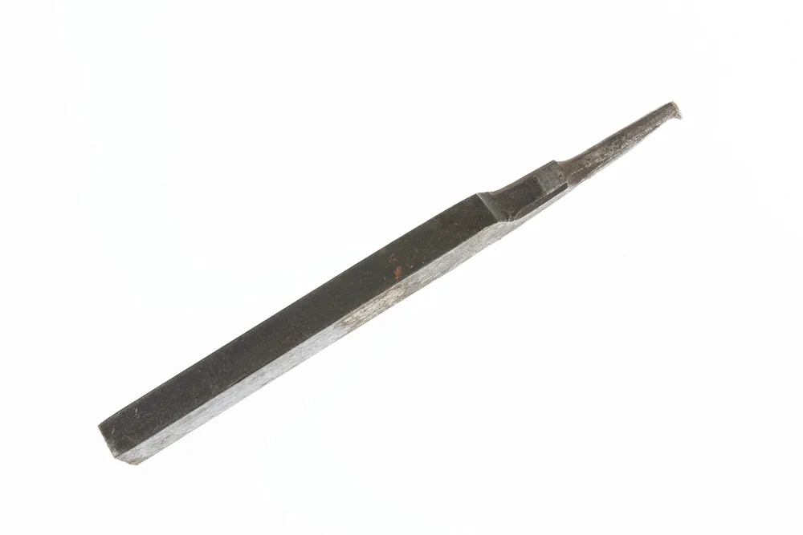
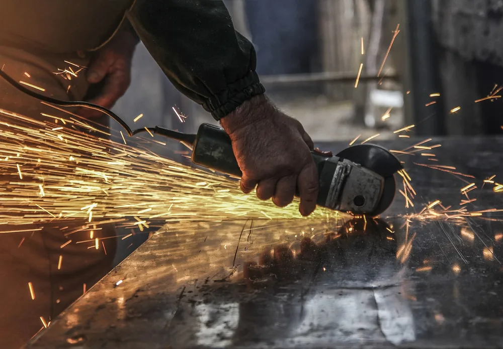

Металлическая стружка образуется при отделении слоя материала режущим инструментом. Её форма зависит от свойств заготовки, геометрии кромки и режимов резания. Длинная стружка может наматываться на деталь и повторно попадать под инструмент. Чтобы устранить причину, проверяют образование стружки и её выход из зоны резания.

## Что форма стружки говорит об обработке

Форма стружки помогает заметить проблемы с её дроблением и отводом, но не подтверждает соответствие детали чертежу. Длинная лента может наматываться на заготовку, задевать поверхность и попадать под кромку повторно. Короткие завитки удобнее отводить, однако размер, шероховатость и повреждения поверхности проверяют отдельно. Наладчик оценивает стружку вместе с состоянием инструмента и результатом прохода.

В статье Modern Machine Shop описан механизм повторного резания: длинная стружка застревает между кромкой и деталью. Инструмент встречает уже отделённый материал, что может привести к поломке. Фрагмент источника приведён в поле `claims`.

Одной фотографии недостаточно.

На снимке не видны подача, глубина резания, состояние кромки и момент образования стружки. Поэтому по нему нельзя уверенно выбрать новый режим. Для разбора нужны данные операции и наблюдение за проходом через предусмотренные станком средства контроля.

Заказчику важен результат обработки. Форма стружки помогает исполнителю настроить процесс, а приёмку детали проводят по требованиям чертежа.

<!-- inline-cta -->

## Как срезаемый слой превращается в стружку

*Резец для токарного станка с ножным приводом, которым пользовался Уильям Битти в Beattie Manufacturing Company. Фото: [This file was contributed to Wikimedia Commons by Missouri Historical Society a…](https://commons.wikimedia.org/wiki/File:Thread_Cutting_or_Parting_Tool_for_Foot_Lathe_Used_by_William_Beattie_of_Beattie_Manufacturing_Company,_St._Louis_-_DPLA_-_52bb7e96de736d345dce7a2f40da30f1_%28page_2%29.jpg) · [Public domain](https://creativecommons.org/publicdomain/mark/1.0/)*

При резании инструмент деформирует материал перед кромкой и отделяет его от заготовки. Стружка движется по передней поверхности инструмента, изгибается и выходит из зоны обработки. Её дальнейшая форма зависит от материала, геометрии инструмента и условий прохода. Поэтому одинаковая марка сплава не означает одинаковую стружку на черновой и чистовой операциях.

В пластичных материалах отделение сопровождается заметной пластической деформацией. При обработке хрупких материалов большую роль играет разрушение с образованием отдельных фрагментов. Это различие помогает понять механизм, но не заменяет наблюдение за конкретной операцией.

Подачу и глубину резания рассматривают вместе.

Их влияние на толщину и ширину среза зависит от положения режущей кромки. У вершины пластины геометрия контакта отличается от контакта вдоль прямого участка. Поэтому нельзя объяснять работу стружколома одной подачей, не учитывая глубину прохода и радиус вершины.

Нагрев связан с деформацией материала и трением. По цвету стружки нельзя отдельно определить температуру кромки или причину её износа.

## Сливная, суставчатая, элементная и стружка надлома

Названия видов стружки описывают характер отделения материала и связь между образовавшимися элементами. Сливная стружка сохраняет непрерывность, суставчатая имеет различимые связанные участки, элементная разделяется на отдельные фрагменты. Стружку надлома связывают с хрупким разрушением материала. Эти признаки нужно отличать от внешней укладки: лента, спираль и завиток описывают форму уже вышедшей стружки.

| Вид | Основной признак | Что учитывать при осмотре |
| --- | --- | --- |
| Сливная | Непрерывная стружка | Она может выходить лентой или завиваться |
| Суставчатая | Различимые элементы сохраняют связь | Один обломок не показывает строение всей стружки |
| Элементная | Отдельные элементы | Россыпь может содержать и фрагменты, сломанные после образования |
| Надлома | Фрагменты, образованные при хрупком разрушении | Для оценки нужны сведения о материале и операции |

Короткий кусок не обязательно образовался коротким.

Непрерывная стружка может разрушиться при сходе, столкновении с препятствием или последующем перемещении. Поэтому содержимое общего контейнера хуже подходит для анализа, чем стружка от известного прохода.

Тип стружки также не служит оценкой готовой поверхности. Даже при удобном дроблении остаются отдельные проверки размера, шероховатости и следов повреждения.

## Почему стружка наматывается и возвращается под инструмент

*Стружка, образовавшаяся при шлифовании металла. Фото: [Lacholazarovphotos](https://commons.wikimedia.org/wiki/File:A_song_of_fire_and_metal.jpg) · [CC BY 4.0](https://creativecommons.org/licenses/by/4.0)*

При разборе наматывания полезно разделить образование длинной стружки и направление её схода. В первом случае проверяют, почему она не дробится. Во втором — почему попадает на деталь или оснастку. Отдельная проблема возникает, когда уже отделённый материал остаётся в зоне обработки и снова встречается с кромкой. Эти ситуации требуют разных изменений процесса.

Наличие канавки стружколома ещё не подтверждает, что выбранная пластина подходит для текущего прохода. Нужны её обозначение, рекомендации производителя и фактические режимы.

Начинают с причины, а не с уборки.

Очистка удаляет накопившийся материал, но не исправляет направление схода и условия дробления. Если после возобновления обработки стружка снова собирается в том же месте, проверку процесса продолжают.

В материале Modern Machine Shop также описан приём с предварительной обработкой отдельных участков элемента. Его рассматривают как вариант изменения траектории для конкретного контура. Переносить чужую последовательность проходов без проверки припуска и требований детали нельзя.

Повреждения поверхности оценивают вместе с состоянием кромки. Дополнительные признаки разобраны в статье о [причинах брака при обработке металла](/blog/brak-pri-obrabotke-metalla-prichiny-oshibki).

## Как согласовать стружколом, подачу и глубину резания

Стружколом подбирают под материал, операцию и диапазон режимов конкретной пластины. Для проверки нужны рекомендации производителя, фактическая подача, глубина резания и геометрия вершины. Если проход выходит за рекомендованную область, наличие стружколома само по себе не обеспечивает дробления. Изменения оценивают по стружке, состоянию кромки и поверхности детали одновременно.

Радиус вершины влияет на геометрию среза при малой глубине прохода. Поэтому режимы чистового точения нельзя оценивать только по номинальной подаче. Универсального соотношения глубины и радиуса для всех пластин здесь нет.

Проверку удобно вести последовательно:

1. Установить точное обозначение пластины и материал заготовки.
2. Найти рекомендации производителя для этой операции.
3. Сопоставить фактические режимы с рекомендованной областью применения.
4. После пробного прохода проверить стружку, кромку и поверхность.

Меняют условия с учётом ограничений всей операции: крепления, мощности станка, припуска и требований чертежа. Повышение подачи ради дробления нельзя оценивать отдельно от нагрузки и шероховатости.

Результат проверяют на детали.

## Как совместить дробление стружки и требование по шероховатости

Дробление стружки и шероховатость поверхности проверяют вместе: изменение подачи или геометрии пластины затрагивает оба результата. Удобный завиток в лотке ещё не означает, что поверхность соответствует чертежу. Для выбора режима нужны требования к поверхности, рекомендации по инструменту и измерение после пробного прохода. Окончательное решение принимают по результату обработки.

В статье Modern Machine Shop описаны пластины wiper, позволяющие в рассмотренных условиях увеличить подачу с сохранением или улучшением поверхности. Это возможность определённой геометрии инструмента, а не обещание результата при любом креплении и материале.

Название пластины не заменяет проверку.

Если для дробления приходится менять подачу, технолог оценивает полученную поверхность и состояние кромки. Когда одновременно выполнить оба требования не удаётся, рассматривают другую геометрию инструмента или последовательность проходов.

Заказчик задаёт материал, допуски и шероховатость на нужных поверхностях. Исполнитель подбирает инструмент и режимы, которые позволяют выполнить эти требования.

## Как отводят стружку при точении, фрезеровании и сверлении

Способ отвода зависит от доступа к зоне резания. При точении проверяют сход относительно детали и оснастки. При фрезеровании важно, чтобы стружка не оставалась на пути следующего зуба. При сверлении оценивают её выход из отверстия. Подачу смазочно-охлаждающей жидкости и цикл обработки выбирают по документации инструмента с учётом возможностей станка.

| Операция | Где искать скопление | Что проверить |
| --- | --- | --- |
| Точение | Возле детали, кулачков и резца | Направление схода, дробление, доступ СОЖ |
| Фрезерование | В кармане и возле стенок | Выход стружки, траекторию, подачу СОЖ |
| Сверление | В отверстии и канавках сверла | Выход стружки, рекомендованный цикл и подачу СОЖ |

Транспортёр решает следующую задачу: перемещает стружку из зоны сбора в тару. Он не устраняет наматывание возле резца или скопление внутри кармана.

Путь стружки должен оставаться свободным.

При обработке кармана отвод учитывают ещё при выборе траектории. С этим связаны [методы и режимы фрезеровки металла](/blog/frezerovka-metalla-metody-tehnologiya). При заказе [фрезерных работ по металлу](/frezerovka.html) исполнитель должен учитывать доступ инструмента и удаление срезанного материала из полости.

## Как организовать безопасное удаление стружки

Ручная очистка и штатный отвод во время цикла требуют разных действий. Порядок остановки, защиты от случайного пуска и доступа в рабочую зону должен быть определён для конкретного оборудования. Эта статья не задаёт такой порядок: без руководства станка нельзя установить безопасную последовательность очистки, допустимые приспособления и ограничения на обдув.

Стружку нельзя вытягивать руками из вращающейся детали или инструмента. Ручную очистку проводят после остановки опасных движений и защиты от случайного пуска.

Перчатки не делают вращающиеся части безопасными.

Выбор средств защиты и приспособлений для очистки должен учитывать риск пореза и захвата движущимися частями. Рекомендация «надеть перчатки» без описания операции недостаточна.

Сжатый воздух также нельзя считать универсальным способом очистки. Допустимость обдува и его условия нужно установить по руководству оборудования. Если документации нет, её отсутствие нельзя заменять подбором давления на глаз.

## Как собирать стружку и что согласовать при заказе деталей

Организацию сбора связывают с материалом заготовок, загрязнением и условиями дальнейшей передачи партии. Для производственного учёта важно сохранять сведения о сплаве и применённой смазочно-охлаждающей жидкости. Юридическую классификацию отхода, сроки накопления и способ обращения с ним нельзя определить по общему названию «металлическая стружка». Для этого нужны данные конкретного производства и подтверждающие документы.

Смешивание стружки от разных материалов затрудняет определение состава партии. Поэтому при разработке схемы сбора отдельно рассматривают разделение потоков, обозначение тары и предотвращение проливов.

| Что согласовать | Какие сведения нужны |
| --- | --- |
| Состав партии | Марки сплавов, возможность их смешивания |
| Загрязнение | Применённая СОЖ и другие примеси |
| Тара | Совместимость с содержимым, удержание стружки и жидкости |
| Передача | Документы и условия приёма конкретной партии |

Способ хранения и тушения нельзя выбирать только по внешнему виду стружки. Для реакционноспособных металлов необходимы отдельные сведения о пожарных свойствах материала.

Массу партии определяют взвешиванием. Плотность сплошного металла не учитывает пустоты между завитками и не позволяет напрямую пересчитать объём контейнера в массу.

При заказе деталей управление стружкой входит в задачу исполнителя. Заказчик передаёт чертёж, материал, состояние поставки и требования к поверхностям.

Передайте эти данные на [изготовление деталей по чертежам](/), чтобы согласовать обработку конкретной детали.

## Частые вопросы

### Нужно ли промывать металлическую стружку от СОЖ перед сдачей?

Не назначайте промывку без согласованной схемы обращения с партией и образующейся жидкостью. Сначала нужны сведения о загрязнении и требования к приёму. Самостоятельная промывка не подтверждает, что отход подготовлен к передаче.

### Кто задаёт срок хранения стружки на площадке цеха?

По названию материала срок определить нельзя. В статье нет подтверждённого основания для такого срока. Условие договора с получателем само по себе также не подтверждает соблюдение требований к накоплению отходов.

### Меняет ли покрытие пластины форму стружки при тех же режимах?

По одному обозначению покрытия предсказать форму нельзя. При сравнении учитывают геометрию пластины, стружколом, состояние кромки и материал заготовки. Вывод делают по рекомендациям производителя и результатам прохода.

## Источники

- [Tips on Breaking Chips and Controlling Burrs When Machining Automotive Transmission Components](https://www.mmsonline.com/articles/tips-on-breaking-chips-and-controlling-burrs-when-machining-automotive-transmission-components) — материал Modern Machine Shop. Представленные цитаты относятся к повторному резанию и применению пластин wiper; статья не заменяет документацию конкретного инструмента.
- [Sandvik Coromant](https://www.sandvik.coromant.com/) — официальный сайт производителя. Главная страница не подтверждает режимы конкретной пластины; документ для выбранного инструмента в исходных материалах отсутствует.
- [Росприроднадзор](https://rpn.gov.ru/) — официальный сайт ведомства. Ссылка не подтверждает код, класс опасности или срок накопления конкретной партии отходов.
- [Министерство труда и социальной защиты Российской Федерации](https://mintrud.gov.ru/) — официальный сайт ведомства. Конкретный документ, подтверждающий порядок очистки оборудования, в исходных материалах отсутствует.
