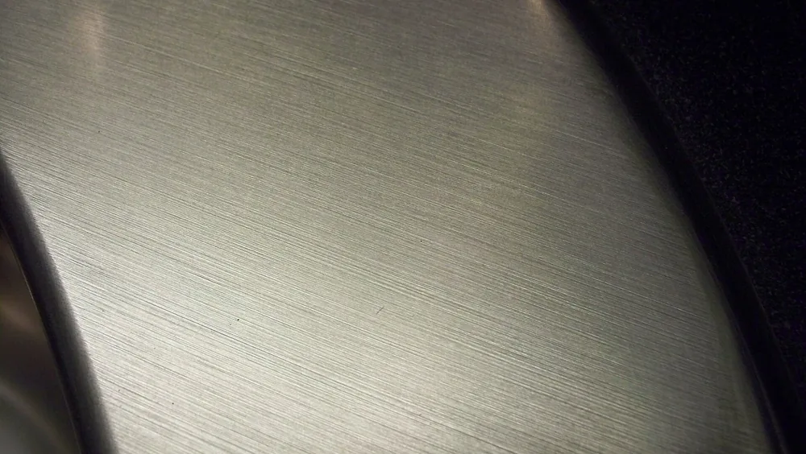

Металлический блеск связан с отражением света, в котором участвуют электроны проводимости. Но внешний вид детали зависит ещё и от поверхности: следы инструмента рассеивают свет, а плёнки и загрязнения меняют отражение. Поэтому одна заготовка после фрезерования, шлифования и полирования выглядит по-разному.

## Почему металл блестит

В отражении света металлом участвуют электроны проводимости. Они реагируют на электромагнитное поле падающей волны, и часть света отражается от поверхности. При этом металл поглощает другую часть падающего света. Видимый блеск зависит и от самого материала, и от состояния его поверхности, и от освещения. Поэтому название сплава ещё не описывает внешний вид готовой детали.

На гладкой поверхности заметнее направленное отражение: глаз видит резкий блик, иногда — очертания окружающих предметов. Неровности меняют направление отражённых лучей. Блик становится шире, а отражение предметов теряет чёткость.

Состав прежний, внешний вид другой.

Для заказа детали это различие принципиально. Марка материала описывает металл, но не заменяет требования к фактуре видимых граней. Их согласуют отдельно: например, поверхность со следами фрезы, направленным сатином или зеркальным отражением.

<!-- inline-cta -->

## Почему медь цветная, а металлический порошок выглядит иначе

*Пример шлифованной металлической поверхности на смесителе. Фото: [Gordeonbleu ( talk )](https://commons.wikimedia.org/wiki/File:Brushed_metal.jpg) · [Public domain](https://creativecommons.org/publicdomain/mark/1.0/)*

Цвет металла связан с тем, как он отражает разные участки видимого спектра. Медь выглядит красноватой, алюминий — серебристым. Но при осмотре детали виден не только основной материал: поверхностная плёнка, загрязнение или покрытие могут изменить оттенок. Поэтому потемневший образец нельзя сравнивать с очищенным, не учитывая состояние поверхности. По одному цвету на фотографии причину различия не установить.

Форма материала тоже влияет на впечатление. У порошка множество отдельных частиц с разной ориентацией. Свет от них отражается в разные стороны, поэтому порошок может выглядеть иначе, чем гладкая заготовка из того же металла.

Сам по себе тусклый вид порошка ещё не объясняет его причину.

При сравнении образцов полезно разделять цвет основного материала, состояние поверхности и условия съёмки. Иначе разницу в освещении легко принять за разницу между сплавами.

## Как шероховатость, направление рисок и свет меняют блеск

Микрорельеф поверхности влияет на распределение отражённого света. Гладкая грань даёт более чёткий блик, а разнонаправленные неровности делают его рассеянным. Следы инструмента добавляют направленность: при повороте детали светлые и тёмные полосы меняются местами. Поэтому поверхность, которая выглядит однородной под рассеянным светом, может показать полосы под боковой лампой. Для сравнения деталей нужны одинаковые условия осмотра.

Зеркальной обычно называют поверхность, в которой различимы отражения предметов. На матовой они не читаются. Сатинированная поверхность сохраняет направленную фактуру и мягкий блеск.

Этих названий мало для приёмки.

Слова «сатин» или «зеркало» стороны могут понимать по-разному. Образец помогает договориться точнее: на нём видны направление рисок, характер блика и допустимые следы обработки.

Освещение входит в это соглашение. Без него одна сторона оценивает деталь у окна, другая — под направленной лампой, и получает другое впечатление.

## Как выглядит поверхность после разных способов обработки

Обработка оставляет на металле характерный след. После точения заметны следы подачи резца, после фрезерования — проходов инструмента, после шлифования — абразивные риски. Полирование уменьшает следы предыдущих операций, а струйно-абразивная обработка создаёт другую фактуру. Итог зависит от материала, инструмента и последовательности операций. Поэтому таблица ниже описывает возможный внешний вид, а не гарантированный результат любого процесса с таким названием.

| Способ обработки | Характер поверхности | Возможный видимый эффект | Что согласовать |
| --- | --- | --- | --- |
| Точение | Следы подачи резца | Регулярный рисунок блика | Допустимые следы резца на видимых зонах |
| Фрезерование | Следы зубьев и проходов фрезы | Полосы при боковом свете | Направление проходов и необходимость отделки |
| Шлифование | Направленные абразивные риски | Направленный блеск | Направление и однородность фактуры |
| Полирование | Уменьшенные следы предыдущих операций | Более чёткое отражение | Образец поверхности и допустимые дефекты |
| Струйно-абразивная обработка | Разнонаправленный рельеф | Матовая фактура | Образец, защищаемые зоны и очистка после обработки |

Для [фрезерных работ по металлу](/frezerovka.html) важно заранее определить, останется ли обработанная грань окончательной. Если да, след инструмента становится частью внешнего вида детали.

Название операции образец не заменяет.

Запись «полировать» не объясняет, насколько чётким должно быть отражение и какие царапины допустимы. Эти условия нужны рядом с указанием обработки.

## Почему поверхность тускнеет или меняет цвет

Потускнение может сопровождать загрязнение, появление поверхностной плёнки или изменение рельефа. Эти причины требуют разного разбора. Масляный след, коррозионное повреждение и царапины могут выглядеть как неоднородность блеска, но состояние металла под ними различается. Поэтому до решения об очистке или повторной обработке важно установить, что именно изменилось. Фотография помогает показать участок, но не всегда позволяет определить причину.

Сравнивать детали лучше в согласованном состоянии: например, после очистки и высушивания. Защитное масло, следы пальцев и остатки обработки мешают оценить фактуру.

Очистка тоже должна быть согласована.

Если поверхность имеет покрытие, осматривают уже его внешний вид. В таком случае требования к блеску и допустимым дефектам относятся к готовой покрытой детали. Образец необработанного металла для такой приёмки не подходит.

## Почему одного Ra недостаточно для оценки блеска

Ra — параметр шероховатости, который описывает среднее отклонение профиля поверхности. Это численная характеристика рельефа, а не полное описание внешнего вида. В ней нет цвета детали, условий освещения или требований к заметности отдельных царапин. Поэтому для видимых поверхностей измеряемые параметры и визуальную приёмку задают отдельно. Одно не заменяет другое, даже если обе проверки относятся к одной грани.

При измерении важны место и направление трассы. Если на поверхности есть направленные следы инструмента, способ проведения измерения нужно согласовать заранее.

Число без условий контроля оставляет место для спора.

Образец дополняет требования к профилю: показывает фактуру и допустимую неоднородность. При этом он не отменяет измерений, если они предусмотрены чертежом.

> Ra описывает характеристику профиля. Внешний вид детали требует отдельного описания.

## Что мешает получить равномерную отделку

Неоднородность отделки стоит разбирать по следам на поверхности и последовательности операций. Полосы, отдельные царапины и различие соседних граней — разные признаки. Для поиска причины важно знать, чем обрабатывали каждый участок и в каком состоянии он поступил на отделку. Повторное полирование без такого разбора может оставить исходную причину. Проверку удобнее вести от видимого дефекта к операции, после которой он появился.

Ниже — вопросы для разбора, а не диагноз по одному внешнему признаку.

- При пятнистой фактуре: одинаково ли обработаны соседние участки?
- При отдельных глубоких царапинах: оставались ли они перед завершающей операцией?
- При различии граней: совпадали ли последовательность обработки и требования к каждой зоне?
- При изменении цвета: есть ли загрязнение, покрытие или следы нагрева?

Скорость работы абразива согласуют с рекомендациями его производителя. Максимально допустимая скорость инструмента и выбранный режим обработки — разные условия: соблюдение первого само по себе не описывает весь процесс.

Для обсуждения переделки нужны образец дефекта и история обработки. Общие причины разобраны в материале [о браке при обработке металла](/blog/brak-pri-obrabotke-metalla-prichiny-oshibki).

## Когда важнее очищаемость и состояние поверхности, чем блеск

Требования к отделке зависят от назначения детали. Для декоративной панели существенны отражение и однородность видимых граней. Для поверхности, которую предстоит мыть, нужно отдельно описать условия очистки и допустимые дефекты. Для сопрягаемой детали важны требования чертежа к рабочей зоне. Блеск не объединяет эти задачи в один критерий и сам по себе не подтверждает пригодность поверхности.

Зеркальное отражение — ещё не результат испытания.

По внешнему виду нельзя подтвердить стерильность, стойкость к коррозии или точность размеров. Эти свойства требуют собственных критериев контроля. Их нельзя подменять фотографией блестящей детали.

В требованиях к заказу полезно разделить декоративные, рабочие и очищаемые зоны. Тогда подрядчик сможет обсудить обработку каждой поверхности, не распространяя требование «зеркало» на всю деталь без разбора.

## Как согласовать внешний вид детали до изготовления

До изготовления нужно связать требования к поверхности с конкретными зонами чертежа. Общее пожелание «сделать блестящей» не объясняет, какие грани будут видны, допустимы ли следы инструмента и как проводить приёмку. Рабочее описание включает назначение поверхности, фактуру, образец и условия контроля. Измеряемые параметры указывают отдельно от визуальных требований. Так стороны получают общий предмет для обсуждения до запуска обработки.

В пакет требований входят:

1. Назначение зон: декоративная поверхность, сопряжение, участок для очистки.
2. Фактура: матовая, направленная или зеркальная; допустимое направление рисок.
3. Образец: согласованная поверхность с понятными границами допустимых дефектов.
4. Измерения: параметры профиля, места контроля и направление трассы.
5. Осмотр: освещение, положение детали, состояние поверхности и критерии несоответствия.

Фотография полезна как пояснение, но её условия тоже имеют значение. Вспышка, угол съёмки и обработка кадра меняют вид блика. Физический образец позволяет сравнить поверхности при одном освещении.

Отдельно фиксируют состояние детали при передаче: с защитным маслом, после очистки или с покрытием. Иначе стороны будут оценивать разные поверхности.

Для расчёта [изготовления деталей по чертежам](/) приложите к заявке чертёж, описание видимых зон и требования к поверхности. Образец или фотографии помогут обсудить фактуру, а параметры контроля — согласовать приёмку.

## Частые вопросы

### Можно ли вернуть блеск меди или стали после потускнения?

Это зависит от причины потускнения. Удаление загрязнения или поверхностной плёнки не устраняет царапины и коррозионные повреждения. Способ восстановления подбирают с учётом материала, покрытия и допустимого изменения размеров.

### Почему сварной шов блестит иначе, чем металл рядом?

После сварки и зачистки состояние поверхности шва может отличаться от соседнего участка. Разницу могут давать следы инструмента и поверхностные плёнки. Если шов остаётся видимым, его внешний вид согласуют отдельно.

### Нужно ли зеркало на поверхностях, которые закроет сборка?

Решение зависит от функции поверхности и требований чертежа. Закрытая зона может быть рабочей или требовать очистки. Само по себе отсутствие обзора не определяет нужную обработку, но и не служит основанием для зеркальной отделки.

## Источники

В исходных материалах приведены справочная статья и отраслевой обзор. Они не заменяют два конкретных первоисточника для публикационного фактчека.

- [Metallic bond](https://www.britannica.com/science/metallic-bond) — Encyclopaedia Britannica; справочный материал о металлической связи.
- [The basics of metal surface finishes](https://www.thefabricator.com/thefabricator/article/finishing/the-basics-of-metal-surface-finishes) — The Fabricator; отраслевой обзор отделки металлических поверхностей.
