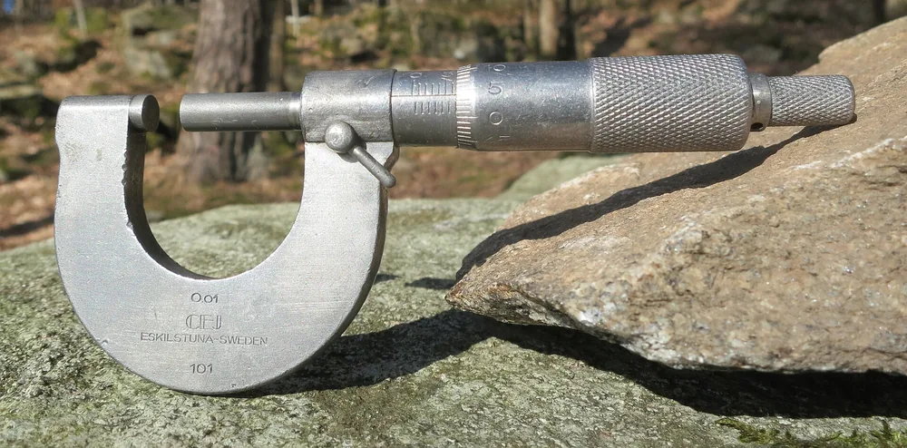
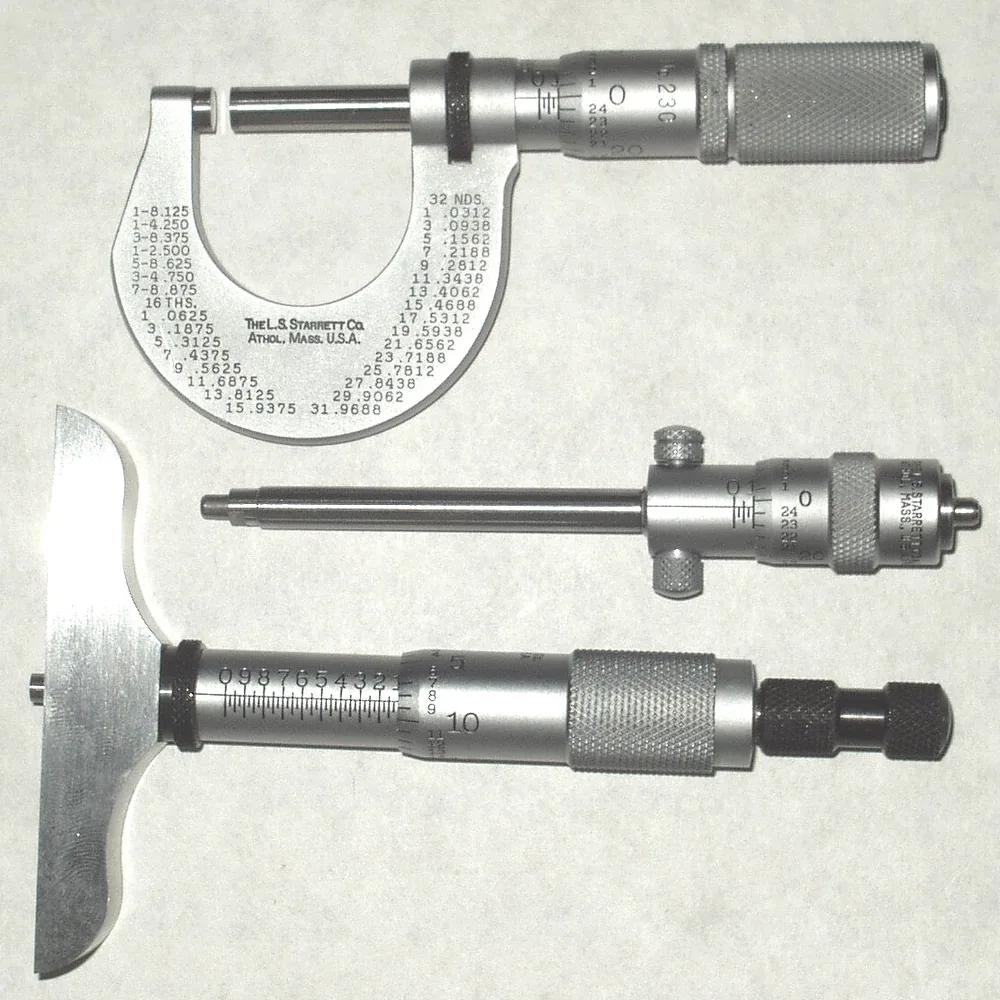

Микрометр — это прибор для измерения линейных размеров: например, диаметра вала или толщины пластины. У наружного микрометра деталь располагают между пяткой и шпинделем, а показание читают по шкалам или дисплею. Ниже — порядок подготовки, учебные примеры отсчёта и разбор ошибок при сравнении размера с чертежом.

## Что такое микрометр и какие размеры им измеряют

Микрометром измеряют линейные размеры детали. Наружная модель с плоскими контактами подходит для доступных противоположных поверхностей: например, для измерения толщины пластины. Для другого расположения поверхностей нужен инструмент подходящего исполнения. Перед работой проверяют, доступны ли места контакта и входит ли ожидаемый размер в диапазон прибора. Затем выбирают места измерения по чертежу и принятому порядку контроля.

Один отсчёт не описывает всю деталь.

Результат относится к выбранному месту и направлению измерения. Если на чертеже есть требования к форме или взаимному расположению поверхностей, проверки одного размера недостаточно. В протоколе полезно указывать место замера: без него трудно сопоставить результаты разных исполнителей.

<!-- inline-cta -->

## Как устроен микрометр и почему вращение даёт отсчёт размера

*Микрометр CE Johansson середины XX века с разрешением 0,01 мм. Фото: [R. Henrik Nilsson](https://commons.wikimedia.org/wiki/File:Mid_20th_century_outside_micrometer_0_to_25_mm_0_01_mm_resolution_by_CE_Johansson_AB_Eskilstuna_Sweden.jpg) · [CC BY 4.0](https://creativecommons.org/licenses/by/4.0)*

Основные части наружного механического микрометра — скоба, пятка, шпиндель, стебель и барабан. Пятка закреплена на скобе, а шпиндель перемещается вдоль оси при вращении микрометрического винта. По шкалам определяют его положение. Механизм ограничения усилия помогает завершить подвод контактов без дополнительного затягивания рукой. Устройство конкретной модели и порядок работы с ней описаны в руководстве.

У механической модели перемещение связано с шагом винта. Часть отсчёта читают на стебле, оставшуюся — на барабане.

Трещотка и стопор выполняют разные задачи: трещоткой доводят контакт, стопором закрепляют положение шпинделя. Стопор не заменяет механизм ограничения усилия.

## Как выбрать диапазон и исполнение под форму детали

Прибор выбирают по размеру детали и доступу к измеряемым поверхностям. KEYENCE приводит диапазоны 0–25 мм и 25–50 мм как примеры выбора под размер объекта. Одного подходящего диапазона недостаточно: контакты должны попадать на нужные поверхности. Для канавки, стенки трубы или внутреннего размера сначала определяют подходящее исполнение, затем проверяют характеристики конкретной модели.

| Задача | Что проверить при выборе |
| --- | --- |
| Наружный диаметр вала | Диапазон и возможность установить контакты на нужном сечении |
| Толщина пластины | Доступ к обеим сторонам и глубину скобы |
| Размер в узкой канавке | Форму и размеры измерительных контактов |
| Толщина стенки трубы | Возможность контакта с внутренней и наружной поверхностями |
| Внутренний размер или глубина | Назначение инструмента для выбранного измерения |

Насадки требуют отдельного внимания. Нельзя переносить порядок отсчёта с обычных плоских контактов на другую оснастку без проверки её инструкции.

Сначала выбирают способ контакта, затем прибор.

## Цена деления, разрешение и погрешность: в чём разница

*Наружный, внутренний и глубинный микрометры. Фото: [Splarka at English Wikipedia](https://commons.wikimedia.org/wiki/File:Micrometers111.jpg) · [Public domain](https://creativecommons.org/publicdomain/mark/1.0/)*

Цена деления показывает, какому изменению размера соответствует промежуток между соседними отметками шкалы. Разрешение характеризует различимость показаний; у цифрового прибора с ним связан шаг индикации. Погрешность относится к отклонению показания или результата от опорного значения. Поэтому количество рисок или знаков после запятой само по себе не доказывает пригодность прибора для контроля заданного допуска.

В примере KEYENCE барабан позволяет отсчитывать 0,01 мм. Это описание отсчёта, а не обещание погрешности измерения.

| Характеристика | На какой вопрос отвечает |
| --- | --- |
| Цена деления | Какой размер соответствует одному делению шкалы? |
| Шаг цифровой индикации | На сколько меняется последнее отображаемое значение? |
| Предел допускаемой погрешности прибора | Какие отклонения показаний допускает документация? |
| Неопределённость измерения | Каков разброс значений, обоснованно приписываемых измеряемому размеру? |

При выборе под допуск нужны характеристики модели и условия измерения. По одному виду шкалы такое решение принять нельзя.

## Что проверить до первого замера

Перед измерением очищают контакты и проверяют начальное показание способом, предусмотренным для модели. KEYENCE рекомендует протирать пятку и шпиндель чистой тканью. Поверхности детали тоже должны быть доступны для осмотра: загрязнение или заусенец могут помешать контакту в нужном месте. При подготовке важно различать очистку и обработку детали — удаление металла уже меняет объект контроля.

Заусенец нельзя снимать произвольно ради удобного отсчёта.

Для подготовки удобно использовать короткий перечень:

- Очистить пятку, шпиндель и место контакта на детали.
- Осмотреть поверхности на повреждения и заусенцы.
- Проверить единицы измерения и выбранный режим отсчёта.
- Проверить начальное показание способом из руководства.
- При расхождении с мерой выяснить причину до контроля партии.

KEYENCE также советует по возможности не держать металл голыми руками либо использовать перчатки для точных работ с низкой теплопередачей. Подготовку детали и прибора к измерению согласуют с принятой методикой.

## Как измерить деталь микрометром: порядок действий

Деталь устанавливают между пяткой и шпинделем так, чтобы контакты попадали на выбранные поверхности. Затем подводят шпиндель и завершают контакт механизмом ограничения усилия. В описании KEYENCE трещотку вращают до проскальзывания, после чего читают показание. Для своего прибора используют порядок из руководства, включая правила работы со стопором и снятия отсчёта.

1. Разведите контакты и установите деталь.
2. Совместите ось шпинделя с направлением измеряемого размера.
3. Подведите шпиндель к поверхности.
4. Завершите подвод трещоткой по инструкции модели.
5. Прочитайте показание и запишите его с единицей измерения.

Не дотягивайте барабан после срабатывания трещотки.

При измерении вала проверяют, что контакты расположены на нужном сечении и не попали на фаску. После повторной установки сопоставляют показания. Если они расходятся, сначала проверяют место контакта, чистоту и положение прибора.

Усреднение не устраняет причину расхождения. В записи результата сохраняют сведения о сечении и направлении, чтобы следующий исполнитель мог повторить измерение.

## Как читать шкалу: миллиметры, половины и сотые

Порядок чтения зависит от устройства и разметки конкретного микрометра. Ниже приведён учебный пример механической шкалы: шаг винта принят равным 0,5 мм, барабан разделён на 50 частей. Тогда одному делению соответствует 0,5 ÷ 50 = 0,01 мм. Это исходные условия примера, а не характеристики любого микрометра.

Сначала читают стебель, затем барабан.

Если на стебле последняя открытая отметка — 12 мм, а отметка 12,5 мм ещё закрыта, к 12 мм добавляют отсчёт барабана. При значении 0,15 мм результат составит:

**12,00 + 0,15 = 12,15 мм.**

Если отметка 12,5 мм уже открыта, при том же положении барабана получится:

**12,50 + 0,15 = 12,65 мм.**

Пропуск открытой половины миллиметра в этом примере даст ошибку на 0,5 мм.

У прибора с другим диапазоном сначала проверяют нумерацию стебля. Начало диапазона нельзя автоматически прибавлять к уже полному показанию шкалы: это приведёт к двойному учёту.

На цифровой модели перед чтением проверяют единицу измерения и режим отсчёта. Относительный ноль может отличаться от начала абсолютного отсчёта.

## Как сравнить измерения с допуском на чертеже

Для сравнения нужны предельные размеры, подходящий метод измерения и правило принятия решения. Номинал с отклонениями переводят в нижний и верхний пределы. После измерения сопоставляют результат с этими границами. При этом результат возле границы требует внимания к неопределённости измерения: одного арифметического сравнения показания с пределом может быть недостаточно.

Рассмотрим условную задачу, а не производственный норматив. На учебном чертеже задан диаметр 20 мм с верхним отклонением +0,018 мм и нижним −0,005 мм.

Получаем:

| Величина | Расчёт | Значение |
| --- | --- | --- |
| Нижний предельный размер | 20 − 0,005 | 19,995 мм |
| Верхний предельный размер | 20 + 0,018 | 20,018 мм |
| Ширина допуска | 20,018 − 19,995 | 0,023 мм |

Показание 20,016 мм численно находится между этими пределами. До верхней границы остаётся 0,002 мм. Но заключение о соответствии требует принятого правила контроля и учёта характеристик измерения.

Это ещё не решение о приёмке.

Места и направления замеров фиксируют заранее. Вопросы объёма контроля разобраны в материале о том, [как принять партию деталей по чертежу](/razdel/kontrol-kachestva.html).

## Почему повторные замеры расходятся

Разные показания могут относиться как к разным размерам детали, так и к разным условиям измерения. Поэтому сначала повторяют установку в том же месте и направлении. Затем проверяют чистоту контактов, положение прибора, способ подвода и режим отсчёта. Изменять сразу несколько условий неудобно: после этого трудно установить причину расхождения.

| Что заметили | Что проверить |
| --- | --- |
| Показания меняются после переустановки | Место контакта, положение прибора, загрязнение |
| Результат зависит от затягивания | Использование механизма ограничения усилия |
| Значения меняются во время работы | Нагрев детали и прибора, условия подготовки |
| В разных сечениях получены разные значения | Совпадают ли места и направления измерения |
| Механический отсчёт отличается на половину миллиметра | Не пропущена ли открытая отметка на стебле |
| Цифровое показание неожиданно изменилось | Единицы измерения и режим абсолютного или относительного отсчёта |

Расхождение — повод разобраться, а не выбрать удобное число.

Если размер проверяют на разных стадиях изготовления, в протоколе указывают и стадию. Результаты до обработки и после неё нельзя сопоставлять без этого контекста.

## Проверка, калибровка, поверка и хранение прибора

Перед работой проверяют начальное показание, но такая проверка не описывает состояние прибора во всём диапазоне. KEYENCE указывает концевые меры длины или специальную меру для проверки микрометра. Какие меры и точки использовать, определяет процедура для конкретного прибора. Самостоятельная установка нуля не заменяет документированную оценку его характеристик.

Не стоит смешивать названия операций. Сверка показания с мерой, регулировка прибора и оформление результатов калибровки или поверки требуют разного порядка действий. Здесь не приводятся обязательность поверки и её интервалы: подтверждающих документов в источниках статьи нет.

Для хранения используют рекомендации изготовителя. Прибор защищают от загрязнения и ударов; повреждённые контакты нельзя считать исправными только потому, что шкала показывает ноль.

Контроль размера начинают планировать до выпуска партии.

При заказе [изготовления деталей по чертежам](/) заранее согласуют контролируемые размеры, места измерения и оформление результатов. Пришлите чертёж с допусками, чтобы согласовать изготовление и контроль детали.

## Частые вопросы

Микрометр выбирают под конкретный размер и доступ к поверхностям. Ниже — ответы о назначении прибора, чтении шкалы и проверке перед работой. Числовой пример выше относится к заданной учебной шкале. Для рабочего инструмента порядок отсчёта и подготовки проверяют по его руководству.

### Что такое микрометр?

Микрометр — прибор для измерения линейных размеров. Наружным микрометром измеряют, например, диаметр вала или толщину пластины. Исполнение и диапазон подбирают под деталь.

### Как понять, нужно ли прибавлять половину миллиметра?

В разобранном учебном примере половину миллиметра учитывают, если соответствующая отметка на стебле уже открыта. Разметку своего прибора проверяют по руководству.

### Означает ли цена деления 0,01 мм такую же погрешность?

Нет. Цена деления описывает шкалу. Характеристики погрешности прибора берут из его документации, а при оценке результата учитывают условия измерения.

### Что делать, если повторные показания различаются?

Повторить измерение в том же месте и направлении, проверить контакты, положение прибора и способ подвода. До выяснения причины не стоит заменять расходящиеся значения их средним.

## Источники

Ниже приведены материалы, использованные при подготовке статьи. Страница KEYENCE содержит описание устройства, диапазонов, чтения шкалы и подготовки к измерению. Публикация Modern Machine Shop рассматривает исполнения микрометров. Подтверждающие выдержки для оставленных проверяемых утверждений приведены в поле `claims`; журнальный материал не заменяет руководство конкретной модели.

- [Micrometer — KEYENCE](https://www.keyence.com/ss/products/measure-sys/measurement-selection/type/micrometer.jsp) — описание прибора и порядка работы.
- [There's a Micrometer for That — Modern Machine Shop](https://www.mmsonline.com/articles/theres-a-micrometer-for-that) — дополнительный материал об исполнениях и измерительных контактах.
