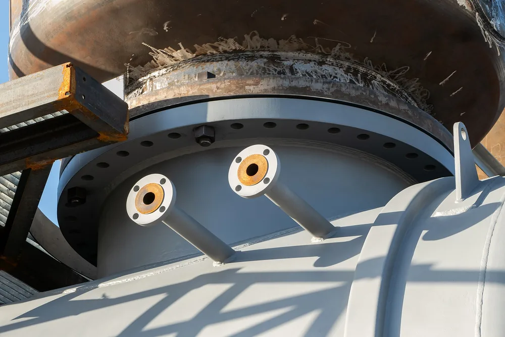
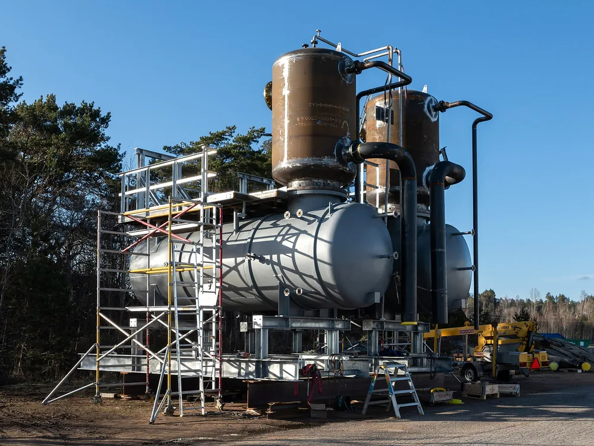

НАКС сварщика — обиходное название аттестации сварщика в системе Национального Агентства Контроля Сварки и документов о её прохождении. Заказчику нужно выяснить, требуется ли аттестация для конкретных работ, и сопоставить документы исполнителя с чертежом. Одного сообщения «у нас сварщики с НАКС» для такой проверки недостаточно.

## НАКС сварщика: что это подтверждает для заказчика

За фразой «у сварщика есть НАКС» заказчику нужны документы конкретного исполнителя и сведения об области его аттестации. Само название организации не описывает работы, которые предстоит выполнить. При проверке важны способ сварки, материалы и параметры соединений по вашему заказу. Эти сведения нужно сопоставить с удостоверением и приложениями к нему.

Начните с копии документа. Проверьте, кому он выдан, какие работы в нём указаны и какие ограничения записаны.

Квалификация исполнителя и результат изготовления — разные предметы проверки. Для приёмки узла нужны согласованные требования к швам и результаты контроля самого изделия. Документ сварщика не заменяет проверку поставки.

<!-- inline-cta -->

## Как определить, нужна ли аттестация для вашего изделия

*Резервуар под давлением с трубными муфтами на производстве West Pipe Welding в Швеции. Фото: [W.carter](https://commons.wikimedia.org/wiki/File:Pipe_couplings_on_a_pressure_tank_under_construction.jpg) · [CC0 1.0](https://creativecommons.org/publicdomain/zero/1.0/deed.en)*

Проверку начните с назначения узла и места его установки. Затем соберите требования проекта и договора к сварочным работам. Если в документах упоминается аттестация персонала, найдите соответствующий пункт и выясните, какие операции он охватывает. Не принимайте решение только по названию детали или отрасли: для него нужно основание, относящееся к вашему заказу.

Одинаковые по чертежу кронштейны могут заказываться для разных условий эксплуатации. Поэтому описание «обычная металлическая деталь» не закрывает вопрос о требованиях к исполнителю.

Для подготовки заказа:

1. Зафиксируйте назначение изделия и место установки.
2. Соберите проектные требования к сварным соединениям и персоналу.
3. Найдите в договоре условия о подтверждении квалификации.
4. Запросите документ и конкретный пункт для каждого заявленного обязательного требования.
5. Согласуйте перечень подтверждений до запуска изготовления.

Если исходных данных об объекте нет, этот пробел нужно закрыть с проектировщиком или техническим заказчиком.

## Какие нормативные основания нужно проверить

Для каждого утверждения об обязательной аттестации нужно установить документ, конкретный пункт и его связь с вашим изделием. Упоминания ведомства или номера приказа недостаточно. В рабочей таблице полезно разделить нормативные требования, положения проекта и условия договора. Так будет видно, откуда взялось каждое требование и чем подрядчик должен подтвердить его выполнение.

| Что проверяют | Какое подтверждение нужно получить |
| --- | --- |
| Нормативное требование | Официальный текст, конкретный пункт и объяснение применимости к объекту и работам |
| Требование проекта | Раздел или лист документации, относящийся к заказываемому узлу |
| Условие договора | Пункт договора или согласованного приложения |
| Процедура аттестации | Документ, описывающий заявленную процедуру и её область применения |

Фраза «так требует НАКС» не позволяет проверить основание.

Если подрядчик ссылается на нормативный акт, в пакет проверки нужен сам текст. Главная страница ведомства не подтверждает содержание документа.

## Уровни I–IV и разряд сварщика: в чём разница

*Изготовление резервуара под давлением на предприятии West Pipe Welding в Швеции. Фото: [W.carter](https://commons.wikimedia.org/wiki/File:Pressure_tanks_under_construction.jpg) · [CC0 1.0](https://creativecommons.org/publicdomain/zero/1.0/deed.en)*

При проверке исполнителя не подменяйте обозначение уровня аттестации сведениями о разряде. Для заказа нужно установить, какую работу человек будет выполнять и какими документами она подтверждена. Если подрядчик указывает уровень I–IV, запросите расшифровку обозначения со ссылкой на конкретный пункт документа, по которому проводилась аттестация. Затем сопоставьте её с ролью исполнителя.

Не выводите полномочия человека из названия должности.

| Сведения подрядчика | Что выяснить для заказа |
| --- | --- |
| Уровень аттестации | Как он назван в подтверждающем документе и к какой деятельности относится |
| Разряд | Каким документом подтверждён и зачем указан в требованиях заказа |
| Роль на производстве | Кто выполняет сварку, готовит технологию и организует контроль |
| Область аттестации | Какие работы и ограничения записаны в документах исполнителя |

Условие «сварщик высокого разряда» оставляет слишком много вопросов. Для приёмки документов нужны проверяемые признаки.

## Как сопоставить область аттестации с чертежом

Сопоставление удобно вести по таблице: требование заказа, запись в документах исполнителя и результат проверки. Выпишите способ сварки, материал, размеры соединений и положение сварки из чертежа и технологии. Затем найдите соответствующие сведения в удостоверении и приложениях. Любое расхождение вынесите на техническое согласование до начала работ, не заменяя недостающую запись устным объяснением.

Например, в заказе указана аргонодуговая сварка неплавящимся электродом, а в представленных документах — ручная дуговая покрытым электродом. Такого комплекта недостаточно, чтобы подтвердить соответствие исполнителя заявленному способу.

Это разные сварочные процессы. Подробнее — в материале [об отличиях аргонодуговой сварки и полуавтомата](/blog/argonodugovaya-svarka-tig-i-poluavtomat).

| Параметр | Что взять из заказа | Что сопоставить |
| --- | --- | --- |
| Способ сварки | Обозначение из технологии | Способ, указанный в документах сварщика |
| Группа технических устройств | Требование проекта, если оно задано | Соответствующую запись и её расшифровку |
| Материал | Марку и принятые в документации обозначения | Указанные материалы или группы |
| Толщина и диаметр | Размеры соединения | Записанные диапазоны |
| Вид соединения | Требование чертежа | Описание в области аттестации |
| Положение сварки | Положение по технологии | Соответствующие обозначения в документах |

Не заполняйте пробелы по аналогии с похожей деталью.

## Виды аттестации и срок действия документов

При проверке срока зафиксируйте дату, на которую исполнитель должен подтвердить документы: начало сварки, период выполнения работ или другой согласованный момент. Сопоставьте её с датами в представленном комплекте. Если подрядчик ссылается на продление, запросите подтверждающий документ. Одного объяснения о большом стаже или непрерывной работе для проверки срока недостаточно.

Даты и область аттестации проверяют отдельно.

При упоминании первичной, дополнительной, периодической или внеочередной аттестации попросите указать основание выбранной процедуры. Для заказа важно понять, какой результат она должна дать и какие документы подрядчик представит.

Универсальный срок действия здесь не указан: подтверждающего нормативного текста в источниках нет.

## Как выбрать центр и подготовить документы

До подачи заявки передайте центру описание требуемых работ и запросите подтверждение, что он проводит нужную процедуру. В ответе должны быть понятны область аттестации, перечень документов и результат услуги. Затем сопоставьте сведения центра с официальной информацией о нём. Не ограничивайтесь рекламным обещанием оформить удостоверение: оно не описывает содержание будущего документа.

Удобно заранее собрать единый пакет исходных данных:

1. Чертёж и требования к сварным соединениям.
2. Сведения о способе сварки и материалах.
3. Требования проекта и договора к персоналу.
4. Имеющиеся документы исполнителя.
5. Вопросы о составе процедуры и выдаваемых документах.

Перечень для подачи заявки нужно получить у выбранного центра. В нём полезно отдельно отметить, какие документы подтверждают личность, квалификацию и опыт, а какие относятся к условиям конкретной услуги.

Обучение и подтверждение аттестации проверяйте по разным документам.

## Что проверяют на экзаменах

Для оценки предложения центра запросите программу процедуры: какие знания и навыки проверяют, какие задания выполняет кандидат и как оформляют результат. Если предусмотрен контрольный сварной образец, выясните требования к нему и порядок оценки. Это позволит сравнить предложения по содержанию. Точный состав экзаменов нельзя установить по одной рекламной странице или названию курса.

В письменном ответе центра полезно видеть описание теоретической и практической частей, если они предусмотрены. Отдельно уточните порядок действий при неудовлетворительном результате.

Контроль экзаменационного образца не заменяет приёмку поставляемого узла.

Для изделия заранее согласуют методы контроля, объём проверки и критерии приёмки. Эти условия нужно связать с чертежом и техническими требованиями заказа.

## От чего зависят стоимость и сроки аттестации

Сравнивайте предложения центров по одинаковому заданию и составу услуги. Запросите расчёт с отдельными строками для подготовки, проверки знаний, практической части и оформления результата, если они входят в предложение. Для сроков нужна последовательность этапов с датой получения итоговых документов. Уточните, какие события могут сдвинуть эту дату и какие расходы не включены в расчёт.

| Статья расчёта | Что уточнить |
| --- | --- |
| Подготовка | Нужна ли она кандидату и включена ли в предложение |
| Экзамены | Какие проверки входят в цену |
| Образцы и контроль | Кто предоставляет материалы и оплачивает проверку |
| Документы | Что выдадут и когда |
| Повторное прохождение | Какие условия и расходы предусмотрены |
| Поездка и отсутствие на производстве | Нужны ли проезд, проживание и замена исполнителя |

Без такого состава общие суммы трудно сопоставить.

Расчёт аттестации также нужно отделять от [стоимости изготовления деталей и узлов](/ceny.html).

## Как проверить удостоверение в реестре НАКС

Для проверки начните с официального сайта НАКС и найдите раздел со сведениями об аттестованном персонале. Используйте реквизиты из копии удостоверения. Сопоставьте найденную запись с документами подрядчика, сохранив дату проверки. Если нужных сведений нет или они расходятся, запросите пояснение у выдавшего документ центра. Не считайте отсутствие результата поиска самостоятельным доказательством подделки.

Проверку удобно фиксировать по пунктам:

- Данные исполнителя совпадают с представленным документом.
- Реквизиты удостоверения и сведения о центре не расходятся.
- Указанные даты сопоставлены со сроками выполнения заказа.
- Область аттестации проверена по доступным сведениям и полному комплекту документов.
- Расхождения перечислены и направлены на уточнение.

Публичная запись не должна становиться поводом пропустить чтение удостоверения и приложений.

Если проверить документ не удалось, отметьте это в результате проверки. Не оформляйте предположение как подтверждённый допуск.

## Что согласовать с подрядчиком до изготовления

До запуска заказа согласуйте требования к соединениям, способ подтверждения квалификации исполнителя и документы на готовую поставку. Для каждого пункта укажите основание, ответственного и момент предъявления. Так проверка не сведётся к обмену копиями удостоверений. У подрядчика и заказчика будет общий перечень того, что нужно проверить перед сваркой и при приёмке узла.

В перечень включают чертёж, требования к швам, согласованную технологию, методы контроля и критерии приёмки. Документы на оборудование или изготовителя добавляют с указанием основания, по которому они нужны для заказа.

Подтверждение квалификации и документы о результате контроля храните в комплекте заказа.

Для расчёта изготовления пришлите чертёж и требования к сварным узлам через страницу [изготовления деталей и узлов по чертежам](/).

## Частые вопросы

### Что такое НАКС сварщика?

Так обычно называют аттестацию сварщика в системе Национального Агентства Контроля Сварки и документы о её прохождении. Для конкретного заказа нужно проверить документы исполнителя и сопоставить область аттестации с предстоящими работами.

### Достаточно ли копии удостоверения для проверки подрядчика?

Одной копии недостаточно для сопоставления с заказом. Нужны требования к изделию, сведения об области аттестации и проверка реквизитов документа. Для приёмки готового узла отдельно согласуют контроль сварных соединений.

### Что делать, если удостоверение не находится в реестре?

Сначала перепроверьте введённые реквизиты. Затем запросите пояснение у центра, выдавшего документ. До получения ответа зафиксируйте, что сведения не подтверждены.

## Источники

Перечисленные сайты служат отправными точками для поиска документов. Ссылки на их главные страницы не подтверждают обязательность аттестации, классификацию уровней или порядок её проведения. Для публикации нужны конкретные официальные документы с указанием подтверждающих пунктов.

- [Национальное Агентство Контроля Сварки](https://naks.ru/) — официальный сайт организации.
- [Ростехнадзор](https://www.gosnadzor.ru/) — официальный сайт надзорного ведомства.
- [Официальный интернет-портал правовой информации](https://pravo.gov.ru/) — портал официального опубликования правовых актов.
