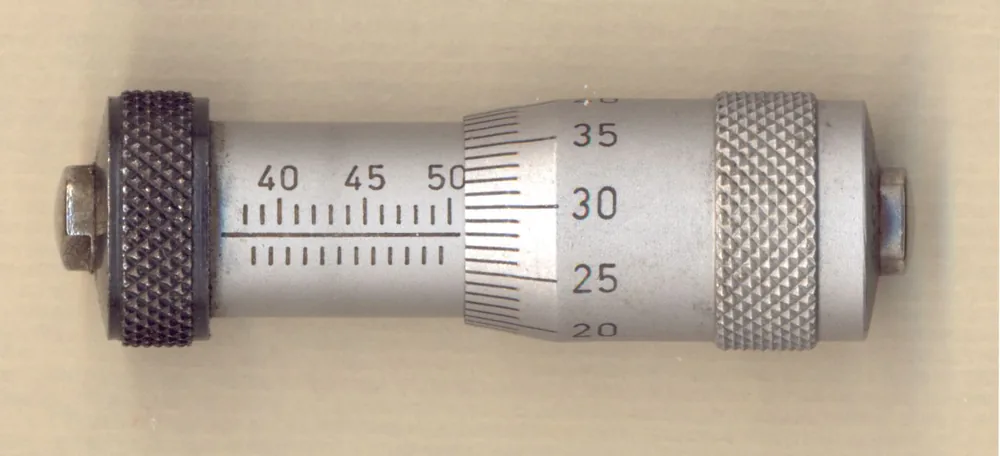

Нутромер используют для измерения внутренних размеров детали, прежде всего отверстий. Чтобы выбрать прибор для контроля по чертежу, сопоставляют допуск, глубину измерения и характеристики конкретного исполнения. Мелкая цена деления ещё не означает, что результат подходит для приёмки детали.

## Что измеряет нутромер и как сравнивать приборы

Нутромер помогает определить внутренний размер в выбранном месте детали. При контроле отверстия важно заранее указать сечение и направление измерения: без них запись диаметра трудно воспроизвести. Прибор выбирают под эту задачу, сравнивая диапазон, доступ к поверхности, способ отсчёта и метрологические характеристики. Одного совпадения номинала с диапазоном недостаточно.

Возможность измерять пазы, канавки и расстояния между внутренними поверхностями проверяют отдельно. Название прибора не описывает форму его контактов и доступ к нужному участку.

Цена деления и погрешность — разные характеристики.

Первая описывает шкалу. Для оценки результата нужны также характеристики прибора, средства настройки и условия измерения. Поэтому сравнивать нутромеры только по числу знаков на шкале или экране неудобно: такая таблица не отвечает на вопрос о пригодности для конкретного допуска.

В этом обзоре нет испытаний приборов и сравнения марок. Порядок работы с выбранной моделью должен опираться на её руководство.

<!-- inline-cta -->

## Индикаторный, микрометрический и электронный: в чём различия

*Нутромер для измерения внутренних размеров в диапазоне 40–50 мм. Фото: [Rrudzik](https://commons.wikimedia.org/wiki/File:Srednicowka_mikr.jpg) · [CC0 1.0](https://creativecommons.org/publicdomain/zero/1.0/deed.en)*

При сравнении нутромеров полезно разделять способ получения размера, способ отображения результата и устройство головки. Индикаторные исполнения часто используют для сравнения с опорным размером, микрометрические — для непосредственного отсчёта. Цифровой экран описывает отображение показания. По нему нельзя определить ни число контактов, ни доступную глубину измерения.

| Что сравнивают | Что нужно выяснить |
| --- | --- |
| Способ отсчёта | Прибор показывает размер или отклонение от заданной опоры |
| Измерительную головку | Где расположены контакты и к каким поверхностям они подходят |
| Диапазон | Какие размеры доступны с выбранной комплектацией |
| Глубину | До какого сечения доходят измерительные контакты |
| Настройку | Какое средство нужно для задания исходного отсчёта |
| Характеристики измерения | Какие значения и условия указаны в документации исполнения |

Двухточечные и трёхточечные головки нельзя считать взаимозаменяемыми только потому, что они охватывают одинаковый диапазон. Для канавки, прерывистой поверхности или участка рядом с дном важна геометрия контактов.

Экран этого вопроса не решает.

Удлинители тоже оценивают как часть комплекта. Наличие подходящей детали в футляре ещё не подтверждает, что собранный прибор подходит для выбранной операции.

## Как выбрать нутромер под допуск и геометрию отверстия

Выбор начинают с чертежа: выписывают номинал, предельные размеры, глубину отверстия и требования к контролируемой поверхности. Затем определяют, где именно нужно получить результат. Для сквозного и глухого отверстия одного диаметра условия доступа могут различаться. После этого сравнивают исполнения нутромеров и средства, которыми их предстоит настраивать.

Для предварительного подбора удобно собрать короткий перечень:

- номинальный размер и его пределы;
- сечения и направления измерения;
- глубина доступа и расстояние до дна;
- канавки, уступы и прерывистые поверхности;
- требования к записи результатов и приёмке.

Это исходные данные, а не готовая методика контроля.

В документации прибора ищут характеристики именно выбранного исполнения и комплекта. Значение для другой головки или диапазона нельзя автоматически переносить на свой прибор.

Отдельно рассматривают средство настройки. Оно должно подходить к выбранному способу работы и опорному размеру. Стоимость имеет смысл сравнивать после того, как определены подходящие комплекты.

## Как настроить индикаторный нутромер и проверить знак отклонения

При сравнительном измерении индикаторный нутромер сначала связывают с известным опорным размером. Для этого нужны подходящее средство настройки и порядок работы из руководства конкретной модели. До измерения детали важно разобраться, что означает исходное показание и какое направление отсчёта соответствует увеличению размера. Иначе даже правильно прочитанное отклонение можно записать с противоположным знаком.

Кольцо, микрометр или другое средство настройки выбирают по документации прибора. Универсальную последовательность для всех исполнений здесь применять нельзя.

Настройка должна воспроизводиться.

Если после повторной установки на ту же опору показания расходятся, сначала выясняют причину. Переносить нестабильный отсчёт в протокол детали рано.

Условный пример показывает только арифметику. Пусть опорный размер равен 50,000 мм, а отклонение составляет 0,012 мм. Если оно соответствует увеличению размера, результат равен 50,012 мм. Если уменьшению — 49,988 мм. Эти числа не описывают точность прибора или допуск детали.

Для микрометрического исполнения нужен собственный порядок проверки исходного отсчёта. Последовательность настройки индикаторной головки на него автоматически не переносят.

## Как установить нутромер в отверстии и снять показание

Показание снимают в заданном сечении и рабочем положении измерительной головки. Способ введения, поиска этого положения и ограничения усилия зависит от конструкции прибора. Поэтому указание «покачать и взять крайнее значение» без описания модели недостаточно для рабочей инструкции. В протокол должен попасть результат, который другой контролёр сможет воспроизвести тем же способом.

Перед измерением осматривают отверстие и контакты. Стружка, загрязнение или заусенец могут помешать установить головку на нужную поверхность. Удаление материала с самой детали требует отдельного решения: подготовку к измерению нельзя незаметно превращать в доработку.

Если показание меняется при каждой установке, сначала проверяют положение контактов, состояние поверхностей и настройку. Усреднять такие числа без разбора причины не стоит.

Повторение помогает оценить устойчивость отсчёта, но само по себе не доказывает его правильность.

Нутромер также не заменяет отдельную оценку шероховатости. Её методы разобраны в статье про [измерение шероховатости поверхности](/blog/izmerenie-sherohovatosti-poverhnosti-profilometr-obrazcy).

## Зачем измерять отверстие на разной глубине и в разных направлениях

Измерение в одном месте не описывает всё отверстие. Когда задача требует сравнить размеры по глубине или направлениям, точки контроля назначают заранее и отмечают в протоколе. Их расположение должно соответствовать чертежу и принятому способу контроля. Универсального числа сечений для любой детали из этого обзора вывести нельзя.

Результаты из разных точек позволяют сопоставить полученные размеры. Чтобы сравнение было понятным, для каждого значения сохраняют глубину, направление и условия измерения.

Разницу показаний не стоит без пояснений называть овальностью или конусностью. Сначала нужен метод, который связывает измерения с конкретной характеристикой формы.

Требование к форме — отдельная задача.

Если чертёж задаёт круглость, цилиндричность или профиль, для каждого требования выбирают подходящий метод оценки. Таблица локальных размеров не должна подменять отсутствующее измерение формы.

## Как записать результаты и оценить соответствие чертежу

Протокол должен позволять понять, какую поверхность проверяли, где получили результат и каким прибором пользовались. Для отверстия записывают обозначение детали, размер с чертежа, его пределы, сечение, направление и единицу измерения. Отдельно указывают прибор и средство настройки. Порядок заключения о соответствии определяют до того, как результаты начнут сравнивать с пределами.

Ниже — условный пример оформления. Все числа придуманы для иллюстрации и не описывают производственный контроль.

| Поле | Сечение I, направление А | Сечение I, направление Б | Сечение II, направление А |
| --- | --- | --- | --- |
| Номинал | 50,000 мм | 50,000 мм | 50,000 мм |
| Нижний предел | 50,000 мм | 50,000 мм | 50,000 мм |
| Верхний предел | 50,030 мм | 50,030 мм | 50,030 мм |
| Результат | 50,012 мм | 50,018 мм | 50,009 мм |

Положения сечений и направлений в рабочем протоколе поясняют схемой или ссылкой на документ. Буквы и номера без расшифровки оставляют слишком много места для догадок.

Само число ещё не заключение о годности.

В правиле приёмки нужно определить, как учитывать характеристики измерения, особенно рядом с границей допуска. В этой статье такого правила нет: учебная таблица показывает только форму записи.

Единицы во всех документах должны быть согласованы. Примеры обозначений есть в материале про [обозначения и перевод единиц измерения](/blog/edinicy-izmereniya).

При заказе на [изготовление деталей по чертежам](/) состав контроля и протокола согласуют вместе с требованиями к детали.

## Настройка, калибровка и поверка: что проверить перед контролем

Запись о настройке, документ о калибровке и сведения о поверке отвечают на разные вопросы. Для подготовки контроля важно выяснить, какие процедуры относятся к выбранному прибору и задаче. Установленный ноль сам по себе не подтверждает все характеристики измерения. Названия процедур без документов также не дают основания для заключения о пригодности.

В комплекте документов сопоставляют модель, исполнение, заводской номер и характеристики, которые нужны для работы. Для средства настройки проверяют его собственные данные.

Документ на похожий прибор не подтверждает характеристики экземпляра на рабочем месте.

Конкретные правовые условия поверки и порядок поиска записей здесь не приводятся: ссылки в конце статьи не подтверждают эти положения. До публикации разделу нужны конкретные первоисточники.

Пришлите чертёж отверстия на расчёт: согласуем способ контроля и состав протокола приёмки.

## Частые вопросы

### Чем нутромер отличается от штангенциркуля при измерении отверстия?

Различаются конструкция измерительных контактов и способ получения отсчёта. Для выбора нужно сравнить доступ к нужному сечению и характеристики конкретных приборов. Утверждать, что любой нутромер точнее любого штангенциркуля, нельзя.

### Как часто нужно заново настраивать индикаторный нутромер в течение смены?

Универсальный интервал здесь не установлен. Его определяют для конкретной операции с учётом руководства прибора и методики контроля. При сомнениях в настройке сначала проверяют исходный отсчёт, затем продолжают измерения.

### Кто подписывает протокол контроля отверстия?

Исполнителя и ответственного за заключение указывают в принятом порядке контроля. Из этой статьи нельзя вывести обязательный состав подписей. В протоколе важно сохранить связь между результатом, прибором, условиями измерения и исполнителем.

## Источники

Ниже сохранены официальные ресурсы из исходной статьи. Это главные страницы, а не конкретные документы по работе с нутромерами. Они не подтверждают приведённую методику. Для публикации нужны ссылки на руководство выбранного исполнения и документы, обосновывающие метрологическую часть; до их проверки статья оставлена в черновике.

- [ФГИС «Аршин»](https://fgis.gost.ru/).
- [Федеральное агентство по техническому регулированию и метрологии](https://www.rst.gov.ru/).
