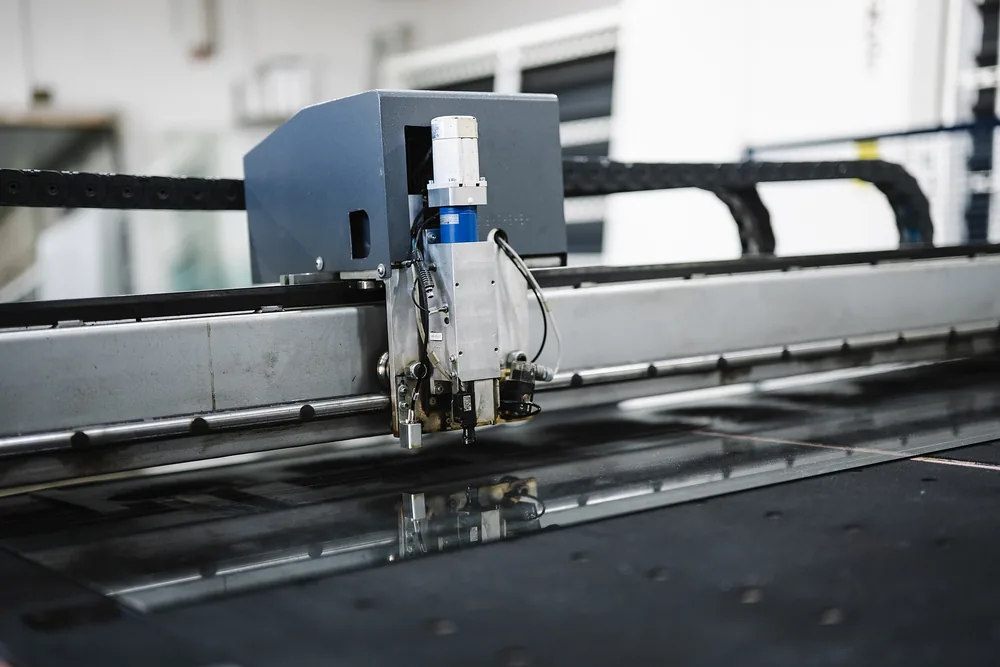
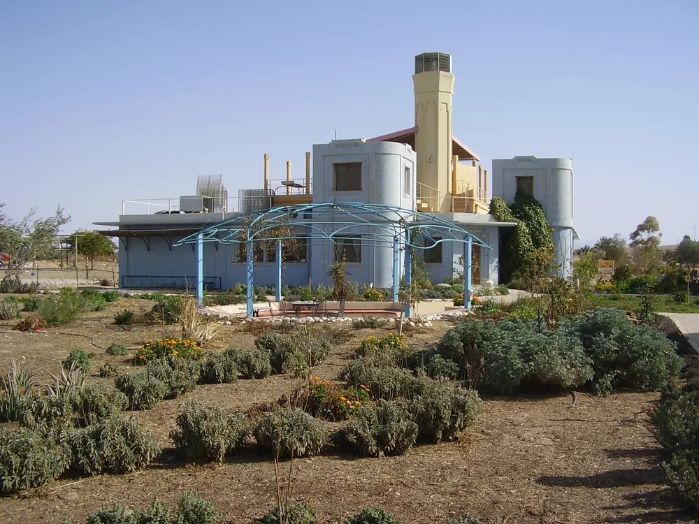

Обрабатывающая промышленность — это производства, которые превращают сырьё, материалы и комплектующие в другую продукцию. Результатом бывает товар для покупателя, полуфабрикат, деталь или собранный узел. Для классификации этих производств используют раздел C ОКВЭД 2. Ниже — основные отрасли и место изготовления деталей по чертежам в производственной цепочке.

## Что такое обрабатывающая промышленность

Обрабатывающая промышленность выпускает продукцию из сырья, материалов и комплектующих. Мельница превращает зерно в муку, металлургический завод выпускает прокат, механический цех изготавливает детали. Результат не обязательно поступает в магазин: его может купить другое предприятие для дальнейшей обработки или сборки. Поэтому в одной производственной цепочке встречаются разные отрасли, а продукция предыдущего этапа становится материалом следующего.

Для описания видов деятельности используют ОКВЭД 2. Его обозначение — ОК 029-2014 (КДЕС Ред. 2): именно так классификатор назван в документе по ссылке в разделе «Источники».

Раздел C называется «Обрабатывающие производства». Однако бытового смысла слова «обработка» недостаточно, чтобы выбрать вид деятельности. Важны содержание операции, результат и исключения в пояснениях классификатора.

Название предприятия само по себе этого не объясняет.

<!-- inline-cta -->

## Чем обработка отличается от добычи, энергетики и строительства

*Резка материала на производственной линии: станок обрабатывает плоскую заготовку. Фото: [Shixart1985](https://commons.wikimedia.org/wiki/File:Machine_working_in_a_factory_while_cutting_material_on_a_production_line_in_the_workshop.jpg) · [CC BY 2.0](https://creativecommons.org/licenses/by/2.0)*

Разницу удобнее рассматривать на производственной цепочке. Добывающая компания получает нефть из недр, нефтеперерабатывающий завод выпускает из неё топливо. Лесозаготовитель заготавливает древесину, деревообрабатывающее предприятие делает пиломатериалы. Кирпичный завод производит строительный материал, а строительная организация использует его при возведении здания. Материал связывает участников цепочки, но выполняемые работы и результаты у них различаются.

| Направление | Пример операции | Результат |
| --- | --- | --- |
| Добыча | Извлечение нефти из недр | Сырая нефть |
| Обрабатывающее производство | Переработка нефти | Бензин, дизельное топливо |
| Лесозаготовка | Заготовка древесины | Круглые лесоматериалы |
| Обрабатывающее производство | Распил древесины | Доска, брус |
| Обрабатывающее производство | Формование и обжиг кирпича | Строительный материал |
| Строительство | Возведение кирпичной стены | Часть здания |
| Энергетика | Выработка электроэнергии | Электроэнергия |

Сложности возникают на границах процессов. Например, подготовка добытого сырья и выпуск нового материала могут выглядеть похожими операциями. Для выбора кода требуется описание конкретной работы: одного слова «переработка» недостаточно.

## Какие отрасли входят: от пищевой промышленности до стройматериалов

К обрабатывающим производствам относятся пищевая, текстильная, деревообрабатывающая, химическая и другие отрасли. Они различаются сырьём, технологией и назначением продукции. Одни выпускают товары для повседневного использования, другие снабжают предприятия материалами. Например, бумагу покупают для печати и упаковки, а пластмассовые изделия могут стать как готовым товаром, так и частью оборудования.

В таблице приведены примеры производственных цепочек. Названия направлений здесь помогают понять их содержание и не заменяют формулировки классификатора.

| Направление | Исходный материал | Пример процесса | Продукция |
| --- | --- | --- | --- |
| Пищевая промышленность | Зерно | Помол | Мука |
| Производство напитков | Плоды | Получение и обработка сока | Сок |
| Табачное производство | Табачный лист | Подготовка табака и изготовление изделий | Сигареты |
| Текстильное производство | Пряжа | Ткачество | Ткань |
| Производство одежды | Ткань | Раскрой и пошив | Костюм |
| Кожевенное производство | Шкуры | Дубление и отделка | Кожа |
| Деревообработка | Брёвна | Распил и сушка | Пиломатериалы |
| Бумажное производство | Волокнистая масса | Формование и сушка | Бумага |
| Полиграфия | Бумага, краска | Печать и переплёт | Книга |
| Нефтепереработка | Нефть | Разделение и переработка компонентов | Топливо |
| Химическое производство | Химическое сырьё | Синтез и смешение | Химические продукты |
| Фармацевтическое производство | Фармацевтические субстанции, вспомогательные вещества | Приготовление лекарственной формы | Таблетки |
| Производство пластмассовых изделий | Полимерное сырьё | Литьё или экструзия | Корпус, труба |
| Производство минеральных изделий | Глина | Формование и обжиг | Кирпич |

Одинаковое сырьё не означает одинаковую отрасль. Деревообрабатывающее предприятие выпускает доску, мебельное — собирает из материалов шкаф. Между этими результатами могут стоять сушка, изготовление плит, раскрой и отделка.

Для заказчика важен нужный этап цепочки.

## Металлургия, машиностроение, электроника и другие производства

*Предприятие по переработке фруктов в израильском кибуце Неот-Семадар. Фото: [ד"ר אבישי טייכר](https://commons.wikimedia.org/wiki/File:PikiWiki_Israel_18692_Fruite_processing_factory_in_kibbutz_Neot_Semadar.JPG) · [CC BY 2.5](https://creativecommons.org/licenses/by/2.5)*

Металлургия выпускает металлы, сплавы и продукцию дальнейшего передела. Предприятия металлообработки делают из заготовок детали и металлические изделия. Машиностроительные заводы собирают оборудование, используя детали, приводы, приборы и другие комплектующие. Электроника и электротехника обеспечивают эту цепочку средствами управления, измерения и питания. При этом каждое предприятие может специализироваться на отдельном продукте или совмещать несколько производств.

| Направление | Что поступает в работу | Пример результата |
| --- | --- | --- |
| Металлургия | Металлосодержащее сырьё, лом, металлические полуфабрикаты | Металл, лист, пруток |
| Производство металлических изделий | Прокат и другие заготовки | Крепёж, корпус, каркас |
| Электроника и приборостроение | Электронные и оптические компоненты | Датчик, измерительный прибор |
| Электротехника | Проводники, изоляционные материалы, детали | Электродвигатель, кабель |
| Машиностроение | Детали и узлы | Станок, насос |
| Транспортное производство | Детали, кузова, двигатели, системы управления | Автомобиль, вагон, судно |
| Мебельное производство | Плиты, древесина, ткань, фурнитура | Шкаф, кресло |

Ремонт и изготовление изделия решают разные задачи. В первом случае восстанавливают работоспособность существующего оборудования, во втором — выпускают продукцию. При выборе вида деятельности для ремонта важны само изделие и содержание работ.

## Куда относится изготовление деталей по чертежам

Изготовление металлических деталей по чертежам — часть обрабатывающего производства. Заказчик задаёт геометрию, материал и требования к поверхностям, а исполнитель подбирает заготовку и маршрут обработки. Результатом может быть отдельная деталь, комплект деталей или собранный узел. Поэтому название «контрактная металлообработка» описывает формат работы с заказчиком, но не заменяет описание выполняемых операций.

Заготовкой служат прокат, поковка или отливка. Точение, фрезерование и шлифование позволяют получить заданные поверхности. Термообработка, нанесение покрытия и сборка добавляются, если они предусмотрены документацией и технологией.

У каждой операции своя задача.

Материал может закупать исполнитель или передавать заказчик. Для расчёта работы в обоих случаях нужны сведения о заготовке: марка, состояние поставки, размеры и требования к документам. При использовании конкретной марки полезны сведения о её обработке — например, [о свойствах стали 08Х18Н10](/blog/08h18n10-sostav-svoystva-obrabotka).

При выборе подрядчика по [изготовлению деталей по чертежам](/) важнее проверить оборудование, доступные операции и контроль размеров. Код деятельности не подтверждает, что цех сможет выдержать допуск на конкретной детали.

## Почему полуфабрикат тоже считается продукцией

Продукция предприятия не обязательно готова к использованию конечным покупателем. Прокат нужен для изготовления заготовок, заготовки — для обработки деталей, детали — для сборки узлов. На каждом этапе появляется результат, который можно передать следующему участнику производства. Его назначение в дальнейшей цепочке не отменяет того, что для изготовителя это выпущенная продукция.

Плавка, прокатка, резка и механическая обработка выполняют разные задачи. Плавкой получают металл или сплав, прокаткой придают ему форму. Резкой отделяют заготовку, а обработкой поверхностей получают геометрию детали.

Эти этапы может выполнять одна компания или несколько подрядчиков.

При сборке важны не только размеры отдельных деталей, но и их совместная работа. Например, для разнородных металлов учитывают условия контакта и среду эксплуатации. Этому посвящён материал о [совместимости металлов и гальванической коррозии](/blog/galvanicheskaya-korroziya-kakie-metally-nelzya-soedinyat).

## От чего зависит размещение предприятий

При выборе площадки предприятие учитывает поставки сырья, доступную энергию, транспорт, сотрудников и покупателей. Значение каждого фактора зависит от технологии. Для перевозки тяжёлых заготовок важны транспортные расходы и погрузка. Для сборки сложного оборудования — доступность специалистов и комплектующих. Контрактному механическому цеху также нужны поставщики инструмента, обслуживание станков и маршрут доставки готовых деталей.

Близость предприятий сама по себе не гарантирует удобную кооперацию. Заготовка может находиться рядом, но требовать дополнительной обработки у другого исполнителя. Поэтому маршрут заказа включает все операции, в том числе контроль и нанесение покрытия.

Карта заводов ещё не показывает путь конкретной детали.

Заказчику полезно знать, где закупают материал, какие работы передают подрядчикам и кто отвечает за итоговую приёмку. Так проще оценить зависимости внутри заказа.

## Как оценивают вклад отрасли в экономику

Вклад обрабатывающей промышленности описывают через добавленную стоимость, отгрузку, занятость и динамику производства. Эти показатели отвечают на разные вопросы. Добавленная стоимость характеризует результат производства за вычетом промежуточного потребления. Отгрузка отражает стоимость отгруженной продукции, занятость — участие работников, а индекс производства используют для оценки изменения объёма выпуска. Сравнивать показатели можно только с учётом их методики и периода.

Рост денежного показателя может быть связан с изменением цен. Поэтому по стоимости отгрузки нельзя отдельно судить о том, сколько изделий произвели.

Показатели дополняют друг друга.

Для сравнения отраслей также нужны одинаковые единицы, территория и период наблюдения. Годовой итог и данные за часть года отвечают на разные вопросы. Предварительную оценку следует отличать от уточнённых данных.

Для заказчика деталей отраслевая статистика даёт общий фон. Возможности конкретного исполнителя проверяют по загрузке, технологии и условиям заказа.

## Что помогает производству расти и что его ограничивает

Увеличение выпуска требует согласовать заказы, оборудование, персонал, материалы и контроль. Новый станок добавляет возможности, но для работы на нём нужны оснастка, программа, инструмент и наладка. Если заготовки задерживаются или следующая операция перегружена, отдельный участок не решит проблему всей цепочки. Поэтому при расширении производства рассматривают маршрут изделия целиком.

Учёт операций помогает увидеть, где заказ задерживается. Записи о простоях, браке и результатах измерений позволяют разбирать причины отклонений. При этом программа учёта сама не меняет технологию: решения принимают по собранным данным.

Выпуск ограничивает конкретное узкое место.

Для контрактного производства такими ограничениями могут стать загрузка оборудования, доступность материала, нехватка оснастки или ожидание контроля. При оценке заказа важно учитывать их вместе, а не ориентироваться только на наличие станка.

## Что эта классификация даёт заказчику деталей

Классификация помогает различать поставщика металла, механический цех и сборочное предприятие. Но возможность изготовить деталь определяют по техническим требованиям и производственному маршруту. Для расчёта нужны чертёж, сведения о материале, объём партии и условия приёмки. Эти данные позволяют обсудить операции, контроль и результат, который исполнитель должен передать заказчику.

Исходные данные удобно собрать в короткий перечень:

- Чертёж с размерами, допусками, шероховатостью и маркой материала.
- Требования к заготовке и состоянию материала.
- Количество деталей и график поставок.
- Требования к измерениям и подтверждению результатов контроля.
- Условия приёмки и комплект сопроводительных документов.

Код ОКВЭД не заменяет этот перечень.

Связь материала, геометрии и операций с расчётом разобрана на странице [«Из чего складывается цена металлообработки»](/ceny.html). Пришлите чертёж, марку материала и размер партии для расчёта изготовления.

## Частые вопросы

Обрабатывающее производство включает разные результаты: от материалов до собранных изделий. Для заказчика деталей основные вопросы связаны с границей между этими этапами. Важно понимать, что выпускает предприятие и какие операции оно берёт на себя. Ниже — ответы о составе отрасли, полуфабрикатах и выборе исполнителя по виду деятельности.

### Что такое обрабатывающая промышленность?

Это производства, которые превращают сырьё, материалы и комплектующие в другую продукцию. Результатом бывает готовое изделие, полуфабрикат, деталь или узел.

### Относится ли изготовление деталей по чертежам к обрабатывающей промышленности?

Да, изготовление металлических деталей входит в обрабатывающее производство. Для выбора конкретного вида деятельности учитывают операции и выпускаемую продукцию.

### Почему полуфабрикат считают продукцией?

Для предприятия, которое его изготовило, полуфабрикат — результат производства. Следующий участник цепочки использует его как материал или заготовку для своей продукции.

### Можно ли выбрать цех только по коду ОКВЭД?

Кода недостаточно. Для выбора исполнителя нужны сведения об оборудовании, операциях и контроле, а также проверка требований конкретного чертежа.

## Источники

В статье приведён документ с обозначением ОКВЭД 2 и сайты профильных ведомств. Главные страницы ведомств служат справочными адресами: они не подтверждают отдельные положения классификатора или определения статистических показателей. Для этих утверждений нужны конкретные документы и фрагменты, на которые можно сослаться при проверке.

- [ОК 029-2014 (КДЕС Ред. 2). Общероссийский классификатор видов экономической деятельности](https://www.consultant.ru/document/cons_doc_LAW_163320/) — текст документа размещён в «КонсультантПлюс». Приведённая цитата подтверждает обозначение классификатора.
- [Федеральная служба государственной статистики](https://rosstat.gov.ru/) — официальный сайт Росстата; ссылка на главную страницу не заменяет методику расчёта показателей.
- [Федеральное агентство по техническому регулированию и метрологии](https://www.rst.gov.ru/) — официальный сайт Росстандарта; ссылка на главную страницу не подтверждает состав разделов классификатора.
