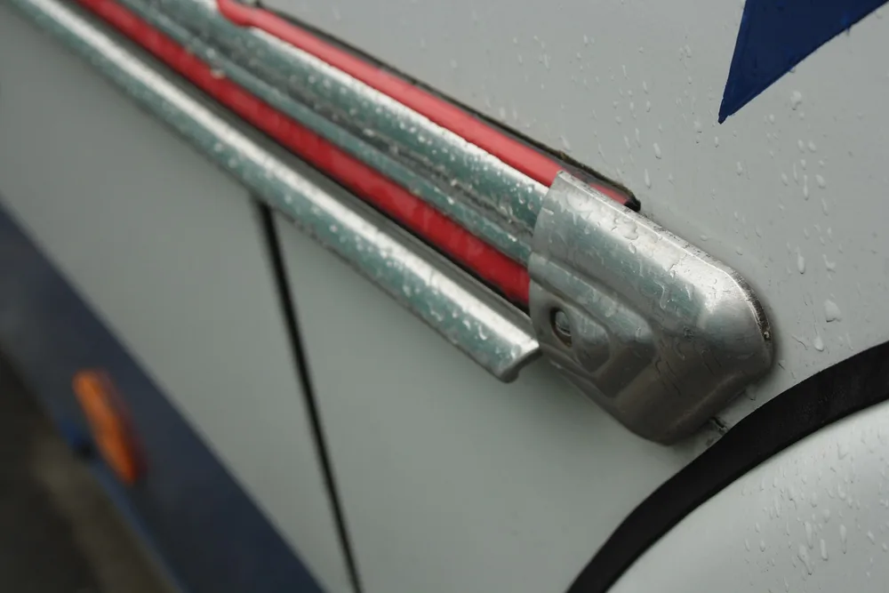

Алюминиевую полосу для детали выбирают по размерам, марке сплава, состоянию материала и способу изготовления заготовки. До покупки стоит связать эти характеристики с чертежом: определить припуски, требования к кромкам и предстоящие операции. Одного совпадения ширины и толщины для выбора недостаточно.

## Какую алюминиевую полосу выбрать под вашу деталь

Выбор полосы начните с чертежа готовой детали и маршрута обработки. Запишите назначение детали, материал, состояние поставки и операции: раскрой, гибку, фрезерование, сварку или покрытие. Затем подберите размеры заготовки с припусками. Так в заявке появится связь между требованиями к изделию и покупным материалом. Поставщику будет проще предложить заготовку, а технологу — проверить её пригодность до запуска.

Покупную полосу и готовую деталь описывайте отдельно. У заготовки укажите размеры поставки. У детали — размеры после обработки, допуски, требования к поверхности и покрытию.

Замену материала согласуйте до покупки.

В согласовании зафиксируйте, что именно меняется: марка, состояние, способ изготовления или размеры заготовки. Формулировка «аналог по наличию» оставляет слишком много неопределённости для расчёта.

<!-- inline-cta -->

## Прессованная полоса, раскроенный лист и шина: в чём разница

*Алюминиевая планка на чехословацком автобусе RTO LUX в военном музее Лешаны. Фото: [I would appreciate being notified if you use my work outside Wikimedia. More of…](https://commons.wikimedia.org/wiki/File:Le%C5%A1any,_vojensk%C3%A9_muzeum,_RTO_LUX,_li%C5%A1ta.JPG) · [CC BY 3.0](https://creativecommons.org/licenses/by/3.0)*

При заказе уточните, какую продукцию поставщик называет алюминиевой полосой: прессованный профиль, заготовку после раскроя листа или электротехническую шину. Не ограничивайтесь торговым названием и размерами из карточки. Попросите обозначение продукции, способ изготовления и документ, по которому её предлагают. Эти сведения нужны для выбора требований к заготовке и проверки её соответствия заказу.

| Вариант поставки | Что уточнить до заказа |
| --- | --- |
| Прессованная полоса | Обозначение профиля, марку, состояние, требования к размерам и поверхности |
| Полоса после раскроя листа | Исходный лист, способ резки, припуск и обработку кромок |
| Электротехническая шина | Назначение, материал, состояние и требования документа на шину |

Для полосы из листа отдельно согласуйте состояние кромок после раскроя. Если кромка входит в размер детали или остаётся видимой, укажите требования к ней в чертеже.

Название товара не заменяет описание заготовки.

При сравнении предложений проверьте, что поставщики предлагают один и тот же вид продукции. Если варианты различаются, передайте их технологу вместе с документами поставщиков.

## Толщина, ширина и длина: как читать размеры полосы

Размеры алюминиевой полосы записывайте с названиями: толщина, ширина и длина. Порядок чисел в карточке проверяйте по подписи поставщика. В заказе разделяйте номинальный размер и допустимое отклонение. Для каждого размера должно быть понятно, относится он к покупной заготовке или к готовой детали. Это особенно важно, когда часть поверхностей предстоит обработать, а часть останется в состоянии поставки.

Три числа без пояснения — неполная запись.

Припуски назначайте по маршруту обработки. Отдельно рассмотрите торцы, плоскости и продольные кромки. Если деталь получит покрытие, укажите, на каком этапе нужно контролировать её окончательные размеры.

Допуск заготовки не подменяет допуск детали.

Для проверки предложения удобно приложить эскиз с двумя контурами: заготовки и готового изделия. Отметьте поверхности под обработку. Размеры припусков внесите после согласования с технологом, а не по условному рисунку из каталога.

## Марка сплава и состояние поставки: что проверять вместе

Марку сплава и состояние поставки указывайте отдельными характеристиками. Не оставляйте поставщику выбор состояния по умолчанию, если деталь предстоит гнуть, сваривать или обрабатывать резанием. Попросите полное обозначение материала и документ с его расшифровкой. Затем сопоставьте предложенный вариант с чертежом и маршрутом. Если конструктор допускает замену, запишите её границы в заявке.

Краткое обозначение без расшифровки не стоит переносить из одного каталога в другой. В заказе нужна ссылка на конкретный документ, по которому поставщик обозначил материал.

Для партии запросите сведения о марке, состоянии и её идентификации. Проверьте, можно ли связать документ с маркировкой поставленной заготовки.

Замена должна быть понятна обеим сторонам.

Дополнительные вопросы для выбора материала разобраны в статье [о сравнении Д16Т, АМг6 и АД31 для изготовления деталей](/blog/alyuminievyj-splav-d16t-amg6-ad31-sravnenie).

## Как проверить массу полосы и сравнить предложения по цене

Расчётную массу прямоугольной полосы находят через объём и плотность: толщину умножают на ширину, длину и плотность материала. Перед вычислением согласуют единицы измерения. Для сравнения предложений используйте одинаковые исходные данные и указывайте, откуда взята плотность. Если поставщик приводит каталожную массу, запросите основу расчёта: размеры, материал и принятые допущения.

Такой расчёт описывает прямоугольную заготовку с заданными размерами. Фактическую массу партии определяют взвешиванием.

Расчёт и взвешивание отвечают на разные вопросы.

Цены сравнивайте за одинаковое количество пригодных заготовок. В одном предложении может быть только материал, в другом — материал с раскроем и доставкой. Разнесите эти позиции, чтобы увидеть стоимость заказа целиком.

Отдельно согласуйте учёт остатков и отходов раскроя. В предложении должна быть понятна единица оплаты: масса, длина или готовая заготовка.

## Что учесть при гибке, фрезеровании, сварке и анодировании

До покупки полосы проверьте весь маршрут детали вместе с исполнителем обработки. Для каждой операции сформулируйте, что нужно получить и как принять результат. Вместо общей записи «под гибку» укажите геометрию детали; вместо «под анодирование» — назначение покрытия и требования к внешнему виду. Неопределённые параметры согласуйте до закупки, чтобы не рассчитывать пригодность материала уже на станке.

| Операция | Что передать на согласование |
| --- | --- |
| Гибка | Марку, состояние, толщину, геометрию гиба и требования к поверхности |
| Фрезерование | Припуски, размеры, допуски и поверхности для закрепления |
| Сверление | Размеры и расположение отверстий, требования к их кромкам |
| Сварка | Материал соединяемых частей, конструкцию соединения и контроль результата |
| Анодирование | Назначение покрытия, внешний вид и размеры после покрытия |

Минимальный радиус гиба не назначайте по случайной таблице без привязки к материалу и условиям операции. Передайте этот параметр на проверку технологу.

Для сварной детали заранее согласуйте контроль после сварки. Для детали с покрытием определите, какие поверхности и размеры проверяют до нанесения слоя, а какие — после.

При заказе [фрезерной обработки по чертежу](/frezerovka.html) отметьте пазы, отверстия и чистовые поверхности. Это поможет связать выбор полосы с объёмом работ.

## Какие допуски и требования к кромкам указать

Требования к покупной полосе и готовой детали оформляйте раздельно. В заказе на заготовку укажите согласованные размеры, отклонения и требования к форме. В чертеже детали задайте результат после обработки. Если используете таблицу нормативного документа, зафиксируйте её номер, применимый диапазон и вид продукции. Без этой привязки числовой допуск нельзя уверенно использовать при приёмке заказа.

Не оставляйте запись «допуск по стандарту» без обозначения самого документа и применимых требований. Если исходных данных нет, согласуйте их до размещения заказа.

Кромки тоже требуют отдельной записи.

Укажите, где нужно удалить заусенец, выполнить фаску или скругление. Для фасок и радиусов задайте геометрию. Если требуется притупление, уточните допустимый результат, чтобы исполнитель и контролёр одинаково понимали запись.

Требования к видимой поверхности опишите отдельно от требований к размеру. При необходимости приложите согласованный образец или изображение с отмеченными недопустимыми следами.

## Что проверить при получении заготовки

При получении полосы начните с сопоставления заказа, маркировки и документов поставщика. Затем проверьте размеры, форму, кромки и поверхность по согласованному плану контроля. До раскроя нужно понять, относится ли документ к этой партии и соответствует ли заготовка условиям заказа. Результаты измерений сохраняйте вместе с идентификацией партии, чтобы при расхождении можно было установить, что именно проверяли.

Для входного контроля удобно использовать короткий перечень:

- Сопоставить вид продукции, марку, состояние и обозначение партии с заказом.
- Проверить размеры подходящим средством измерения.
- Проверить требования к форме, если они заданы.
- Осмотреть кромки и поверхности, которые останутся на детали.
- Зафиксировать обнаруженные расхождения и решение по партии.

Объём выборки согласуйте заранее.

При несоответствии запишите проверенный параметр, результат и средство измерения. До запуска спорной партии определите, кто принимает решение: поставщик, конструктор или ответственный за производство. Согласованное решение приложите к документам заказа.

## Что передать для расчёта детали из алюминиевой полосы

Для расчёта передайте чертёж с размерами и допусками, материал, состояние поставки и количество деталей. Если есть модель, проверьте её соответствие ревизии чертежа. Укажите, кто закупает заготовку и какие замены допустимы. Добавьте требования к кромкам, поверхности, покрытию и приёмке. По этим данным исполнитель сможет определить состав работ и подготовить предложение.

В комплект заявки включите:

- Чертёж и модель одной ревизии.
- Марку, состояние и условия согласования замены.
- Количество деталей и требования к заготовкам.
- Допуски, шероховатость и требования к кромкам.
- Покрытие и размеры, которые контролируют после него.
- Перечень проверок и документов при сдаче.

Если материал предоставляет заказчик, приложите документы на него до расчёта. Также обозначьте ограничения: можно ли менять длину заготовки, перекраивать её или использовать остатки.

Требования к точности стоит связать с назначением поверхности. Подробнее — в материале [о допусках и шероховатости без лишнего удорожания](/blog/dopuski-i-sherohovatost-bez-lishnego-udorozhaniya).

Передайте чертёж и требования к материалу через [заявку на расчёт детали](/kontakty.html).

## Частые вопросы

### Нужно ли указывать направление прессования при заказе гибки?

Если направление задано в чертеже или технологическом процессе, перенесите это требование в заявку. В остальных случаях необходимость такой привязки согласуйте с исполнителем гибки до покупки материала.

### Можно ли рихтовать полосу перед фрезерованием?

Не включайте рихтовку в маршрут без согласования с технологом. В задании укажите исходную форму заготовки, требования после рихтовки и последующую обработку.

### Как отметить в заявке, что полоса уже анодирована?

Прямо укажите наличие покрытия и приложите сведения о нём. Отметьте поверхности, на которых слой нужно сохранить, и допустима ли повторная обработка. Уточните, к какому состоянию детали относятся размеры: до покрытия или после него.

## Источники

Ниже приведены сайты организаций, указанные в исходном материале. Ссылки ведут на главные страницы и не подтверждают конкретные требования к полосе или обозначениям состояний.

- [Росстандарт](https://www.rst.gov.ru/) — сайт Федерального агентства по техническому регулированию и метрологии.
- [Российский институт стандартизации](https://www.gostinfo.ru/) — сайт организации.
- [The Aluminum Association](https://www.aluminum.org/) — сайт отраслевой ассоциации.
