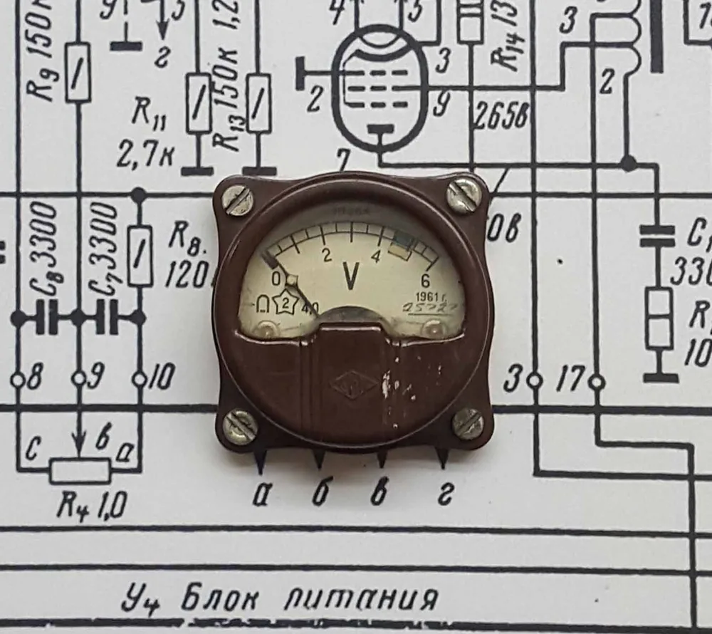
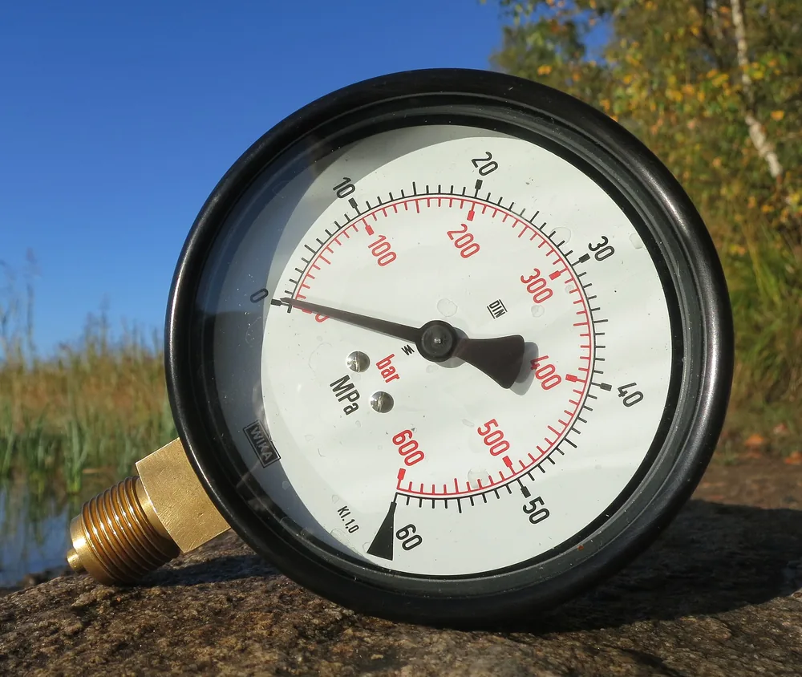

Приведённую погрешность рассчитывают как отношение абсолютной погрешности к нормирующему значению. Для результата в процентах это отношение умножают на 100. Главная задача — выбрать знаменатель: верхний предел шкалы и размах диапазона могут различаться. Ниже разобраны учебные примеры с явно заданным основанием расчёта.

## Формула приведённой погрешности: что делить и на что

Для расчёта приведённой погрешности используют формулу γ = Δ / XN × 100 %. Здесь Δ — абсолютная погрешность, а XN — нормирующее значение. В примерах абсолютную погрешность определяем как разность показания и опорного значения: Δ = xизм − xоп. Опорное значение задано условием задачи. Для реального прибора основание нормирования нужно установить по его документации.

Перед делением Δ и XN переводят в одну единицу.

Относительная погрешность имеет другой знаменатель: δ = Δ / xоп × 100 %. При нулевом опорном значении эта формула не определена. Поэтому два процента, рассчитанные для одного измерения, могут различаться.

| Величина | Формула | Результат |
| --- | --- | --- |
| Абсолютная погрешность | Δ = xизм − xоп | В единицах измеряемой величины |
| Относительная погрешность | δ = Δ / xоп × 100 % | В процентах от опорного значения |
| Приведённая погрешность | γ = Δ / XN × 100 % | В процентах от нормирующего значения |

Знак результата сохраняют: положительная разность означает, что показание выше опорного значения. Отрицательная — ниже. Запись ± в примерах обозначает симметричные границы допускаемой погрешности, а не знак рассчитанной разности.

<!-- inline-cta -->

## Как найти нормирующее значение в документации прибора

*Вольтметр М 364 для измерения напряжения в цепях постоянного и переменного тока. Фото: [ANDREY SHTANKO](https://commons.wikimedia.org/wiki/File:Analog_panel_%28switch%29_voltmeter_M_364.jpg) · [CC BY 4.0](https://creativecommons.org/licenses/by/4.0)*

Начните с формулы погрешности в паспорте, руководстве или описании типа прибора. Нужно установить, к чему относится процент: к показанию, верхнему пределу, размаху диапазона или другой указанной величине. Если основание не определено, однозначного расчёта не получится. Цена деления и число знаков дисплея сами по себе не объясняют, какой знаменатель нужен.

Размах диапазона — разность его границ. На учебных шкалах различие выглядит так:

| Диапазон | Верхний предел | Размах |
| --- | --- | --- |
| 0–1 МПа | 1 МПа | 1 МПа |
| −0,1…0,1 МПа | 0,1 МПа | 0,2 МПа |
| 0,2–1 МПа | 1 МПа | 0,8 МПа |

Совпадение в первой строке легко скрывает ошибку.

Для проверки основания расчёта удобно пройти четыре шага:

1. Найти формулу или полное описание погрешности.
2. Установить, к какой величине относится процент.
3. Выписать XN и его единицу.
4. Проверить, относится ли запись к выбранному диапазону и каналу.

По одной надписи «точность 99,5 %» нельзя установить знаменатель. Для расчёта нужна расшифровка этой записи. Число класса точности также не стоит автоматически подставлять вместо γ: сначала нужна формула, связывающая обозначение с пределом погрешности.

## Пошаговый расчёт на примере манометра

В учебной задаче манометр показывает 0,606 МПа при опорном значении 0,600 МПа. Нормирующее значение задано отдельно: XN = 1 МПа. Разность показания и опорного значения составляет +0,006 МПа. Деление этой разности на XN даёт приведённую погрешность +0,6 %. Деление на опорное значение даёт относительную погрешность +1 %. Результаты различаются из-за знаменателя.

Расчёт можно повторить по шагам:

1. Абсолютная погрешность: Δ = 0,606 − 0,600 = +0,006 МПа.
2. Приведённая погрешность: γ = 0,006 / 1 × 100 % = +0,6 %.
3. Относительная погрешность: δ = 0,006 / 0,600 × 100 % = +1 %.

Обратная подстановка возвращает исходную разность: 0,6 / 100 × 1 МПа = 0,006 МПа. Прибавляем её к 0,600 МПа и получаем показание 0,606 МПа.

Подставить показание 0,606 МПа в знаменатель — значит получить третье отношение. Оно не совпадает с относительной погрешностью, определённой выше через опорное значение.

Различие знаменателей подробнее разобрано в статье [об абсолютной и относительной погрешностях](/blog/absolyutnaya-i-otnositelnaya-pogreshnost).

## Почему у начала шкалы относительная погрешность растёт

*Манометр WIKA с диапазоном измерения от 0 до 600 бар, произведённый в Германии в 1990-х годах. Фото: [R. Henrik Nilsson](https://commons.wikimedia.org/wiki/File:1990s_WIKA_analog_pressure_gauge_0_to_600_bar_Alexander_Wiegand_Germany.jpg) · [CC BY 4.0](https://creativecommons.org/licenses/by/4.0)*

Рассмотрим учебную модель: нормирующее значение равно 100 В, а симметричный предел задан как ±0,5 % от него. Абсолютный предел тогда составляет ±0,5 В. Если выразить этот предел в долях разных ненулевых опорных значений, проценты будут различаться. При опорном значении 100 В получится ±0,5 %, а при 25 В — ±2 %.

| Опорное значение | Нормирующее значение | Абсолютный предел | Предел в процентах от опорного значения |
| --- | --- | --- | --- |
| 100 В | 100 В | ±0,5 В | ±0,5 % |
| 25 В | 100 В | ±0,5 В | ±2 % |

В материале SOJI Electronics приведён такой же пересчёт полной шкалы в абсолютный предел. Фрагмент источника: «the maximum possible error at all points on the scale is ±0.5% of 100 V or ±0.5 V». Ссылка на материал приведена в разделе «Источники».

Предел и фактическая погрешность — разные величины.

В этой модели постоянен заданный абсолютный предел. Это не означает, что прибор в каждой точке ошибается ровно на 0,5 В. При уменьшении опорного значения растёт отношение того же предела к этому значению; при нуле деление не определено.

## Как перейти от допустимого процента к абсолютному пределу

Обратный расчёт выполняют по формуле A = γдоп / 100 × XN. Здесь A — положительная величина симметричного абсолютного предела, а γдоп — числовое значение допускаемого процента. В учебном примере γдоп = 1,0 и XN = 1 МПа. Получаем A = 0,01 МПа, то есть границы от −0,01 до +0,01 МПа.

Для ранее рассчитанной разности +0,006 МПа модуль равен 0,006 МПа. Он меньше 0,01 МПа. Это арифметическое сравнение относится к заданной точке и принятой модели.

Одной точки недостаточно для вывода обо всём диапазоне.

Если исходная спецификация содержит процент показания и отдельное слагаемое, приведённая формула не описывает её целиком. Сначала нужно выписать полное выражение. В записи результата полезно сохранить XN, абсолютный предел и условия примера: без них процент допускает разные толкования.

## Что меняется у двусторонней шкалы и диапазона без нуля

Для учебного диапазона −0,1…0,1 МПа зададим XN равным размаху, то есть 0,2 МПа. При абсолютной погрешности +0,001 МПа расчёт даёт γ = 0,001 / 0,2 × 100 % = +0,5 %. Если вместо заданного XN подставить верхний предел 0,1 МПа, получится +1 %. Изменился знаменатель, поэтому изменился и результат.

Отрицательная нижняя граница в этой задаче не меняет знак XN. Размах равен 0,1 − (−0,1) = 0,2 МПа. Положительный знак погрешности следует из положительной разности показания и опорного значения.

Для диапазона 0,2–1 МПа размах составляет 0,8 МПа. Однако само вычисление размаха ещё не делает его нормирующим значением. Основание расчёта должно быть задано отдельно — как в условии учебной задачи или в документации прибора.

Форма шкалы помогает заметить неоднозначность, но не устраняет её.

## Как считать для датчика с выходом 4–20 мА

В учебном примере линейный преобразователь связывает давление 0–1 МПа с током 4–20 мА. Нижней границе давления соответствует 4 мА, верхней — 20 мА. Поэтому размах выходного сигнала равен 16 мА. Для тока 12 мА сначала вычитаем смещение 4 мА, затем делим остаток на размах. Полученная доля диапазона равна 0,5.

Формула примера: p = (I − 4 мА) / 16 мА × 1 МПа. При I = 12 мА получаем p = 0,5 МПа.

Теперь зададим ошибку измерения тока +0,08 мА. Для той же линейной зависимости ей соответствует ошибка давления:

Δp = 0,08 мА / 16 мА × 1 МПа = +0,005 МПа.

При отдельно заданном XN = 1 МПа приведённая погрешность равна +0,5 %. Деление на 20 мА вместо 16 мА дало бы +0,4 %, но такой знаменатель не соответствует размаху сигнала в этом примере.

Смещение и размах выполняют разные роли.

Эти числа описывают только заданное линейное преобразование. Для расчёта конкретного датчика понадобятся его границы диапазона, функция преобразования и полная спецификация погрешности.

## Какие условия и звенья измерения меняют результат

Формула приведённой погрешности пересчитывает уже заданную абсолютную погрешность в долю XN. Она не определяет автоматически вклад датчика, входного модуля, резистора или условий измерения. Для расчёта всей цепи сначала нужна её модель: какие величины измеряют, как преобразуют сигнал и какие исходные данные используют. Без этой модели один паспортный процент не даёт результата для всей цепи.

Например, в задаче с токовым выходом можно отдельно задать ошибку датчика и ошибку измерения тока. Сначала каждый вклад переводят в единицы давления. Простое сложение процентов с разными знаменателями не сохраняет смысл исходных величин.

Общий знаменатель ещё не задаёт способ объединения ошибок.

Пересчёт уровня в объём добавляет другую зависимость: нужна связь между уровнем и объёмом конкретного резервуара. Один и тот же прирост уровня не обязательно означает одинаковый прирост объёма по всей высоте. Для расчёта следует задать эту связь, а не переносить процент датчика уровня непосредственно на объём.

В протоколе полезно разделить исходные характеристики приборов, модель преобразования и итог расчёта. Тогда видно, какие данные учтены и где заканчивается вывод.

## Как использовать расчёт при контроле деталей по чертежу

Расчёт приведённой погрешности описывает отношение ошибки к выбранному нормирующему значению. Сам по себе он не отвечает, соответствует ли размер детали чертежу. Для такого решения нужно задать границы допуска, способ измерения и правило оценки результата у этих границ. Процент без XN нельзя напрямую сопоставить с допуском размера, выраженным в миллиметрах.

Отклонение размера от номинала и погрешность его измерения относятся к разным сравнениям. Первое сопоставляет размер с чертежом. Второе — результат измерения с опорным значением.

Перед согласованием контроля удобно сверить:

- Размер и границы допуска по чертежу.
- Метод измерения и рабочий диапазон.
- Основание нормирования и полную формулу погрешности.
- Условия измерения и состав измерительной цепи.
- Правило оценки результата у границы допуска.
- Единицы, знаки и обратную подстановку в расчёте.

Арифметическая проверка помогает найти ошибку в вычислениях. Подтверждение пригодности метода требует отдельного рассмотрения: [что означает валидация](/blog/chto-takoe-validaciya).

Чтобы согласовать контроль партии, [передайте чертёж и требования к измерениям](/kontakty.html).

## Частые вопросы

### Что делать, если в паспорте нет нормирующего значения?

Проверьте полную формулу погрешности в руководстве или описании типа. Если основание процента остаётся неизвестным, данных для однозначного расчёта недостаточно. Цена деления не заменяет отсутствующее основание.

### Как обозначить в протоколе два разных процента?

Подпишите каждый результат и его знаменатель. Для приведённой погрешности укажите XN, для относительной — использованное опорное значение. Рядом сохраните абсолютную разность и единицу измерения.

### Какие данные нужны для расчёта погрешности датчика с выходом 4–20 мА?

Нужны границы измеряемой величины, соответствующие им значения тока, функция преобразования и формула погрешности. Для расчёта всей цепи понадобятся также характеристики устройств, через которые считывают сигнал.

## Источники

- [Understanding Accuracy Specifications for LIGO Fuel Level Sensors — Percentage of Full Scale](https://sojielectronics.com/understanding-accuracy-specifications-for-ligo-fuel-level-sensors-percentage-of-full-scale/) — материал SOJI Electronics. Приведённый выше фрагмент подтверждает пересчёт ±0,5 % шкалы 100 В в абсолютный предел ±0,5 В.
