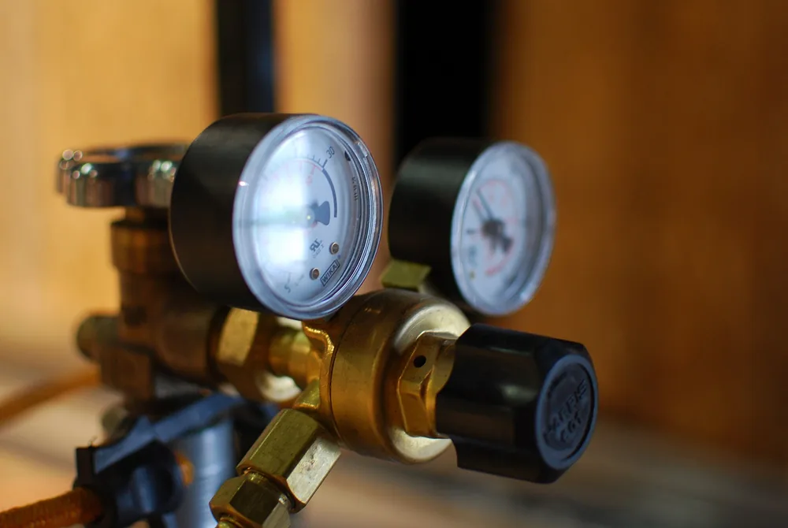

Аргоновый редуктор выбирают по рабочему газу, допустимому входному давлению, соединениям и способу контроля расхода. Совпадения резьбы недостаточно: нужно проверить уплотнение и требования сварочного оборудования. Ниже — устройство редуктора и параметры, которые стоит сопоставить перед покупкой.

## Какой аргоновый редуктор нужен для вашей задачи

Для выбора аргонового редуктора сначала определяют условия работы поста: какой газ поступает из баллона, какие соединения используются и куда идут выходные линии. Затем сопоставляют характеристики редуктора с требованиями оборудования. Такой порядок помогает обнаружить несовместимость до покупки. Внешний вид корпуса и количество приборов на нём не заменяют эту проверку.

Основные данные для сравнения — рабочий газ, допустимые давления, диапазон расхода и присоединения. Их ищут в документации выбранной модели. Если продавец прислал паспорт похожего изделия, характеристики ещё не подтверждены.

Название исполнения тоже не даёт полной картины. «Двухступенчатый», «с ротаметром» и «с двумя выходами» описывают разные свойства. Одно не следует из другого.

Начните с газовой линии целиком.

Если горелке и поддуву нужны отдельные настройки, это условие включают в требования к комплекту. Затем проверяют, как устроена регулировка каждой линии и подходят ли её пределы для выбранной технологии.

<!-- inline-cta -->

## Как редуктор снижает и поддерживает давление

*Газовый редуктор для сварочного оборудования. Фото: [Kevin Gessner](https://commons.wikimedia.org/wiki/File:Gauges_and_Valves_-_Welding_gas_regulator_%284093821184%29.jpg) · [CC BY 2.0](https://creativecommons.org/licenses/by/2.0)*

Редуктор снижает давление газа из баллона до уровня, с которым работает оборудование после него. В мембранной конструкции положение регулирующего клапана зависит от усилия пружины и давления в выходной камере. При изменении расхода механизм меняет открытие клапана. Возможности такого регулирования ограничены характеристиками изделия: редуктор не поддерживает заданный режим при любых входных условиях.

Регулировочная рукоятка меняет поджатие пружины. Через мембрану это влияет на работу клапана и настройку выходного давления. Подробная схема зависит от конструкции модели.

Давление и расход связаны, но это разные величины.

Для настройки расхода в комплекте может быть отдельный вентиль или другой регулирующий узел. Поэтому по одной рукоятке нельзя определить, что именно меняет пользователь. Это должно быть понятно из схемы и обозначений изготовителя.

Наличие фильтра, предохранительного клапана и других элементов также проверяют по документации. Переносить устройство одного редуктора на внешне похожую модель нельзя.

## Что показывают манометр и ротаметр

Манометр показывает давление, а ротаметр — расход газа. Входной манометр помогает следить за давлением со стороны баллона, выходной — после редуцирования. Ротаметр позволяет наблюдать поток в своей линии. Эти показания отвечают на разные вопросы: наличие давления само по себе ещё не означает, что через горелку проходит нужное количество аргона.

По одному показанию входного манометра нельзя точно определить, на сколько хватит газа. Для такой оценки нужны дополнительные данные, в том числе объём баллона, температура и расход.

У ротаметра поток перемещает поплавок внутри измерительной трубки. Какую часть поплавка совмещать с делением и в каком положении устанавливать прибор, должно объяснять руководство.

Шкалу читают по правилам конкретного прибора.

На некоторых редукторах расходные деления нанесены на прибор, который измеряет давление. Это косвенная оценка расхода, связанная с условиями калибровки и устройством газового тракта. Считать такую шкалу универсальным расходомером нельзя.

Перед сравнением показаний нужно установить, для какого газа и каких условий предназначена каждая шкала. Без этих сведений одинаковые деления ещё не означают одинаковый поток.

## Одноступенчатый или двухступенчатый: что сравнивать

Число ступеней показывает, сколько последовательных этапов снижения давления предусмотрено в редукторе. Оно не определяет ни количество выходов, ни способ измерения расхода. При выборе стоит отдельно сравнить ступени редуцирования, приборы контроля и регулировку линий. Затем проверить характеристики конкретных моделей: одного названия конструкции недостаточно, чтобы оценить её работу на посту.

В одноступенчатой конструкции давление снижается за один этап. В двухступенчатой газ сначала поступает на промежуточную ступень, затем — на выходную. Для сравнения нужны данные об изменении выходного давления при изменении входного давления и расхода.

| Признак | Что сравнивать | Зачем это нужно |
| --- | --- | --- |
| Ступени редуцирования | Конструкцию и характеристики регулирования | Оценить работу при изменении входных условий |
| Контроль расхода | Ротаметр или косвенную расходную шкалу | Понять, как получать и читать показание |
| Выходные линии | Количество выходов и способ их регулировки | Подобрать комплект для горелки и поддува |
| Комплектацию | Соединения, приборы и регулирующие узлы | Сравнить предложения на одинаковых условиях |

Два выхода не означают две независимые настройки. Это отдельный пункт проверки.

## Как проверить совместимость с баллоном и газовой линией

Совместимость проверяют по газу, давлению, входному соединению и выходному тракту. Совпавшая резьба подтверждает лишь часть соединения: остаются уплотнение, сопрягаемые поверхности и допустимые условия работы. Для сопоставления нужны сведения о вентиле баллона, редукторе, шланге и сварочном оборудовании. Если обозначения расходятся или отсутствуют, совместимость пока не установлена.

Для проверки удобно пройти по всей линии:

1. Сопоставить газ в баллоне с перечнем газов, разрешённых для редуктора.
2. Проверить допустимое входное давление и условия подачи газа.
3. Сверить обозначение резьбы, сопрягаемые поверхности и тип уплотнения.
4. Проверить выходной штуцер, шланг и вход аппарата.
5. Уточнить допустимость переходников, если без них соединение не собирается.

Переходник сам по себе совместимость не доказывает.

Материал корпуса тоже определяют по сведениям изготовителя. Цвет покрытия и сходство с другим редуктором для этого не подходят. Аналогично нельзя переносить допуск на аргон на любую газовую смесь: состав смеси проверяют отдельно.

## Как подобрать диапазон расхода для горелки и поддува

Диапазон расхода выбирают под условия сварки: горелку, сопло, газовую линзу, соединение и требования к защите шва. Исходные настройки берут из технологической документации и руководств оборудования. После этого подбирают прибор, на котором нужное значение можно установить и прочитать. Универсального расхода для всех деталей из одного материала здесь нет.

Сам по себе широкий диапазон не делает прибор удобнее. Важно, насколько различимы деления около рабочей настройки и подходит ли прибор по остальным характеристикам.

Увеличение подачи не гарантирует защиту шва. При оценке результата учитывают состояние газового тракта, сопла, горелки и движение воздуха возле зоны сварки.

Поддув рассматривают отдельно.

Если технология предусматривает защиту корня шва, для неё определяют свой режим подачи. В схеме с общей подачей нужно выяснить, можно ли настраивать потоки независимо и как изменение одной линии влияет на другую.

Выбор источника сварочного тока — отдельная задача. Устройство поста подробнее разобрано в материалах о том, [как выбрать аппарат аргонодуговой сварки](/blog/kupit-apparat-argonodugovoy-svarki) и [чем TIG-сварка отличается от полуавтоматической](/blog/argonodugovaya-svarka-tig-i-poluavtomat).

## Как проверить подключение и настроить подачу

Порядок подключения зависит от конструкции редуктора, вентиля баллона и сварочного аппарата. До начала работы нужно установить, какие уплотнения используются, как выставляются регулировки и каким способом проверяется герметичность. Без руководства выбранной модели нельзя составить безопасную пошаговую инструкцию. Поэтому этот раздел описывает вопросы для проверки, а не последовательность действий с газовым оборудованием.

В документации должны быть понятны следующие пункты:

- требования к креплению баллона и установке редуктора;
- состояние соединений и перечень допустимых уплотнений;
- исходные положения регулировок;
- порядок подачи газа и проверки герметичности;
- режим аппарата для настройки расхода;
- порядок прекращения подачи и снятия оборудования.

Если один из этих пунктов неясен, сведений для подключения недостаточно.

Проверка расхода должна учитывать состояние газового тракта во время измерения. Закрытый клапан аппарата и открытая подача к горелке — разные условия. Сопоставлять показания имеет смысл только после уточнения того, как изготовитель предписывает выполнять настройку.

## Почему расход меняется и когда работу нужно остановить

Изменение показаний не указывает на одну причину. Проверять приходится подачу из баллона, соединения, шланг, клапан аппарата и сам измерительный прибор. Сначала важно определить, что именно меняется: входное давление, выходное давление или показание расхода. Без этого можно заменить исправный редуктор и оставить причину нестабильности в другом участке линии.

Для поиска причины полезно записать условия появления отклонения: при открытии подачи, во время сварки или после её прекращения. Затем эти наблюдения сопоставляют с разделом неисправностей в руководстве оборудования.

Пористость шва тоже не доказывает поломку редуктора. Помимо подачи газа, проверяют подготовку соединения, состояние горелки и условия защиты сварочной зоны.

Один симптом — ещё не диагноз.

При обнаружении утечки или повреждения работа с оборудованием прекращается. Дальнейшие действия требуют порядка безопасного отключения из руководства. Разборка редуктора и вмешательство в его внутренние узлы не входят в обычную проверку расхода на посту.

## Какие документы и комплектацию проверить перед покупкой

Перед покупкой нужно получить документы именно на выбранную модель и сопоставить их с маркировкой изделия. В них ищут рабочий газ, допустимые давления, расход, соединения, состав поставки и условия обслуживания. Если характеристика есть только в карточке продавца, а в документации её нет, использовать её как подтверждённый параметр для выбора нельзя.

Особенно внимательно стоит разобрать формулировку «с поверкой». Нужно установить, к какому измерительному прибору она относится и какими документами подтверждается. Такое обещание не заменяет проверку совместимости всего комплекта.

Запись о приборе и паспорт редуктора решают разные задачи.

Для закупки можно собрать короткий перечень:

- модель и изготовитель;
- паспорт или руководство на выбранное исполнение;
- характеристики газа, давления и расхода;
- обозначения соединений и уплотнений;
- состав поставки;
- документы на измерительные приборы;
- условия обслуживания и поставки запасных частей.

Цены сравнивают после сверки комплектации. Разница в стоимости может относиться к другим приборам, соединениям или набору выходных линий.

Если нужна готовая деталь или сварной узел, на странице [изготовления деталей по чертежам](/) можно передать задачу на расчёт. Пришлите чертёж, материал и требования к сварным соединениям.

## Частые вопросы

### Можно ли оставлять редуктор на баллоне между сменами?

В статье нет подтверждённого разрешения для такого режима хранения. Решение требует руководства конкретного оборудования и установленного на участке порядка безопасного отключения.

### Что делать, если расход виден только на экране аппарата?

Сначала нужно выяснить, что означает показание экрана: измеренный расход, заданное значение или другой параметр. Это должно быть описано в руководстве аппарата. Затем проверяют требования к подаче газа на его вход.

### Кто должен проверить совместимость редуктора с баллоном перед работой?

Ответственного определяет порядок работы участка. В проверку включают газ, давление, соединения и уплотнения. Без сведений об организации работ назвать конкретную должность нельзя.

## Источники

В исходном материале приведены только главные страницы официальных ресурсов. Они не подтверждают изложенные рекомендации по подключению и настройке. Для завершения проверки нужны ссылки на конкретные руководства изготовителей с указанием разделов, которые подтверждают технические утверждения.

- [ФГИС «Аршин»](https://fgis.gost.ru/) — ресурс для проверки сведений о средствах измерений; конкретные записи на приборы в статье не приведены.
- [Росстандарт](https://www.rst.gov.ru/) — официальный ресурс; конкретные документы, подтверждающие рекомендации статьи, не представлены.
