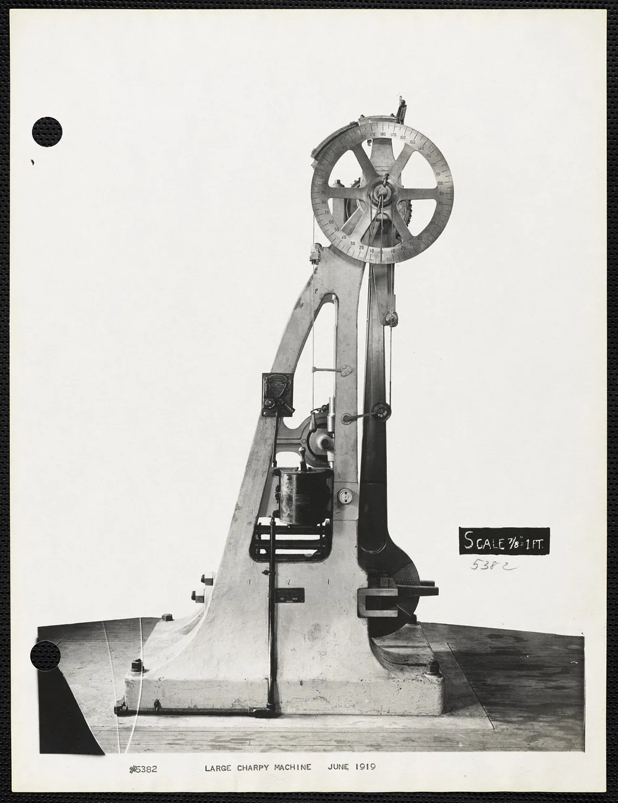
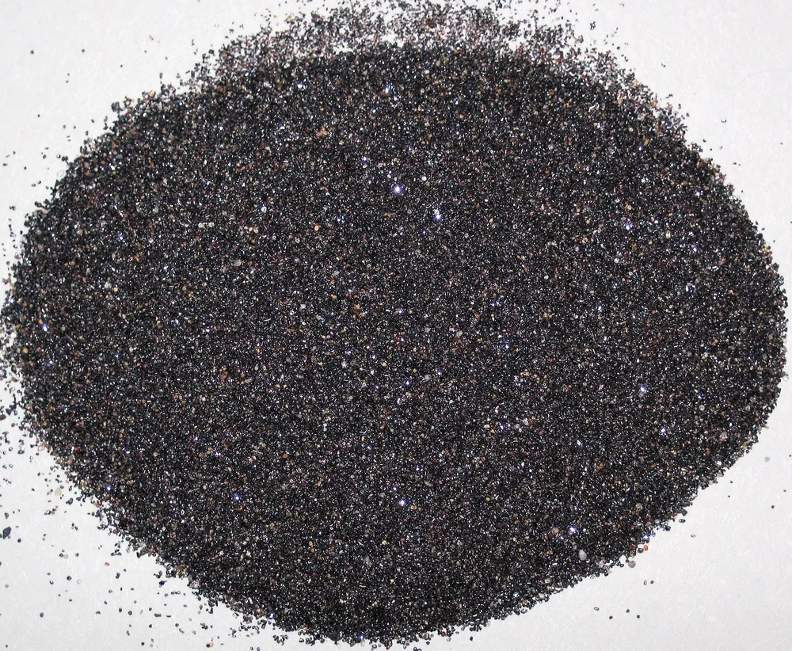

Самый прочный металл нельзя выбрать без условий сравнения: сопротивление растяжению, вмятинам и удару — разные свойства. Для детали по чертежу сначала определяют нагрузки, температуру и ограничения по массе. Затем сравнивают конкретные марки и состояние материала. Название металла само по себе не показывает, выдержит ли деталь работу.

## Какой металл самый прочный: сначала определите нагрузку

Ответ зависит от того, что должна выдержать деталь. Для тяги важна работа при растяжении, для кронштейна — ещё и прогиб, для ударного инструмента — поведение при ударе. Поэтому сравнение начинают с условий эксплуатации. После этого выбирают показатели материала и проверяют геометрию детали. Рейтинг металлов без этих условий не даёт основания назначить марку.

Одинаковое название материала тоже не гарантирует одинаковых свойств. В сравнении нужны марка, вид заготовки, состояние поставки и условия испытания. Значение для проволоки нельзя автоматически переносить на массивную заготовку.

Сначала — задача детали, затем — материал.

<!-- inline-cta -->

## Какие характеристики сравнивают: прочность, твердость и вязкость

*Большая испытательная машина Шарпи в арсенале Уотертауна, июнь 1919 года. Фото: [Watertown Arsenal (United States Army)](https://commons.wikimedia.org/wiki/File:Large_Charpy_machine,_Watertown_Arsenal,_June_1919,_from_the_Digital_Commonwealth_-_commonwealth_df65wd85w.jpg) · [Public domain](https://creativecommons.org/publicdomain/mark/1.0/)*

Прочность, твёрдость и ударная вязкость описывают разные стороны поведения материала. При растяжении оценивают сопротивление деформации и разрушению, при измерении твёрдости — сопротивление местному вдавливанию. Испытание на удар даёт отдельную характеристику. Для выбора марки эти результаты рассматривают вместе с методом испытания, состоянием образца и температурой, при которой получены данные.

Временное сопротивление при растяжении обозначают Rm. Оно связано с наибольшей силой в испытании и начальной площадью поперечного сечения образца. Предел текучести используют при оценке риска остаточной деформации. Эти показатели нельзя подменять друг другом.

Твёрдость указывают вместе со шкалой и методом измерения. Число без обозначения метода неполно: результат по Роквеллу нельзя читать как результат по Бринеллю.

Удельная прочность связывает прочностной показатель с плотностью. Она помогает сравнивать материалы при ограничении массы, но не заменяет проверку прогиба и устойчивости детали.

| Вопрос о детали | Что проверяют |
| --- | --- |
| Сохранится ли форма после снятия нагрузки? | Напряжения и предел текучести |
| Когда возможно разрушение при растяжении? | Характеристики растяжения и расчётную схему |
| Как поверхность сопротивляется вдавливанию? | Твёрдость по выбранному методу |
| Как материал ведёт себя при ударе? | Результаты ударных испытаний при нужной температуре |
| Можно ли уменьшить массу? | Удельные характеристики и геометрию конструкции |

## Вольфрам, титан и хром: почему рейтинги дают разные ответы

Вольфрам, титан и хром нельзя сравнивать по одному числу без описания образцов. Для каждого значения нужны источник, форма материала, состояние и условия испытания. Отдельно проверяют, относится ли результат к чистому металлу, сплаву или покрытию. Иначе в одной строке рейтинга оказываются данные о разных объектах, а вывод выглядит точнее, чем позволяют исходные сведения.

Твёрдость покрытия не описывает прочность всей детали. Аналогично результат испытания тонкой проволоки не служит готовой характеристикой прутка или плиты.

Подпись «титан» тоже недостаточна. В сравнении нужно различать технически чистый металл и конкретный титановый сплав. Для стали действует тот же принцип: название группы не заменяет марку.

Температура плавления не отвечает на вопрос о допустимой нагрузке.

## Стали и титановые сплавы: сравнение конкретных марок

*Рутиловый концентрат из современных прибрежных песков Квинсленда, Австралия. Содержание рутила — около 98%. Фото: [James St. John](https://commons.wikimedia.org/wiki/File:Rutile-rich_sand_%28titanium_ore_concentrate%29_%28Holocene;_Tin_Can_Bay,_Queensland,_Australia%29.jpg) · [CC BY 2.0](https://creativecommons.org/licenses/by/2.0)*

Сталь 45, сталь 40Х и сплав ВТ6 имеет смысл сопоставлять после уточнения заготовки и её состояния. До этого таблица прочности создаёт ложную определённость. Для каждой марки нужны документ на материал, размеры полуфабриката, термообработка и условия испытания. Также важно различать гарантируемое минимальное значение и фактический результат испытания конкретного образца.

Ниже — состав данных для сравнения, а не рейтинг марок. Численных характеристик без подтверждающих документов здесь нет.

| Материал | Что определить перед сравнением | Какие данные собрать |
| --- | --- | --- |
| Сталь 45 | Вид и размер заготовки, состояние поставки | Показатели растяжения, пластичность, твёрдость |
| Сталь 40Х | Состояние заготовки и назначенную термообработку | Свойства после указанной обработки |
| ВТ6 | Вид полуфабриката и состояние материала | Прочностные показатели, пластичность, плотность |
| Другая сталь по чертежу | Точную марку и требования к поставке | Показатели, по которым принимают материал |
| Технически чистый титан | Марку и вид полуфабриката | Свойства именно этой марки и формы поставки |
| Вольфрам | Состав, способ получения и форму заготовки | Данные для соответствующего состояния материала |

В каждой числовой колонке должны совпадать смысл показателя и единицы измерения. Если данных нет, сравнение остаётся незавершённым.

## Почему прочная деталь может гнуться или разрушаться от повторных нагрузок

Сопротивление разрушению, упругий прогиб и долговечность при повторных нагрузках требуют отдельных проверок. Деталь может сохранять прочность, но прогибаться больше допустимого для узла. При циклической работе важны также местные напряжения и состояние поверхности. Поэтому повышение прочностного показателя материала само по себе не закрывает все требования к конструкции и её ресурсу.

Упругий прогиб зависит от нагрузки, модуля упругости, геометрии и закрепления. Для его уменьшения рассматривают сечение, длину свободного участка и расположение опор.

Смена марки может не решить проблему прогиба.

При повторных нагрузках отдельно учитывают отверстия, резьбу, переходы сечений и следы обработки. Одно значение Rm не позволяет назначить число циклов до появления трещины. Для этого нужны исходные данные и расчёт на усталость.

## Как связать предел текучести с нагрузкой: условный расчет

Для стержня при центральном растяжении среднее напряжение определяют как силу, делённую на площадь поперечного сечения: σ = F / A. Это упрощённая расчётная схема. Она не описывает автоматически изгиб, удар или местные напряжения возле отверстий. Ниже приведён арифметический пример с заданными числами, а не характеристика марки или рекомендация для изготовления.

Пусть в учебной задаче заданы:

| Величина | Условное значение |
| --- | --- |
| Предел текучести σт | 600 Н/мм² |
| Площадь сечения A | 100 мм² |
| Коэффициент запаса n | 2 |

Для принятой схемы силу вычисляют по выражению:

**F = σт × A / n = 600 × 100 / 2 = 30 000 Н.**

Числа выбраны только для примера. Коэффициент запаса здесь не установлен стандартом, а принят как условие задачи.

Реальная деталь требует проверки расчётной схемы, нагрузок, соединений и критериев отказа. Полученную силу нельзя переносить на другой узел по сходству размеров.

## Что меняют температура, среда и состав материала

Данные испытания описывают материал в определённых условиях. Для детали, которая работает при нагреве, на морозе или в контакте с реагентом, нужны сведения для соответствующей эксплуатации. В запросе на подбор материала поэтому фиксируют температуру, продолжительность нагрузки и состав среды. Без них сравнение комнатных характеристик может оказаться недостаточным для решения задачи.

Точку плавления нельзя использовать как допустимую рабочую температуру. При длительном нагружении отдельно рассматривают ползучесть, а при контакте со средой — коррозию и другие изменения материала.

Стойкость к среде тоже не универсальна.

При сравнении важно сохранить границы темы. Покрытие, карбидный материал и металлический сплав требуют разных исходных данных. Их можно рассматривать как варианты решения задачи, но общий рейтинг «металлов» скроет различия конструкции и технологии.

## Как свойства материала влияют на обработку и стоимость детали

Стоимость детали зависит от всей последовательности изготовления: закупки заготовки, подготовки, обработки, контроля и возможных повторных операций. По одному показателю прочности цену не определить. Для сравнения вариантов нужен согласованный маршрут и одинаковые требования к готовому изделию. Иначе разница в предложениях может относиться к разному объёму работ, а не к цене материала.

Состояние заготовки учитывают при выборе инструмента и режимов резания. Термообработку согласуют с механической обработкой: после неё могут понадобиться исправление геометрии, финишные операции и повторный контроль.

| Часть стоимости | Что сопоставить |
| --- | --- |
| Заготовка | Марку, форму поставки, размеры и отход |
| Подготовка | Программу, инструмент и оснастку |
| Обработка | Операции, установы и требования к поверхности |
| Термообработка | Требуемое состояние и последующие операции |
| Контроль | Геометрию, свойства материала и состав документов |

Порядок сопоставления предложений разобран в статье [о сравнении коммерческих предложений на металлообработку](/blog/kak-sravnivat-kommercheskie-predlozheniya-na-metalloobrabotku). Пример технологической услуги — [фрезерные работы по металлу](/frezerovka.html).

## Что выбрать для тяги, легкого узла и детали с ударной нагрузкой

Для разных деталей меняется порядок проверок. У статически растянутой тяги сначала рассматривают напряжения и риск остаточной деформации. У лёгкого узла к ним добавляют массу и прогиб. Для ударной нагрузки нужны данные о поведении материала при ударе. Каждая задача приводит к своему набору требований, после чего можно сравнивать марки.

Готового победителя среди сталей, титана и вольфрама из такого перечня не получается. Выбор зависит от расчёта и доступной формы материала.

| Задача | Основная проверка | Что учитывать дополнительно |
| --- | --- | --- |
| Тяга на растяжение | Напряжения и предел текучести | Соединения и местные ослабления сечения |
| Лёгкий узел | Массу, прочность и жёсткость | Прогиб и устойчивость |
| Деталь под ударом | Прочность и поведение при ударе | Температуру и геометрию |
| Деталь при нагреве | Свойства при рабочей температуре | Длительность нагрузки и среду |

При ограничении массы в сравнение могут входить и алюминиевые сплавы. Их рассмотрению посвящена статья [о свойствах алюминия и выборе материала для детали](/blog/alyuminiy-eto-metall-i-ego-svoystva).

## Что указать в запросе на изготовление детали

Для оценки изготовления нужны чертёж с обозначением версии, количество деталей и требования к материалу. Если марка ещё не назначена, это важно указать отдельно. К запросу полезно приложить описание нагрузок, рабочей температуры, среды и ограничений по массе. Такой набор исходных данных позволяет определить, какие вопросы относятся к изготовлению, а какие требуют конструкторской проработки.

Для сверки запроса подходит следующий перечень:

- Чертёж, его обозначение и версия.
- Количество деталей в партии.
- Марка материала, вид заготовки и состояние поставки, если они назначены.
- Требования к термообработке и покрытию.
- Контролируемые размеры, свойства и документы.
- Условия эксплуатации, если требуется рассмотреть выбор или замену материала.

Подбор замены и расчёт ресурса стоит оговорить как отдельные задачи. Возможность замены оценивают по требованиям чертежа и условиям работы.

Передайте чертёж и требования через страницу [изготовления деталей по чертежам](/), чтобы согласовать состав работ и получить расчёт стоимости.

## Частые вопросы

Перед сравнением материалов полезно отделить требования к поставке от результатов конкретного испытания. Те же различия важны при замене марки и изменении термообработки: похожее название или более высокое число в сертификате ещё не означают пригодность для детали. Ниже — ответы на вопросы, которые возникают при чтении документов и обсуждении заказа.

### Как читать сертификат, если рядом стоят норма «не менее» и фактический результат испытания?

Это разные сведения. Норма задаёт требование, а фактический результат описывает испытанный образец. Их не усредняют. Значение для расчёта выбирают по принятой методике и требованиям к материалу.

### Что делать, если чертёж указывает зарубежную марку, а поставщик предлагает российский аналог?

Сходства названий недостаточно. Для рассмотрения замены нужны состав, состояние поставки, свойства и требования к контролю. Решение следует согласовать с ответственным за конструкцию.

### Стоит ли повышать твёрдость сверх чертежа, чтобы деталь стала прочнее?

Самовольно менять заданную твёрдость не стоит. Такое изменение требует проверки остальных свойств и технологии изготовления. Более высокая твёрдость сама по себе не доказывает, что деталь лучше перенесёт рабочую нагрузку.

## Источники

В исходных материалах приведены брошюра СИ и сайты организаций по стандартизации. Брошюра относится к обозначениям единиц; главные страницы организаций не подтверждают характеристики марок или определения методов испытаний. Для завершения фактчека нужны конкретные документы и фрагменты, на которых основаны технические утверждения статьи. До их добавления материал остаётся черновиком.

- [The International System of Units (SI Brochure)](https://www.bipm.org/en/publications/si-brochure) — публикация Международного бюро мер и весов о системе СИ.
- [International Organization for Standardization](https://www.iso.org/) — сайт ISO; ссылка не ведёт на конкретный стандарт испытаний.
- [Федеральное агентство по техническому регулированию и метрологии](https://www.rst.gov.ru/) — сайт Росстандарта; ссылка не подтверждает свойства перечисленных материалов.
