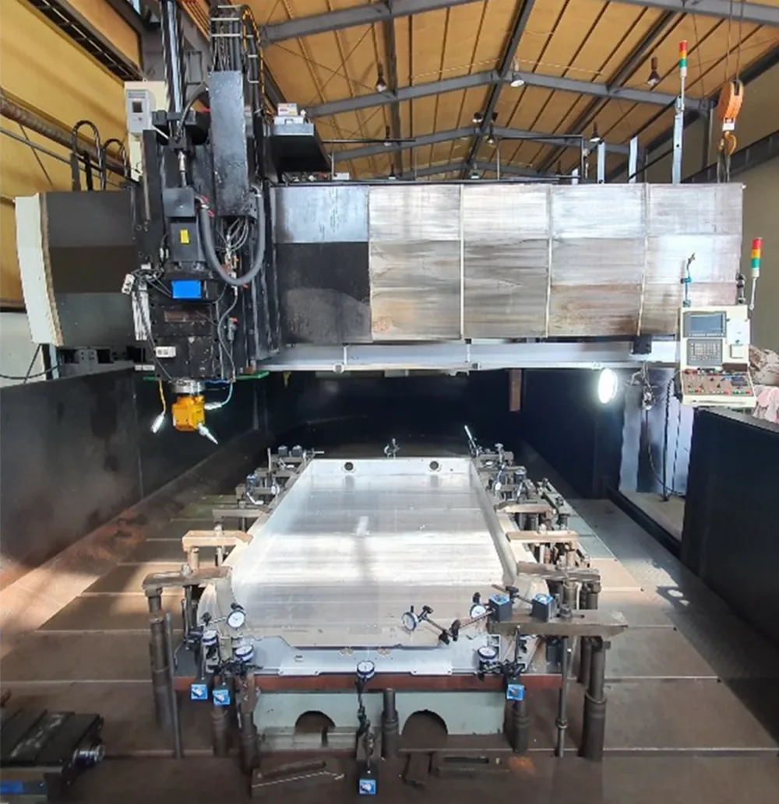
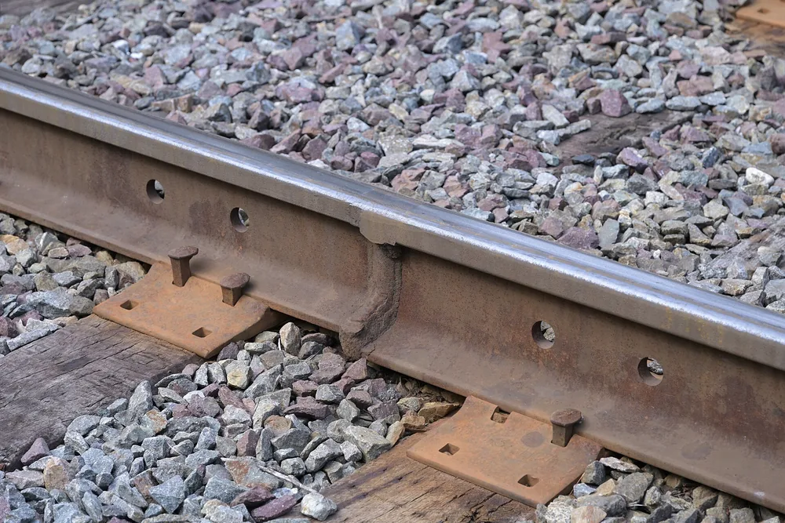

Сварные конструкции собирают цепочкой: раскрой металла, сборка под допуски, сварка и контроль шва. Пропуск этапа может дать перекос или скрытую трещину, а переделка съедает срок и бюджет первого заказа. До старта спросите, кто собирает узел, по какому стандарту примут шов и что входит в цену.

## Что входит в понятие «сварные конструкции» на производстве

Сварная конструкция — узел или изделие из отдельных заготовок, соединённых сваркой. На производстве это весь путь: чтение чертежа, раскрой, сборка в нужном положении, сварка и проверка шва.

Литая деталь получается целиком в одной форме. Сварка соединяет уже готовые части. Для мелкой серии не нужна литейная оснастка, и в одном изделии можно сочетать разные толщины и марки стали.

Под этим словом на практике лежат вещи разного масштаба: рама под станок, ферма навеса, корпус бака, резервуар. Итог везде зависит от всей цепочки. Слабое звено на любом этапе даёт брак на выходе.

> **Мнение.** Если подрядчик говорит только «сварка», спросите, кто режет металл и кто собирает узел. Геометрия зависит от раскроя и сборки сильнее, чем от шва.

## Способы сварки и виды соединений: что выбрать под вашу деталь

*Оборудование для фрикционно-сдвиговой сварки применяется при производстве рам и конструкций электромобилей. Фото: [Hwanjin Kim, 1 Kwangjin Lee, 2 Jaewoong Kim, 3 Changyeon Lee, 4 Yoonchul Jung 5…](https://commons.wikimedia.org/wiki/File:Fillet_joint_friction_stir_welding_%28FSW%29_equipment_for_welding_the_fillet_joint_of_an_electric_vehicle_frame.png) · [CC BY 4.0](https://creativecommons.org/licenses/by/4.0)*

Способ сварки выбирают по толщине металла, марке стали и по тому, каким должен быть шов снаружи. Детали стыкуют по-разному: встык, в тавр, внахлёст или в угол. От этого зависит, какой способ вообще применим.

Ручная дуговая сварка (РДС) удобна на монтаже, на сложной геометрии и на небольших партиях. Она медленнее автоматических способов. Результат сильнее зависит от квалификации сварщика.

МИГ/МАГ — сварка плавящимся электродом в защитном газе. Её берут на серию и на средние толщины: проволока идёт непрерывно, штучный электрод менять не нужно.

TIG, аргонодуговая сварка неплавящимся электродом, нужна на тонком металле и на нержавеющей стали. Шов получается аккуратным и без брызг. Скорость ниже, чем у МИГ/МАГ.

Сварка под флюсом — автомат для длинных прямых швов и толстого металла. Флюс закрывает расплав, и протяжённый шов ведут машиной.

Диапазон толщин под каждый способ зависит от оборудования и марки стали. Его называет технолог конкретного цеха, а не общая таблица «для всех».

## На какие ГОСТы опираются при проектировании и приёмке

Геометрию шва задаёт стандарт. Для ручной дуговой сварки это ГОСТ 5264-80. Для дуговой сварки в защитном газе — ГОСТ 14771-76. МИГ/МАГ и аргонодуговая сварка неплавящимся электродом идут как раз в защитном газе.

Оба стандарта устанавливают основные типы сварных соединений, их конструктивные элементы и размеры. Речь о сталях и о сплавах на железоникелевой и никелевой основах. Соединения стальных трубопроводов эти стандарты не описывают: в области применения указан ГОСТ 16037-80.

Номер стандарта в чертеже или в спецификации заказа — общий язык приёмки. Заказчик и подрядчик сверяют шов по одним размерам. Если в документах написано только «сварка», критерии приёмки придётся согласовывать отдельно. На это уходит время.

> **Факт.** ГОСТ 5264-80 относится к ручной дуговой сварке, ГОСТ 14771-76 — к дуговой сварке в защитном газе. Оба задают типы, конструктивные элементы и размеры соединений из сталей и сплавов на железоникелевой и никелевой основах.

## Аттестация сварщиков по НАКС: зачем это заказчику

*Сварной стык рельсов железной дороги на линии Фитчбург. Фото: [4300streetcar](https://commons.wikimedia.org/wiki/File:Welded_rails_near_Kendal_Green_station_June_2025.jpg) · [CC BY 4.0](https://creativecommons.org/licenses/by/4.0)*

НАКС — Национальное агентство контроля сварки. Заказчику аттестация важна, когда узел пойдёт на опасный производственный объект.

> **Факт.** На опасных производственных объектах сварщики и специалисты сварочного производства должны пройти аттестацию по документам Ростехнадзора. Так указывает Национальное агентство контроля сварки.

Попадает ли узел в этот перечень, видно из класса объекта и проекта. Одного того, что деталь сварная, для перечня мало. Удостоверение сварщика и проверка технологии — разные процедуры. НАКС ведёт отдельный реестр организаций, прошедших проверку готовности к применению технологий сварки. Карточка сварщика в этот реестр не входит.

Перед заказом на такой объект попросите два документа: аттестацию сварщиков и проверку технологии. В области аттестации должны быть ваш металл и тип соединения.

<!-- inline-cta -->

## Как проходит заказ: от чертежа до готового узла

Заказ сварного узла идёт по пяти этапам. На каждом заказчик может остановить работу, если размер или допуск расходится с ожиданием.

1. **Разработка и согласование КД.** Технолог читает чертёж, уточняет спорные размеры и допуски. Если нужно, предлагает правку, которая упрощает изготовление и не меняет функцию детали.
2. **Раскрой металла.** Заготовки режут плазмой, лазером или газом на ЧПУ. Способ выбирают по толщине и по тому, насколько чистой должна быть кромка.
3. **Сборка под сварку.** Детали фиксируют в приспособлении, проверяют зазоры и углы. Затем ставят прихватки: короткие швы, которые держат геометрию до основной сварки.
4. **Сварка.** Швы кладут выбранным способом и в таком порядке, чтобы узел меньше повело.
5. **Контроль и приёмка.** Шов смотрят визуально. Если чертёж требует, добавляют инструментальный контроль. После этого узел отдают заказчику или отправляют на обработку.

Проверить деталь проще всего на сборке под сварку и на финальной приёмке. После сварки металл уже стянут, и деформация зафиксирована.

## Допуски и точность сборки перед сваркой

Геометрию готового узла задаёт сборка до сварки. Зазор в стыке влияет на провар. Слишком широкий зазор оставляет непровар в корне. Слишком узкий не даёт металлу электрода заполнить соединение.

Порядок швов тоже решает исход. Длинный шов, сваренный подряд с одного конца, при остывании стягивает деталь и уводит её из плоскости. Шов делят на участки и чередуют направление. Тогда деформация компенсируется, а не копится в одну сторону.

Перед сваркой сверяют три вещи: разметку по чертежу, зазоры в стыках и перпендикулярность деталей. Ошибку этого этапа после сварки почти не исправить. Узел либо переделывают, либо принимают с погрешностью, которую чертёж может не допускать.

> Плохая сборка уводит деталь сильнее, чем ошибка в самом шве. Геометрию, потерянную до сварки, потом не вернуть.

## Контроль качества сварных швов: какие методы и когда применяют

Метод контроля выбирают по ответственности узла. Одного способа на все случаи нет.

Визуально-измерительный контроль смотрит геометрию шва, подрезы и трещины на поверхности. Работают глазом или с лупой. Это первый осмотр, его делают до ультразвука и рентгена.

Ультразвуковой контроль ищет внутренние дефекты без разрушения детали: поры, непровары, трещины в теле шва. Его берут там, где скрытый дефект опасен, а резать шов нельзя.

Радиографический контроль просвечивает шов рентгеном или гамма-излучением. Внутренний дефект смотрят по снимку. Метод берут на ответственных стыках: сосуды, несущие узлы.

Цветная дефектоскопия, капиллярный контроль, проявляет поверхностные трещины, которых не видно глазом. Проникающий краситель видит только то, что вышло на поверхность.

Гидроиспытание заполняет ёмкость водой под давлением и проверяет герметичность узла целиком, а не одного шва. Типичные дефекты и то, как их не допустить на сварке, разобраны в статье про [дефекты сварных швов](/blog/defekty-svarnyh-shvov-vidy-prichiny-profilaktika).

## Что делают с узлом после сварки

Сварка греет металл неравномерно, и в шве остаются внутренние напряжения. Если их не снять, узел со временем может повести или дать трещину под нагрузкой. Термообработка нагревает деталь и медленно её охлаждает. Так напряжения снимают.

После термообработки шов зачищают: убирают шлак, окалину и неровности. Иначе под ними копится влага, и покрытие ложится пятнами. Дальше идёт защита от коррозии: грунт и финишный слой. Шов без зачистки и покрытия ржавеет быстрее остального металла: на нём остаются продукты сварки, и краска не держится.

Термообработку и покрытие можно не закладывать в разовую оснастку, которая стоит в сухом помещении и не нагружает шов. Для несущего или уличного узла этот пункт лучше записать в техническое задание сразу.

> **Мнение.** Если узел стоит на улице или несёт нагрузку, не экономьте на антикоррозийном покрытии. Переделка ржавого шва выйдет дороже исходной защиты.

## Сроки и стоимость изготовления сварного узла

Цена сварного узла складывается из длины шва, массы металла, подготовки кромок и выбранного способа сварки. Точечную работу и мелкую деталь чаще считают по длине шва. Крупный узел и серию — по массе металла, с трудоёмкостью сборки.

Срок зависит от готовности чертежа, размера партии и от того, есть ли нужный металл на складе. Согласованный чертёж без правок по ходу дела, понятный размер партии и металл, который не надо заказывать отдельно, сокращают ожидание. Доработка чертежа и заказ нестандартного проката срок увеличивают.

Цену за сантиметр шва и срок по конкретной детали называют под чертёж: они зависят от технологии и загрузки цеха. Ориентиры по работам смотрите на странице [цен на металлообработку и сварку](/ceny.html).

## Как выбрать подрядчика для сварных узлов: короткий чек-лист

Перед заказом проверьте подрядчика по пунктам ниже. Это короче, чем разбирать брак уже сваренного узла.

- Есть ли аттестация сварщиков и технологии, если узел пойдёт на опасный производственный объект. Карточка сварщика не заменяет проверку технологии.
- Какой контроль заложат в заказ: осмотр шва, ультразвук, рентген или проверка герметичности.
- Что входит в цену: сварка, термообработка, зачистка, покрытие и контроль могут идти одной суммой или отдельными строками.
- Куда отправить чертёж для расчёта и сколько займёт расчёт до старта работ.

Дальше остаётся прислать чертёж. Как устроен заказ деталей на стороне, разобрано в материале про [контрактное производство](/blog/kontraktnoe-proizvodstvo-detaley-kak-rabotaet). Для более крупных партий есть страница про [серийное производство сварных узлов](/serijnoe-proizvodstvo-detalej.html). Если чертёж уже готов, отправьте его на расчёт: так быстрее, чем выяснять срок и цену по телефону.

## Частые вопросы

### Какие ГОСТы регулируют сварные соединения?

Для ручной дуговой сварки — ГОСТ 5264-80, для дуговой сварки в защитном газе — ГОСТ 14771-76. Оба задают типы, конструктивные элементы и размеры соединений из сталей и сплавов на железоникелевой и никелевой основах. Стыки стальных трубопроводов в эти стандарты не входят.

### Нужна ли аттестация НАКС для сварки моих деталей?

Нужна для работ на опасных производственных объектах: сварщики и специалисты сварочного производства проходят аттестацию по документам Ростехнадзора. Попадает ли узел в этот перечень, решают класс объекта и проект. Отдельно спросите, проверена ли технология сварки: удостоверение сварщика эту проверку не заменяет.

### Сколько стоит сварка металлоконструкции — по шву или по весу?

Встречаются обе схемы. По длине шва считают точечные работы и мелкие детали. По массе металла — крупные узлы и серии. Итог ещё зависит от толщины, способа сварки и подготовки кромок. Цифру называют по чертежу.

### Как долго делают сварной узел под заказ?

Срок называют после проверки чертежа, размера партии и наличия металла. Готовая документация и металл на складе ожидание сокращают. Доработка чертежа и заказ проката его увеличивают.

## Источники

- [ГОСТ 5264-80. Ручная дуговая сварка. Соединения сварные. Основные типы, конструктивные элементы и размеры](https://protect.gost.ru/gost/details/a9790f59-b8a8-4555-946a-6f1906a2c9c5) — Росстандарт
- [ГОСТ 14771-76. Дуговая сварка в защитном газе. Соединения сварные. Основные типы, конструктивные элементы и размеры](https://protect.gost.ru/gost/details/09aac02f-5966-47b5-ba55-2d356f754462) — Росстандарт
- [Удостоверение сварщика НАКС](https://naks.ru/udostoverenie-svarshchika-NAKS) — НАКС
