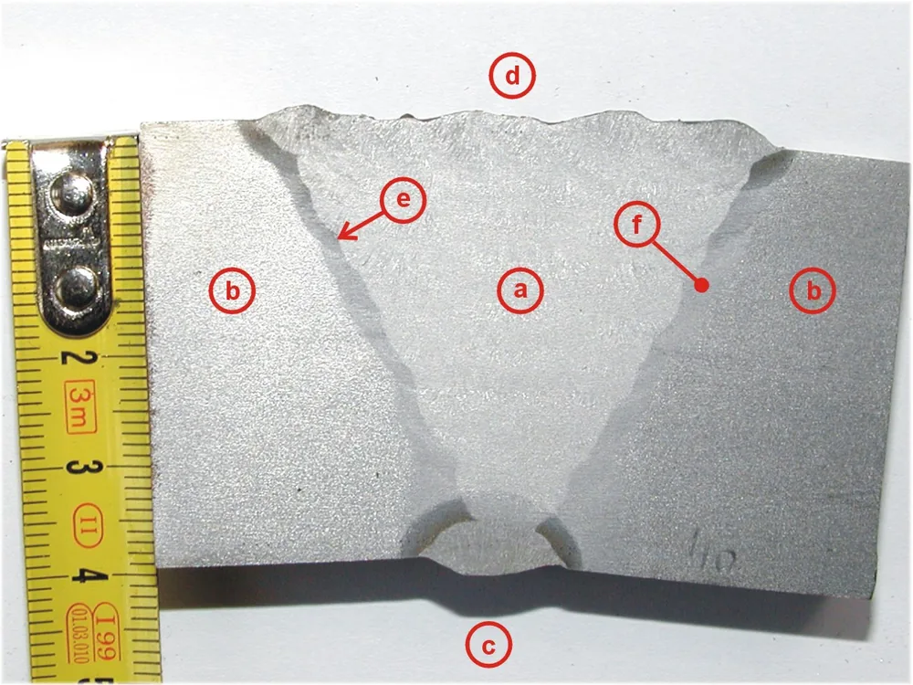

Сварные швы выбирают по конструкции узла, материалу, толщине деталей и нагрузке. На чертеже задают тип соединения, размеры шва и требования к контролю. Одного слова «ГОСТ» недостаточно. Разберём, как различать швы и какие сведения передать подрядчику для согласования изготовления и приёмки.

## Как выбрать сварной шов для детали или узла

Выбор сварного шва начинается с задачи узла: какие детали он соединяет, как передаёт нагрузку и в каких условиях работает. Затем учитывают материал, толщину и доступ к месту сварки. На сборочном чертеже закрепляют результат этого выбора. Пометка «сварить» оставляет открытыми вопросы о размерах, герметичности и допустимой деформации.

Шов и соединение — разные понятия. При оценке соединения учитывают не только металл шва, но и прилегающие участки деталей, которые нагревались при сварке.

Ровный валик сам по себе не подтверждает прочность.

Герметичность, геометрию и состояние поверхности проверяют отдельно. Соединение может выдержать проверку на утечку, но не уложиться в допуск по плоскостности. Поэтому требования к готовому узлу нужны ещё до выбора технологии.

Для контрактного изготовления полезно разделить ответственность: конструктор задаёт требования к соединению, технолог разрабатывает порядок работ. Неясности согласуют до запуска.

<!-- inline-cta -->

## Стыковые, тавровые и другие типы соединений

*Стыковой шов с V-образной разделкой кромок на плите из ферритно-перлитной стали S355J2G3 толщиной 40 мм. Фото: [Alu.cz](https://commons.wikimedia.org/wiki/File:V-butt-weld.jpg) · [Public domain](https://creativecommons.org/publicdomain/mark/1.0/)*

Тип соединения описывает взаимное расположение деталей, а тип шва — геометрию соединяющего их участка. Эти признаки связаны, но не совпадают. Например, угловой шов встречается в тавровых и нахлёсточных соединениях. По одному названию нельзя определить сторону сварки, размеры или несущую способность: для этого нужен чертёж с сечением и требованиями.

| Тип соединения | Как расположены детали | Что важно показать на чертеже |
| --- | --- | --- |
| Стыковое | Детали примыкают кромками | Подготовку кромок и положение деталей |
| Тавровое | Торец одной детали примыкает к поверхности другой | Стороны и размеры швов |
| Угловое | Детали образуют угол | Геометрию угла и доступ к соединению |
| Нахлёсточное | Части деталей перекрывают друг друга | Величину перекрытия и расположение швов |
| Торцевое | Детали соединяют по смежным торцевым поверхностям | Сечение соединения и назначение шва |

Для таврового узла особенно важна схема нагрузки. Универсальное правило «варить со стороны усилия» не заменяет расчёт: нужно учитывать направление силы, изгиб и работу всего соединения.

Доступ с двух сторон — возможность для технологии, а не готовое решение конструктора.

Открытый или закрытый угол также не определяет сам по себе выбор присадки. Его рассматривают вместе с материалом, подготовкой и способом сварки.

## Как различаются швы по исполнению и положению сварки

Швы различают по нескольким признакам, которые могут сочетаться. Сплошной шов проходит без предусмотренных разрывов, прерывистый состоит из отдельных участков. Односторонний и двусторонний описывают стороны выполнения. Слой и проход относятся к последовательности формирования шва. Эти характеристики отвечают на разные вопросы, поэтому их удобнее указывать раздельно.

Проход — отдельное перемещение источника нагрева при сварке. Один слой может состоять из нескольких проходов. Число проходов само по себе не описывает прочность соединения.

Профиль поверхности бывает выпуклым, плоским или вогнутым. Оценивать его нужно вместе с размерами сечения и требованиями к изделию.

Больше наплавленного металла не означает лучше.

Положение сварки описывает ориентацию места соединения во время работы. Оно может меняться при повороте детали в оснастке. Поэтому направление шва на сборочном чертеже ещё не говорит, в каком положении его будут выполнять.

Прерывистые участки оставляют промежутки между швами. Для герметичного контура требуется отдельное решение, которое исключает путь утечки.

## Кромки, зазор и прихватки: что задают до сварки

Подготовка соединения включает очистку, форму кромок, сборочный зазор и фиксацию деталей. Эти параметры рассматривают вместе: они влияют на доступ к корню и формирование шва. Прихватки удерживают сборку до основных проходов. Их расположение и дальнейшую обработку задают в технологии с учётом материала и конструкции узла.

Разделка открывает доступ к участку соединения, который иначе трудно проплавить. Но сама по себе она не гарантирует провар. Важны также сборка, режим и выполнение сварки.

Единого зазора для всех деталей нет.

Размеры подготовки должны соответствовать выбранному соединению. Если фактическая сборка отличается от документации, отклонение согласуют до сварки. Попытка просто заполнить увеличенный зазор меняет условия выполнения шва.

Фаска на детали не обязательно служит сварочной разделкой. Она может потребоваться для сборки, обработки или удаления острой кромки. Различия разобраны в статье [о фаске на чертеже](/blog/faska-na-chertezhe).

## Как способ сварки и тепловложение влияют на результат

Способ сварки, присадочный материал и защитную среду выбирают с учётом металла и требований к соединению. Затем разрабатывают режим, последовательность проходов и способ фиксации. Эти решения связаны: нагрев и остывание могут менять геометрию сборки. Поэтому размеры готового узла проверяют наряду с размерами самого шва.

Для тонких деталей особенно важен порядок выполнения участков. Его нельзя назначать только по длине шва: учитывают жёсткость сборки, доступ и возможность отвода тепла.

Универсальный шаг прихваток здесь не поможет.

Для деталей разной толщины требуется согласовать условия нагрева обеих кромок. Положение горелки, режим и подготовку выбирают для конкретного процесса. Короткая рекомендация без этих условий не годится как инструкция для производства.

Последовательность сварки и оснастку стоит обсудить до изготовления, если узел должен сохранить плоскостность или взаимное положение отверстий. Типичные проблемы разобраны в статье [о дефектах сварных швов](/blog/defekty-svarnyh-shvov-vidy-prichiny-profilaktika).

## Как читать обозначения сварных швов на чертеже

Чтение обозначения начинается с системы, принятой в комплекте документации. Затем определяют место соединения, сторону выполнения, тип шва и указанные размеры. Выноску рассматривают вместе с сечениями и техническими требованиями. Одной строки может быть недостаточно, чтобы понять обработку поверхности, объём контроля или условия приёмки готового узла.

При разборе чертежа полезно последовательно ответить на вопросы:

- Какие детали соединяет шов и где он проходит?
- С какой стороны его выполняют?
- Какие размеры заданы для сечения и длины?
- Есть ли разрывы, замкнутый контур или отдельные участки?
- Какие требования вынесены в примечания?

Положение записи относительно полки нельзя толковать без выбранной системы обозначений. То же относится к вспомогательным знакам.

Ошибка чтения становится ошибкой изготовления.

Если выноска допускает разные трактовки, нужен ответ автора документации. Предположение подрядчика не должно незаметно становиться требованием к изделию.

## Какие ГОСТ отвечают за обозначения, размеры и приёмку

Для работы со сварным соединением могут понадобиться разные документы: о терминах, обозначениях на чертеже, подготовке кромок и контроле. Они решают отдельные задачи. Название одного стандарта не описывает соединение целиком. В комплекте документации нужно связать выбранные документы с материалом, способом сварки и требованиями к готовому изделию.

| Задача | Что требуется найти в документе |
| --- | --- |
| Чтение чертежа | Правила условного изображения и обозначения |
| Подготовка соединения | Формы кромок и размеры для нужного процесса |
| Планирование контроля | Условия и порядок применения метода |
| Приёмка | Критерии оценки выявленных несовершенств |
| Оформление результата | Состав записей и протоколов для заказа |

Метод контроля и критерий приёмки — разные части задания. Указание метода говорит, как искать несплошности, но не всегда отвечает, какой результат допустим.

Ссылка должна вести к конкретному требованию.

Обозначения швов на чертеже описывает [ГОСТ 2.312-72](https://ohranatruda.ru/upload/iblock/f94/4294852115.pdf), типы соединений и размеры при ручной дуговой сварке — [ГОСТ 5264-80](https://ntcexpert.ru/documents/gost-5264-80.pdf), методы контроля — [ГОСТ 3242-79](https://meganorm.ru/Data2/1/4294852/4294852787.htm). Для выбора ГОСТ нужен текст документа с областью применения. Главная страница ведомства и пересказ в отраслевой статье не подтверждают правила обозначения, размеры или допустимость дефектов.

## Катет, расчётная толщина и прочность шва

Катет, выпуклость поверхности и расчётная толщина описывают разные стороны геометрии углового шва. Их нельзя подменять друг другом при назначении размеров или измерениях. Для оценки несущей способности нужны также материал, длина шва и схема передачи усилий. Один размер на выноске не заменяет расчёт соединения и проверку всего узла.

Катет связан с геометрией поперечного сечения. Расчётная толщина относится к сечению, принятому для проверки прочности. Связь между ними зависит от формы шва и расчётной модели.

Высокая выпуклость не служит доказательством запаса прочности.

При измерении важно понимать, какой именно размер контролируют. Оценка валика на глаз не заменяет измерение заданного параметра.

Калькулятор может помочь с арифметикой выбранной схемы. Ответственность за исходные данные остаётся у того, кто рассчитывает соединение. Ошибочную схему нагрузки правильное вычисление не исправит.

## Когда шов зачищают и какие дефекты недопустимы

Трещины, поры, непровар, несплавление и подрез различаются по форме и расположению. Оценку соединения проводят по требованиям к изделию и согласованным критериям приёмки. Внешний осмотр не показывает всё внутреннее сечение. Поэтому гладкая поверхность после зачистки не подтверждает отсутствие внутренних несплошностей и не заменяет назначенный контроль.

Удаление шлака и брызг, подготовка под покрытие и снятие усиления — разные операции. Их результат тоже различается: очистка открывает поверхность для осмотра, а снятие металла меняет геометрию.

Зачистка требует границ.

Если нужна поверхность заподлицо, в документации указывают участок и требования к результату. Для углового шва особенно важно сохранить заданное сечение после обработки.

Нельзя заранее обещать, что зачистка устранит обнаруженный дефект. Сначала определяют его характер, затем согласуют способ исправления и повторную проверку.

## Как проверяют сварное соединение при приёмке

Контроль планируют по материалу, геометрии соединения, доступу и предполагаемым несплошностям. Разные методы дают разную информацию, поэтому их не выбирают только по названию. В заказе фиксируют проверяемые участки, объём работ и критерии оценки. Если нужна герметичность, отдельно задают условия её проверки и оформления результата.

| Метод | Для какой задачи его рассматривают | Что важно учесть |
| --- | --- | --- |
| Визуальный и измерительный | Осмотр поверхности и проверка размеров | Доступ, состояние поверхности и измеряемые параметры |
| Капиллярный | Поиск несплошностей, выходящих на поверхность | Материал и подготовку поверхности |
| Магнитопорошковый | Поиск поверхностных и близких к поверхности несплошностей | Магнитные свойства материала |
| Ультразвуковой | Поиск внутренних несплошностей | Геометрию, толщину и доступ |
| Радиографический | Получение изображения внутренних неоднородностей | Направление просвечивания и чувствительность |

Ни один метод не даёт одинаковую чувствительность ко всем видам дефектов. Возможность его применения оценивают для конкретного соединения.

Важен результат проверки, а не перечень методов в заказе.

Состав сдаваемых документов согласуют заранее. Это могут быть результаты измерений, протоколы контроля и сведения об использованных материалах — в объёме, необходимом для приёмки изделия.

## Что передать подрядчику вместе с чертежом

Для расчёта изготовления нужен комплект, который описывает детали, соединения и ожидаемый результат. В него включают актуальную ревизию чертежа, материал, толщину, количество и требования к готовому узлу. Отдельно фиксируют обработку и приёмку. Для работы под давлением, при переменных нагрузках или в агрессивной среде важны условия эксплуатации.

Перед передачей заказа удобно проверить комплект по пунктам:

- Актуальная ревизия сборочного чертежа и связанные спецификации.
- Материалы, толщины и количество изделий.
- Расположение, стороны и размеры швов.
- Допуски геометрии после сварки.
- Требования к зачистке и покрытию.
- Методы, объём и критерии контроля.
- Состав документов при сдаче.

Пропуски согласуют с ответственным за конструкцию. Изменение размера или расположения шва должно попасть в документацию, по которой работает производство.

Устное уточнение легко потерять.

Пришлите комплект на [изготовление деталей по чертежам](/): актуальную ревизию, условия эксплуатации и требования к контролю.

## Частые вопросы

### Нужно ли в каждой выноске указывать способ сварки?

Это зависит от принятой системы обозначений и оформления комплекта. Способ сварки может быть связан с обозначением соединения и его размерами. При чтении выноски нужно учитывать общие технические требования; при противоречии требуется уточнение автора чертежа.

### Должны ли прихватки остаться внутри готового шва?

Это определяет технология сварки. Прихватки могут включаться в основной шов или удаляться. Само наличие прихватки не позволяет считать её частью заданного расчётного сечения.

### Кто согласует замену катета, если заданный размер невозможно выполнить?

Изменение согласуют с ответственным за конструкцию. Подрядчик описывает препятствие: например, ограниченный доступ или особенности сборки. Согласованный размер вносят в документацию до выполнения изменённого соединения.

## Источники

Отраслевая публикация посвящена аргонодуговой сварке и не подтверждает правила российских стандартов; для них ниже указаны тексты самих документов. Перед применением проверяйте текущий статус и редакцию стандарта.

- [ГОСТ 2.312-72. ЕСКД. Условные изображения и обозначения швов сварных соединений](https://ohranatruda.ru/upload/iblock/f94/4294852115.pdf) — правила изображения и обозначения швов на чертежах.
- [ГОСТ 5264-80. Ручная дуговая сварка. Соединения сварные. Основные типы, конструктивные элементы и размеры](https://ntcexpert.ru/documents/gost-5264-80.pdf) — деление соединений на стыковые, угловые, тавровые и нахлёсточные, формы кромок и размеры.
- [ГОСТ 3242-79. Соединения сварные. Методы контроля качества](https://meganorm.ru/Data2/1/4294852/4294852787.htm) — методы контроля и области их применения.
- [GTAW: Common joint designs](https://www.thefabricator.com/thewelder/article/arcwelding/gtaw-common-joint-designs) — отраслевая публикация The Welder / The Fabricator о типах соединений при аргонодуговой сварке.
- [Федеральное агентство по техническому регулированию и метрологии](https://www.rst.gov.ru/) — официальный сайт Росстандарта для проверки статуса стандартов.
