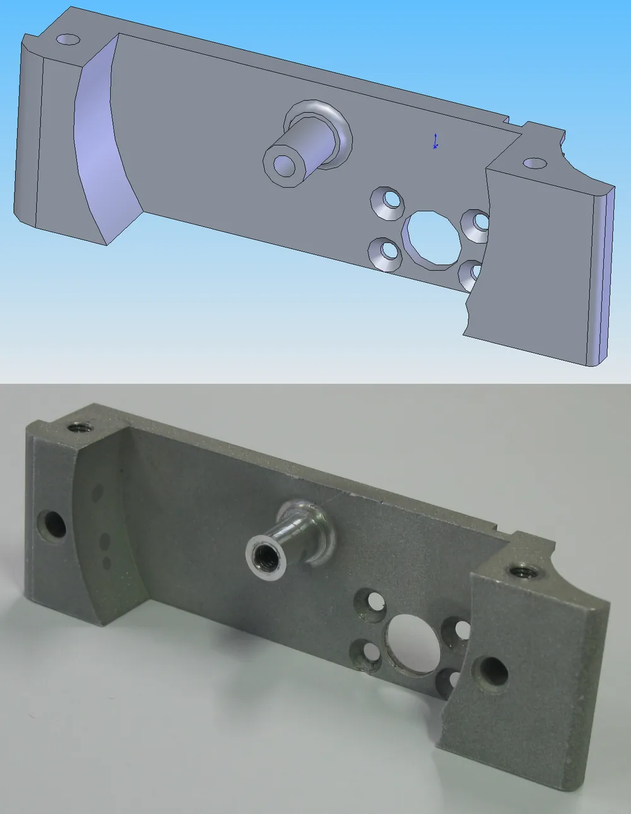
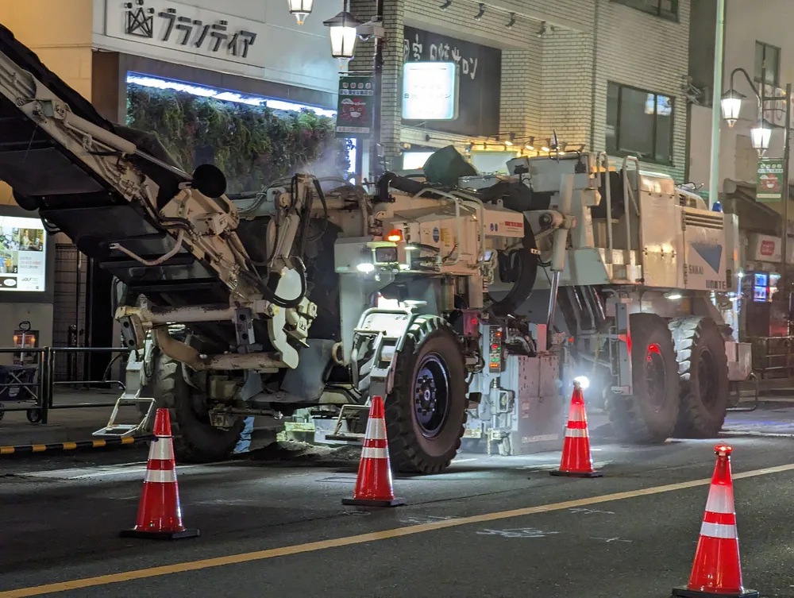

Технологичная деталь — та, которую можно изготовить без лишних установов, особого инструмента и придирчивых допусков. Для фрезеровки это значит: внутренние радиусы под диаметр фрезы, стенки и карманы с запасом по жёсткости, допуск только там, где он нужен. Всё остальное заказчик оплачивает временем станка.

## Технологичность конструкции: что это и что оценивают у одной детали

Чертёж готов, деталь встаёт в узел, размеры сходятся, а расчёт фрезеровки приходит дороже, чем ждали. Обычно причина не в материале, а в конструкции: она заставляет станок делать лишнее.

Технологичность конструкции — это совокупность свойств конструкции изделия, определяющих её приспособленность к достижению оптимальных затрат при производстве, техническом обслуживании и ремонте для заданных показателей качества, объёма выпуска и условий выполнения работ (ГОСТ 14.205-83) [1]. Для заказчика фрезеровки важна производственная часть определения. Свойство относится к конструкции, а не к функции: две детали с одинаковой работой в узле могут стоить по-разному.

Технологичность оценивают только для заданных условий: конкретного производства и объёма выпуска. Деталь, удобная для единичного заказа, в серии может потребовать другой оснастки.

Для заказчика фрезеровки главное — трудоёмкость: она превращается в часы станка и в цену.

> Технологичность — не оценка «хорошей детали». Это соответствие конструкции условиям конкретного производства и объёма заказа.

<!-- inline-cta -->

## Как решение конструктора превращается в цену детали

*CAD модель (вверху) и соответствующая готовая деталь, обработанная на 6-осевом фрезерном станке с финальной пескоструйной обработкой поверхности. Фото: [Mike1024](https://commons.wikimedia.org/wiki/File:CAD_model_and_CNC_machined_part.PNG) · [Public domain](https://creativecommons.org/publicdomain/mark/1.0/)*

Цену фрезеровки задаёт машинное время, число переустановок, особый инструмент и оснастка, а не только вес заготовки. Каждое решение конструктора проходит одну цепочку: элемент детали, доступ инструмента, число установов, время станка, цена. DFM — не упрощение детали, а согласование конструкции с тем, как её будут брать и обрабатывать. Разбор всех статей цены — в материале [от чего зависит цена детали по чертежу](/blog/ot-chego-zavisit-cena-metalloobrabotki-po-chertezhu).

### Установы и оснастка

Установ — одно закрепление заготовки в станке. Каждая поверхность, до которой нельзя добраться за один установ, добавляет переустановку, наладку и риск накопленной погрешности баз. Установ увеличивает трудоёмкость, а значит, и цену детали.

Если форма заготовки неудобна для тисков, технолог делает специальную оснастку. Её изготавливают отдельно, до самой детали. Избежать этого можно конструкцией: добавить плоскую базу или припуск под зажим.

### Три оси и пять осей

Пятиосевой станок подводит инструмент под разными углами и часто убирает лишние установы. Но правила проектирования он не отменяет: радиус по-прежнему ограничен фрезой, а тонкая стенка по-прежнему вибрирует. Час такого станка, как правило, стоит дороже. Что выгоднее для вашей детали, считает технолог по чертежу: универсальных чисел здесь нет.

## Внутренние радиусы и карманы: главный источник переделок

Откроем чертёж с прямоугольным карманом, у которого все четыре внутренних угла нарисованы острыми. Цех такой карман не сделает. Фреза круглая, поэтому в углу остаётся радиус не меньше радиуса инструмента. Внутренний радиус ограничен диаметром фрезы: это геометрия, а не каприз цеха.

Радиус разумно брать чуть больше радиуса фрезы. И делать одинаковым во всех углах детали: тогда технолог работает одним инструментом и не меняет фрезу ради каждого угла. Радиус у дна кармана тоже стоит указать на чертеже.

С глубиной та же связь. Карман при большой глубине требует фрезы подходящего диаметра и длинного вылета. Длинная фреза гнётся, поэтому приходится снижать режимы. Ориентир соотношения глубины к диаметру для вашего материала уточните у технологов IRONEX.

Если острый угол нужен по функции, есть два пути. Можно оставить радиус и снять кромку у ответной детали. Или заранее согласовать электроэрозию либо доработку: это отдельная операция, а не «просто нарисовать».

> **Факт.** Чем глубже карман относительно диаметра фрезы, тем длиннее вылет инструмента и тем ниже допустимые режимы резания.

## Стенки, рёбра, отверстия и резьбы

*Фрезерный станок SAKAI UNITE ER555F для холодного фрезерования металлических деталей. Фото: [Syced](https://commons.wikimedia.org/wiki/File:SAKAI_UNITE_ER555F_cold_milling_machine_2.jpg) · [CC0 1.0](https://creativecommons.org/publicdomain/zero/1.0/deed.en)*

Чем тоньше и глубже элемент, тем хуже он держит нагрузку резания. Ниже — что проверить у стенок, рёбер, отверстий и резьб до отправки чертежа.

### Тонкие стенки и рёбра

Тонкая стенка склонна к вибрации и деформации при фрезеровке: фреза давит на неё сбоку, а подпереть нечем.

- Стенка, которая сильно выступает над основанием, «поёт» под фрезой и уходит от размера. Итог — брак по толщине и следы вибрации на поверхности.
- Алюминий и сталь ведут себя по-разному: алюминий мягче и легче гнётся, сталь сильнее нагружает инструмент. Минимальную толщину и отношение высоты к толщине для вашего материала называют технологи IRONEX.

### Отверстия и резьбы

Глубину отверстия считают в его диаметрах. Чем оно глубже, тем хуже уходит стружка и тем осторожнее режим. Предельную глубину для вашего сверла уточните у технолога.

- Резьба до самого дна глухого отверстия: метчику нужен запас на выход, поэтому резьбу делают короче отверстия.
- Нестандартный диаметр вместо стандартного сверла удорожает деталь: вместо одного прохода появляется фрезерование по контуру или расточка.
- Глубокое отверстие с резьбой — двойной риск: стружка забивает канал, и метчик ломается.

## Доступ инструмента и базы: как деталь будут закреплять

Технолог смотрит на чертёж и задаёт два вопроса: куда подойдёт инструмент и за что деталь можно взять. Нет ответа на любой из них — деталь переделывают или ждут оснастку, и цена растёт раньше, чем начнётся обработка.

Недоступные поверхности и подрезы инструмент не достаёт. Тогда меняют установ или переходят на пять осей. Пример: паз на внутренней стороне корпуса, куда фреза не проходит из-за стенки. Его обрабатывают отдельным установом, иногда с особым приспособлением.

Заготовку нужно за что-то зажать. Без технологических баз и припуска под зажим деталь либо переделывают, либо изготавливают под неё оснастку. Чем меньше сторон нужно обработать, тем меньше установов: одна-две вместо шести — заметная экономия времени. Лишняя грань съедает установ.

Проверьте и переходы. Выход инструмента и радиус на стыке поверхностей избавляют деталь от «ступенек», которые остаются от фрезы.

> Если технолог не видит, за что деталь взять и как до неё добраться, цена растёт раньше, чем начнётся обработка.

## Допуски и шероховатость: где лишний квалитет стоит денег

Жёсткий допуск на все размеры подряд — типичная ошибка. Допуск нужен поверхностям, которые работают в паре: посадкам, базам, уплотнениям. Остальные размеры оставьте по общим допускам. Общие допуски — предельные отклонения размеров без индивидуального допуска; их задают одной ссылкой на чертеже, например «ГОСТ 30893.1 — m». Стандарт идентичен ISO 2768-1 и предусматривает четыре класса точности: f, m, c и v [2].

Избыточный допуск и квалитет повышают трудоёмкость. Появляются чистовые проходы, иногда шлифовка, отдельный контроль каждого размера. С шероховатостью так же: чем меньше допустимая шероховатость, тем больше проходов и тем дольше станок держит деталь. Сколько времени добавит квалитет на вашей детали, считает технолог по чертежу.

Подробнее о том, как назначать допуски, разобрано в статье про [допуски без переплат](/blog/dopuski-i-sherohovatost-bez-lishnego-udorozhaniya). Здесь важно одно: допуск связан с конструкцией, а не с привычкой.

> Допуск нужно назначать функции поверхности, а не привычке: каждый лишний квалитет добавляет операции и контроль.

## Типичные ошибки конструктора: таблица правил и исправлений

Таблица для самопроверки: элемент детали, правило, последствие нарушения и способ исправить чертёж. Числовые ориентиры, где они нужны, уточняйте у технолога.

| Элемент детали | Правило | Что будет при нарушении | Как исправить |
|---|---|---|---|
| Внутренний угол | Радиус не меньше радиуса фрезы, лучше чуть больше и один для всех углов | Острый угол не получить, ответная деталь не встаёт | Нарисовать радиус, у ответной детали снять фаску |
| Глубокий карман | Глубина соразмерна диаметру фрезы | Длинный вылет, вибрация, сниженные режимы | Сделать карман шире или мельче |
| Тонкая стенка | Толщина с запасом под нагрузку резания | Вибрация, уход от размера | Утолстить стенку или добавить ребро |
| Глубокое отверстие | Глубина в диаметрах в пределах ориентира технолога | Плохой отвод стружки, риск поломки инструмента | Уменьшить глубину или сделать отверстие сквозным |
| Резьба до дна | Запас под выход метчика | Неполная резьба, сломанный метчик | Удлинить отверстие под резьбой |
| Недоступная поверхность | Инструмент доходит до каждой поверхности | Лишний установ, оснастка или пять осей | Изменить форму или разделить деталь на две |
| Допуск и шероховатость | Строгие значения только на функциональных поверхностях | Чистовые проходы, шлифовка, лишний контроль | Оставить общие допуски на остальных поверхностях |

> **Мнение.** Если деталь заказывают единичным заказом, начните проверку с внутренних радиусов и допусков: их проще всего поправить на чертеже, а влияние на время станка заметное.

## Чек-лист перед отправкой чертежа и что делает технолог

Пройдите чертёж по шагам до отправки на расчёт. Каждый пункт закрывает одну из причин, по которой деталь возвращают на доработку.

1. Радиусы: у всех внутренних углов есть радиус, он одинаковый и чуть больше радиуса фрезы.
2. Карманы: глубина соразмерна ширине, у дна указан радиус.
3. Стенки и рёбра: толщина с запасом, нет длинных тонких выступов.
4. Отверстия и резьбы: стандартные диаметры, у глухой резьбы запас на выход метчика.
5. Доступ и базы: инструмент доходит до каждой поверхности, есть место под зажим.
6. Допуски и шероховатость: строгие значения только на функциональных поверхностях.
7. Материал и 3D-модель: материал указан, модель совпадает с чертежом. Как это сделать, описано в статье, [как подготовить 3D-модель для расчёта](/blog/kak-podgotovit-3d-model-dlya-rascheta-metalloobrabotki).

Технолог проходит тот же список. Всё, что нарушает правила, он возвращает вопросом и часто сразу предлагает правку, которая не меняет функцию детали. Это дешевле, чем узнать о проблеме на станке.

## Частые вопросы

### Что такое технологичность конструкции детали?

Это приспособленность конструкции к изготовлению с оптимальными затратами. Она зависит от конструкции детали, а не от её функции.

### Зависит ли технологичность детали от объёма выпуска?

Да, её оценивают для заданных условий производства и объёма выпуска. Деталь, удобная для единичного заказа, в серии может оказаться неудобной, и наоборот.

### Отменяет ли пятиосевой станок правила технологичности?

Нет: радиус по-прежнему ограничен фрезой, а тонкая стенка по-прежнему вибрирует. Пятиосевой станок часто убирает лишние установы, но выгоду для конкретной детали считает технолог по чертежу.

Если чертёж готов, пришлите его на расчёт через [форму на странице контактов](/kontakty.html): технолог проверит радиусы, доступ инструмента и допуски и вернёт вопросы до запуска заказа. Подробнее о наших [фрезерных работах по металлу](/frezerovka.html).

## Источники

1. [ГОСТ 14.205-83. Технологичность конструкции изделий. Термины и определения](https://meganorm.ru/Data2/1/4294851/4294851993.htm) — определение технологичности конструкции, введён с 1 июля 1983 года.
2. [ГОСТ 30893.1-2002 (ИСО 2768-1-89). Общие допуски](https://meganorm.ru/Data1/40/40423/index.htm) — предельные отклонения линейных и угловых размеров с неуказанными допусками; классы точности f, m, c, v.
