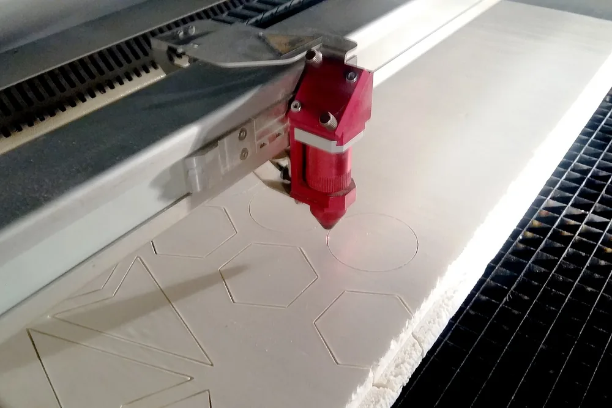

Один из сервисов лазерной резки листа называет ориентир ±0,127 мм для большинства своих материалов. Это порядок десятых долей миллиметра, и он относится к простому контуру. Толщина, габарит детали и гибы допуск расширяют. Разберём, где проходит граница, и что написать в чертеже, чтобы не платить за лишнюю точность.

## Что такое точность лазерной резки: станок и деталь — разные цифры

На вопрос «какая у вас точность?» нельзя честно ответить одной цифрой. Паспорт станка описывает позиционирование его осей, а заказчик принимает готовую деталь. На итог влияют марка и толщина листа, его внутренние напряжения, режим резки, состояние оптики, нагрев и размер контура.

Под точностью также понимают разные параметры: отклонение линейного размера, перпендикулярность кромки, конусность, шероховатость и наличие грата. Деталь может попасть в размер, но потребовать очистки кромки. Отверстие может совпасть с чертежом по верхнему краю, но сузиться к нижней стороне толстого листа.

ГОСТ Р ИСО 9013-2022 устанавливает геометрические характеристики и допуски по качеству для классификации термических резов. Стандарт помогает согласовать способ оценки реза, но не превращает любое оборудование и любой лист в процесс с одинаковой погрешностью.

> Паспортная точность станка показывает возможности механики. Допуск готовой детали определяют материал, толщина, геометрия и весь маршрут изготовления.

> **Факт.** Один из сервисов лазерной обработки указывает ориентир ±0,127 мм для большинства своих материалов. Слова «для большинства» означают, что для части материалов допуск другой.

<!-- inline-cta -->

## Допуски по толщине и материалу: чего ждать от стали, нержавейки и алюминия

*Станок лазерной резки обрабатывает полистирол. Луч вырезает геометрические формы, создавая прорез в материале. Фото: [Teknad](https://commons.wikimedia.org/wiki/File:Machine_de_d%C3%A9coupe_laser_en_train_de_couper_des_formes_g%C3%A9om%C3%A9triques_sur_du_polystyr%C3%A8ne_expans%C3%A9,_La_Villette,_Paris,_F%C3%A9vrier_2017.jpg) · [CC0 1.0](https://creativecommons.org/publicdomain/zero/1.0/deed.en)*

Допуск нужно согласовывать для конкретного материала, толщины и габарита детали. Одинаковая цифра для тонкой стали, толстой нержавейки и большого алюминиевого контура вводит в заблуждение. Длинная деталь чувствительнее к нагреву и напряжениям проката, чем небольшой элемент из того же листа.

ГОСТ Р ИСО 9013-2022 описывает геометрические характеристики и допуски по качеству термических резов. Нужный класс согласуйте с подрядчиком при расчёте заказа. Если у него нет подтверждённых замеров по вашему сочетанию марки и толщины, точное значение пока называть рано.

| Параметр контроля | Что проверяют | Чем проверяют |
|---|---|---|
| Размерное отклонение | Разницу между чертежом и фактическим контуром | Штангенциркулем, шаблоном или КИМ |
| Перпендикулярность | Отклонение поверхности реза от нормали к листу | Угольником или измерительным оборудованием |
| Конусность | Разницу верхнего и нижнего размера | Измерением с обеих сторон листа |
| Шероховатость | Следы реза на поверхности кромки | Профилометром |
| Грат | Наплыв и остатки металла снизу | Визуально и контрольным шаблоном |

Допуск по стали, нержавейке или алюминию имеет смысл только вместе с толщиной, размером детали и режимом резки. Без этих условий точные десятые доли миллиметра выглядят убедительно, но не помогают принять партию.

## Ширина реза: сколько «съедает» луч и как это учитывают в контуре

Ширина реза — полоса материала, которую удаляет лазер. Она меняется вместе с толщиной листа, материалом, режущим газом, фокусом, скоростью, состоянием сопла и оптики. Поэтому у ширины реза нет одного значения для всех деталей.

CAM-система строит эквидистанту: смещает траекторию луча относительно контура примерно на половину фактической ширины реза. После компенсации наружный контур и отверстия должны соответствовать готовым размерам из чертежа. Заказчику не нужно самостоятельно прибавлять ширину реза к детали или вычитать её из отверстия.

> В чертеже указывают готовый размер детали. Ширину реза измеряет и компенсирует технолог при подготовке управляющей программы.

Ширина реза всё же важна конструктору. Она ограничивает минимальный паз, тонкую перемычку и зазор между вложенными контурами. В сборных деталях нужно обозначить функциональный зазор, а не пытаться угадать компенсацию оборудования.

Путаница возникает, когда заказчик уже сместил контур, а технолог применил штатную эквидистанту ещё раз. Чтобы этого избежать, передавайте исходную геометрию детали и отдельно сообщайте, если файл уже содержит технологическую компенсацию.

## Что портит точность: конусность, тепло и размер детали

Точность ухудшают факторы, которые меняют форму реза или положение металла во время обработки. Цех управляет ими через режим, раскладку деталей и последовательность проходов, но полностью исключить свойства листа нельзя.

- **Конусность кромки.** На толстом листе верхний и нижний размеры могут различаться. Отверстие поэтому проверяют с обеих сторон.
- **Тепловая деформация.** Длинная или узкая деталь коробится при локальном нагреве, особенно если в прокате уже есть напряжения.
- **Плотная раскладка резов.** Соседние контуры нагревают одну зону и могут сдвинуть тонкую стенку.
- **Мелкие элементы.** Острые углы, малые отверстия и узкие пазы получают больше тепла на небольшой площади.
- **Состояние процесса.** Скорость, мощность, фокус, газ, сопло и оптика меняют ширину и форму кромки.

Слишком тонкая перемычка создаёт две проблемы. Сначала она теряет прочность, затем может выгореть под лучом ещё до снятия детали со стола. Технолог меняет очередность резов и режим, но геометрию меньше технологического минимума настройкой не исправить.

Конусность растёт вместе с толщиной и влияет прежде всего на отверстия и пазы с сопряжением. Если посадка работает по всей толщине, её проверяют по худшему сечению либо оставляют припуск под механическую доводку.

## Отверстия, перемычки и расстояние до кромки: правила, которые экономят деталь

Отверстия и пазы требуют отдельных ограничений: наружный контур может попасть в допуск, пока мелкий элемент уже ослабляет кромку или выгорает. Перед отправкой файла проверьте четыре правила. Их даёт SendCutSend как свои общие рекомендации по резке.

- Отверстие располагайте не ближе одного его диаметра от кромки.
- Паз отодвигайте от кромки и соседнего выреза минимум на полторы его ширины.
- Диаметр отверстия и перемычку делайте не меньше половины толщины листа.
- Для прочной стенки закладывайте ширину от одной до полутора толщин листа.

Половина толщины — технологический минимум, а не обещание прочности. Такая перемычка может сохраниться после резки, но разрушиться под нагрузкой. Для силовой детали ширину определяют расчётом и затем проверяют на технологичность.

Отступ от кромки нужен потому, что близкое отверстие уменьшает сечение металла. Крепёж при нагрузке может вырвать оставшуюся стенку. Плотно расположенные отверстия также образуют зону локального перегрева.

Допуск диаметра задавайте отдельно от наружного контура. Для точной посадки, например H7, отверстие лучше резать с припуском и доводить расточкой, развёрткой или фрезерованием. Принцип назначения таких полей разбирает материал о том, [как читать допуски по квалитетам на чертеже](/blog/dopuski-po-kvalitetam-kak-chitat-ih-v-chertezhe).

## Размеры через гиб: допуск растёт в разы

Размеры на одной плоскости точнее размеров между гранями после гибки. Отверстия, вырезанные за одну установку, зависят преимущественно от резки. Размер «гиб–отверстие», «гиб–кромка» или «гиб–гиб» включает погрешность резки, положение линии гиба, угол и свойства материала.

У коробки с крышкой четыре отверстия на одной развёртке могут совпадать между собой, но после четырёх гибов оказаться смещёнными относительно отверстий на другой детали. В примере Protolabs размер между отверстиями через четыре гиба получает линейный допуск ±0,762 мм и накопление углового отклонения по 1° на каждый гиб.

Ориентиры показывают разницу порядка величин:

- контур и элементы на одной плоскости — около ±0,127 мм;
- размер между отверстиями через четыре гиба — ±0,762 мм, примерно в шесть раз больше;
- взаимное положение запрессованного крепежа согласуют отдельно.

> Проблему накопления допусков решает конструкция: базы размещают на одной плоскости, ответные отверстия увеличивают или используют плавающий крепёж.

Даже простая гнутая деталь проходит резку и гибку. У каждой операции свои ограничения, поэтому гиб расширяет итоговый допуск. Ужесточение цифры в чертеже не отменяет это накопление.

## Как указать допуски в чертеже и не переплатить

В чертеже выделяют размеры, которые влияют на сборку, посадку и работу узла. Остальным размерам оставляют общий согласованный допуск. Требование минимального отклонения по всему контуру увеличивает число контрольных операций и может добавить механическую доработку.

Сначала разделите размеры на три группы: посадочные, сборочные и свободные. Для посадочных укажите поле допуска и базу. Для сборочных проверьте худшее сочетание предельных размеров. Свободные размеры не нужно превращать в прецизионные без функциональной причины.

> Допуск нужен там, где отклонение мешает сборке или работе узла. Остальным размерам достаточно точности, которую лазер держит без дополнительной операции.

Общие допуски можно указать в основной надписи со ссылкой на согласованный стандарт и класс. Отдельные критические размеры маркируют непосредственно на изображении. Применимость выбранного класса к лазерной детали нужно подтвердить у подрядчика до запуска.

Если лазер не обеспечивает посадку, контур режут с припуском и доводят механически. Цена растёт из-за дополнительной установки, инструмента и контроля, а не из-за самой записи допуска. Для расчёта подготовьте DXF с единицами измерения и замкнутыми контурами, чертёж с базами, марку материала, толщину и объём партии. Эти данные избавят от повторного запроса исходников.

> **Мнение.** Если критичны только два-три размера, назначьте жёсткий допуск им, а остальные согласуйте как свободные: такой чертёж проще изготовить и принять.

## Как проверить деталь: приёмка партии по чертежу

Приёмка партии проверяет соответствие детали чертежу, поэтому состав измерений и объём выборки согласуют до производства. После обнаружения расхождения менять правила контроля поздно: подрядчик и заказчик начнут оценивать разные признаки.

1. Выберите критические размеры, контрольные габариты и признаки кромки.
2. Зафиксируйте, сколько деталей и из каких мест партии попадёт в выборку.
3. Подберите инструмент с погрешностью заметно меньше проверяемого допуска.
4. Очистите кромку от грата и выдержите деталь с инструментом в одинаковых условиях.
5. Занесите значения, номер детали и средство измерения в протокол.
6. При отклонении согласуйте доработку, замену или отдельное разрешение до отгрузки.

Штангенциркуль подходит для доступных линейных размеров. Шаблон ускоряет повторяемую проверку контура, КИМ измеряет сложное взаимное положение элементов, профилометр оценивает шероховатость. Один инструмент не подтверждает все характеристики реза.

Протокол отделяет измеренный факт от визуальной оценки. В нём указывают номинал, границы допуска, результат, инструмент и решение по отклонению. Приёмка партии по такой схеме снижает риск спора о том, что именно требовал чертёж.

## Итог: что запомнить перед отправкой чертежа

Перед заказом проверьте следующее:

- согласован ли допуск для выбранных материала, толщины и габарита;
- находятся ли критические отверстия и базы на одной плоскости;
- выдержаны ли расстояния до кромок и ширина перемычек;
- отделены ли посадочные размеры от свободных;
- указаны ли DXF, единицы, марка материала и толщина;
- согласованы ли метод контроля и выборка партии.

Если выбираете технологию раскроя, посмотрите [сравнение лазера, плазмы и гидроабразива по точности](/blog/lazernaya-plazmennaya-ili-gidroabrazivnaya-rezka). Затем [отправьте чертёж на расчёт](/): подрядчик проверит критические допуски и припуски до запуска детали в работу.

## Частые вопросы

### Какая ширина реза у лазера?

Она зависит от толщины, материала, газа, фокуса и состояния оптики. Цех определяет ширину для выбранного режима и компенсирует её эквидистантой в CAM. В чертеже указывают готовый размер детали.

### Как близко к кромке можно делать отверстие?

Ориентир — не ближе одного диаметра отверстия. Паз отодвигают минимум на полторы его ширины. Для конкретного материала, толщины и нагрузки технологический минимум может быть больше.

### Нужно ли ставить жёсткий допуск на все размеры детали?

Нет. Жёсткий допуск назначают критическим размерам, которые влияют на посадку и сборку. Остальные оставляют в согласованном общем поле, чтобы не добавлять лишние операции и контроль.

## Источники

- [ГОСТ Р ИСО 9013-2022. Термическая резка. Классификация термических резов](https://docs.cntd.ru/document/1200189229) — текст стандарта
- [Basic Tolerances and Cut Feature Relationships](https://sendcutsend.com/blog/basic-tolerances-and-cut-feature-relationships/) — SendCutSend
- [Working with Sheet Metal Tolerances](https://www.protolabs.com/resources/blog/working-with-sheet-metal-tolerances/) — Protolabs
