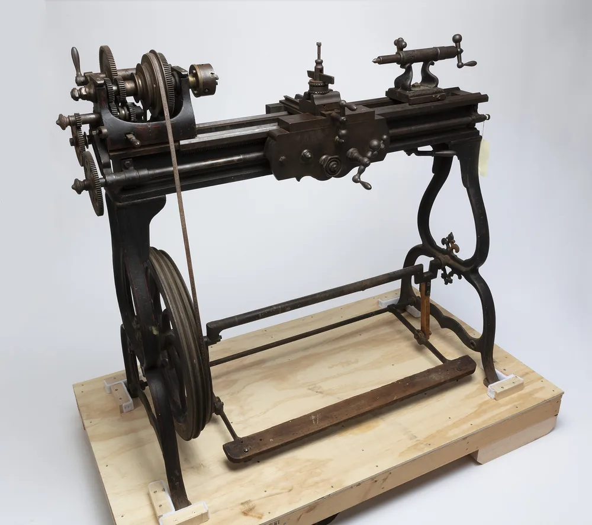
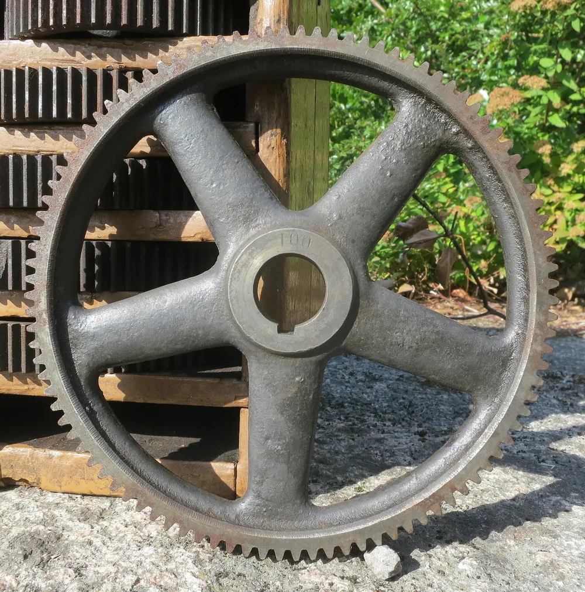

Токарь — рабочий, который обрабатывает заготовки на токарном станке: получает заданные поверхности, отверстия и резьбу по чертежу. Он готовит инструмент, закрепляет заготовку, выполняет обработку и проверяет результат. На примере втулки разберём, какие навыки нужны токарю и чем его работа отличается от задач оператора ЧПУ, наладчика и программиста.

## Кто такой токарь и какие детали он делает

Токарь снимает материал с вращающейся заготовки режущим инструментом. Так он получает наружные цилиндрические и конические поверхности, торцы, отверстия, канавки и резьбу. На токарных станках изготавливают втулки, валы, оси и кольца. Если на детали есть паз или лыска, маршрут может включать фрезерование.

Работа начинается с чертежа.

Для втулки заготовкой может служить пруток, труба или поковка. Выбор зависит от материала, размеров и технологии изготовления. Токарь снимает припуск — слой материала, оставленный для обработки, — и проверяет полученные поверхности.

Готовая деталь должна соответствовать требованиям чертежа. Одного внешнего сходства недостаточно: втулка может выглядеть правильно, но не подходить к валу или корпусу по размеру.

<!-- inline-cta -->

## Что входит в обязанности токаря в течение смены

*Станок Eagle с ножным приводом, изготовленный W. L. Chase около 1875 года и использовавшийся Уильямом Джоном Битти. Фото: [This file was contributed to Wikimedia Commons by Missouri Historical Society a…](https://commons.wikimedia.org/wiki/File:Eagle_Foot-Powered_Screw_Cutting_Engine_Lathe_Used_by_William_John_Beattie_of_Beattie_Manufacturing_Company,_St._Louis_-_DPLA_-_b92f5a298df92aaab42899f7307e6a68_%28page_1%29.jpg) · [Public domain](https://creativecommons.org/publicdomain/mark/1.0/)*

Работа токаря охватывает подготовку, обработку и проверку деталей. Сначала он знакомится с заданием и чертежом, проверяет заготовки и готовит рабочее место. Затем закрепляет заготовку, устанавливает инструмент и выполняет переходы. Кто выбирает режимы, настраивает станок и принимает партию, зависит от распределения обязанностей на участке.

Последовательность работы удобно проверить по шагам:

1. Сверить обозначение детали, версию чертежа, материал и количество заготовок.
2. Подготовить станок, оснастку, режущий и измерительный инструмент.
3. Выполнить обработку по технологической документации.
4. Проверить размеры и поверхности в назначенных точках контроля.
5. Зафиксировать результат и передать детали дальше.

Самоконтроль токаря и приёмка отдела технического контроля решают разные задачи. Проверка в ходе обработки помогает заметить отклонение до изготовления всей партии. Приёмку проводят по принятому на предприятии порядку.

Состав обязанностей стоит читать в описании конкретного рабочего места.

## Какие операции выполняют на токарном станке

Для каждой поверхности выбирают свою операцию и инструмент. Наружное точение формирует цилиндр или конус, подрезка — торец. Сверлением получают отверстие, растачиванием обрабатывают уже существующее. Канавки и резьбу выполняют предназначенным для них инструментом. Способ проверки выбирают с учётом размера, допуска, формы поверхности и доступа к ней.

| Операция | Что обрабатывают | Пример инструмента | Что проверяют |
| --- | --- | --- | --- |
| Наружное точение | Наружную поверхность | Проходной резец | Диаметр и форму |
| Подрезка торца | Торцевую поверхность | Подрезной резец | Длину и требования к торцу |
| Сверление | Отверстие | Сверло | Диаметр и глубину |
| Растачивание | Существующее отверстие | Расточной резец | Диаметр и форму отверстия |
| Прорезание канавки | Канавку | Канавочный резец | Ширину, глубину и положение |
| Нарезание резьбы | Резьбовую поверхность | Резьбовой резец, метчик или плашка | Параметры резьбы |

Сверления может хватить для одних требований чертежа и не хватить для других. Если нужна последующая обработка отверстия, её включают в маршрут.

Один инструмент не заменяет весь набор.

Порядок переходов разобран в материале про [операции и маршрут обработки на токарном станке](/blog/obrabotka-na-tokarnom-stanke).

## Как токарь изготавливает втулку по чертежу

*Шестерня для восьмидюймового токарно-винторезного станка, изготовленного AB Lidköpings Mekaniska Verkstad для SKF в Швеции. Фото: [R. Henrik Nilsson](https://commons.wikimedia.org/wiki/File:1916_AB_Lidkoepings_Mekaniska_Verkstad_8_inch_thread_cutting_lathe_serial_1546_change_gears_for_SKF_Sweden_view_3.jpg) · [CC BY 4.0](https://creativecommons.org/licenses/by/4.0)*

Рассмотрим втулку с наружным цилиндром, сквозным отверстием и торцами. Это учебный пример без размеров и режимов резания. До обработки нужно определить материал, заготовку, требования к поверхностям и способ закрепления. Последовательность переходов зависит в том числе от того, какие поверхности связаны допусками.

В одном из возможных маршрутов сначала подрезают торец, затем обрабатывают наружную поверхность. В сплошной заготовке сверлят отверстие и при необходимости растачивают его. После переустановки обрабатывают противоположный торец и получают заданную длину.

Для заготовки из трубы маршрут будет другим: исходное отверстие уже есть.

Переустановка влияет на взаимное положение поверхностей. Поэтому порядок обработки выбирают по чертежу и условиям закрепления.

Перед передачей детали проверяют диаметры, длину и остальные требования. Режимы резания, припуски и средства контроля в этом примере не назначены: для рабочего задания нужны исходные данные.

## Какие знания и навыки нужны токарю

Токарю нужно понимать чертёж, свойства материала и поведение инструмента при резании. Он читает размеры, допуски, обозначения шероховатости и технические требования. Также ему важно понимать базы — поверхности или другие элементы, относительно которых задают положение детали. Ошибка в выборе базы может нарушить взаимное расположение поверхностей.

Практические навыки включают закрепление заготовки, установку инструмента, управление станком и измерение детали. Здесь важна последовательность: сначала понять требование, затем выбрать способ его выполнения и проверки.

Размер нельзя оценить на глаз.

Вибрация, износ режущей кромки и недостаточная жёсткость закрепления могут повлиять на результат. Токарю нужно замечать изменения в ходе обработки и разбираться в их причинах.

Отдельный навык — измерение. Неправильная установка прибора или стружка между измерительными поверхностями могут исказить показание.

## Как токарь проверяет размер и качество поверхности

Годность детали оценивают по требованиям чертежа. Номинальный размер служит исходным значением, а предельные отклонения задают допустимые границы. Допуск размера — разность между наибольшим и наименьшим допустимыми размерами. Проверка диаметра при этом не заменяет проверку формы, взаимного положения поверхностей и шероховатости, если они заданы отдельно.

Посадка характеризует соединение сопрягаемых деталей. Например, требования к отверстию втулки связаны с тем, как она должна соединяться с валом.

Размер и шероховатость проверяют отдельно.

Штангенциркуль, микрометр и нутромер решают разные измерительные задачи. Прибор выбирают по диапазону, доступу к поверхности и допустимой погрешности. Одного названия прибора недостаточно, чтобы судить о пригодности замера.

Калибр помогает проверить соответствие заданным границам без получения числового значения размера. Его применимость также зависит от задачи контроля.

Погрешность измерения относится к результату замера. Подробнее об этом — в статье о том, [как рассчитывают абсолютную погрешность измерения](/blog/absolyutnaya-i-otnositelnaya-pogreshnost).

## Чем отличаются токарь, оператор ЧПУ, наладчик и программист

Различие между этими ролями связано с подготовкой и управлением обработкой. На универсальном станке токарь непосредственно управляет подачами и выполняет переходы. На станке с ЧПУ движения задаёт управляющая программа. Её подготовку, наладку оборудования и выпуск деталей могут поручать разным работникам или совмещать в одной должности.

| Роль | Основной круг задач |
| --- | --- |
| Токарь универсального станка | Подготовка к обработке, управление станком, изготовление и проверка деталей |
| Оператор ЧПУ | Установка заготовок, запуск подготовленного цикла, наблюдение за обработкой и контроль |
| Наладчик ЧПУ | Подготовка инструмента и оснастки, настройка станка, проверка наладки на детали |
| Программист ЧПУ | Подготовка управляющей программы и участие в её проверке |

Это ориентир для понимания работы. Обязанности в конкретной вакансии могут пересекаться.

Наличие ЧПУ не отменяет закрепление заготовки, выбор инструмента и контроль. Программа управляет движениями, но результат зависит и от подготовки процесса.

Универсальные, револьверные и карусельные станки различаются устройством и кругом задач. Название станка помогает понять оборудование, но не описывает всю работу человека.

## Чем токарная обработка отличается от фрезерной

При обычном точении главное движение резания создаёт вращение заготовки. Резец перемещается относительно неё и снимает материал. При фрезеровании вращается фреза, а подача меняет её положение относительно детали. Поэтому цилиндрические поверхности часто получают точением, а пазы, карманы и плоскости — фрезерованием.

Втулка с лыской может потребовать обоих видов обработки.

На токарно-фрезерном оборудовании часть таких задач совмещают на одном станке. Возможность совмещения зависит от его оснащения, геометрии детали и доступа инструмента.

Наличие паза само по себе ещё не определяет весь маршрут. Нужно учитывать его форму, положение и требования к точности.

Примеры поверхностей и задач собраны на странице [токарных работ по металлу](/tokarnaya.html).

## Какие опасности есть у станка и как допускают к работе

У токарного станка опасны вращающиеся части, вылетающая стружка и ненадёжно закреплённая заготовка. Контакт одежды, волос или перчатки с вращением может привести к захвату. Оставленный в патроне ключ при запуске может вылететь. Эти риски нужно учитывать ещё при подготовке рабочего места и оборудования.

Измерение ручным инструментом и удаление стружки требуют остановки вращения. Стружку убирают предназначенным для этого приспособлением, а не рукой. Правила по охране труда при обработке металлов, утверждённые приказом Минтруда от 11.12.2020 № 887н, запрещают удалять стружку руками: разрешены щётки-сметки и крючки, только на остановленном оборудовании и в защитных очках (п. 651). Во время работы запрещено снимать ограждения, касаться движущихся частей и работать в рукавицах или перчатках (п. 652). У токарных станков зона обработки должна иметь защитный экран или кожух, сблокированный с пуском станка (п. 655) [1]. Этот текст не заменяет обучение работе на конкретном станке.

Перед самостоятельной работой нужно знать порядок остановки оборудования, назначение защитных устройств и действия при неисправности.

Универсального описания допуска для всех рабочих мест здесь нет. Требования к подготовке, проверке знаний и медицинским осмотрам в исходных источниках не подтверждены. Поэтому использовать статью как основание для допуска к станку нельзя.

## Как получить профессию и повышать квалификацию

При выборе обучения стоит сравнивать содержание программы с будущими задачами. Для работы на универсальном станке нужна практика ручного управления обработкой. Для ЧПУ — понимание наладки, управляющей программы и контроля цикла. В обоих случаях важны чтение чертежа, закрепление заготовки, работа инструментом и измерения.

Практика должна давать возможность пройти путь от задания до проверенной детали.

В описании программы полезно искать сведения об оборудовании, учебных работах и документе по окончании. Название курса само по себе не показывает, чему научится выпускник.

Квалификационный разряд связан со сложностью поручаемых работ. Неподтверждённые перечни разрядов и нормативные требования здесь не приводятся.

Дальнейшее развитие может включать обработку более сложных деталей, наладку или подготовку программ. Конкретное направление зависит от интересов работника и задач производства.

## Какие условия работы и перспективы у токаря

Условия труда зависят от оборудования и организации участка. В работе могут присутствовать шум, стружка и контакт со смазочно-охлаждающей жидкостью. Закрытая рабочая зона и механизированное удаление стружки меняют повседневные задачи. По одному названию профессии нельзя определить нагрузку, график или содержание смены.

Вакансию полезно оценивать по конкретным обязанностям.

Нужно понимать, кто готовит инструмент, выполняет наладку, проверяет детали и отвечает за передачу партии. Совмещение этих задач заметно меняет работу даже на одинаковых станках.

При сравнении оплаты важны регион, график, сложность деталей и условия начисления. Сумму до вычета налогов нельзя напрямую сравнивать с суммой на руки.

Подтверждённой выборки вакансий в статье нет, поэтому зарплатные диапазоны и прогноз спроса не приводятся.

## Что передать производству для изготовления детали

Для оценки изготовления нужны актуальный чертёж, марка материала, количество деталей и желаемый срок. В документации должны читаться требования к размерам, поверхностям и контролю. Если втулка соединяется с валом или корпусом, важно показать требования к сопряжению. Они влияют на обработку и проверку детали.

Требования, которые известны только заказчику, нельзя восстановить по внешнему виду.

Технолог определяет маршрут изготовления с учётом чертежа, оборудования и заготовки. Токарь выполняет порученные операции и контролирует результат в пределах своих обязанностей. Условия заказа согласуют отдельно.

Для [изготовления деталей по чертежам](/) отправьте чертёж на расчёт вместе с материалом и количеством.

## Частые вопросы

Работа токаря включает подготовку, обработку и контроль, но распределение задач зависит от участка. Поэтому описание профессии помогает понять общий принцип, а обязанности конкретного работника нужно сопоставлять с оборудованием и заданием. Ниже — короткий ответ на основной вопрос статьи: кто такой токарь и за что он отвечает.

### Кто такой токарь?

Токарь — рабочий, который обрабатывает заготовки на токарном станке по чертежу и технологической документации. Он готовит инструмент, выполняет порученные операции и проверяет результат.

## Источники

1. [Приказ Минтруда России от 11.12.2020 № 887н «Об утверждении Правил по охране труда при обработке металлов»](https://legalacts.ru/doc/prikaz-mintruda-rossii-ot-11122020-n-887n-ob-utverzhdenii/) — требования к станкам холодной обработки: удаление стружки (п. 651), ограждения и перчатки (п. 652), защитный экран токарного станка (п. 655).
