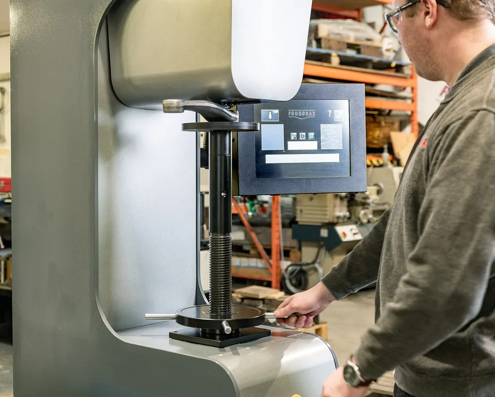

Пишите твёрдость диапазоном, со шкалой и зоной: «56…60 HRC, рабочая поверхность». Для закалённой стали берут HRC, для мягких и нормализованных заготовок, поковок и чугуна — HB. Одно число без допуска и шкалы исполнитель не может ни выполнить, ни принять.

## HRC и HB: что измеряют и почему числа нельзя сравнивать напрямую

Первый вопрос технолога при чтении чертежа — в какой шкале контролировать твёрдость. HRC измеряют методом Роквелла: алмазный конус входит в металл под предварительной и основной нагрузками, а прибор определяет результат по разнице глубины внедрения. Число записывают вместе с обозначением HR и буквой шкалы.

Запись `58 HRC` означает 58 единиц по шкале C. Алмазный конус этой шкалы имеет угол 120°. Полученное значение помогает оценить сопротивление поверхности вдавливанию и косвенно проверить результат закалки и отпуска.

HB измеряют методом Бринелля. Твердомер вдавливает шарик, после чего оператор или оптическая система измеряет диаметр отпечатка. Значения HRC и HB нельзя сопоставлять как одинаковые единицы.

| Шкала | Индентор | Основа измерения | Типичное применение |
|---|---|---|---|
| HRC | Алмазный конус | Глубина внедрения | Закалённые стали |
| HBW | Твердосплавный шарик | Диаметр отпечатка | Отожжённые стали, чугун, поковки |
| HV | Алмазная пирамида | Диагонали отпечатка | Тонкие слои и мелкие детали |

> **Мнение.** Если деталь закалена и её толщина допускает полноценный отпечаток, задавайте HRC: подрядчику будет проще связать требование с термообработкой и контролем.

<!-- inline-cta -->

## Метод Бринелля: когда указывать HB, а не HRC

*Контроль твёрдости компонента подвески методом Бринелля в соответствии с требованиями чертежа. Фото: [Foundrax_Engineering_Products](https://commons.wikimedia.org/wiki/File:A_Brinell_hardness_testing_machine.jpg) · [CC BY 4.0](https://creativecommons.org/licenses/by/4.0)*

HB подходит для материалов, в которых крупный отпечаток показывает усреднённые свойства объёма. Метод применяют для мягких, отожжённых и нормализованных сталей, чугуна, поковок и крупных отливок. Закалённую сталь обычно контролируют по HRC, поскольку шарик Бринелля может деформироваться на твёрдом материале.

При испытании твердосплавный шарик вдавливают с заданной нагрузкой и выдерживают под ней установленное время. На практике встречаются шарики диаметром 2,5 и 10 мм, нагрузки от 187,5 до 3000 кгс и выдержка от 10 до 30 секунд. Конкретное сочетание выбирают по стандарту с учётом материала и ожидаемой твёрдости.

После разгрузки отпечаток измеряют в двух взаимно перпендикулярных направлениях. Твёрдость рассчитывают по нагрузке, диаметру шарика и среднему диаметру отпечатка. Результаты, полученные при несопоставимых отношениях нагрузки к квадрату диаметра шарика, напрямую не сравнивают.

Критерий выбора можно свести к трём случаям: закалённая сталь — HRC, мягкая массивная заготовка — HB, тонкий слой или небольшая деталь — HV либо поверхностная шкала Роквелла.

## Как записать твёрдость на чертеже, чтобы деталь можно было принять

Технические требования чертежа должны фиксировать диапазон, шкалу и зону контроля. Запись `HRC 58` оставляет спор о допустимом отклонении. Формулировка `56…60 HRC, рабочая поверхность А` задаёт проверяемое условие для производства и приёмки.

Плохая запись: `Твёрдость 58`. Здесь нет шкалы, допуска и места замера. Рабочая запись для закалённой детали: `Закалить и отпустить до 56…60 HRC`. Если требование относится к одной поверхности, добавляют обозначение этой поверхности и участок контроля.

Марку стали и вид термообработки указывают вместе с твёрдостью. Закалка и отпуск задают итоговый диапазон HRC, но достижимый результат зависит от химического состава, сечения детали и режима охлаждения. Полезно также проверить, [что ещё должно быть на чертеже, чтобы его посчитали без переписки](/razdel/chertezhi-i-dopuski.html).

> Твёрдость на чертеже — это диапазон, шкала и зона замера. Одно число нельзя однозначно изготовить и проверить.

### Закалка ТВЧ и цементация: слой и поверхность

Для поверхностного упрочнения задают два отдельных требования: твёрдость поверхности и глубину упрочнённого слоя. Пример: `Рабочую поверхность Б закалить ТВЧ до 54…58 HRC; глубина слоя — уточнить по расчёту`.

Для цементованной детали дополнительно согласуют способ определения границы слоя. Без этого лаборатория может измерить глубину по другому критерию и получить формально иной результат. Зону отпечатков показывают на чертеже либо описывают в технических требованиях.

## 45 HRC и 58 HRC: что технолог проверяет до запуска

Одно и то же число HRC на чертеже может означать разный объём работы. Достижимый диапазон для выбранной марки не стоит брать из чужой таблицы: его подтверждает технолог по марке, сечению и состоянию заготовки.

| Что проверяют | Почему это влияет на результат |
|---|---|
| Сечение детали | В толстом сечении твёрдость на поверхности и в сердцевине может различаться |
| Исходное состояние заготовки | От него зависят режим нагрева и поведение металла при закалке |
| Режим охлаждения и отпуска | Определяет итоговую твёрдость и риск трещин |
| Припуск под шлифовку | Позволяет снять обезуглероженный слой и скорректировать деформацию |

Термообработка может вызвать коробление, поэтому ответственные поверхности часто оставляют с припуском и шлифуют после закалки. Дополнительные операции влияют на [цену детали по чертежу](/blog/ot-chego-zavisit-cena-metalloobrabotki-po-chertezhu) и производственный срок.

## Как измеряют твёрдость у исполнителя: порядок контроля

Контроль начинается с подготовки поверхности и проверки твердомера. Окалина, обезуглероженный слой, загрязнение или качание детали меняют глубину внедрения индентора. Значение на дисплее при этом выглядит точным, хотя установка образца нарушена.

1. Поверхность очищают и при необходимости шлифуют, не перегревая металл.
2. Деталь устанавливают на опору без качания и загрязнений под ней.
3. Твердомер проверяют по эталонной мере нужного диапазона.
4. Отпечатки ставят в заданной зоне с нормативными отступами от края и друг от друга.
5. Результаты оценивают по принятому плану контроля и заносят в протокол.

Для цилиндрических и выпуклых поверхностей учитывают поправку на кривизну. Допустимые расстояния и поправки берут из таблиц применяемого стандарта, поэтому их лучше зафиксировать в методике контроля.

В протокол включают обозначение детали, шкалу, зону, результаты отдельных измерений, итог, модель или номер прибора и сведения о проверке твердомера. Для партии отдельно указывают сплошной либо выборочный контроль.

Портативный динамический твердомер удобен на крупной детали, которую нельзя поставить на стационарный прибор. Метод Либа чувствителен к массе, толщине, шероховатости и закреплению изделия, поэтому способ контроля согласуют до приёмки.

## Тонкие детали и слои: когда HRC не подходит

Для тонкого металла шкалу выбирают прежде всего по толщине. Слишком большое усилие продавливает образец настолько, что на результат начинает влиять опорная наковальня. После такого испытания полученное число нельзя считать твёрдостью материала.

### Как выбрать шкалу по толщине

Ориентировочная минимальная толщина равна десяти глубинам отпечатка для алмазного конуса и пятнадцати глубинам для шарика. Точный предел определяют по таблицам стандарта. После замера проверяют обратную сторону: видимый след деформации указывает на неверную шкалу или недостаточную толщину.

Для тонких листов применяют поверхностные шкалы HR15N, HR30N и HR45N с меньшей нагрузкой. Приближённо значению 57 HRC соответствуют 88,9 HR15N, 74,8 HR30N и 63,2 HR45N.

| Исходный ориентир | Приближённый перевод |
|---|---|
| 57 HRC | 88,9 HR15N |
| 57 HRC | 74,8 HR30N |
| 57 HRC | 63,2 HR45N |

По ASTM E18, как его приводит Buehler, для стали около 57 HRC стандартное испытание по HRC требует толщины не менее 0,76 мм. Более тонкий лист при таком уровне твёрдости контролируют по подходящей поверхностной шкале.

### Когда уходить от Роквелла

Если толщина или глубина слоя не позволяют выбрать шкалу Роквелла, используют метод Виккерса либо Кнупа. Небольшая нагрузка и малый отпечаток подходят для тонких упрочнённых слоёв и мелких деталей. В чертеже указывают фактическую шкалу измерения, чтобы лаборатория не заменяла контроль пересчётом.

## Перевод HB, HRC и HV: что можно, а что нельзя

Таблицы перевода дают ориентировочное соответствие между HB, HRC и HV для определённых групп материалов. На результат влияют структура металла, термообработка и диапазон твёрдости. Поэтому одинаковое значение HB у двух сплавов не гарантирует одинаковое HRC.

Перевод полезен на этапе оценки. Например, закупщик может понять, подходит ли выбранный метод к ожидаемому состоянию заготовки. Для приёмки нужен замер по шкале, записанной на чертеже или в договоре.

Особенно рискован обратный расчёт механических свойств по HB. Справочные коэффициенты работают только для оговорённых сталей и состояний поставки. Без подтверждённой зависимости предел прочности по одному значению HB не назначают.

> Перевод между шкалами даёт оценку. Приёмочное значение получают тем методом и в той шкале, которые указаны в технических требованиях.

## Ошибки в требовании по твёрдости, из-за которых детали возвращают

Большинство споров начинается до производства: чертёж не задаёт способ однозначной проверки. Исполнитель выбирает режим по своему пониманию, а заказчик применяет другой критерий при входном контроле. Проверка пяти формулировок снижает этот риск.

- `58 HRC` без допуска: добавьте нижнюю и верхнюю границы.
- `Твёрдость 220` без шкалы: укажите HBW, HRC или HV.
- HRC для мягкой заготовки: проверьте, не нужен ли контроль по Бринеллю.
- `Закалить поверхность` без обозначения зоны: привяжите требование к поверхности или участку.
- Термообработка без метода контроля: укажите шкалу, зону, план измерений и требования к протоколу.

Ошибочная шкала приводит к недостоверному контролю. Слишком узкий диапазон увеличивает риск повторной обработки и брака. Необозначенная зона позволяет поставить отпечаток на удобном участке, который не характеризует рабочую поверхность. Другие [типичные причины брака при обработке металла](/blog/brak-pri-obrabotke-metalla-prichiny-oshibki) лучше исключить до запуска партии.

## Что указать в заявке, чтобы расчёт пришёл без переписки

Для расчёта нужны данные, которые влияют на технологический маршрут и контроль: марка стали, диапазон твёрдости со шкалой, зона измерения и вид термообработки. При поверхностном упрочнении добавляют глубину слоя и способ её определения.

Укажите, кто проводит закалку и отпуск: подрядчик по мехобработке, отдельная термическая площадка или заказчик. Если нужен протокол измерений, задайте его состав и формат заранее. Количество деталей в партии тоже влияет на расчёт, поскольку от него зависит сплошной или выборочный контроль.

Перед отправкой проверьте комплект:

- чертёж и модель детали;
- марка и состояние поставки стали;
- диапазон HRC, HBW или HV;
- зона измерения;
- глубина упрочнённого слоя;
- вид термообработки;
- требования к протоколу и объёму контроля.

> Расчёт проходит без уточнений, когда заявка содержит диапазон, шкалу, зону замера и требования к протоколу.

Если эти данные готовы, [пришлите чертёж на расчёт](/kontakty.html). Технолог проверит совместимость материала, термообработки, геометрии и выбранного метода контроля.

## Частые вопросы

### Что означает твёрдость 58 HRC?

Это значение по шкале C Роквелла: алмазный конус с углом 120° вдавливают под предварительной и основной нагрузками, а результат определяют по глубине внедрения. Для чертежа одного числа мало: добавьте допуск, например 56…60 HRC, и зону замера.

### Как проверить твёрдость тонкого листа?

Стандартное измерение HRC для стали около 57 HRC требует толщины не менее 0,76 мм. Более тонкий металл контролируют по поверхностным шкалам Роквелла (HR15N, HR30N, HR45N) либо методом Виккерса. Шкалу лучше указать на чертеже, а не оставлять на усмотрение лаборатории.

### Можно ли перевести HB в HRC?

Можно получить приблизительное значение по справочной таблице для подходящего материала. Для приёмки пересчёт не используют: деталь измеряют в шкале, указанной на чертеже.

### Когда указывать HB, а когда HRC?

HB выбирают для мягких и нормализованных заготовок, чугуна, поковок и отливок. HRC подходит для закалённых сталей достаточной толщины. Тонкие детали и упрочнённые слои проверяют поверхностными шкалами Роквелла либо методом Виккерса.

## Источники

- [Rockwell Hardness Testing](https://www.buehler.com/blog/rockwell-hardness-testing/) — Buehler
- [Brinell Hardness Testing](https://www.buehler.com/blog/brinell-hardness-testing/) — Buehler
- [Material Thickness When Choosing a Rockwell Scale](https://www.buehler.com/blog/material-thickness-when-choosing-a-rockwell-scale/) — Buehler
- [ISO — международные стандарты, в том числе по испытаниям твёрдости](https://www.iso.org/) — International Organization for Standardization
