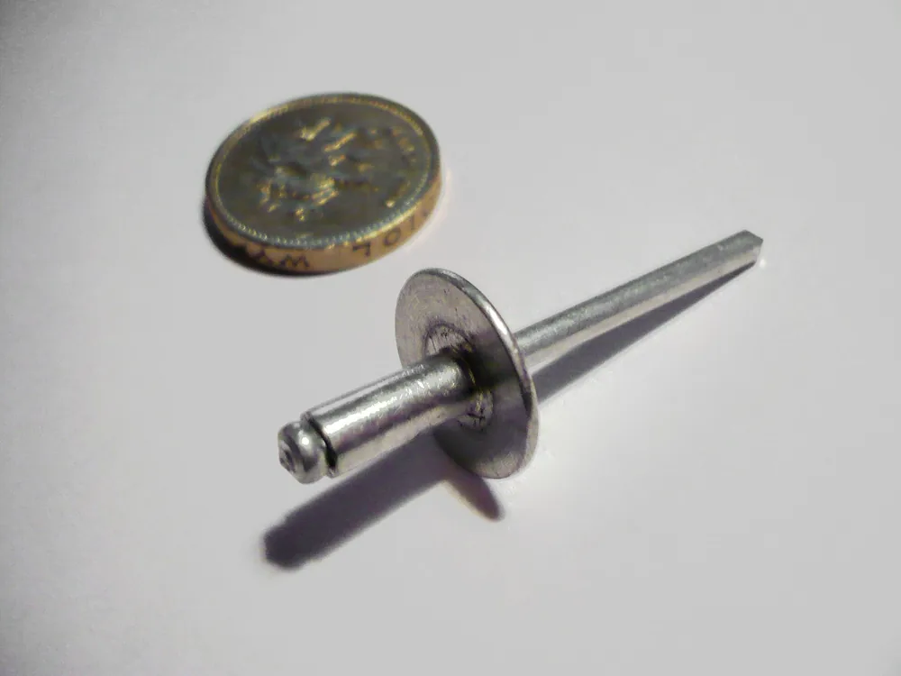

Для листовой конструкции чаще всего берут вытяжные заклёпки: их ставят с одной стороны, доступ к обратной не нужен. Забивные подходят, когда подход есть с двух сторон, резьбовые — когда в тонком листе нужна резьба, структурные — для нагруженных узлов. Выбор решают нагрузка, толщина пакета и пара материалов.

## Какую задачу решает заклёпка и когда она лучше других крепежей

Заклёпка нужна, когда пакет должен держать сдвиг и отрыв, а греть кромку нельзя. Заклёпочное соединение собирает материалы, которые не сваривают между собой: алюминий со сталью, металл с пластиком, окрашенный лист. Дуги нет, у отверстия не возникает зона термического влияния, покрытие остаётся тем, что пришло с заготовкой.

Сварка уместна, если оба металла из одной свариваемой пары, к шву есть доступ и нагрев кромки допустим. Винт ставят, когда узел придётся разбирать: снять заклёпку можно только высверливанием. Срез и растяжение берите из карточки крепежа на ваш диаметр и материал. Фраза «держит вибрацию» выбор не закрывает: предел записан в артикуле.

> Заклёпочное соединение держит разнородные материалы без нагрева кромки. Разборным оно не становится.

<!-- inline-cta -->

## Виды заклёпок по способу установки

*Вытяжная заклёпка с большим бортиком из алюминиевого сплава для композитных материалов. Фото: [Propshaft](https://commons.wikimedia.org/wiki/File:Pop_rivet_with_large_head_alloy-alloy.jpg) · [Public domain](https://creativecommons.org/publicdomain/mark/1.0/)*

Тип выбирают по доступу к пакету и по нагрузке. Забивная нужна, когда с обратной стороны есть опора. Вытяжная — когда к обороту не подойти. Резьбовая — когда в тонком листе нужна резьба. Структурные и многозажимные оставляют для нагруженного узла: числа берут из каталога производителя.

| Тип | Доступ | Инструмент | Где ставят | Ограничение |
| --- | --- | --- | --- | --- |
| Забивная, сплошная | Две стороны, нужна опора | Поддержка и обжимка | Пакет, открытый с обеих сторон | Длина хвостовика должна точно соответствовать пакету |
| Вытяжная | Одна сторона | Заклёпочник | Закрытый профиль, лист к трубе | Сердечник обрывается, отверстие в допуске |
| Резьбовая | Одна сторона | Заклёпочник под гайку-заклёпку | Тонкий лист под винт | Корпус остаётся, винт потом выворачивается |
| Структурная, замковый стержень | Обычно одна сторона | Инструмент под артикул | Нагруженный узел | Числа только из каталога производителя |

### Забивные (сплошные)

Забивная заклёпка требует опору с обратной стороны: хвостовик осаживают, пока не соберётся замыкающая головка. ГОСТ 10299-80 задаёт полукруглую головку, стержень от 1 до 36 мм, классы В и С. Потайную в том же диапазоне диаметров задаёт ГОСТ 10300-80. Рабочая температура заклёпок классов В и С по ГОСТ 10304-80 — от плюс 300 до минус 60 °С. Короткий хвостовик не наберёт головку, длинный сомнёт лист.

### Вытяжные, резьбовые и структурные

Вытяжную ставят, когда к обратной стороне листа не подойти: корпус и сердечник работают с лица. Резьбовая заклёпка создаёт резьбу в тонкостенном материале. Корпус развальцовывают с одной стороны, винт вворачивают потом. Структурную и заклёпку с замковым стержнем берут, когда среза обычной вытяжной мало. Диапазон зажима и усилие сверяйте по артикулу завода до сверления отверстий в серийной партии.

## Вытяжная заклёпка: устройство, бортик, открытый и закрытый тип

Вытяжная заклёпка состоит из корпуса и сердечника. Корпус остаётся в пакете. Сердечник тянут заклёпочником: он собирает замыкающую головку с обратной стороны и обрывается. Доступ к обратной стороне листа для этого не нужен, всю работу делают с лица. Инструмент — заклёпочник под диаметр сердечника.

Монтажник идёт в одном порядке.

1. Корпус вставляют в отверстие, бортик садится на лицевой лист.
2. Заклёпочник захватывает сердечник и тянет его на себя.
3. Головка сердечника раздаёт дальний конец корпуса и собирает замыкающую головку.
4. Сердечник обрывается в насечке. У открытого типа в корпусе остаётся канал. У закрытого торец глухой, обломок остаётся внутри.

Стандартный бортик остаётся на листе и подходит для обычного пакета. Потайной уходит в зенковку, если плоскость должна быть гладкой. Широкий нужен на мягком или тонком листе, чтобы бортик не протащило в отверстие.

Закрытый корпус берут, когда через точку не должна идти влага. Губки заклёпочника должны совпадать с диаметром сердечника. Сношенные губки срывают его раньше, чем соберётся головка. Открытый канал после обрыва для этого типа — штатный вид, не признак брака.

> Сначала бортик на лицо, потом вытяжка, потом замыкающая головка, и только после этого обрыв сердечника.

## Материал заклёпки и гальванические пары

Корпус и сердечник подбирают парой под лист и под среду. Алюминий со стальным сердечником описывает DIN EN ISO 15977. Стальной корпус ставят в стальной пакет, A2 и A4 — на улице, медь — в медных узлах. Обломок сердечника остаётся в точке и тоже входит в пару.

Разнородные металлы во влажной среде провоцируют гальваническую коррозию: через плёнку влаги разрушается менее стойкий. ГОСТ 9.005-72 судит контакт по разности потенциалов, поляризуемости и сопротивлению среды. В морской воде у алюминия −0,53 В, у стали Х13 в пассивном состоянии +0,03 В. «Нержавейка» пару с алюминием сама не оправдывает: порядок сдвигается от состава воды, аэрации и поверхности.

Если контакт по таблицам недопустим, между металлами в атмосферных условиях ставят цинковое или кадмиевое покрытие. В средних условиях оно не тоньше 9 мкм, в жёстких и очень жёстких — не тоньше 12 мкм. Чем закрыть кромку, разобрано в материале про [гальванические покрытия и их выбор под чертёж](/blog/galvanicheskoe-pokrytie-vidy-i-kogda-primenyat).

> Разнородные металлы во влажной среде дают гальваническую пару, и первым разрушается менее стойкий. Пару сверяют по ГОСТ 9.005-72.

## Как подобрать диаметр, отверстие и длину под толщину пакета

Толщина пакета определяет длину заклёпки, а диаметр заклёпки определяет диаметр отверстия. Сначала срез и растяжение из карточки, затем сумма толщин. Длина — та, чей зажим содержит эту сумму. Таблица ниже — открытая вытяжная Al/St с выступающей головкой по DIN EN ISO 15977: минимумы класса L и рекомендуемый зажим длин 8 и 10 мм.

| Диаметр, мм | Отверстие, мм | Зажим, длина 8 мм | Зажим, длина 10 мм | Срез L, не менее, Н | Растяжение L, не менее, Н |
| --- | --- | --- | --- | --- | --- |
| 3,2 | 3,3–3,4 | 3–5 | 5–6,5 | 500 | 700 |
| 4,0 | 4,1–4,2 | 2,5–4 | 4–6 | 850 | 1200 |
| 4,8 | 4,9–5,0 | 2,5–4 | 4–6 | 1200 | 1700 |

Класс H для диаметра 4,8 мм: срез от 1850 Н, растяжение от 2600 Н. Сталь и A2 берите из нормы на свою пару.

Пакет 1,5 и 1,0 мм равен 2,5 мм. Заклёпка 3,2×8 держит 3–5 мм и для этого пакета длинна. Диаметр 3,2 мм длиной 6 мм держит 1–3 мм. У диаметра 4 мм длина 6 мм кончается на 2,5 мм.

Отверстие шире допуска не обжимает листы. Слишком длинная заклёпка вспухает между ними, бортик не садится.

> **Факт.** Для вытяжной заклёпки Al/St диаметром 4,8 мм DIN EN ISO 15977 задаёт отверстие 4,9–5,0 мм и срез класса L не ниже 1200 Н.

> **Мнение.** Если пакет попал на край диапазона зажима, берите соседнюю длину, где толщина внутри интервала, и сверьте карточку партии.

## Проектирование клёпаного шва: шаг, край, число рядов

Прочность шва задают шаг и расстояние до края вместе с диаметром. Одна крупная заклёпка у кромки ряд не заменяет. Для алюминиевых строительных конструкций СНиП 2.03.06-85 ставит между центрами не меньше 3d. До края вдоль усилия и по диагонали — не меньше 2,5d, поперёк при обрезной кромке тоже 2,5d, при прокатной или прессованной — 2d. Здесь d — диаметр отверстия. В крайних рядах без окаймления шаг не больше 5d или 10t: t — толщина самого тонкого наружного листа. На одной стороне стыка в рабочем элементе заклёпок не меньше двух.

Второй ряд нужен, когда один ряд не вмещает точки без нарушения шага.

В алюминиевых конструкциях при заводской холодной клёпке пакет на скобе не толще четырёх диаметров. Диаметр заклёпки не больше пяти толщин самого тонкого листа. Длину вытяжной заклёпки задаёт диапазон зажима. Нагруженный узел считает конструктор, каталог вытяжных заклёпок эти строительные минимумы не отменяет.

> Шаг и расстояние до края решают, выдержит ли лист, даже если диаметр заклёпки по каталогу проходит.

## Заклёпка, сварка или винт: сравнение способов соединения

Одного «лучшего» крепления нет. Смотрят нагрузку, вибрацию, разборку, нагрев и число открытых сторон. Вытяжная закрывает односторонний доступ без нагрева, сварка — однородную пару, винт — узел с обслуживанием, резьбовая — резьбу в тонком листе. Цену одной точки без вашего пакета и серии называть нельзя.

| Критерий | Вытяжная заклёпка | Сварка | Винт с гайкой | Резьбовая заклёпка |
| --- | --- | --- | --- | --- |
| Нагрузка | Срез и растяжение из карточки | Шов считает технолог | Класс винта | Резьба в тонком листе |
| Вибрация | Гайки нет, предел по карточке | Шов не откручивается | Нужна фиксация гайки | Как у обычной резьбы |
| Разборка | Высверливание | Резка шва | Отворачивается | Винт выходит, корпус остаётся |
| Нагрев | Нет | Есть, покрытие у шва страдает | Нет | Нет |
| Доступ | Одна сторона | Подход горелкой | Обе стороны | Одна сторона под корпус |

Вытяжную оставляют на закрытом профиле и на паре, которую не варят. Сварку оставляют на однородной паре, если нагрев кромки допустим. Винт ставят, когда узел обслуживают с обеих сторон. Резьбовую ставят в тонкий лист под винт, без приварной гайки. Смежные способы той же детали собраны в разборе [как выбрать метод обработки под деталь](/blog/obrabotka-metalla-vidy-vybor-metoda).

> **Мнение.** Если к обратной стороне не подобраться и узел не разбирают, берите вытяжную заклёпку. Нужна повторная сборка в тонком листе — сначала резьбовая заклёпка, потом винт.

## Типичные дефекты клёпки и как их выявить

Плохая точка видна с лица, а с оборота — если оборот открыт. Первые листы смотрят целиком, дальше идут выборкой: тот же артикул, пакет и инструмент. Смена длины, новая партия крепежа или износ губок — повод остановить серию и проверить снова, пока брак не ушёл в готовые детали.

- Перекос бортика. Инструмент стоял под углом, или листы разошлись при вытяжке.
- Бортик не лёг на лист. Заклёпка длиннее пакета, или сердечник не дотянули.
- Нет замыкающей головки, или она рыхлая. Заклёпка короче пакета, отверстие шире допуска, губки изношены.
- Сердечник оборвался рано или не оборвался. В губках не тот типоразмер, или заклёпочник изношен.

Причину убирают до следующей точки: правят отверстие, меняют длину, меняют губки. Одного вида брака на первом листе достаточно, чтобы остановить партию, проверить инструмент и записать номер партии крепежа в сопроводительный лист. Снимают заклёпку высверливанием по оси корпуса. Увод сверла разбивает отверстие, и следующая заклёпка того же диаметра уже не попадает в допуск.

## Как указать заклёпки в чертеже и что влияет на цену

Если в спецификации нет типа заклёпки и отверстия, технолог не видит ни инструмент, ни артикул, ни норму времени. До выпуска чертежа спросите его, если доступ к узлу спорный: односторонняя установка и установка с опорой — разная оснастка.

В чертёж и в спецификацию вписывают шесть строк.

- Тип: вытяжная, забивная, резьбовая или структурная.
- Диаметр и длина, либо диапазон зажима под фактический пакет.
- Материал корпуса и сердечника, стандарт или артикул.
- Диаметр отверстия и допуск. Для Al/St по DIN EN ISO 15977 это вилка из таблицы, не «отверстие примерно под заклёпку».
- Число точек, шаг и расстояние до края.
- Сторону установки, если подход односторонний.

На стоимость точки влияют число заклёпок, материал корпуса, тип и доступ к узлу. Закрытый профиль добавляет время. Сумму без пакета и серии назвать нельзя.

## Итог: что выбрать под вашу деталь

Доступ только с лица и разборка не нужна — вытяжная, длина по диапазону зажима. В тонком листе нужен винт — резьбовая. Подход есть с двух сторон — забивная по ГОСТ 10299 или ГОСТ 10300, длина хвостовика под замыкающую головку. Нагрузка выше карточки обычной вытяжной — структурная или с замковым стержнем, числа из каталога производителя.

Перед запуском сверьте сумму толщин с диапазоном зажима, пару металлов по ГОСТ 9.005-72, шаг и край, строку типа и отверстия в чертеже. Если пакет, материал и шаг уже указаны, [пришлите чертёж на расчёт](/kontakty.html): по нему видно, сядет ли выбранная длина в фактический пакет.

## Частые вопросы

### Чем открытая вытяжная заклёпка отличается от закрытой?

У закрытой корпус с глухим дном. После установки сердечник остаётся внутри, сквозного канала в точке нет, поэтому соединение герметичнее. У открытой в корпусе после обрыва остаётся сквозное отверстие.

### Как снять заклёпку, если нужно разобрать соединение?

Заклёпку высверливают сверлом по диаметру корпуса, затем выбивают остаток. Сверло держат по оси. После снятия отверстие проверяют: оно не должно разойтись. Разбитое отверстие под ту же заклёпку уже не попадает в допуск. Следующую точку переносят или берут ремонтный диаметр по каталогу.

### Как подобрать материал заклёпки, чтобы не было коррозии?

Берите корпус, близкий по стойкости к соединяемым деталям, и сверьтесь с таблицами контактов ГОСТ 9.005-72 для вашей среды. Во влажной среде разнородные металлы без покрытия, которое требует стандарт, ставить не стоит. Алюминиевый лист и нержавеющий корпус в морской воде — пара, на которую стоит смотреть отдельно: в приложении стандарта потенциал алюминия −0,53 В, стали Х13 в пассивном состоянии +0,03 В.

## Источники

- [ГОСТ 10299-80. Заклёпки с полукруглой головкой](https://mirprom.com/spravka/gost-10299-80.htm) — Госстандарт СССР
- [ГОСТ 9.005-72. Допустимые и недопустимые контакты металлов](https://snip.ruscable.ru/Data1/6/6662/index.htm) — Госстандарт СССР
- [СНиП 2.03.06-85. Алюминиевые конструкции](https://www.vashdom.ru/snip/20306-85/index-5.htm) — Госстрой СССР
- [DIN EN ISO 15977. Открытые вытяжные заклёпки с разрывающимся сердечником и выступающей головкой, AlA/St](https://www.globalfastener.com/standards/detail_5224.html) — ISO, таблица размеров и нагрузок
