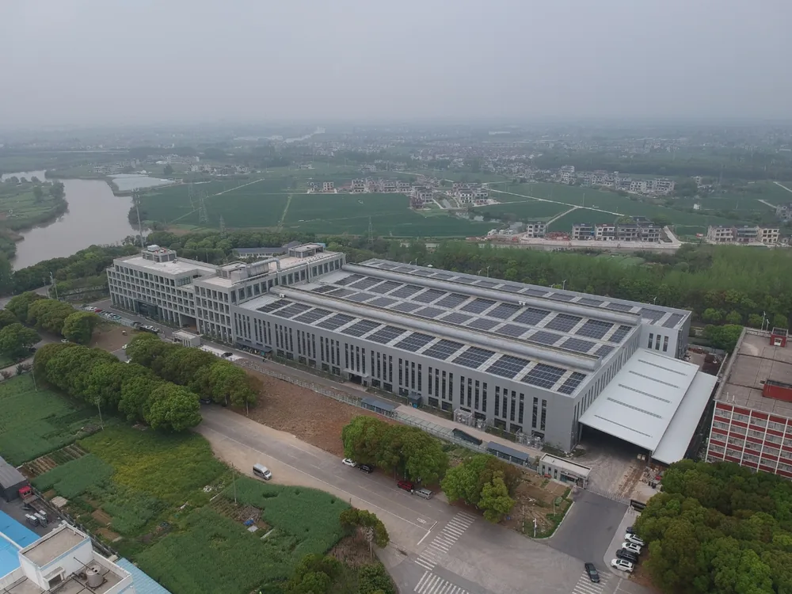

Сталь берут, когда нужны прочность, жёсткость и низкая цена материала. Алюминий — когда важна масса. Нержавейку — когда деталь работает во влаге, в химии или рядом с едой. Остальное решают нагрузка, способ обработки и бюджет: материал меняет и цену детали, и срок её изготовления.

## С чего начать: что деталь должна выдержать

Материал выбирают под условия работы детали, а не по привычке и не по цене за килограмм. Пять вопросов отсекают лишнее ещё до разговора о марке. Одна и та же деталь из разного металла ведёт себя по-разному и стоит по-разному.

1. **Какая нагрузка?** Большая и постоянная — смотрите на сталь. Алюминию придётся увеличить сечение.
2. **Есть ли ограничение по массе?** Если есть, отсекайте сталь: алюминий почти втрое легче.
3. **Какая среда?** Влага, химия, пищевой или медицинский контакт отсекают сталь без покрытия.
4. **Какая температура?** Нагрев отсекает часть алюминиевых сплавов, о них ниже.
5. **Как деталь будут делать?** Резание, гибка и сварка задают класс нержавейки и марку стали.

Ответы редко указывают на один металл. Чаще остаются два-три кандидата, и между ними выбирают по обработке и цене.

<!-- inline-cta -->

## Сталь, алюминий, нержавейка: сводное сравнение

*Тяжелые стальные конструкции и детали ветровых турбин, изготовленные на промышленном объекте с производительностью 3000 тонн в месяц. Фото: [Leadingtopunion](https://commons.wikimedia.org/wiki/File:Custom_heavy_steel_structures_and_wind_power_components.jpg) · [CC0 1.0](https://creativecommons.org/publicdomain/zero/1.0/deed.en)*

Три материала различаются по массе, коррозионной стойкости и поведению на станке. Лучшего вообще среди них нет, а сравнивать их удобно по одним и тем же критериям.

| Критерий | Сталь | Алюминиевые сплавы | Нержавеющая сталь |
|---|---|---|---|
| Плотность | около 7,85 г/см³ | около 2,7 г/см³ | около 7,9 г/см³ |
| Жёсткость (модуль упругости) | около 200 ГПа | около 70 ГПа | близка к стали |
| Коррозионная стойкость | низкая без покрытия | защищает оксидная плёнка | зависит от класса |
| Обрабатываемость | зависит от марки | режется быстро | тяжелее: наклёп, налипание |
| Свариваемость | падает с ростом углерода | зависит от сплава | зависит от класса, L-марки лучше |
| Цена материала | ниже | выше стали | заметно выше стали |

Значения справочные, для расчёта берут данные ГОСТ на конкретную марку. Алюминиевые сплавы имеют меньшую плотность, чем сталь, и платят за это жёсткостью. Сталь подходит нагруженным и жёстким деталям при ограниченном бюджете. Алюминий — там, где важна масса. Нержавейка — в агрессивной среде и при контакте с пищей.

## Сталь: где она выигрывает

Сталь выигрывает на нагруженных и жёстких деталях: валах, кронштейнах, корпусах под нагрузкой. Материал недорогой, а жёсткость втрое выше, чем у алюминия. Слабое место — коррозия: без покрытия деталь ржавеет, поэтому в цену закладывают окраску, цинкование или другую защиту.

Поведение стали по углероду можно прикинуть заранее. Чем его больше, тем прочнее сталь, ниже её пластичность и труднее сварка. Выбирают баланс, а не максимум. Марку подбирают вместе с состоянием поставки и термообработкой: об этом ниже, в разделе про чертёж.

## Алюминиевые сплавы: лёгкость и то, что за неё платят

Алюминиевые сплавы дают выигрыш в массе: около 2,7 г/см³ против около 7,85 у стали. Расплата — жёсткость (около 70 ГПа против около 200) и чувствительность к нагреву. Деталь прогибается сильнее, поэтому сечение часто приходится увеличивать. Выбирают не «алюминий вообще», а группу сплавов; конкретные марки мы сравнили в статье [как выбрать алюминиевый сплав: Д16Т, АМг6 или АД31](/blog/alyuminievyj-splav-d16t-amg6-ad31-sravnenie).

### Сплавы Al-Mg (АМг): упрочняются наклёпом

Наклёп после формовки теряется при нагреве выше примерно 65 °C или в цикле окраски с запечкой. Если деталь работает горячей или проходит горячую окраску, эти сплавы подходят хуже. При вытяжке и гибке с растяжением появляются полосы Людерса (растяжки), поэтому на лицевых поверхностях после глубокой вытяжки эти сплавы не ставят.

### Сплавы Al-Mg-Si: формуются, потом упрочняются

Они поставляются относительно пластичными и упрочняются до состояния T6 при последующем нагреве, например при запечке краски. Берут их там, где нужна формуемость при изготовлении и прочность в готовой детали. Точную марку и состояние поставки записывают в чертёж.

## Нержавейка: классы, формуемость и стоимость

Нержавеющая сталь — железный сплав, в котором не менее 10 % хрома. Хром образует на поверхности прозрачную оксидную плёнку, и она ограничивает дальнейшую коррозию. Никель входит в состав аустенитных классов и поднимает их цену. Ниже разберём три класса, которые чаще всего встречаются в заказах.

| Класс | Закалка термообработкой | Коррозионная стойкость | Когда брать |
|---|---|---|---|
| Аустенитные | нет | выше, чем у мартенситных | сложная форма, важна коррозионная стойкость |
| Ферритные | нет, лишь умеренный наклёп | выше, чем у мартенситных | простая форма, цена важнее формуемости |
| Мартенситные | да | ниже, чем у двух других | важна твёрдость, а не стойкость |

### Аустенитные (3XX): формуются лучше всех

Аустенитные стали позволяют делать более сложные детали. Никеля в них около 10 %, отсюда цена. Безникелевая серия 4XX дешевле, но формуется хуже, поэтому замену согласуют с технологом до запуска.

### Ферритные и мартенситные: когда аустенитные не нужны

Ферритные не закаливаются термообработкой и лишь умеренно упрочняются наклёпом. Если детали нужна большая твёрдость, они не подходят. Мартенситные закаливаются до разных уровней твёрдости, но по коррозионной стойкости уступают аустенитным и ферритным. Их берут, когда важна твёрдость.

## Как материал меняет обработку: фрезеровка, точение, сварка

На станке материал определяет режимы резания, износ инструмента и достижимую шероховатость. Алюминий режется быстро, но требует правильных режимов и отвода стружки. Нержавейка склонна к наклёпу и налипанию, инструмент изнашивается быстрее. Сталь зависит от марки и состояния поставки. Обрабатываемость задаёт марка, записанная в чертеже.

Жёсткий допуск и низкая шероховатость добавляют машинного времени на любом материале. Указывайте только то, что нужно.

Для сварных деталей из нержавейки берите L-вариант марки. Суффикс L означает пониженный углерод: свариваемость выше, прочность немного ниже. У алюминиевых сплавов свариваемость зависит от сплава, поэтому группу уточняют до заказа. Как материал ложится на оборудование, описано в разделе о [технологиях обработки](/razdel/tehnologii.html).

## Что материал делает с ценой и сроком детали

Цена детали складывается из материала, машинного времени, оснастки и покрытия, поэтому дешёвый килограмм не означает дешёвую деталь. Марка в чертеже влияет на стоимость дважды: ценой заготовки и временем обработки. Алюминий дороже стали по килограмму, но быстрее режется, поэтому разница в цене детали может оказаться меньше, чем в цене заготовки. Нержавеющий корпус с глубокими карманами дорожает от обоих факторов: заготовка дороже, а резание медленнее и сильнее изнашивает инструмент.

> За деталь платят и за металл, и за время станка. Самый дешёвый материал не всегда даёт самую дешёвую деталь.

Замена материала сдвигает и срок: другое время обработки, другая доступность проката, иногда другое покрытие. Рублёвые ориентиры смотрите на странице [цены на металлообработку](/ceny.html), точный расчёт зависит от чертежа.

## Что указать в чертеже и заявке, чтобы получить именно тот материал

Укажите марку полностью, стандарт, состояние поставки и то, что проверять при приёмке. Тогда заказ не уйдёт в производство с двусмысленной маркой.

- **Марка целиком**, а не «конструкционная сталь». Без этого технолог выберет сам, и свойства разойдутся с ожидаемыми.
- **ГОСТ или ТУ.** Без стандарта допуски по химии остаются открытыми.
- **Состояние поставки и термообработка.** Пропустите — получите материал с другой твёрдостью.
- **Испытание на растяжение на каждую поставку**, если деталь формуется: для таких деталей его советуют запрашивать.
- **L-вариант для сварной нержавейки:** пониженный углерод улучшает свариваемость, но снижает прочность.
- **Допустимые аналоги и кто их согласует**: подробнее — [как согласовать аналог материала](/blog/kak-soglasovat-material-analog-dlya-metallicheskoy-detali).

> **Факт.** Допуск по химии внутри одной марки — это диапазон, а не точка: у стали SAE 1010 по спецификации J403 углерод может составлять от 0,08 до 0,13 %. Поэтому в чертеже пишут конкретную марку и стандарт, а не «сталь примерно такого класса».

## Частые ошибки при выборе материала

Пять ошибок чаще всего заканчиваются переделкой детали или лишними расходами.

- Выбор по цене за килограмм без учёта обработки и покрытия: деталь выходит дороже ожидаемой.
- Нержавейка «на всякий случай»: переплата или класс, который не держит среду.
- Сплав Al-Mg для горячей окраски или нагрева: пропадает наклёп, деталь мягче расчётной.
- Ферритная нержавейка там, где нужна закалка: нужной твёрдости не получить.
- Марка через «или» и замена без согласования: приходит не тот материал.

> **Мнение.** Если среда не агрессивная и пищевого контакта нет, сравните нержавейку с окрашенной или оцинкованной сталью: покрытие может стоить меньше разницы в цене материала.

## Итог: как выбрать материал под задачу

Сталь берут для нагруженных и жёстких деталей при ограниченном бюджете. Алюминий — когда важны масса и быстрая обработка. Нержавейку — когда среда агрессивная или деталь касается пищевых и медицинских сред.

> Материал выбирают под условия работы детали и способ её изготовления, а не под привычную марку.

Для расчёта пришлите чертёж, условия работы, размер партии и допустимые аналоги. Если марка ещё не выбрана, опишите нагрузку, среду и температуру: варианты можно сузить вместе. Когда данные собраны, [отправьте чертёж на расчёт](/kontakty.html).

## Частые вопросы

### Можно ли заменить стальную деталь на алюминиевую с теми же размерами?

Нет. Жёсткость алюминия ниже, и деталь прогнётся сильнее. Сечение пересчитывают по нагрузке, а замену обсуждают с конструктором до запуска.

### Что делать, если нужного проката нет в наличии?

Не заменять молча. Аналог меняет обработку, цену и срок. Согласуйте замену письменно, с маркой и состоянием поставки.

### Можно ли прислать заказ, если марка ещё не выбрана?

Можно, если в заявке есть условия работы: нагрузка, среда, температура, размер партии. По ним выбор сужают до двух-трёх материалов, а итоговую марку записывают в чертёж.

## Источники

- [Metal grades and designations for grading sheet metals](https://www.thefabricator.com/thefabricator/article/metalsmaterials/metal-grades-designations-for-grading-sheet-metals) — The Fabricator
- [Росстандарт](https://www.rst.gov.ru/) — Федеральное агентство по техническому регулированию и метрологии: где искать действующие ГОСТ
