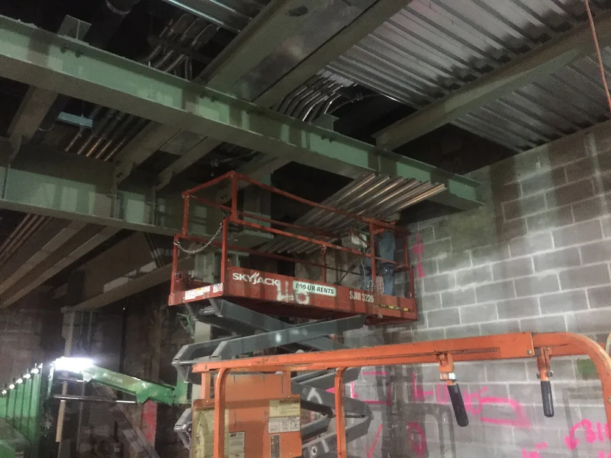

Материал выбирают не по названию, а по условиям работы детали: нагрузка, среда, температура, ресурс. Конструкционной стали хватает для большинства валов и кронштейнов, нержавейка нужна при влаге и химии, алюминий — где важен вес, медь — где нужен отвод тепла или ток. Ниже — как сравнить варианты и что сообщить мастерской.

## Что нужно знать о детали до выбора материала?

Условия эксплуатации детали определяют выбор материала. До марки нужны нагрузка, среда, температура и ресурс. Чертёж с контуром и пустым штампом марку ещё не задаёт.

Сначала отсекают группы, которые среду или удар не держат. Потом сравнивают оставшиеся по прочности, массе, резанию и цене готовой штуки.

Пять вопросов о детали, на которые нужен ответ до выбора марки:

- Нагрузка: постоянная, удар или знакопеременный цикл?
- Среда: сухой воздух, влага, масло, щёлочь, кислота?
- Температура и число часов, которые деталь в ней стоит?
- Ресурс: разовая оснастка или тысячи часов в машине?
- Что ещё нельзя потерять: массу, ток, тепло, магнитность, сварку?

Прочность впереди, если деталь бьют. Коррозионная стойкость впереди, если деталь моют или стоит на улице. Ток и тепло считают, только когда через деталь идёт ток или тепло.

<!-- inline-cta -->

## Сталь, нержавейка, алюминий, медь: сводное сравнение

*Монтаж стальной палубы над конструкционными балками при строительстве. Фото: [MTA Capital Construction Mega Projects](https://commons.wikimedia.org/wiki/File:Overhead_decking_going_in_above_structural_steel_beams_in_the_back_of_house_area_of_the_LIRR_passenger_concourse._08-26-2019_%2848647324728%29.jpg) · [CC BY 2.0](https://creativecommons.org/licenses/by/2.0)*

Конструкционную сталь, нержавейку, алюминий, медь, латунь и бронзу сравнивают по одним критериям. Цифры ориентировочные: точное значение зависит от марки и состояния поставки.

| Группа | Прочность | Плотность | Теплопроводность | Коррозия без покрытия | Резание |
| --- | --- | --- | --- | --- | --- |
| Конструкционная сталь | база для валов | 7700–7900 кг/м³ | ниже меди | ржавеет во влаге | среднее |
| Нержавеющая сталь | близко к конструкционной | как у стали | ниже меди | держит влагу | тяжелее стали |
| Алюминиевые сплавы | ниже сталей | 2,6989 г/см³ у алюминия | 237 Вт/(м·К) у алюминия | не любая химия | легко |
| Медь | не для силовой нагрузки | 8,92 г/см³ | 401 Вт/(м·К) | спокойнее стали | вязкая |
| Латунь | ближе к меди | зависит от марки | ниже меди | спокойнее стали | легче меди |
| Бронза | для втулок | зависит от марки | ниже меди | зависит от марки | средняя |

> **Факт.** Плотность стали — 7700–7900 кг/м³, алюминия — 2,6989 г/см³, меди — 8,92 г/см³. При том же объёме алюминиевая заготовка легче стальной примерно втрое.

Алюминиевые сплавы имеют меньшую плотность, чем конструкционная сталь. Кронштейн из сплава выходит легче. Нержавеющая сталь устойчива к коррозии там, где конструкционная без покрытия ржавеет. Медь и её сплавы отводят тепло лучше стали: у меди в таблице 401 Вт/(м·К). Сталь 45 в поставке и после закалки — две разные детали.

## Конструкционные стали: когда хватает Ст3, стали 45 или 40Х

Конструкционной стали хватает, когда среда металл не разрушает и масса детали не ограничена. Ст3, сталь 45, 40Х и 09Г2С закрывают валы, оси, фланцы, кронштейны и корпуса подшипниковых узлов.

Ст3 идёт по ГОСТ 380-2005: пластины, кронштейны, неответственные фланцы.

Сталь 45 — прокат по ГОСТ 1050-2013 для валов и осей. Конструкционная сталь этой марки допускает термообработку: закалка и отпуск поднимают прочность, после печи нужен припуск на увод.

40Х берут на более нагруженные валы. ГОСТ 4543-2016 относит такую сталь к работе после термической обработки. 09Г2С оставляют сварным рамам.

Без покрытия конструкционная сталь ржавеет. Защиту дают гальваника, порошок или масло в закрытом узле.

> Конструкционная сталь с покрытием закрывает вал, фланец и кронштейн, пока среда металл не разрушает и масса детали не ограничена.

> **Мнение.** Если узел сухой, а деталь потом красят или цинкуют, берите Ст3, сталь 45 или 40Х. Нержавейку оставляйте для влаги и химии.

## Нержавеющая сталь: какая марка нужна и где без неё не обойтись?

Нержавеющая сталь нужна, когда покрытие среду не закрывает: при конденсате, мойке, уличной эксплуатации, пищевом или медицинском контакте, кислотах и хлоридах, а также когда шов не красят. ГОСТ 5632-2014 задаёт марки для работы в коррозионно-активных средах и при высоких температурах.

### Аустенитные марки: 08Х18Н10, 12Х18Н10Т, 03Х17Н14М3

08Х18Н10 — базовая марка для влаги и общих сред. В хлориды её не ставят наугад: без молибдена точечная коррозия приходит раньше. У 12Х18Н10Т в марке титан. Титан связывает углерод, и шов после сварки меньше страдает от межкристаллитной коррозии. 03Х17Н14М3 — низкий углерод и молибден, её смотрят при хлоридах.

Свариваемость у тройки рабочая, режим другой, чем у Ст3. Резание тоже другое: нержавейка вязкая, греет кромку, минут на штуку больше, чем у стали 45. Разницу закладывают в цену заранее.

### Когда нержавейка не нужна?

В сухом узле, под маслом или под покрытием хватает обычной стали. Гальваника или порошковая окраска дешевле и по заготовке, и по станку: нержавейка дольше стоит в резании. На короткой серии пруток берут длиннее заказа, остаток лежит, а минуты станка уже оплачены.

Платить за нержавейку имеет смысл, когда сталь с покрытием по среде уже не проходит. Сухая деталь из неё дороже и по прутку, и по минутам резания. Краску по шву при этом закладывают в ту же цену.

## Алюминий и медные сплавы: вес, теплоотвод, проводимость

Алюминиевые сплавы и медь берут, когда сталь проигрывает по массе, теплу или току. За это платят жёсткостью и ценой килограмма. Состояние поставки меняет свойства сильнее, чем одна буква в марке.

### Алюминиевые сплавы: Д16Т, АМг6, АД31

Алюминиевые сплавы имеют меньшую плотность, чем конструкционная сталь: у алюминия она 2,6989 г/см³. Марки деформируемых сплавов собраны в ГОСТ 4784-2019.

Д16Т — кронштейны и корпуса. Сварку плавлением не закладывают: шов склонен к трещинам, узел собирают механически. АМг6 варят: баки и рамы во влаге. АД31 — профили и радиаторы. Подробнее: [как выбрать между Д16Т, АМг6 и АД31](/blog/alyuminievyj-splav-d16t-amg6-ad31-sravnenie).

> Алюминий берут ради массы и отвода тепла. По прочности большинство его сплавов уступает конструкционным сталям, поэтому сечение приходится увеличивать.

### Медь, латунь и бронза

Медь проводит тепло и ток лучше стали. Теплопроводность меди — 401 Вт/(м·К), плотность — 8,92 г/см³, заготовка тяжелее стальной того же объёма. Медь М1 ставят на шины, контакты и теплоотводящие элементы.

Латунь Л63 режется легче меди: штуцеры, гайки, мелкая токарная номенклатура. Бронзу БрАЖ9-4 оставляют втулкам и парам трения, где нужна износостойкость, а ток чистой меди не нужен. Цену килограмма без актуального прайса не называем: сравнивают готовую деталь и диаметр прутка на складе.

## Обрабатываемость, сварка и термообработка: как марка меняет срок и цену

Выбор материала влияет на срок и стоимость детали через обрабатываемость резанием. Соседние сплавы расходятся по скорости, износу пластины и минутам на штуку. Коэффициент «во сколько раз» зависит от твёрдости и пластины. В таблице порядок групп, без нормы из справочника режимов.

| Группа | Как режется | Как варится | Что даёт термообработка |
| --- | --- | --- | --- |
| Ст3 | легко | штатный режим | обычно не нужна |
| Сталь 45 и 40Х | после закалки тяжелее | режим жёстче | закалка и отпуск, нужен припуск |
| Аустенитная нержавейка | вязкая, греет кромку | шов чувствителен к коррозии | закалкой не упрочняют |
| Алюминиевые сплавы | быстро, стружка липнет | АМг6 варят, Д16Т обычно нет | старение, не закалка стали |
| Медь, латунь, бронза | латунь легко, медь тянется | свой режим | закалкой обычно не упрочняют |

Сталь 45 и 40Х на силовом шве требуют разделки. Д16Т в сварной конструкции — повод сменить марку. Термообработку ставят так: черновая обработка, печь, чистовая с припуском на коробление. Готовый размер в печь не отдают. До программы имеет смысл [подобрать маршрут обработки под деталь](/razdel/tehnologii.html). Смена марки без смены программы сдвигает и срок, и стоимость. Припуск на коробление закладывают до заказа заготовки.

## Цена заготовки и цена обработки: когда дорогой материал выгоднее

Стоимость детали — это заготовка, минуты станка, инструмент, брак и покрытие. Дорогой материал выгоднее, когда он снимается быстрее, даёт меньше брака и позволяет взять заготовку ближе к готовому размеру.

Дешёвый пруток проигрывает, если нержавейку ставят на сухую деталь: металл дороже, и штука дольше стоит на станке. Проигрывает и длинный пруток «за тонну», когда серия — двадцать штук: остаток дороже короткого со склада. Нет нужного диаметра — берут больший и превращают лишнее в стружку.

Диаметр и наличие на складе двигают срок сильнее, чем строка прайса. Пруток пачкой на год для двадцати деталей дороже короткого куска у поставщика. Пластина под нержавейку живёт меньше, чем на стали 45, и тоже входит в штуку. Рублей за килограмм без актуального прайса здесь нет. Считают готовую штуку в вашем количестве. [Цены на металлообработку](/ceny.html) показывают работу станка, металл считают отдельно по марке и массе.

> Стоимость готовой детали решает выбор: разница в цене заготовки часто тает в минутах станка, браке и покрытии.

## Марки ГОСТ, AISI и EN: что делать, если нужного материала нет?

Обозначения по ГОСТ, AISI и EN не взаимозаменяемы: составы и допуски по элементам расходятся. Иностранную марку используют как ориентир при поиске проката, а замену согласуют до запуска.

| Марка по ГОСТ | Что сверить до замены |
| --- | --- |
| 08Х18Н10 | углерод, хром и никель по сертификату плавки |
| 12Х18Н10Т | титан: он указан в марке, в соседней марке без буквы Т его может не быть |
| 03Х17Н14М3 | молибден и низкий углерод, а не только номер марки |
| Д16 | состояние поставки (Т или М) меняет прочность |

Сверяют химический состав по сертификату на плавку, а не строку в каталоге поставщика.

Соседний сплав предлагает мастерская, решение принимает заказчик. Как оформить согласие: [как согласовать аналог материала](/blog/kak-soglasovat-material-analog-dlya-metallicheskoy-detali).

> Замена марки — решение заказчика. Без подписи в переписке или на чертеже соседний сплав в работу не берут.

## Что сообщить мастерской: чек-лист и примеры для типовых деталей

Выбор материала закрывается пакетом данных. Мастерской нужны условия работы, нагрузка, количество и правило замены. Чертёж без этого оставляет технолога гадать.

Как подготовить данные для подбора материала:

1. Опишите среду, температуру и ресурс: сухо, влага, масло, химия, улица.
2. Укажите нагрузку: постоянная, удар, цикл, и что ломается первым.
3. Напишите, что важнее: прочность, масса, тепло, ток, магнитность.
4. Приложите чертёж с маркой по ГОСТ и строкой, можно ли менять марку.
5. Для давальческого металла добавьте сертификат и номер плавки.

На типовых деталях группа сужается сама. Вал в сухой среде — сталь 45 или 40Х с термообработкой. Корпус подшипникового узла — конструкционная сталь, алюминий если узел легче. Фланец во влажном стыке — нержавейка. Кронштейн — сталь, при сварном шве смотрят АМг6. Теплоотводящий элемент — медь М1 или алюминий, если важнее масса.

Марка стоит в штампе чертежа. Номер плавки на торце и в сертификате должны совпасть. Частая ошибка: марки нет на складе, запрет на замену всплывает после закупки.

Пришлите чертёж и ответы по пяти пунктам. По ним называют марку и говорят, где замена ломает узел. Дальше считают заготовку и маршрут.

## Частые вопросы

### Как проверить, что металл соответствует заявленной марке?

Запросите сертификат на партию и сверьте номер плавки с маркировкой на прутке или листе. Клеймо и документ должны относиться к одной плавке. Если цифры расходятся, до запуска делают химический анализ. Надпись марки в штампе чертежа плавку не подтверждает.

### Почему нельзя выбирать материал только по цене за килограмм?

В штуку входят ещё минуты станка, пластины, брак, покрытие и длина прутка на складе. Короткая серия из складского металла часто обходится спокойнее, чем тонна проката с лишней стружкой. Сравнивают готовую деталь в вашем количестве.

### Чем грозит неверно выбранный материал?

Деталь ржавеет, садится под нагрузкой или истирается раньше узла. Дальше новая заготовка, повторная обработка и сдвиг срока сборки. На партии ошибка в марке дороже, чем согласование замены до закупки.

## Источники

- [ГОСТ 1050-2013. Металлопродукция из нелегированных конструкционных качественных и специальных сталей. Общие технические условия](https://files.stroyinf.ru/Index2/1/4293768/4293768057.htm) — Межгосударственный совет по стандартизации, метрологии и сертификации
- [ГОСТ 4543-2016. Металлопродукция из конструкционной легированной стали. Технические условия](https://files.stroyinf.ru/Index2/1/4293748/4293748469.htm) — Межгосударственный совет по стандартизации, метрологии и сертификации
- [ГОСТ 5632-2014. Нержавеющие стали и сплавы коррозионно-стойкие, жаростойкие и жаропрочные. Марки](https://files.stroyinf.ru/Index2/1/4293768/4293768317.htm) — Межгосударственный совет по стандартизации, метрологии и сертификации
- [ГОСТ 4784-2019. Алюминий и сплавы алюминиевые деформируемые. Марки](https://files.stroyinf.ru/Index2/1/4293728/4293728395.htm) — Межгосударственный совет по стандартизации, метрологии и сертификации
