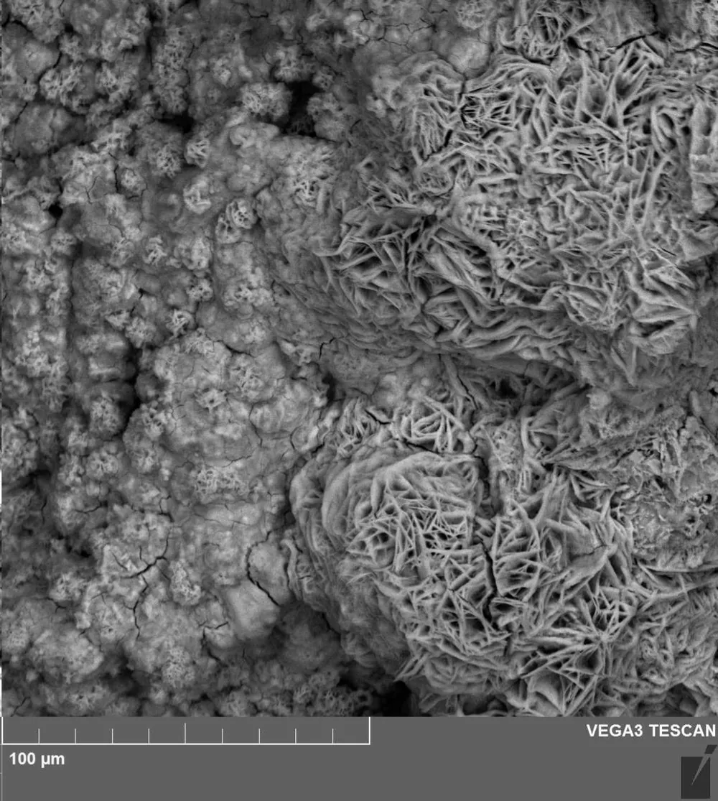
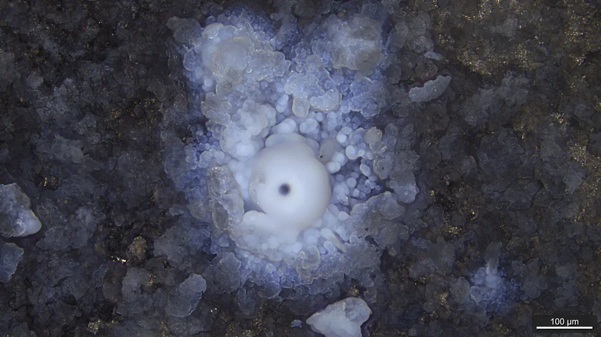

Переплата за материал прячется в трёх местах: марка выше нужной, дорогая обработка и лишняя защита. Начните с условий работы детали — среда, нагрузка, температура — и берите самую простую марку, которая их выдерживает. Нержавейка оправдана во влаге и агрессивной среде, а в сухом узле часто хватает углеродистой стали с покрытием.

## С чего начать: где и как будет работать деталь

Начните со встречного вопроса: где будет стоять деталь? Ответ отсекает половину марок раньше, чем вы откроете прайс. Среда, нагрузка, температура и особые требования задают минимальный класс материала. Всё, что выше этого минимума, — запас, за который вы платите, а пользы не получаете.

Деталь проверяют по четырём вопросам. Среда: влага, химия, улица или сухой цех. Нагрузка: статическая, ударная или износ трением. Температура: комнатная, нагрев или мороз. Особые требования: немагнитность, контакт с пищей, ограничение по массе. На каждый пункт хватит одной строки.

Решение идёт в одном порядке: условия работы, затем класс материала, затем конкретная марка. Обратный ход («возьмём привычную 12Х18Н10Т») чаще всего заканчивается лишними деньгами. Ответы про среду, нагрузку и температуру обычно сужают выбор до одной-двух марок.

> Берите самую простую марку, которая выдерживает условия работы. Запас «на всякий случай» оплачивает заказчик.

Условий не знаете — спросите конструктора узла.

<!-- inline-cta -->

## Из чего складывается цена детали и где здесь материал

*Поверхность излома стали показывает структуру материала и влияние включений на его прочность, что учитывается при определении цены детали. Фото: [Mykhailo Voron](https://commons.wikimedia.org/wiki/File:Steel_fracture_surface.jpg) · [CC BY 4.0](https://creativecommons.org/licenses/by/4.0)*

Цена детали складывается из четырёх статей: заготовка, машинное время, износ инструмента и последующая защита или термообработка. Материал влияет на все четыре, а не только на первую. Поэтому металл, дешёвый по килограмму, не гарантирует дешёвую деталь. Общую картину затрат разбираем в статье [от чего зависит цена металлообработки по чертежу](/blog/ot-chego-zavisit-cena-metalloobrabotki-po-chertezhu).

> Разница в цене заготовки часто меньше, чем разница в машинном времени и защите. Дешёвый по килограмму материал не делает деталь дешёвой.

### Заготовка: сортамент и припуск

Заготовка — круг, пруток или лист под размер детали. Вы платите за вес всей заготовки, а не готовой детали: припуск уходит в стружку, но оплачивается как металл. Нужного диаметра нет в наличии — берут ближайший больший, и лишний металл тоже превращается в стружку. Размер детали, подогнанный под ходовой сортамент, сокращает такой отход.

### Машинное время и инструмент

Обрабатываемость резанием определяет режимы: скорость, подачу, глубину прохода. Вязкие и упрочняющиеся металлы режут медленнее, а инструмент на них изнашивается быстрее. Износ инструмента увеличивает стоимость детали дважды: расходом на пластины и простоем при замене. Разницу для вашей детали покажет только расчёт технолога, без него любая цифра будет выдумкой.

## Сравнение групп материалов: обработка, коррозия, цена заготовки

*Активная коррозия магниевого сплава, подвергнутого воздействию электролита. Фото: [MHGuerraMutis](https://commons.wikimedia.org/wiki/File:Corrosion_activa.jpg) · [CC0 1.0](https://creativecommons.org/publicdomain/zero/1.0/deed.en)*

Проще всего обрабатываются сталь 45, латунь и алюминий Д16Т. Тяжелее всего режется нержавейка, зато она лучше всех держит коррозию. Углеродистые стали дешевле в заготовке, нержавейка и латунь дороже. Оценки в таблице приблизительные и без цифр.

| Материал | Обрабатываемость резанием | Свариваемость | Коррозионная стойкость | Цена заготовки |
|---|---|---|---|---|
| Ст3 | хорошая | хорошая | слабая | низкая |
| Сталь 45 | хорошая | ограниченная | слабая | низкая |
| 40Х | средняя | ограниченная | слабая | средняя |
| 09Г2С | средняя | хорошая | слабая | средняя |
| 12Х18Н10Т, 08Х18Н10 | тяжёлая | хорошая | хорошая | дорогая |
| Д16Т | хорошая | плохая | средняя | выше средней |
| Латунь | хорошая | ограниченная | средняя | дорогая |

«Цена заготовки» здесь относительная: она зависит от региона, размера партии и даты закупки. Точные рубли и коэффициенты обрабатываемости мы не приводим — без свежего источника они устареют в день публикации.

## Нержавейка или углеродистая сталь: считаем полную стоимость

Нержавеющая сталь лучше сопротивляется коррозии, но дороже в заготовке и обычно труднее обрабатывается, чем углеродистая. Углеродистая дешевле, зато в агрессивной среде нуждается в защитном покрытии. Сравнивайте варианты по одним критериям: заготовка, время обработки, покрытие (цинк, порошковая краска, оксидирование) и срок службы в вашей среде.

### Когда нержавейка — переплата

Деталь в сухом закрытом узле не встречается с влагой, и коррозия не влияет на её работу. Выбирайте углеродистую сталь с покрытием, если:

- узел сухой и стоит внутри корпуса;
- деталь всё равно красят или цинкуют;
- покрытие легко обновить при обслуживании.

### Когда экономия на ней обходится дороже

В мокрой среде покрытие изнашивается, деталь приходится менять — и вы платите за изготовление дважды. Класс нержавейки тоже важен: аустенитные, ферритные и мартенситные стали различаются по стойкости и магнитности. В хлоридной среде 304 может не хватить, там берут 316 с молибденом. Выбирайте нержавейку, если:

- есть влага, реагенты или хлориды;
- деталь контактирует с пищей или лекарствами;
- покрытие будет стираться при работе.

## Марки и аналоги по ГОСТ и зарубежным стандартам

Аналог марки — это близкий по составу металл, а не тот же самый. Он может снизить стоимость детали, если чертёж требует импортную марку, которой нет на складе. Но свойства могут отличаться, поэтому замену согласуют, а не подставляют. Порядок согласования — в статье [как согласовать аналог материала](/blog/kak-soglasovat-material-analog-dlya-metallicheskoy-detali).

| Марка по ГОСТ | Ближайший аналог | Типичное применение |
|---|---|---|
| 08Х18Н10 | AISI 304 | пищевое и бытовое оборудование |
| 12Х18Н10Т | AISI 321 | сварные узлы, детали с нагревом |
| 03Х17Н14М3 | AISI 316L | хлоридная среда, химия |
| 12Х17 | AISI 430 | бытовые и декоративные детали |
| Д16Т | 2024 | силовые алюминиевые детали |
| В95 | 7075 | нагруженные алюминиевые детали |

> Аналог — это близкий состав, а не тот же металл. Замену фиксируют письменно.

Если в чертеже стоит импортная марка, укажите допустимые аналоги или требования к свойствам. Тогда технолог не будет гадать и не задержит расчёт вопросами.

## Материал, допуски и последующая обработка

Материал тянет за собой допуски, шероховатость и доработку, а они — цену. Вязкие металлы задирают поверхность, аустенитная нержавейка склонна к наклёпу, твёрдая сталь плохо режется. Чем жёстче допуск и чище поверхность, тем больше проходов и тем дороже деталь.

> **Факт.** Аустенитная нержавеющая сталь склонна к наклёпу: при резании поверхность упрочняется, и следующему проходу инструмента приходится труднее.

Термообработка меняет обрабатываемость резанием. Закалённую сталь режут плохо, поэтому деталь чаще обтачивают до закалки. После неё металл может повести, и остаётся припуск под шлифовку. Вал из 40Х с закалкой дороже не из-за марки, а из-за двух дополнительных операций.

Покрытие меняет размер. Цинк и оксидирование добавляют слой, и его толщину закладывают в допуск заранее: иначе деталь после покрытия не встанет в сопряжение. Электрополировку, галтовку и оксидирование указывайте в чертеже, иначе они не попадут в расчёт. Кто их выполняет — исполнитель или подрядчик, — уточняйте в заявке: от этого зависят срок и цена.

## Ошибки заказчика при выборе материала

Типовые ошибки удорожают деталь или срывают срок, и почти все они возникают ещё на чертеже. Каждая из них снимается одной строкой в заявке.

- **Марка «на всякий случай».** Нержавейка там, где хватает стали с покрытием: переплата за заготовку и время обработки.
- **Импортная марка без аналога.** Появляются вопросы, срок растёт, есть риск не той замены.
- **Не учтены сортамент и припуск.** Круга или листа нужного размера нет в наличии — срок растёт.
- **Не указана термообработка.** Деталь приходит мягкой, и её приходится делать заново.
- **Нет требования к сертификату на материал.** Позже подтвердить происхождение металла нечем.
- **Не решено, чей материал.** Если сырьё даёт заказчик, а не исполнитель, ответственность за его качество и сроки нужно оговорить заранее.

> **Мнение.** Если сомневаетесь между нержавейкой и сталью с покрытием, сравнивайте полную стоимость обоих вариантов, а не цену за килограмм.

## Чек-лист перед отправкой чертежа

Чтобы расчёт пришёл без лишних вопросов и без переплаты, подготовьте пять пунктов. Технолог проверит марку и скажет, есть ли вариант проще.

1. Опишите условия работы в двух строках: среда, нагрузка, температура.
2. Укажите марку и допустимые аналоги.
3. Зафиксируйте термообработку, покрытие и требование к сертификату.
4. Определите, чей материал — ваш или исполнителя.
5. Назовите объём партии: от него зависит цена, ориентиры есть на странице [цены на металлообработку](/ceny.html).

К чертежу приложите требования к шероховатости и допускам. Когда всё готово, [отправьте чертёж на расчёт](/kontakty.html) — мы проверим марку под ваши условия и подскажем, где можно обойтись без лишнего.

## Частые вопросы

### Какая сталь дешевле в обработке — углеродистая или нержавеющая?

Как правило, углеродистая. Аустенитные нержавеющие марки склонны к наклёпу, поэтому режимы ниже, а инструмент изнашивается быстрее. Точная разница зависит от марки и детали.

### Чем AISI 304 отличается от AISI 316?

Сталь 316 содержит молибден и устойчивее к хлоридам, поэтому её берут для морской воды и солевой среды. Для сухой среды или пищевой воды обычно достаточно 304.

### Как выбрать сталь для детали по условиям работы?

Определите среду, нагрузку и температуру, затем берите самую простую марку, которая их выдерживает. Если условий не знаете, спросите конструктора узла.

## Источники

- [Росстандарт](https://www.rst.gov.ru/) — Федеральное агентство по техническому регулированию и метрологии
- [ASTM International](https://www.astm.org/) — организация по стандартам на металлы и сплавы
- [World Stainless](https://www.worldstainless.org/) — отраслевая ассоциация производителей нержавеющей стали
