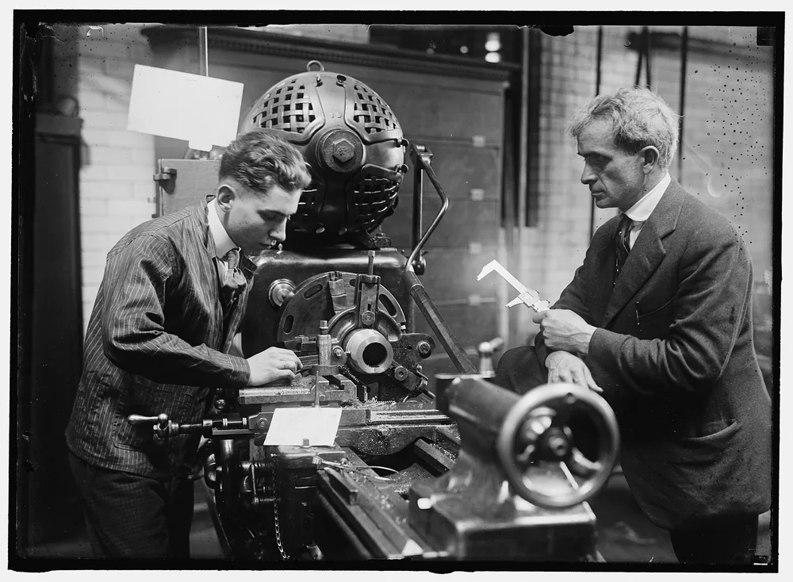
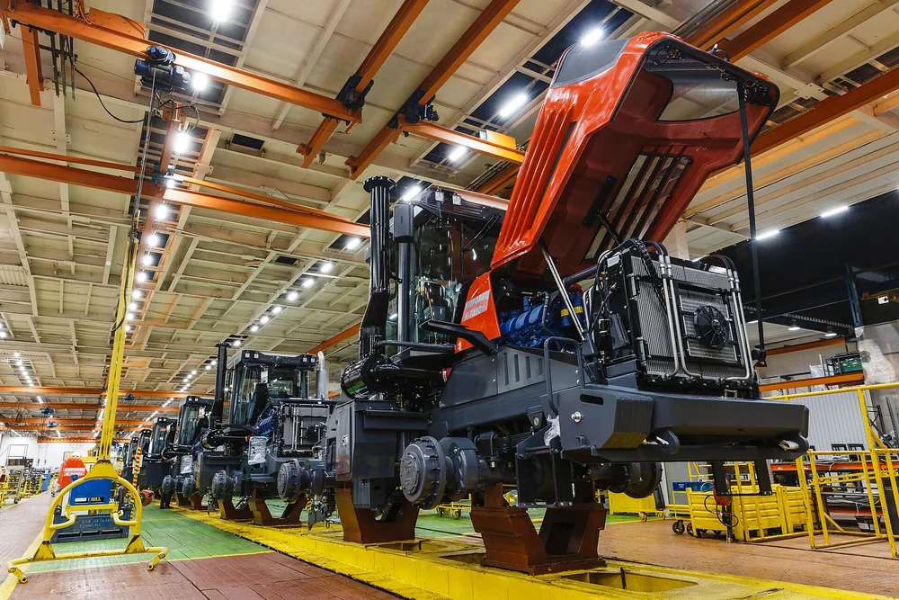

Сроки нередко ломаются не на станке, а вокруг него: в очереди на загрузку, в ожидании металла, у смежника с термообработкой. Поэтому выбирайте цех не по цене в КП, а по тому, что он готов показать заранее: загрузку, маршрут детали, документы на материал и условия приёмки.

## Почему цена в КП — не главное при выборе подрядчика

Цена в КП показывает, сколько вы заплатите цеху, но не показывает, сколько потеряете, если деталь придёт позже. Одна опоздавшая деталь может остановить сборку, и стоимость этого простоя стоит сравнить с разницей между двумя предложениями. Цена без срока — половина предложения.

Стоимость срыва складывается из трёх частей: простой вашей линии или сборки, штрафы перед вашим заказчиком и срочная замена исполнителя. Замена добавляет расходы: вы платите за скорость и заново встаёте в чужую очередь.

Сравнивайте КП только на одинаковых условиях: материал, допуски, размер партии, срок. Если один цех посчитал сталь 45, а другой — 40Х, разница в цене объясняется материалом, а не мастерством. Как складывается сама цена, разобрано в статье [из чего складываются цены на металлообработку](/ceny.html).

> Дешёвое КП дорожает в тот момент, когда деталь не приехала к сборке.

<!-- inline-cta -->

## Кого вы выбираете: исполнителя работ, поставщика проката или продавца станков

*Инструктор контролирует обработку детали на токарном станке во время производственного обучения. Фото: [Harris & Ewing](https://commons.wikimedia.org/wiki/File:HECOX,_C.W._INSTRUCTOR_IN_MACHINE_SHOP,_D.C._PUBLIC_SCHOOLS._SUPERVISING_MFR._OF_PRACTICE_SHELLS_FOR_NAVY,_AT_McKINLEY_TRAINING_SCHOOL.jpg) · [Public domain](https://creativecommons.org/publicdomain/mark/1.0/)*

Статья про заказ детали по чертежу — то есть про контрактную металлообработку. Исполнитель режет, точит и фрезерует по вашему чертежу. Поставщик проката продаёт заготовку, продавец оборудования — станки. У каждого свои риски, поэтому критерии из этой статьи работают только для первого.

Отдельно решите, чей материал пойдёт в работу. Давальческий — ваш: цех не ждёт прокат, но срок зависит от того, когда вы его привезёте. Материал подрядчика избавляет вас от логистики, но в срок входит ожидание проката: спросите, есть ли он на складе. Ещё спросите, кто на самом деле обрабатывает деталь: у посредника появляется лишнее звено и вторая очередь.

Крупный завод подходит для больших серий и сложной кооперации. Среднее контрактное производство закрывает серии и несколько операций в одном месте. Малый цех быстрее берёт разовые детали. Узкий специалист хорош там, где нужна одна технология, например шлифовка.

> Выбирая подрядчика по чертежу, вы покупаете срок и повторяемость результата, а не станко-часы.

## Сроки: что спросить у цеха до подписания договора

*Конвейер кабин в производственном цехе спецтехники. Фото: [Рустам Котов](https://commons.wikimedia.org/wiki/File:%D0%9A%D0%B8%D1%80%D0%BE%D0%B2%D1%81%D0%BA%D0%B8%D0%B9_%D0%B7%D0%B0%D0%B2%D0%BE%D0%B4_%D0%9F%D0%A2%D0%97,_%D0%93%D0%A2%D0%9A,_%D0%BA%D0%BE%D0%BD%D0%B2%D0%B5%D0%B9%D0%B5%D1%80_%D0%BA%D0%B0%D0%B1%D0%B8%D0%BD,_%D1%86%D0%B5%D1%85_%D1%81%D0%BF%D0%B5%D1%86%D1%82%D0%B5%D1%85%D0%BD%D0%B8%D0%BA%D0%B8.jpg) · [CC BY 4.0](https://creativecommons.org/licenses/by/4.0)*

Срок изготовления складывается из станко-времени и ожиданий вокруг него: очередь на загрузку, прокат, смежник, приёмка. Спрашивайте не «за сколько сделаете», а «как деталь пойдёт по операциям». Попросите время каждой операции для партий в 1, 10 и 100 деталей и покажите, где стоят очереди. Уточните запас на непредвиденное и контрольные точки: что цех покажет вам к середине срока. И спросите, кто и за сколько дней сообщит о задержке.

Путь детали от заявки до приёмки проходит через четыре места, где теряется время: очередь на станок, ожидание металла, операции на стороне и приёмка.

### Загрузка станков и смены

Спросите: «Когда деталь реально встанет на станок, а не когда вы примете её в работу?» Срок зависит от загрузки: если станок занят другим заказом на две недели, обещание уложиться в десять дней ничего не стоит. Уточните, сколько смен работает участок и что произойдёт при поломке — есть ли второй станок.

### Операции на стороне: термообработка, покрытие, покраска

Эти операции часто идут у смежника, и очередью там цех не управляет. Спросите, кто их делает и сколько времени они добавляют к маршруту. Отдельно уточните, что случится со сроком, если смежник опоздает. Как это влияет на сроки, разобрано в статьях [как термообработка влияет на цену и сроки](/blog/termoobrabotka-metalla-kogda-ona-nuzhna-i-kak-vliyaet-na-cenu-i-sroki) и [как проверить срок изготовления в КП](/blog/kak-proverit-srok-izgotovleniya-i-dostavki-v-kp).

## Проверка качества: какие документы и замеры просить

Вместо «у вас есть ОТК?» задайте конкретный вопрос: какие документы вы получите вместе с деталью. Качество металла подрядчик подтверждает документами на материал, точность — протоколом измерений по вашему чертежу, порядок работы — сертификатом системы менеджмента качества.

| Документ | Что подтверждает | Когда просить |
|---|---|---|
| Сертификат или паспорт на металл | Марку и партию проката | До запуска в работу |
| Протокол измерений | Размеры готовой детали по чертежу | При каждой приёмке |
| Сертификат СМК | Порядок работы цеха | При выборе подрядчика |
| Акт приёмки | Что и когда вы приняли | При сдаче партии |

В протоколе смотрите, чем мерили. Жёсткий допуск штангенциркулем не проверить: нужны микрометр, калибр или координатно-измерительная машина. Если на чертеже допуск не проставлен, заранее оговорите в договоре, по каким нормам идёт приёмка.

Сертификат системы менеджмента качества говорит о порядке работы, но не о годности вашей детали. Подлинность проверяйте в реестре органа, который его выдал. Условия гарантии — на что она распространяется и сколько действует — фиксируйте в договоре.

## Как сравнить два предложения: скоринг вместо взгляда на цену

Чтобы сравнить КП, оцените каждое по одним и тем же критериям: срок, допуски и контроль, документы и гарантия, цена, тираж. Вес критерия зависит от вашей задачи. Для разовой детали с жёстким допуском важнее срок и контроль, для серии — цена и повторяемость. «Лучшего вообще» подрядчика нет, есть лучший под ваш заказ.

Пример учебный, числа условные, не статистика. Каждому критерию дайте вес от 1 до 5, каждому подрядчику — оценку от 1 до 5. Перемножьте и сложите. В скобках стоит произведение оценки на вес.

| Критерий | Вес | Подрядчик А, оценка | Подрядчик Б, оценка |
|---|---|---|---|
| Срок | 5 | 2 (10) | 5 (25) |
| Допуски и контроль | 4 | 3 (12) | 5 (20) |
| Документы и гарантия | 3 | 3 (9) | 5 (15) |
| Цена | 2 | 5 (10) | 3 (6) |
| Тираж | 1 | 4 (4) | 3 (3) |
| Итого | — | 45 | 69 |

Подрядчик А дешевле, но проигрывает по сроку и контролю. Для другой задачи вес цены поднимется, и итог может поменяться.

> **Мнение.** Если у вас разовая деталь с жёстким допуском, берите цех с лучшим сроком и контролем, даже если он дороже. Если серия большая и деталь простая, поднимите вес цены и тиража.

## Красные флаги на первом звонке и в переписке

Красный флаг — признак, что цех не считал вашу деталь всерьёз, а значит, и срок назван наугад. Тревожных сигналов пять, и у каждого есть вопрос, который снимает сомнение:

- Ни одного вопроса по чертежу. Цех его не читал и маршрут не считал: спросите, какие операции он заложил.
- Расчёт устно или без расшифровки операций. Срок не проверить: попросите письменную смету.
- Отказ показать производство или участок, где пойдёт работа. Попросите хотя бы видео участка.
- Предоплата 100 %. Вся финансовая нагрузка на вас: предложите оплату по этапам.
- Цена заметно ниже остальных без объяснения. Спросите, что исключено из расчёта.

Отдельно проверьте контрагента по открытым источникам: выписка из ЕГРЮЛ на сайте ФНС, картотека арбитражных дел, банк исполнительных производств ФССП, отчётность в ГИР БО. Проверка не гарантирует срок, но уточняет надёжность подрядчика.

## Договор и оплата: как закрепить срок на бумаге

Срок работает, только если он записан в договоре подряда. Пропишите этапы с датами, дату приёмки, неустойку за просрочку, оплату по этапам и порядок рекламаций. Одна общая дата в конце не защищает: о срыве вы узнаете, когда уже поздно.

> **Факт.** Неустойка — денежная сумма, которую должник платит кредитору за просрочку или иное нарушение обязательства; её определяет закон или договор (ст. 330 ГК РФ).

Размер неустойки можно закрепить в договоре, поэтому обсуждайте его до подписания. Оплату делите по этапам вместо 100 % предоплаты. Заранее оговорите, что происходит при новой ревизии чертежа и кто отвечает за ошибки в нём. Договор составляет юрист, ваша задача — прийти к нему с этим списком вопросов.

> Срок, который не привязан к этапам и неустойке, остаётся пожеланием, а не условием.

## Первая деталь и пробная партия: приёмка до серии

Пробная партия нужна, если деталь новая, допуски жёсткие или серия большая. Она задерживает заказ на один цикл, но защищает от переделки всей серии. Сертификат СМК её не заменяет: он показывает порядок работы цеха, но не годность вашей детали. Заодно проба показывает реальную скорость цеха: сравните фактический срок с обещанным.

Порядок приёмки:

1. Цех делает первую деталь по чертежу заказчика.
2. Вы замеряете её по чертежу, а не «на глаз».
3. Подписываете акт: размеры, материал, отклонения, замечания.
4. Только после акта согласуете запуск серии.

Для простой повторяющейся детали иногда хватает приёмки первой детали по акту. Проба стоит один цикл работы, а ошибка, найденная уже в серии, обходится в целую серию.

## Что сделать до запроса КП: короткий порядок действий

Сначала подготовьте чертёж: допуски, материал, тираж и желаемый срок. Что должно быть на нём, чтобы цех посчитал без переписки, описано в статье [что должно быть на чертеже, чтобы его посчитали без переписки](/razdel/chertezhi-i-dopuski.html). Затем запросите КП у двух-трёх цехов на одинаковых условиях, задайте вопросы про загрузку, операции на стороне и документы, сравните по скорингу и договоритесь о пробной партии.

> Сравнивать можно только те предложения, где чертёж и условия одинаковы для всех.

Если готовы сравнивать, [отправьте чертёж на расчёт](/kontakty.html): технолог IRONEX посчитает срок и цену на тех же условиях, что вы дадите другим цехам.

## Частые вопросы

### Почему дешёвое предложение может оказаться дороже?

В КП нет простоя вашей линии, штрафов перед вашим заказчиком и срочной замены исполнителя, а платите за это вы. Поэтому сравнивайте предложения на одинаковых условиях: материал, допуски, партия, срок.

### Нужна ли пробная партия перед серией?

Да, если деталь новая, допуски жёсткие или тираж большой: пробная партия показывает реальный срок и ловит ошибки до серии. Для простой повторяющейся детали иногда хватает приёмки первой детали по акту.

### Какие документы просить у подрядчика по металлообработке?

Сертификат или паспорт на металл, протокол измерений по вашему чертежу и, если нужно, сертификат системы менеджмента качества. Условия гарантии фиксируйте в договоре, а не в переписке.

## Источники

- [Гражданский кодекс Российской Федерации, часть первая (ст. 330)](https://www.consultant.ru/document/cons_doc_LAW_5142/) — КонсультантПлюс
- [Единый государственный реестр юридических лиц: выписки](https://egrul.nalog.ru/) — ФНС России
- [Государственный информационный ресурс бухгалтерской (финансовой) отчётности](https://bo.nalog.gov.ru/) — ФНС России
