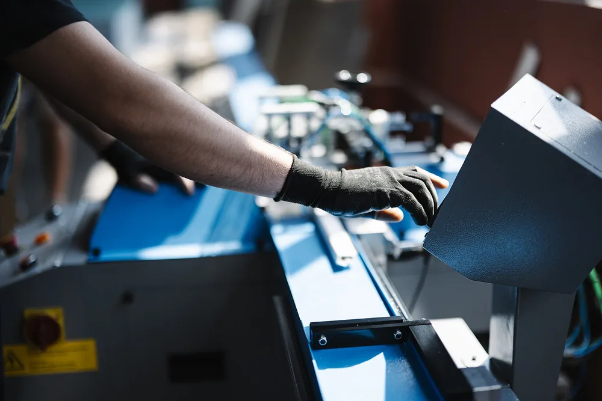
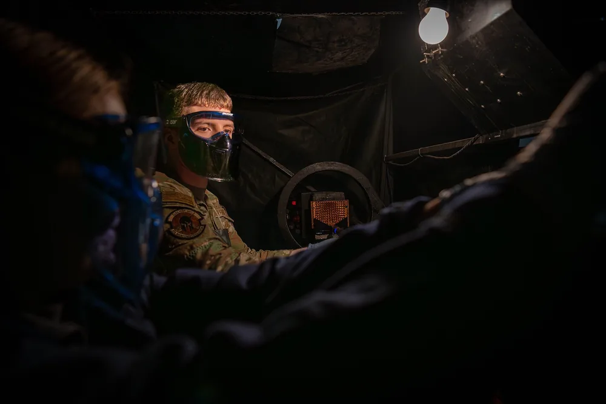

Производителя выбирают не по сайту и не по цене, а по тому, что цех может доказать на вашем чертеже: станок под ваш допуск, измерение в ОТК, сертификат на металл и КП с понятным составом цены. Эти проверки отсеивают посредников и подрядчиков, которые берут заказ «на авось».

## Производитель или посредник: кто на самом деле возьмёт ваш заказ

Производитель держит станки и ОТК у себя и отвечает за технологию детали. Посредник передаёт заказ в другой цех. Срок, цена и исправление брака зависят от того, кто реально режет металл. Скрытый посредник опаснее открытого: проверка идёт по одной фирме, деталь при этом делает другая.

В поиске находится «завод», контур режут в чужом цехе. За брак отвечает фирма без прибора.

Попросите перечень станков с моделью и зоной, фото цеха и видеовизит: стойка ЧПУ, табличка, стол ОТК. Снимок проверьте поиском по картинке.

До предоплаты откройте карточку на egrul.nalog.ru, споры в kad.arbitr.ru и производства на fssp.gov.ru. Свежие дела о срыве поставки — повод не отдавать крупную серию первым заказом.

Пять признаков скрытого посредника:

- В переписке нет модели станка, только фраза «сделаем на ЧПУ».
- На фото нет инвентарного номера и вашего типа оборудования.
- Видеовизит не назначают или переносят без новой даты.
- Счёт выставляет одно юрлицо, цех в разговоре называют другим.
- На вопрос про станок под ваш допуск отвечают скидкой.

Открытый посредник называет конечный цех до старта. Спросите, чьи станки, кто держит брак и кто пускает на измерение. Уход в «коммерческую тайну» значит, что чертёж отправлять рано.

<!-- inline-cta -->

## Станки и опыт: может ли цех сделать именно вашу деталь

*Производственное оборудование и компетентность персонала — основные факторы выбора производителя. Фото: [Shixart1985](https://commons.wikimedia.org/wiki/File:Worker_operates_machine_in_factory.jpg) · [CC BY 2.0](https://creativecommons.org/licenses/by/2.0)*

Станочный парк ЧПУ ограничивает достижимые допуски по чертежу заказчика. Цех берёт деталь, когда геометрия влезает в зону станка и поле допуска он закрывает измерением. Модель станка сверяют с габаритом конкретной детали и числом осей. Перечень услуг на сайте этого не показывает.

| Вид обработки | Что решает, возьмут ли деталь | Вопрос подрядчику |
| --- | --- | --- |
| Токарная ЧПУ | Диаметр, длина, число осей | Какой диаметр и длина в патроне и какой протокол будет на допуск |
| Фрезерная ЧПУ | Габарит, число осей, глубина кармана | Влезает ли деталь в стол, хватает ли трёх осей |
| Лазерная резка | Толщина, марка, контур | Какую толщину вашей марки режете без доработки кромки |
| Гибка | Длина полки, радиус, пружинение | Есть ли инструмент под радиус и как учтёте пружинение |
| Сварка | Шов, толщина, требования объекта | Кто варит и нужна ли аттестация для опасного объекта |

Спросите, на какой неделе свободен станок под вашу операцию и сколько смен на нём уже занято.

Опыт виден на похожей детали: та же марка, близкий габарит, такой же допуск. Попросите фото или обезличенный фрагмент. Одна штука и серия устроены по-разному: наладка в серии делится на партию.

Термообработка, покрытие и зубообработка часто уходят на сторону. В договоре запишите, кто отвечает за срок и брак кооперации и можно ли передать чертёж заказчика дальше без согласия.

## Допуски и ОТК: как проверить компетенцию на вашем чертеже

Чертёж заказчика задаёт допуски и посадки: на нём стоят поля, базы и шероховатость. ОТК проверяет соблюдение допусков и посадок на готовой детали. Станочный парк ЧПУ ограничивает достижимый допуск, если нет нужной оси или жёсткости. Пока цех не назвал прибор, компетенцию цеха считать рано. До запуска серии цех называет квалитет с чертежа в письменном ответе.

Отправьте рабочий чертёж. Технолог, который возьмётся за деталь, спросит базы для замера, шероховатость посадок и то, какой размер критичный. Молчание после файла — слабый знак: чертёж не открыли или не увидели, где деталь портят.

Линейный размер читают по ГОСТ 25346-2013: стандарт устанавливает систему допусков ИСО на линейные размеры. Числовые отклонения отверстий и валов общего применения даёт ГОСТ 25347-2013, их вычисляют по ГОСТ 25346. Шероховатость задают по ГОСТ 2789-73: стандарт распространяется на неё независимо от материала и способа получения поверхности. Спросите прибор и протокол на вашу поверхность.

> Допуск на детали подтверждает протокол измерений этой детали. Обещание точности на сайте протокол не заменяет.

ОТК под ваш чертёж — прибор до нужного размера и свидетельство о поверке на него. Протокол первой детали повторяет обозначения чертежа: размер, допуск, факт, годность. Строка «соответствует чертежу» без чисел для посадки бесполезна. Поверку прибора просите на период изготовления вашей партии.

> **Факт.** ГОСТ 25346-2013 устанавливает систему допусков ИСО на линейные размеры, числовые отклонения отверстий и валов общего применения даёт ГОСТ 25347-2013.

## Сертификаты: что подтверждает каждый документ и как его проверить

*Специалист устанавливает деталь в машину для неразрушающего контроля методом флуоресцентного пентранта. Фото: [U.S. Air Force photo by Airman 1st Class Sydney Franklin](https://commons.wikimedia.org/wiki/File:Precision_in_Readiness-_NDI_Specialists_Ensure_F-16_Combat_Reliability_%288830882%29.jpg) · [Public domain](https://creativecommons.org/publicdomain/mark/1.0/)*

Сертификат ISO 9001 и приёмка первой детали отвечают на разные вопросы. Сертификат показывает систему менеджмента качества. Приёмка показывает, попал ли в допуск этот экземпляр. Бумагу на систему и протокол на деталь запрашивают вместе. Сверьте, что область включает металлообработку на этой площадке.

ISO 9001:2015 задаёт требования к системе менеджмента качества: организация показывает стабильные поставки по требованиям заказчика и применимым нормам. Текущая международная редакция — ISO 9001:2026, она заменила ISO 9001:2015. На переход с редакции 2015 есть три года. Сертификация добровольная.

На копии сверьте орган, номер, срок, площадку и область. Площадка должна совпасть с цехом. Подлинность уточняйте у выдавшей организации или в реестре её системы.

Сварку проверяйте, только если она есть на чертеже. ISO 3834-1:2021 задаёт уровень требований к сварке плавлением и систему менеджмента целиком не описывает. Для устройства опасного производственного объекта спросите аттестацию НАКС: сварщиков ведут по ПБ-03-273-99, технологии — по РД 03-615-03. Сверьте записи в реестрах на сайте НАКС. Без требований объекта это решает договор.

> Сертификат ISO 9001 показывает, как цех ведёт систему качества. Размер детали подтверждает приёмка первой детали с протоколом.

Сертификат ISO 9001 не заменяет приёмку первой детали: одну штуку до серии закрывают протоколом.

## Материал: сертификат на металлопрокат и прослеживаемость партии

Сертификат на металлопрокат подтверждает свойства металла, из которого режут деталь. Марка в коммерческом предложении и марка в документе на прокат должны совпасть знак в знак, вместе со стандартом на марку. Копию сверяют с партией, иначе в цех мог прийти другой металл.

По ГОСТ 7566-2018 каждую отгружаемую партию сопровождают документом о качестве: изготовитель удостоверяет соответствие требованиям документов или заказа. Просите документ 3.1, в нём есть результаты специального контроля. Обозначения видов взяты из ISO 10474:2013. Достоверность подтверждает уполномоченный представитель изготовителя, не занятый в производстве.

В документе указывают марку стали, наименование стали и/или класс прочности. Попросите цех показать, как партия привязана к документу: номер плавки или партии должен совпасть в документе, на бирке металла и в сопроводительных документах на детали. Если привязки нет, партию к документу не отнести. Копию просите вместе с партией.

Замену марки делайте только после письменного согласия. Пока его нет, в работе марка с чертежа. Порядок замены — в тексте [как согласовать аналог материала](/blog/kak-soglasovat-material-analog-dlya-metallicheskoy-detali).

> Марка в коммерческом предложении и марка в документе о качестве на прокат должны совпасть до последнего знака.

## Как сравнивать КП: из чего складывается цена и что значит слишком низкая

Коммерческое предложение раскладывает цену на металлопрокат, машинное время, наладку, оснастку и покрытие. Итог без строк сравнивать рано: низкая сумма часто значит, что вынули контроль или марку. Сравнивают три предложения на один чертёж. Короткая сумма без этих строк прячет чужой металл или пропущенный контроль.

Комплект у всех один: марка, количество, покрытие, срок. Наладка в серии делится на штуки, в разовой детали ложится целиком. Как выбрать количество — в тексте [как выбрать размер партии](/blog/kak-opredelit-ekonomicheski-razumnyy-razmer-partii). Ориентиры по видам работ: [ориентиры по ценам на металлообработку](/ceny.html).

| Строка КП | Что должно быть написано | Когда сравнение ломается |
| --- | --- | --- |
| Металлопрокат | Марка, стандарт, кто покупает металл | В одном КП ваша марка, в другом «аналог» без согласия |
| Машинное время | Операции и тип станка | Есть итог и нет перечня операций |
| Наладка и оснастка | Отдельная сумма или уже внутри штуки | В разовом заказе строки наладки нет |
| Покрытие | Вид, толщина, исполнитель | Написано «по запросу», цены ещё нет |
| Контроль | Размеры и документ, который отдадут | Контроль пропущен при жёстком допуске |
| Срок | Рабочие дни и дата отсчёта | «От запуска» без даты запуска |
| Цена | За штуку, за партию, налог внутри или сверху | Сумма ниже других, состава нет |

В низкой сумме часто нет вашей марки, покрытия или протокола. Вторым счётом приходят доставка, тара, образцы и повторный проход. Эти строки ставят до старта.

> **Мнение.** Если одно предложение сильно ниже двух других и в нём нет строк по металлу и контролю, за основу берите полное: добор исключённого обычно съедает разницу.

## NDA, брак и срыв сроков: что прописать до передачи чертежей

NDA и раздел договора защищают чертёж заказчика до того, как файл уйдёт подрядчику. Юрист пишет формулировки. Заказчик заранее закрывает тайну, передачу на сторону, брак и срыв срока. Без ответов комплект отправлять рано: правила потом ищут уже в споре о браке или сроке.

Статья 702 ГК РФ задаёт подряд: подрядчик делает работу по заданию и сдаёт результат, заказчик его принимает и оплачивает. Статья 727 закрывает сведения, полученные при исполнении: получатель не вправе сообщать их третьим лицам без согласия другой стороны. Порядок задаёт соглашение сторон, то есть NDA или раздел договора.

Если в работе есть недостатки, статья 723 позволяет заказчику потребовать безвозмездного устранения недостатков в разумный срок или соразмерного уменьшения цены, когда закон или договор не установили иное. Срок ответа на претензию юрист записывает в договоре.

Шесть пунктов до отправки чертежа:

- Что закрыто: чертёж, модель, технология, кому файл можно показать.
- Можно ли отдавать операции на сторону и кто держит брак и срок.
- Марка металла и запрет замены без письменного согласия.
- Приёмка: акт, протокол, первая деталь до серии, выборочный или сплошной контроль.
- Брак: устранение, новая деталь или отказ, срок ответа на претензию.
- Срыв срока: предупреждение, новый срок, право поставить работу на паузу.

## Красные флаги и пробный заказ: итоговый чек-лист

Красный флаг при выборе производителя — отказ показать, как закроют чертёж. В серию пускайте цех после вопросов по допускам, состава цены, документа на металл и приёмки первой детали. Пропуск вопроса по допуску, состава цены или документа на металл возвращает риск скрытого посредника.

Тревожно, когда на допуски отвечают «сделаем как надо», станки показать нельзя, цена пришла одной суммой, документа на металл нет. Попросите контакт заказчика с похожей деталью и спросите, совпал ли протокол с чертежом. Серия свежих дел о браке — повод остановиться.

Приёмка первой детали идёт раньше серии: одна штука, протокол критичных размеров, затем остальное количество.

Порядок такой:

1. Отправьте чертёж с маркой, количеством и покрытием.
2. Ответьте письменно на вопросы цеха по допускам, базам и шероховатости.
3. Возьмите три предложения на один комплект и разложите цену по строкам.
4. Проверьте юрлицо, станки, документ на металл и нужные сертификаты.
5. Примите первую деталь с протоколом, затем отдавайте серию.

Если на допусках, составе цены и документах тишина, серию не начинайте. Состав работ до полного комплекта можно увидеть так: [прислать чертёж на расчёт](/kontakty.html). [Изготовление деталей по чертежам](/) отдавайте туда, где станок, измерение и марка металла названы до запуска.

## Частые вопросы

### Чем производитель отличается от посредника?

У производителя заказ остаётся на его станках, и за технологию отвечает он сам. Посредник передаёт чертёж в другой цех. Открытый посредник называет этот цех до старта. Скрытый называет себя заводом, пока не случится брак. Перечень станков, фото с табличкой оборудования и видеовизит показывают разницу быстрее, чем текст на главной странице.

### Как проверить сертификаты производителя?

Запросите копию и сверьте орган, номер, срок, адрес площадки и область сертификации. Подлинность уточните у организации, которая документ выдала, или в реестре её системы. Сертификат системы качества не подтверждает марку металла и не заменяет документ о качестве на партию проката. Для сварки на опасном объекте отдельно сверьте аттестацию в реестре НАКС.

### Сколько коммерческих предложений запрашивать?

Три и больше, и только на одинаковый комплект: один чертёж, одна марка, одно количество, одно покрытие, один срок. Два предложения уже дают вилку, третье показывает, кто выпал из неё. Если количество или покрытие различаются, суммы лежат в разных заказах и сравнить их нельзя.

### Нужно ли ехать на производство перед заказом?

На крупную партию и на деталь, от которой зависит посадка узла, лучше приехать и посмотреть станок, ОТК и место хранения металла. На небольшой заказ обычно хватает видеовизита: стойка ЧПУ, табличка станка, прибор, которым закроют ваш допуск. Отказ и от визита, и от видео — тот же красный флаг, что и цена без состава.

## Источники

- [ГОСТ 25346-2013. Система допусков ИСО на линейные размеры](https://nevacert.ru/dokumenty/normadoc/standartsbase-gost/gost-25346-2013) — Межгосударственный стандарт
- [ГОСТ 2789-73. Шероховатость поверхности. Параметры и характеристики](https://informproekt.ru/docs/1200003160/) — Межгосударственный стандарт
- [ГОСТ 7566-2018. Металлопродукция. Правила приемки, маркировка, упаковка, транспортирование и хранение](https://dokipedia.ru/print/5405081) — Межгосударственный стандарт
- [Гражданский кодекс РФ, статья 723. Ответственность подрядчика за ненадлежащее качество работы](https://www.consultant.ru/document/cons_doc_LAW_9027/0f3422f73df7bee03d56085359c80be8d2981ead/) — Гражданский кодекс Российской Федерации
