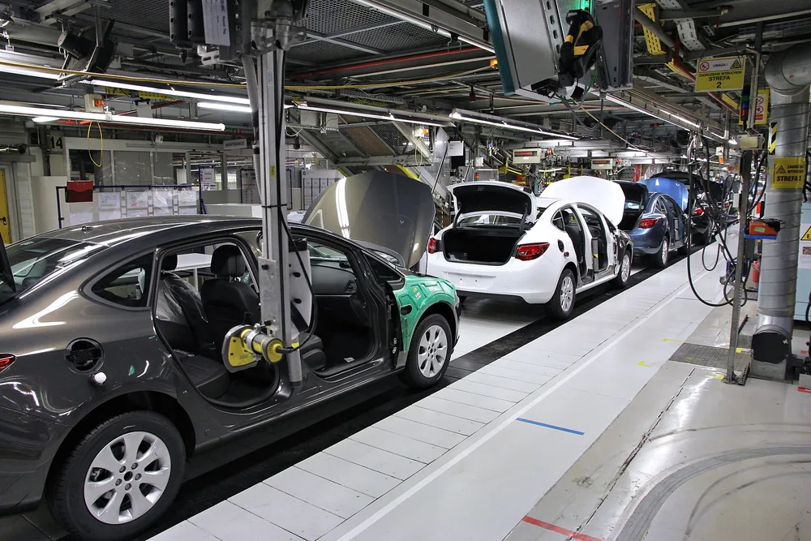
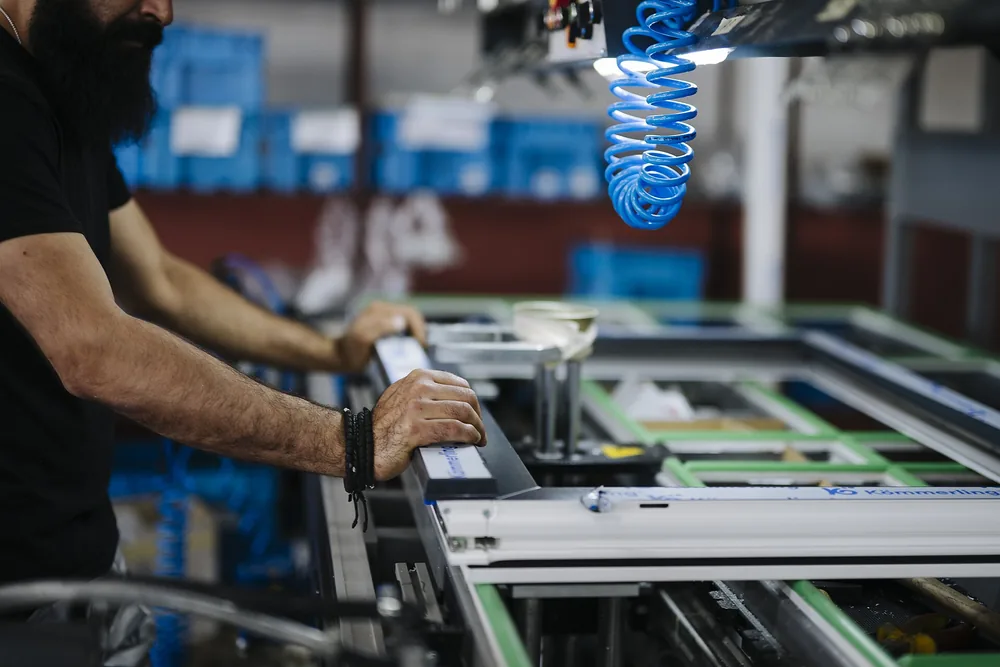

Подрядчика по металлообработке проверяют четыре вещи: протоколы измерений по прошлым партиям, сертификаты на металл, условия по браку в договоре и пробная партия. Репутацию и сертификат ISO читайте как входной билет, а не как вердикт: они не говорят, выдержит ли подрядчик допуски вашей детали.

## Что на самом деле значит «хороший подрядчик»?

Что именно вы проверяете: компанию с известным названием или способность изготовить конкретную деталь? Второй критерий полезнее. Подрядчик по металлообработке должен разобрать чертёж заказчика, подтвердить материал, допуски, объём партии и маршрут обработки.

Опыт и отзывы показывают, что цех выполняет заказы. Они не подтверждают возможность стабильно выпускать вашу деталь. Для решения нужны четыре доказательства: протоколы измерений, документы на материал, согласованные условия приёмки и результат пробной партии.

Входным фильтром служат регистрация компании, понятный адрес производства, профиль оборудования и сертификаты. Решающими доводами становятся вопросы технолога по чертежу, записи контроля и готовность отвечать за несоответствия по договору.

> Подрядчик подходит под конкретное сочетание материала, допусков, технологии и размера партии. Универсальная репутация не заменяет эту проверку.

<!-- inline-cta -->

## Порядок проверки: от запроса до пробной партии

*Сборочная линия производства Opel Astra J. Организация рабочего пространства и последовательность операций обеспечивают соблюдение требований к качеству. Фото: [Marek Ślusarczyk ( Tupungato ) Photo portfolio](https://commons.wikimedia.org/wiki/File:001_Car_factory_assembly_line_-_Opel_factory_in_Gliwice,_Poland.jpg) · [CC BY 3.0](https://creativecommons.org/licenses/by/3.0)*

Проверку проводят последовательно. После каждого шага у заказчика должен остаться документ или наблюдаемый результат, на котором можно строить решение.

1. **Отправьте один чертёж нескольким цехам.** Сравните не только цены. Запишите вопросы подрядчиков о базах, допусках, термообработке, покрытии и приёмке. Молчаливое КП без технических уточнений повышает риск разного прочтения задания.
2. **Проверьте компанию.** Возьмите сведения из [ЕГРЮЛ](https://egrul.nalog.ru/index.html), изучите споры в [Картотеке арбитражных дел](https://kad.arbitr.ru/) и проверьте [реестр недобросовестных поставщиков](https://zakupki.gov.ru/). На руках должны быть реквизиты, адрес и объяснение найденных рисков.
3. **Запросите доказательства контроля.** Нужны обезличенные протоколы измерений по похожим деталям и документы на металл. Проверьте состав измерений, приборы и подписи.
4. **Осмотрите площадку.** Личный визит можно заменить видеопоказом маршрута: склад материала, станок, участок контроля, маркировка партий.
5. **Закажите пробную партию.** Согласуйте контрольный план и примите детали по протоколу. Пробная партия проверяет заявленный допуск и квалитет точности до серии.

Цена часто останавливает проверку после второго шага. Экономия времени здесь переносит разбор технологии и контроля на момент первой рекламации. Для отдельной оценки производственного резерва пригодится инструкция о том, [как выбрать субподрядчика при перегрузке производства](/blog/kak-vybrat-subpodryadchika-pri-peregruzke-proizvodstva).

## Оборудование и мощности: подходит ли цех под вашу деталь?

Допуск и квалитет точности задают требования к станочному парку, оснастке и средствам контроля. Количество станков ничего не решает без технологического маршрута. Попросите подрядчика назвать оборудование для каждой операции и объяснить, где возникнут переустановки детали.

В разговоре с технологом задайте пять вопросов:

- На каком станке выполнят каждую операцию?
- Сколько установов потребуется и как сохранят базы?
- Какой резерв загрузки останется на повторную партию?
- Понадобится ли специальная оснастка?
- Какие операции передадут внешнему исполнителю?

Передача термообработки, шлифования или покрытия другому цеху допустима, если заказчик знает исполнителя и способ контроля. Отказ раскрыть кооперацию мешает оценить сроки и прослеживаемость.

Для нестандартной оснастки запросите два расчёта: изготовление приспособления и доработку конструкции под стандартный инструмент. Решение согласуйте с конструктором. Посмотреть, какое [оборудование подходит под маршрут детали](/oborudovanie.html), полезно до сравнения коммерческих предложений.

> **Мнение.** Если подрядчик может назвать станок, число установов, способ базирования и контрольную операцию, его расчёт надёжнее общей фразы о возможностях цеха.

## Допуски и контроль: как проверить точность, а не обещание?

*Оператор станка выполняет работу в организованном цехе среди инструментов и емкостей хранения материалов. Фото: [Shixart1985](https://commons.wikimedia.org/wiki/File:Worker_operates_a_machine_in_a_production_area.jpg) · [CC BY 2.0](https://creativecommons.org/licenses/by/2.0)*

Точность детали подтверждает протокол измерений по партии. Для линейных размеров квалитет и номинал определяют поле допуска по выбранному стандарту; обозначение на чертеже нельзя заменять «типичной точностью» оборудования. Значение Ra относится к указанной поверхности, поэтому подрядчик должен связать шероховатость с операцией и способом контроля.

Шаблон показывает совпадение с заданным контуром. Предельный калибр проверяет прохождение размера относительно границ. Координатно-измерительная машина помогает контролировать геометрию и взаимное положение элементов. Вид прибора выбирают под характеристику из чертежа.

Контрольный план определяет состав протокола измерений: какие размеры проверяют, на каких деталях, каким средством и кто принимает результат. В текстовом виде запись может выглядеть так: «позиция размера по чертежу — установленный допуск — измеренное значение — прибор и его идентификатор — номер детали — подпись контролёра». Пустая таблица без результатов партии ничего не подтверждает.

Проверьте, сколько деталей вошло в выборку, присутствуют ли критические размеры и можно ли связать запись с конкретной партией. Перед серией полезно отдельно разобрать, [как принять первую деталь перед запуском серии](/blog/kak-prinyat-pervuyu-detal-pered-zapuskom-serii).

> Точность детали подтверждает измеряемый результат по согласованному плану контроля, а не формулировка в коммерческом предложении.

## Сертификация: что подтверждает ISO 9001, а что нет?

ISO 9001 подтверждает наличие системы менеджмента качества. Сертификат ISO 9001 не гарантирует допуск и квалитет точности конкретной детали: для этого нужен протокол измерений.

| Документ | Что подтверждает | Что не подтверждает | Как проверить |
|---|---|---|---|
| Сертификат ISO 9001 | Наличие сертифицированной СМК в заявленной области | Результат измерения вашей партии | Найти сертификат в реестре органа, сверить номер, срок и область действия |
| Отраслевая сертификация | Выполнение требований выбранной отрасли | Пригодность детали без проверки чертежа | Сверить стандарт, редакцию, площадку и процессы |
| Протокол измерений | Результаты контроля указанной партии | Происхождение материала | Проверить номера деталей, размеры, приборы и подпись |
| FAI или пакет PPAP | Согласованный набор доказательств первого образца или производственного процесса | Автоматическое соответствие любому другому заказу | Сверить состав пакета с требованиями заказчика |

Для отдельных отраслей заказчик может потребовать собственную отраслевую сертификацию. Перечень задают договор и отраслевая документация проекта, поэтому сверяйте его с заказчиком конечного изделия.

> **Факт.** ISO 9001:2026 задаёт требования к созданию, внедрению, поддержанию и постоянному улучшению системы менеджмента качества.

Запросите вместе с сертификатом перечень площадок и процессов из области действия. Механическая обработка или контроль нужного типа могут находиться за её пределами.

## Материал: сертификаты, поставщики и допустимые аналоги

Подрядчик по металлообработке может предъявлять по запросу документ на материал по EN 10204 и должен связывать его с заготовкой. Номер плавки или партии переносят в складскую маркировку, маршрутный документ и комплект отгрузки. Без этой цепочки сертификат может относиться к другому металлу.

Документы EN 10204 различаются глубиной подтверждения. Тип 2.2 содержит результаты неспецифического контроля. Сертификат 3.1 содержит результаты специального контроля. Сертификат 3.2 подтверждают представитель производителя и представитель покупателя либо назначенный инспектор. Требуемый тип указывают в заказе до закупки металла.

Вместе с партией запросите:

- сертификат или отчёт на металл требуемого типа;
- маркировку, связывающую заготовку с документом;
- запись о термообработке, если она есть в маршруте;
- письменное согласование аналога материала;
- сведения о внешнем исполнителе термообработки или покрытия.

Аналог марки согласуют до запуска. Технолог и конструктор должны сравнить свойства, состояние поставки и последующую обработку. Устное разрешение закупщика не меняет требования чертежа заказчика.

## Договор: брак, рекламации, чертежи и остатки металла

Договор поставки регулирует рекламацию: порядок приёмки, документы о несоответствии, сроки уведомления и доступные действия сторон. Статья 513 ГК РФ связывает проверку количества и качества с законом, договором и обычаями делового оборота. Конкретную процедуру стоит согласовать с юристом до запуска заказа.

В договоре или спецификации зафиксируйте:

- версию чертежа и перечень контролируемых характеристик;
- критерии брака и способ измерения;
- порядок изоляции, возврата, замены или доработки деталей;
- приёмку силами ОТК заказчика;
- действия при срыве срока и изменении спецификации;
- режим доступа к конструкторской документации и условия NDA;
- учёт давальческого сырья, стружки и пригодных остатков.

Допустимый уровень несоответствий или PPM указывают только по согласованию сторон. Универсальное число без данных о назначении детали и процессе создаёт ложный ориентир.

> Условия приёмки и работы с браком согласуют до запуска партии. После рекламации стороны уже спорят о том, что не записали.

Формулировки о правах на документацию, конфиденциальности и ответственности проверяет юрист с учётом конкретной сделки.

## Красные флаги и как читать отзывы

Красный флаг не доказывает будущий брак. Он показывает, какой риск нужно проверить до аванса. Один сигнал можно объяснить; несколько несвязанных отказов требуют паузы.

- **Цех не показывают.** Уточните, где пройдёт обработка и не передают ли заказ неизвестному субподрядчику.
- **Нет записей контроля.** Без протокола нельзя проверить стабильность размеров между партиями.
- **По чертежу не задали вопросов.** Возможна оценка только по габариту и материалу без разбора технологии.
- **Цена заметно отличается от других предложений.** Попросите разложить экономию по материалу, установам, оснастке и контролю.
- **Отказываются согласовать пробную партию.** Серийный заказ переносит технический риск на весь объём.

Информативный отзыв называет тип детали, условия эксплуатации, соответствие размерам и стабильность повторных партий. Общая похвала не помогает оценить вашу задачу. Попросите контакт заказчика с похожим процессом, если подрядчик получил разрешение передать его данные.

Низкая цена не означает брак, а высокая не подтверждает качество. Сравнивайте одинаковый объём контроля, материал и состав операций. Для заказов через кооперацию используйте отдельный порядок работы с [подрядчиком по механообработке](/razdel/zakazchiku.html).

## Чек-лист: как сравнить подрядчиков перед решением

Сравнивайте кандидатов по одной шкале: 0 — подтверждения нет, 1 — есть обещание или неполный документ, 2 — критерий подтверждён. Порог допуска к заказу установите заранее. Критический ноль по материалу, измерениям или договору нельзя компенсировать баллами за отзывы.

| Критерий | На что смотреть | Риск при игнорировании | Оценка |
|---|---|---|---|
| Оборудование | Маршрут, установы, оснастка, резерв загрузки | Срыв точности или срока | 0–2 |
| Контроль | План и протоколы измерений | Необнаруженное отклонение | 0–2 |
| Материал | Сертификат и прослеживаемость | Подмена марки или партии | 0–2 |
| Сертификация | Область действия и подлинность | Неприменимый сертификат | 0–2 |
| Договор | Приёмка, рекламации, документация | Спор без согласованной процедуры | 0–2 |
| Пробная партия | Приёмка по критическим размерам | Перенос риска на серию | 0–2 |

После выбора закажите пробную партию и примите первую деталь по согласованному протоколу. Если нужно оценить чертёж и получить расчёт, [пришлите документацию и требования к приёмке](/kontakty.html).

## Частые вопросы

### Как читать отзывы о производителе деталей?

Ищите конкретику: условия эксплуатации, соответствие размерам, стабильность между партиями. Общие похвалы ничего не говорят о качестве вашей детали.

### Достаточно ли сертификата ISO 9001, чтобы доверять подрядчику?

Нет. Он подтверждает систему управления качеством, но не точность конкретной детали. Проверьте область действия сертификата и запросите протоколы измерений.

### Цена ниже рынка — повод насторожиться?

Это повод спросить, на чём экономия: материал, контроль или допуски. Низкая цена сама по себе не признак брака, но и высокая не гарантирует качество.

## Источники

- [ISO 9001:2026 — Quality management systems — Requirements](https://www.iso.org/standard/9001) — International Organization for Standardization
- [BS EN 10204:2004 — types of inspection documents](https://www.penflex.com/news/bs-en-10204-2004-products-types-inspection-documents/) — Penflex, обзор типов документов о контроле
- [ГОСТ 25346-2013 «Система допусков на линейные размеры»](https://nd.gostinfo.ru/print.aspx?control=27&id=6143755&print=yes) — Стандартинформ
- [ГК РФ, статья 513 «Принятие товаров покупателем»](https://www.consultant.ru/document/cons_doc_LAW_9027/01e5234912b40bb8dc9ac37b51bc7c9d173dfe68/) — КонсультантПлюс
