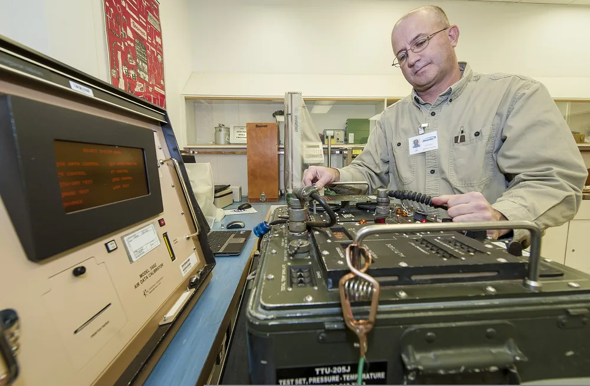

Выборочный контроль — это приёмка партии по небольшой выборке: проверяют, например, 125 деталей из 2000, а решение принимают по всей партии. Сколько деталей мерить и сколько дефектных допустимо, говорит план выборки по стандарту ISO. Гарантии, что брака в партии нет, он не даёт: он только ограничивает риск, и этот риск можно посчитать.

## Выборка или сплошной контроль: что решается в каждом случае

При выборочном контроле решают судьбу партии: принять её целиком или не принять. При сплошном контроле решают судьбу изделия: эта деталь годна или нет. Поэтому выборка отвечает на вопрос «брать ли партию», а сплошной контроль — на вопрос «что с этой деталью».

Сплошной контроль оправдан для жизненно важных и дорогих изделий и там, где проверка не разрушает деталь. Остальные партии он делает слишком дорогими: измерять каждую штуку долго, а при разрушающих испытаниях сдавать было бы нечего. Для таких партий приёмку ведут по выборке.

Правила такой приёмки по признаку «годен / не годен» задают стандартные планы выборки по ISO: они определяют, сколько деталей проверить и сколько дефектных допустимо.

> Выборка решает судьбу партии, а не каждой детали, и цена этого решения — оценённый риск.

<!-- inline-cta -->

## Что в детали проверяют выборкой, а что на каждой штуке

*Техник калибрует тестовый набор в лаборатории точных измерений. Фото: [SSgt Benjamin Stratton](https://commons.wikimedia.org/wiki/File:Larry_Loe,_a_precision_measurement_equipment_laboratory_physical_dimensions_technician_with_the_92nd_Maintenance_Squadron,_calibrates_a_test_set_at_Fairchild_Air_Force_Base,_Wash.,_Nov._5,_2013_131105-F-JF989-003.jpg) · [Public domain](https://creativecommons.org/publicdomain/mark/1.0/)*

Выборкой проверяют признаки, брак по которым не ломает узел сразу и нарастает от партии к партии. Каждую деталь проверяют по признакам, от которых зависит сборка и работа узла. Граница проходит по трём вопросам: насколько дефект критичен для узла, сколько стоит проверка и разрушает ли она деталь.

Ниже — типовое разделение. Это правило принятия решения, а не норма стандарта: окончательно его определяют чертёж и договор.

| Признак по чертежу | Как проверяют | Почему |
|---|---|---|
| Линейные размеры с обычным допуском | Выборка | По нескольким деталям видно, куда ушёл размер из-за износа инструмента |
| Шероховатость поверхности | Выборка | Меняется по мере износа инструмента, а замер занимает время |
| Твёрдость | Выборка | Зависит от термообработки партии, а замер оставляет отпечаток на детали |
| Покрытие | Выборка | Условия нанесения общие для всей садки |
| Посадочные диаметры | Каждая деталь | От них зависит сборка узла, брак вскроется только на сборке |
| Резьбы | Каждая деталь | Проверка калибром быстрая и не разрушает деталь |
| Критичные допуски | Каждая деталь | Отклонение выводит узел из строя |

Разделение связано с классами дефектов: критический, значительный, незначительный. Критический дефект делает деталь непригодной или опасной в работе, и такие дефекты выборке не оставляют. Значительные и незначительные допускают выборку, но с разным AQL.

Сварной шов — отдельный случай: там сплошной неразрушающий контроль применим. Его разбирает статья про [контроль сварного шва: УЗК, РК и ВИК](/blog/kontrol-svarnogo-shva-uzk-rk-i-vik).

> **Мнение.** Если посадочный диаметр или резьба входят в сборку узла, берите на них сплошной контроль, а остальные признаки принимайте по выборке: так проверка не растягивается на всю карту размеров.

## Что считать партией и как честно отобрать детали

Партия — это детали, изготовленные в одинаковых условиях: на одной наладке, с одной оснасткой, в одну смену. Только к такой партии можно применять результат выборки. Если смешать разные наладки и смены, выборка усреднит несравнимое, и её результат ничего не докажет ни про одну из групп.

Размер партии ограничивают и сверху, и снизу. Слишком большая партия тянет под задержку отгрузки больше изделий, когда обнаружилась проблема. Слишком маленькая делает приёмку частой и дорогой. Подробнее о том, [как выбрать размер партии](/blog/kak-opredelit-ekonomicheski-razumnyy-razmer-partii), рассказано отдельно.

Типичная ошибка отбора выглядит так: контролёр открывает ящик и берёт детали из верхнего ряда. Или мерит первые детали после наладки. Верхний ряд — то, что положили в тару последним. Первые детали показывают станок на старте, а не на всём протяжении партии. В обоих случаях выборка описывает удобный край партии, а середина и дно ящика остаются непроверенными.

Честный отбор случайный и с расслоением: образцы берут из разных мест тары, в разное время, с разной оснастки и из разных смен. Идентификаторы отобранных изделий и результаты записывают, иначе спорный результат не перепроверить.

> Результат выборки верен только для партии, изготовленной в одинаковых условиях.

## Как читать план выборки: партия 2000 деталей

План выборки читают по пяти шагам: от размера партии к объёму выборки, а от него к числам приёмки и браковки. Цифры ниже относятся к одной партии из 2000 деталей и одному значению AQL, для других партий они изменятся.

1. Размер партии: 2000 деталей.
2. Уровень контроля: общий II.
3. Кодовая буква по таблице стандарта: K.
4. Объём выборки n для буквы K: 125 деталей.
5. Числа Ac и Re в столбце AQL: 3 и 4 при AQL 1,0%.

### Считаем на примере: партия 2000 деталей, AQL 1,0%

Берём общий уровень контроля II. Для партии 2000 деталей он даёт кодовую букву K. Для буквы K при нормальном контроле проверяют 125 деталей.

Столбец AQL 1,0% даёт Ac=3 и Re=4. Партию принимают, если несоответствующих деталей не больше трёх, и бракуют при четырёх и более. Промежуточного исхода в одноступенчатом плане нет: решает число дефектных в выборке.

### Одно-, двух- и многоступенчатые планы

В двухступенчатом плане после первой выборки возможны три решения: принять, забраковать или взять вторую выборку. Одноступенчатый план проще в отборе: образцы берут один раз. Многоступенчатый может сэкономить измерения при очень хорошем или очень плохом качестве партии.

## AQL: что это и чего он не означает

AQL — параметр плана выборки: уровень качества процесса, при котором план принимает большинство партий. Это не доля брака, которую заказчик готов принять в поставке. Партия с большей долей брака тоже может пройти приёмку, просто реже.

AQL работает в паре с кодовой буквой. Буква задаёт объём выборки, а AQL выбирает столбец таблицы, из которого берут числа Ac и Re. В примере выше буква K и AQL 1,0% дали 125 деталей, Ac=3 и Re=4. При другом AQL числа приёмки и браковки будут из другого столбца.

Когда заказчик пишет в ТЗ «AQL 1,0», он покупает правило приёмки, а не гарантию «не больше 1% брака». Даже сплошной контроль не даёт такой гарантии: контролёр может пропустить дефект.

AQL задают по классам дефектов: для критических, значительных и незначительных значения разные. Их согласуют заказчик и поставщик в договоре. В примере мы держим только AQL 1,0%.

> AQL выбирает план и определяет числа Ac и Re, но не обещает, сколько брака окажется в поставке.

## Выборка не гарантирует партию: риск и OC-кривая

Выборка не гарантирует качества всей партии: план принимает и негодные партии с некоторой вероятностью. Эту вероятность показывает OC-кривая плана. По одной оси на ней доля брака в партии, по другой — вероятность, что партию примут.

Планы по ISO ограничивают два риска. Риск поставщика — что годную партию забракуют. Риск потребителя — что негодную примут. Обе величины видны на OC-кривой.

> **Факт.** В планах по ISO риск поставщика принимают равным 5%, а риск потребителя — 10%.

Возьмём учебный план: 10 деталей, партию принимают, если дефектная не больше одной.

| Доля брака в партии | Вероятность приёмки партии | Что это значит |
|---|---|---|
| 1% | 99,61% | Партия почти всегда проходит |
| 30% | 14,79% | Примерно каждая седьмая такая партия проходит |

Числа относятся только к этому плану. На план из 125 деталей их переносить нельзя.

Рост объёма выборки при том же приёмочном числе снижает риск отгрузки негодной партии, но удлиняет и удорожает контроль. Для деталей, которые разрушаются при проверке, это особенно тяжело. Поэтому объём выбирают по балансу стоимости контроля и нужного качества.

> **Мнение.** Если в договоре записан только объём выборки, запросите у поставщика OC-кривую плана: по одному n не понять, с какой вероятностью пройдёт партия с браком.

## Строгость контроля и что делать с забракованной партией

Строгость контроля — режим, в котором работает план: нормальный, усиленный или ослабленный. Режим переключают по истории приёмок, то есть по тому, как проходили прошлые партии. Пока с процессом всё в порядке, работают по нормальному контролю.

Стабильные партии позволяют ослабить контроль и мерить меньше. Брак его ужесточает. В [серийном производстве деталей](/serijnoe-proizvodstvo-detalej.html) партии идут потоком, и история приёмок копится сама. Сколько партий подряд нужно для переключения режима, стороны фиксируют в договоре заранее.

| Режим контроля | Когда применяют | Что меняется для поставщика |
|---|---|---|
| Нормальный | Пока с процессом всё в порядке | Партии принимают по обычному плану из таблицы |
| Усиленный | После брака в череде приёмок | Партии проходят приёмку труднее |
| Ослабленный | Когда партии идут стабильно | Проверяют меньше деталей, приёмка дешевле |

Забракованную партию не выбрасывают. Остаются три пути: сплошная сортировка с заменой брака, возврат поставщику или решение по договору. Выбор зависит от условий, которые прописаны заранее.

## Что прописать в договоре и акте приёмки партии

Чтобы выборочная приёмка не превратилась в спор, её условия записывают в ТЗ, договоре и акте входного контроля до первой поставки. Ниже семь пунктов, из которых складывается черновик такого раздела договора.

1. Стандарт плана выборки (название и год редакции) и уровень контроля: например, общий II.
2. Вид плана и режим: одно- или двухступенчатый, нормальный контроль по умолчанию.
3. AQL по классам дефектов: отдельно для критических, значительных и незначительных.
4. Порядок отбора: кто отбирает образцы, как обеспечивают случайность, как фиксируют идентификаторы.
5. Средства измерения: чем мерят и как проводят арбитражные измерения, то есть повторный замер спорных образцов.
6. Действия при отклонении партии: повторный контроль, сортировка, возврат.
7. Акт входного контроля: результат по каждому образцу и решение по партии.

Как принимают партию и убеждаются, что деталь соответствует чертежу, описано на странице [о контроле качества деталей](/razdel/kontrol-kachestva.html).

Есть чертёж и условия приёмки? [Пришлите чертёж](/kontakty.html): согласуем, какие признаки проверять выборкой, а какие на каждой детали.

## Частые вопросы

### Когда деталь нужно проверять каждую, а не по выборке?

Когда дефект критичен для работы узла, а проверка быстрая и деталь не разрушает. Так обычно назначают контроль посадочных диаметров и резьб.

### Что такое AQL?

Параметр плана выборки: уровень качества процесса, при котором план принимает большинство партий. Допустимой долей брака в поставке он не считается.

### Что такое статистический приёмочный контроль?

Выборочная приёмка партии по правилам стандарта: план задаёт, сколько деталей проверить и сколько дефектных допустимо. Риск ошибочного решения при этом известен заранее.

## Источники

- [Sampling inspection: how sampling plans work](https://www.keyence.com/ss/products/measure-sys/measurement-selection/process/sampling-inspection.jsp) — Keyence
- [Росстандарт: национальные стандарты](https://www.rst.gov.ru/) — Федеральное агентство по техническому регулированию и метрологии
- [ISO: международные стандарты](https://www.iso.org/) — Международная организация по стандартизации
