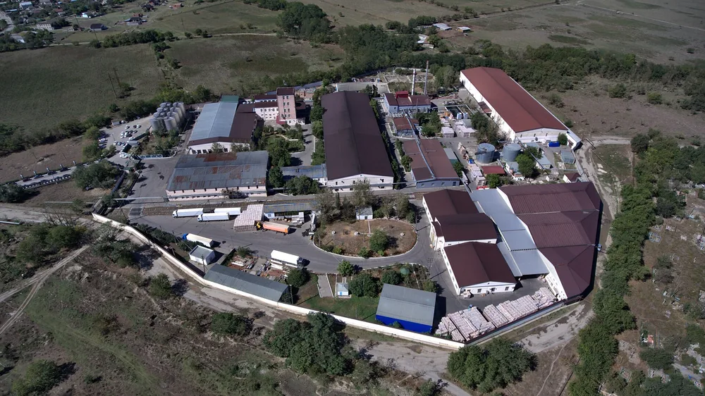
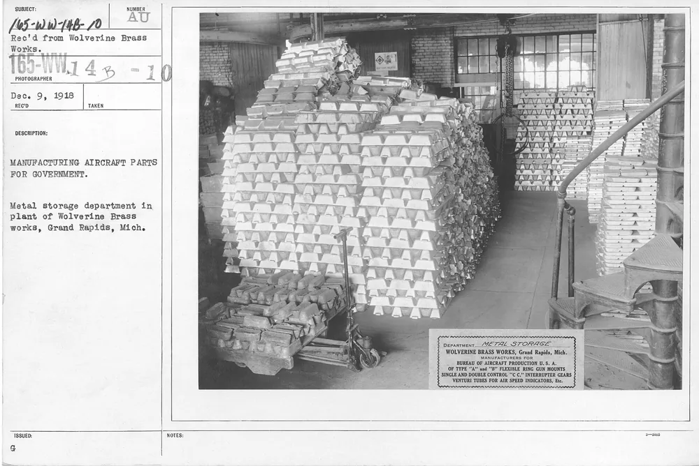

Надёжный завод-изготовитель отвечает на три вопроса: что он делает сам, чем измеряет и что покажет до серии. Спросите про станки на собственной площадке, протоколы измерений и сертификат на металл, а потом закажите пробную партию. Посредник на эти вопросы отвечает общими словами.

## Что значит «завод-изготовитель» для заказчика детали

Для заказчика завод-изготовитель — тот, кто делает деталь на своих станках и отвечает за брак. Слово «завод» в названии компании этого не гарантирует. Бывает, что фирма только принимает заказ и передаёт его другой площадке. Такая фирма — посредник (трейдер): он передаёт заказ заводу и берёт плату за организацию.

В обиходе «изготовитель» и «производитель» — синонимы. Для договора на детали важнее другое: кто фактически исполняет чертёж и отвечает за результат.

Разница проявляется в трёх местах: кто отвечает за брак, кто может изменить технологию и кто назовёт реальный срок. Завод решает это сам. Посреднику нужно согласовывать каждый шаг с чужим цехом.

> Название компании ничего не гарантирует. Заказчику важно, на чьих станках и под чьей ответственностью сделают деталь.

<!-- inline-cta -->

## Три типа исполнителей: завод, малый цех, посредник

*Один из производственных цехов ККЗ. Фото: [Kizlyar Brandy Factory](https://commons.wikimedia.org/wiki/File:%D0%9F%D1%80%D0%BE%D0%B8%D0%B7%D0%B2%D0%BE%D0%B4%D1%81%D1%82%D0%B2%D0%B5%D0%BD%D0%BD%D1%8B%D0%B9_%D1%86%D0%B5%D1%85_%D0%9A%D0%9A%D0%97.jpg) · [CC BY 2.0](https://creativecommons.org/licenses/by/2.0)*

Исполнителей по чертежу делят на три типа: завод с полным циклом, малый цех и посредник. Их сравнивают по одним критериям: сроки, гибкость под нестандарт, ответственность за брак, минимальная партия и прозрачность процесса. Лучшего типа вообще нет — есть подходящий под вашу задачу.

| Тип исполнителя | Сроки | Гибкость под нестандарт | Ответственность за брак | Минимальная партия | Прозрачность процесса |
|---|---|---|---|---|---|
| Завод с полным циклом | Зависят от очереди, операции не уходят на сторону | Есть технологи и оснастка, но действуют регламенты | Один исполнитель, один договор | Обычно рассчитана на серию | Можно увидеть цех и протоколы |
| Малый цех | Быстро на единичных деталях | Большая для простых задач, ограничена парком станков | Отвечает цех, ресурса на переделку меньше | Единичные детали и малые партии | Станок и технолог известны |
| Посредник | Срок площадки плюс пересылка | Выбор площадок широкий, правки идут через менеджера | Размыта между заказчиком, посредником и площадкой | Определяет площадка | Цех видно не всегда |

Завод с полным циклом подходит для средних и крупных серий: резка, обработка, термообработка и покрытие идут под одной крышей. Малый цех выручает на прототипах, если станки подходят под материал и габарит. Посредник даёт доступ к нескольким площадкам сразу, но срок зависит от чужого производства.

## Как отличить настоящий завод от посредника за один звонок

*Отделение хранения металла — инфраструктура завода-изготовителя для управления сырьем. Фото: [Unknown author Unknown author or not provided](https://commons.wikimedia.org/wiki/File:Airplanes_-_Manufacturing_Plants_-_Manufacturing_Aircraft_Parts_for_Government._Metal_storage_department_in_plant_of_Wolverine_Brass_works,_Grand_Rapids,_Mich_-_NARA_-_17340574.jpg) · [Public domain](https://creativecommons.org/publicdomain/mark/1.0/)*

Сколько раз вам отвечали «всё делаем сами» и не называли ни одного станка? Настоящий завод называет станок, цех и технолога по вашей детали. Задайте несколько вопросов и слушайте, насколько конкретны ответы.

Спросите, на каком станке и в каком цехе обработают именно вашу деталь. Уточните, какие операции идут на своей площадке, а какие уходят на сторону: термообработка, покрытие, гальваника. Попросите подключить технолога, который разберёт чертёж и обсудит допуски напрямую. И предложите видео-обход цеха с вашим заказом в работе.

Ответ «мы работаем с проверенными партнёрами» без названий и адресов — повод спросить, кто исполнитель. Аутсорс части операций — не грех, если о нём честно сказано: заводу редко нужна собственная гальваника.

> Завод показывает станок и технолога по вашей детали. Посредник рассказывает про «партнёров».

## Станки, ОТК и измерительное оборудование: что спросить про контроль

О способности держать допуски судят по трём вещам: есть ли станок под ваш материал и габарит, работает ли отдельный ОТК и чем измеряют. Допуск на размер задан в чертеже заказчика, и завод должен уметь его проверить, а не только выточить. ОТК проверяет соответствие детали чертежу, а контрольно-измерительное оборудование фиксирует фактические размеры для ОТК.

Парк станков сам по себе говорит мало: важно, подходит ли он под вашу задачу. Чем жёстче допуск, тем точнее нужен инструмент. Штангенинструментом проверяют грубые размеры, микрометрами и калибрами — точные, координатно-измерительной машиной — сложную геометрию. Вопросы технологу до расчёта:

1. Есть ли станок под мой материал, габарит и точность?
2. Работает ли отдельный ОТК и кто подписывает приёмку?
3. Что проверяют: входной материал, операционный контроль, финальный обмер?
4. Чем измеряют размеры с моим допуском?
5. Покажете ли обезличенный протокол измерений по похожей детали?
6. Какие детали близкой сложности и из похожих материалов делали раньше?

Чужие чертежи завод раскрывать не должен. Достаточно описания: материал, габарит, класс точности.

## Проверка контрагента по открытым источникам: четыре шага

Юрлицо проверяют без платных сервисов: выписка ЕГРЮЛ, картотека арбитражных дел, сертификат ISO 9001 и реестр российской промышленной продукции. ЕГРЮЛ и картотека раскрывают данные о юрлице, которые невозможно проверить по сайту. Результат проверки — не приговор, а повод для вопросов.

1. **ЕГРЮЛ.** Закажите выписку на egrul.nalog.ru. Смотрите возраст компании, руководителя, коды ОКВЭД и адрес. Обработка металлов должна быть среди видов деятельности.
2. **Картотека арбитражных дел** (kad.arbitr.ru). Ищите споры с заказчиками о сроках и качестве. Один спор — не сигнал, серия однотипных — сигнал.
3. **ISO 9001.** Подлинность сертификата проверяют через орган, который его выдал, и реестр аккредитованных органов Росаккредитации.
4. **Реестр российской промышленной продукции (ГИСП).** Найдите компанию и посмотрите, что именно подтверждает запись. Оценкой качества вашей детали она не служит.

> **Факт.** Сертификат ISO 9001 подтверждает систему менеджмента качества предприятия, а не размеры каждой детали.

Отсутствие сертификата не приговор, но и наличие не гарантия.

## Документы на материал и допуски: что завод обязан показать

Завод показывает сертификат или паспорт качества на металл: марку, партию, химический состав и механические свойства. Сертификат на металл подтверждает марку и свойства материала для завода-изготовителя, поэтому просите его до запуска, а не после претензии.

| Документ | Что подтверждает | На что смотреть при получении |
|---|---|---|
| Сертификат или паспорт качества на металл | Марку, химсостав и механические свойства партии | Марка и номер партии совпадают с заказом и маркировкой проката |
| Протокол испытаний | Результаты испытаний образцов | Нужен, если в чертеже заданы механические свойства; иначе хватает сертификата |
| Протокол измерений | Фактические размеры готовых деталей | Замерены критичные размеры, указана версия чертежа |

Допуск на размер задаётся в чертеже заказчика. Если он не указан, до запуска письменно договоритесь, по какому стандарту его считать, иначе стороны трактуют размер по-разному. Замену материала на аналог согласовывают только письменно.

## Тревожные признаки в коммерческом предложении

По КП видно, разобрал ли исполнитель чертёж. Если цена и срок пришли без единого вопроса, чертёж, скорее всего, не открывали. Признаки ниже — сигналы для уточнения, а не приговор.

- Цена и срок названы без вопросов по чертежу и материалу.
- В КП нет марки материала, допусков и покрытия либо стоит «по ГОСТ» без номера.
- Исполнитель отказывается показать протокол измерений, сертификат на металл или обсудить производство.
- Срок и цена резко лучше остальных предложений, и никто не объясняет почему.
- Есть один контакт менеджера, а технолога к разговору не подпускают.

Каждый признак снимается вопросом: «Какая марка, какой допуск и по какому ГОСТу?» Если ответ конкретный, предложение живое.

## Пробная партия и приёмка: как проверить завод на деле

Пробная партия — малый заказ до серии. Она выявляет расхождения с чертежом, выход за допуск на размер и показывает, как завод исправляет ошибки. Так вы проверяете исполнителя на своих деньгах в малом объёме, а не в серии.

1. Запросите образец или пробную партию.
2. Попросите в комплекте протокол измерений, сертификат на металл и фото маркировки.
3. Измерьте критичные размеры, проверьте покрытие и версию чертежа.
4. Отправьте замечания и оцените реакцию: срок ответа, причина, план исправления.
5. Решите, запускать ли серию.

Подробнее про шаги три и пять — [приёмка первой детали перед запуском серии](/blog/kak-prinyat-pervuyu-detal-pered-zapuskom-serii). Реакция на замечания часто говорит о заводе больше, чем сам образец: если ОТК фиксирует размеры измерительным оборудованием, причину расхождения находят быстро и показывают в протоколе.

> **Мнение.** Если деталь ответственная или серия дорогая, берите пробную партию даже у завода с ISO 9001: сертификат не заменяет замер вашей детали.

## Итог: чек-лист выбора и что делать дальше

Порядок такой: вопросы про станки и контроль, проверка по открытым источникам, документы на материал, пробная партия. Если на любом шаге ответы уходят в общие слова, сравните предложение с другим исполнителем.

> Завод проверяют вопросами, документами и пробной партией, а не сайтом и названием.

Перед расчётом подготовьте чертёж: [как подготовить заявку на расчёт](/blog/kak-podgotovit-zapros-na-raschet-izgotovleniya-detaley). Нужно [изготовление деталей по чертежам](/)? [Отправьте чертёж на расчёт](/kontakty.html) и сравните ответ с другими исполнителями.

> **Факт.** IRONEX присылает расчёт по чертежу за 3 рабочих дня.

## Частые вопросы

### Чем завод-изготовитель отличается от посредника?

Завод делает деталь на собственных станках и отвечает за результат. Посредник принимает заказ и передаёт его другой площадке. Спросите, на каком станке и в каком цехе будет обработана ваша деталь.

### Какие документы попросить у завода перед заказом?

Реквизиты для проверки по ЕГРЮЛ, сертификат или паспорт качества на металл и пример протокола измерений по похожей детали. ISO 9001 — плюс, но он подтверждает систему качества, а не каждую деталь.

### Завод-изготовитель и завод-производитель — это одно и то же?

В обиходе да: оба слова про того, кто делает продукцию. Для договора важнее не слово, а кто фактически делает деталь и отвечает за брак.

## Источники

- [Выписки из ЕГРЮЛ и ЕГРИП](https://egrul.nalog.ru/) — Федеральная налоговая служба
- [Картотека арбитражных дел](https://kad.arbitr.ru/) — Арбитражные суды Российской Федерации
- [Федеральная служба по аккредитации](https://fsa.gov.ru/) — Росаккредитация
- [Государственная информационная система промышленности (ГИСП)](https://gisp.gov.ru/) — Минпромторг России
