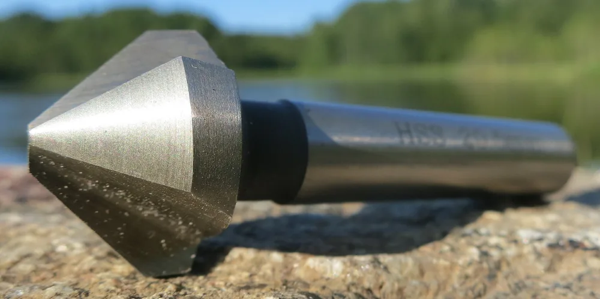

Зенковка — коническое углубление под потайной винт, цековка — цилиндрическое с плоским дном под болт или винт с цилиндрической головкой. На чертеже зенковку задают диаметром отверстия, наружным диаметром конуса и углом, цековку — диаметром отверстия, диаметром и глубиной. Угол пишите явно: он должен совпадать с углом головки винта, а не с тем, что окажется в цехе под рукой.

## Зенковка и цековка: в чём разница

Сначала посмотрите на головку крепежа. Конической потайной головке нужна зенковка, цилиндрической головке болта или винта — цековка с плоским дном. Ошибка в выборе меняет площадь контакта и положение крепежа: головка может выступить над поверхностью, провалиться или опереться только узкой кромкой.

| Параметр | Зенковка | Цековка |
|---|---|---|
| Форма углубления | Конус | Цилиндр с плоским дном |
| Крепёж | Потайной винт или заклёпка | Болт или винт с цилиндрической головкой |
| Опорная поверхность | Коническая | Плоская кольцевая площадка |
| Инструмент | Коническая зенковка или фасочная фреза | Цековка с направляющей цапфой или концевая фреза |
| Дополнительные элементы | Обычно не предусматривает шайбу внутри углубления | Вмещает плоскую или пружинную шайбу, уплотнительное кольцо |
| Типичное применение | Ровная наружная поверхность, тонкий лист, самоцентрирование | Скрытая цилиндрическая головка, шайба под головкой, плоская опора |

Коническая поверхность направляет потайной винт к оси отверстия. Плоское дно цековки создаёт опору для цилиндрической головки и позволяет уложить под неё шайбу либо уплотнительное кольцо.

В переписке цековку иногда называют цилиндрической зенковкой. Такой термин понятен не всем производителям. На чертеже лучше указать форму и полный набор размеров, а в заявке написать «цековка с плоским дном».

> **Факт.** Для однозначного задания цековки нужны три параметра: диаметр сквозного отверстия, диаметр углубления и его глубина.

> **Мнение.** Если название операции вызывает спор, ориентируйтесь на геометрию углубления и головку выбранного крепежа.

<!-- inline-cta -->

## Зенкование, зенкерование, цекование: три разные операции

*Трёхрезцовая зенковка из быстрорежущей стали, угол 90°, диаметр 20,5 мм. Фото: [R. Henrik Nilsson](https://commons.wikimedia.org/wiki/File:1990s_high_speed_steel_three_fluted_countersink_20_5_mm_Biltema_Sweden.jpg) · [CC BY 4.0](https://creativecommons.org/licenses/by/4.0)*

Близкие названия описывают разный результат. Зенкование формирует коническое углубление, цекование — цилиндрическое углубление с плоской опорой. Зенкерование обрабатывает стенки уже полученного отверстия по диаметру и улучшает его геометрию перед следующей операцией.

- **Зенкование:** создаёт конус под потайную головку, снимает заусенец или формирует заданную фаску.
- **Цекование:** делает цилиндрическую выборку под головку, шайбу, кольцо либо опорную поверхность.
- **Зенкерование:** исправляет форму и диаметр просверленного отверстия, подготавливает его к развёртыванию или другой чистовой обработке.

Зенкерование отличается от зенковки направлением обработки. Зенкер режет вдоль цилиндрической стенки, а коническая зенковка работает у входа в отверстие. Заказ «пройти зенкером» без чертежа поэтому не объясняет, нужен ли точный цилиндрический диаметр или посадочное углубление под крепёж.

На станке с ЧПУ конус можно обработать фасочной фрезой, а плоское дно цековки — концевой фрезой. Способ выбирает технолог с учётом диаметра, глубины, серии и доступного инструмента. Чертёж должен задавать конечную геометрию, а не навязывать инструмент без производственной причины.

## Как обозначить цековку на чертеже

Цековку задают тремя размерами: диаметром основного отверстия, диаметром цилиндрической выборки и её глубиной. Эти величины наносят на выноске или у изображения разреза. Дополнительно указывают количество одинаковых отверстий, допуски и требование к размеру после покрытия, если оно влияет на посадку.

Запись `∅10,5 THRU ⌴ ∅18,0 ↧10,0` читают по шагам:

1. `∅10,5 THRU` — выполнить сквозное отверстие диаметром 10,5 мм.
2. `⌴ ∅18,0` — со стороны выноски сделать цилиндрическую цековку диаметром 18,0 мм.
3. `↧10,0` — выдержать глубину цековки 10,0 мм от наружной поверхности.

Запись в таком виде встречается на импортных чертежах. Какие бы условные знаки вы ни использовали, технолог должен увидеть два диаметра и глубину.

На виде сверху цековка выглядит как две концентрические окружности. Разрез показывает плоское дно и переход к сквозному отверстию. Если глубина отсутствует, исполнитель не знает требуемое положение головки: она может выступить над поверхностью либо уйти глубже расчётной плоскости.

Для резьбовой части отдельно задают тип, шаг и глубину резьбы. Правила записи разобраны в материале про [обозначение резьбы на чертеже](/blog/oboznachenie-rezby-na-chertezhe).

> Полная запись цековки отвечает на три вопроса: какое отверстие проходит сквозь деталь, какой диаметр нужен под головку и насколько глубоко выбирать материал.

## Как обозначить зенковку на чертеже

Зенковку описывают диаметром отверстия под крепёж, наибольшим диаметром конуса и углом при вершине. Для потайного винта угол при вершине конуса должен совпадать с углом головки. Одного указания «зенковать под винт» недостаточно: одинаковая резьба встречается у головок разных размеров и стандартов.

Условный пример `∅5,5 THRU ⌵ ∅10,4 × 90°` расшифровывают так:

1. `∅5,5 THRU` задаёт сквозное отверстие диаметром 5,5 мм.
2. `⌵ ∅10,4` задаёт наибольший диаметр конического углубления 10,4 мм.
3. `× 90°` задаёт полный угол при вершине конуса.

Числа в примере иллюстрируют структуру записи. Свои значения берите из размеров выбранной головки.

На виде сверху зенковку показывают концентрическими окружностями. Разрез раскрывает конус и позволяет проверить, к какой поверхности относится углубление. Если зенковки нужны с двух сторон, это следует написать прямо: одна выноска без пояснения может быть прочитана как обработка только показанной стороны.

Требование «головка заподлицо» полезно как функциональный критерий, но оно не заменяет размеры. Конструктор задаёт наружный диаметр конуса, угол и допустимое положение головки относительно поверхности. Значение допуска нельзя брать из привычки цеха: его выбирают по функции узла и подтверждают расчётом либо стандартом изделия.

Для глухой основы также нужно отделить глубину сверления от рабочей глубины. Этот случай подробнее разобран в статье о том, [как проектировать глухое отверстие](/blog/glukhoe-otverstie-kak-proektirovat).

## Какой угол зенковки выбрать

Угол определяет выбранный крепёж. Для дюймовых крепежей системы ASME применяют 82°, в авиационных деталях и очень тонком листе — 100°. Для метрического и отечественного винта угол берут из стандарта или документации производителя на конкретное изделие.

> Угол зенковки должен совпадать с углом головки винта. При несовпадении головка касается конуса узкой зоной и не получает расчётной посадки.

Разница в несколько градусов плохо заметна на небольшом изображении. После затяжки она проявляется положением головки и характером контакта. Поэтому при работе по импортному чертежу нельзя заменять угол привычным значением станка или имеющегося инструмента.

Обозначение на чертеже прямо задаёт угол при вершине конуса. Если обозначение отсутствует, технологу придётся запрашивать данные либо принимать производственное решение вместо конструктора. Оба варианта задерживают расчёт и создают риск переделки партии.

> **Мнение.** Если крепёж ещё не выбран, сначала зафиксируйте стандарт и размеры головки, затем назначайте угол и наружный диаметр зенковки.

## Размеры отверстий под крепёж: на что опираться

Диаметры и глубины берут из геометрии конкретного крепежа. Номинальная резьба сама по себе не задаёт сквозной зазор, диаметр головки и её высоту. На размеры также влияют класс отверстия, способ сборки, шайба, покрытие и требуемое положение головки.

| Тип соединения | Сквозное отверстие | Углубление под головку | Глубина или угол | Откуда взять значение |
|---|---|---|---|---|
| Потайной метрический винт | По таблице отверстий под крепёж | По фактическому или стандартному диаметру головки | Угол по стандарту винта | Стандарт на винт и сквозные отверстия |
| Потайной дюймовый винт | По системе размеров чертежа | По диаметру головки выбранного винта | Угол по стандарту крепежа | ASME или каталог производителя |
| Винт с цилиндрической головкой | По классу свободного прохода | Диаметр цековки с монтажным зазором | По высоте головки и требуемому утоплению | Стандарт на винт и условия сборки |
| Болт с шайбой | По диаметру стержня и классу отверстия | По наружному диаметру шайбы | По суммарной высоте шайбы и головки | Стандарты на болт, шайбу и отверстие |
| Нестандартный крепёж | По измеренному стержню и требуемому зазору | По чертежу или образцу головки | По измеренной геометрии | Согласованный чертёж либо образец |

В таблицу размеров нельзя переносить числа от похожего винта. Для одной номинальной резьбы производитель может выпускать несколько головок. При нестандартном крепеже запросите чертёж, модель или физический образец и согласуйте измеряемые поверхности.

Для посадки без перекоса оставляют обоснованный монтажный зазор. Его значение зависит от точности деталей и способа сборки, поэтому универсальная прибавка без исходных данных создаёт ложную точность.

## Зенковка или цековка: что выбрать для вашей детали

Выбор определяют толщина стенки, форма головки, направление нагрузки и дополнительные элементы соединения. Зенковка сохраняет больше материала в тонкой детали и помогает потайному винту самоцентрироваться. Цековка создаёт плоскую опору для цилиндрической головки, шайбы или уплотнительного кольца.

### Когда нужна цековка

Цековку выбирают для болта или винта с цилиндрической головкой, когда головку нужно утопить в корпус. Плоское дно передаёт усилие затяжки вдоль оси крепежа. Такое решение выбирают, когда расчёт требует плоской опорной поверхности под головку.

Цилиндрическая выборка также нужна, когда внутри углубления должна находиться плоская или пружинная шайба. Уплотнительное кольцо можно разместить на плоском дне, если его канавка и сжатие рассчитаны отдельно.

### Когда нужна зенковка

Зенковку выбирают под потайной винт, когда наружная поверхность должна остаться ровной. Конус направляет головку к центру и помогает совместить детали при сборке. В тонком листе зенковка обычно оставляет больше рабочего сечения, чем глубокая цилиндрическая выборка.

Конус и цековка требуют разного инструмента и контроля, поэтому форма углубления влияет на цену партии. Ориентиры и состав расчёта собраны на странице о том, [сколько стоит металлообработка](/ceny.html).

> Для тонкого листа чаще подходит зенковка. Для цилиндрической головки с шайбой нужна плоская опора цековки.

## Частые ошибки и чем они грозят

Основные дефекты возникают из-за несовпадения формы головки и углубления, неверного угла, вибрации инструмента и неучтённого покрытия. Каждая ошибка влияет на посадку крепежа, поэтому исправлять её нужно в чертеже и технологии, а не дополнительной затяжкой при сборке.

- **Потайной винт поставили в цековку.** Коническая головка касается плоского дна или кромки узкой зоной. В чертеже заменяют выборку зенковкой с углом выбранной головки.
- **Цилиндрическую головку поставили в зенковку.** Головка не получает плоской опоры. Для неё задают цековку с диаметром и глубиной.
- **Угол не указан либо перепутаны 82° и другое значение.** Винт садится на узкую кольцевую зону. В обозначение добавляют полный угол при вершине.
- **Не учли покрытие.** Покрытие меняет размер углубления и отверстия. Для точной посадки указывают размер после покрытия либо согласуют защиту отверстия пробкой.
- **Появились огранка и вибрационные следы.** Возможные причины — биение, слабое закрепление, слишком длинный вылет и неподходящий режим. Технолог проверяет соосность, жёсткость установки, состояние инструмента и рекомендации его производителя.
- **Цековка смещена относительно отверстия.** Головка опирается неравномерно. На чертеже задают функциональное требование к расположению, а производство контролирует элемент калибром или измерительной машиной.

Скорость, подачу и СОЖ подбирают по материалу детали, диаметру и марке инструмента. Для стали, нержавеющей стали, алюминия, латуни и титана нет одной безопасной таблицы режимов. Исходные значения берут из каталога производителя инструмента и уточняют на пробной детали.

## Что указать в чертеже и заявке на изготовление

Полная заявка связывает геометрию углубления с конкретным крепежом, материалом и покрытием. Для цековки нужны два диаметра и глубина. Для зенковки — диаметр отверстия, наружный диаметр конуса и угол при вершине. Допуски назначают по функции соединения.

1. **Назовите крепёж.** Укажите тип, номинальную резьбу, стандарт или приложите чертёж нестандартной головки.
2. **Выберите форму углубления.** Задайте зенковку под потайную головку или цековку под цилиндрическую.
3. **Поставьте размеры.** Для цековки нужны диаметр отверстия, диаметр выборки и глубина; для зенковки — диаметр отверстия и наружный диаметр конуса.
4. **Укажите угол.** Запишите полный угол при вершине зенковки, даже если он кажется очевидным из названия винта.
5. **Опишите покрытие.** Зафиксируйте, относятся ли точные размеры к состоянию до или после нанесения покрытия.
6. **Задайте контроль.** Укажите проверку калибром, шаблоном, измерительным инструментом или контрольной головкой. Требование «заподлицо» дополните допустимым положением головки.
7. **Приложите исходные файлы.** Передайте PDF с размерами, модель детали и спецификацию крепежа в одной ревизии.

> Чертёж должен описывать готовую геометрию и критерий приёмки. Выбор конкретной фрезы, зенковки и режима обработки можно оставить технологу производства.

Если нужно рассчитать партию, отправьте комплект документов на [изготовление деталей по чертежам](/). Вместе с моделью приложите обозначение крепежа, сведения о материале, покрытии и требуемом контроле.

## Частые вопросы

### Чем зенковка отличается от цековки?

Зенковка создаёт коническое углубление под потайную головку. Цековка формирует цилиндрическую выборку с плоским дном под болт или винт с цилиндрической головкой. Плоское дно также позволяет разместить шайбу или уплотнительное кольцо.

### Что такое зенкерование и чем оно отличается от зенкования?

Зенкерование обрабатывает цилиндрическую стенку уже просверлённого отверстия, улучшает форму и подготавливает отверстие к следующей чистовой операции. Зенкование формирует конус у входа под потайную головку, фаску или технологическое углубление.

### Как обозначить зенковку на чертеже?

Укажите диаметр отверстия под крепёж, наибольший диаметр конуса и полный угол при вершине. Условный пример записи: `∅5,5 THRU ⌵ ∅10,4 × 90°`. При нескольких одинаковых элементах добавьте их количество и сторону обработки.

## Источники

- [Counterbore vs. Countersink Holes: Differences, Symbols, and Applications](https://www.rapiddirect.com/blog/counterbore-vs-countersink-holes/) — RapidDirect
- [Y14.5 Dimensioning and Tolerancing](https://www.asme.org/codes-standards/find-codes-standards/y14-5-dimensioning-tolerancing) — ASME
- [Федеральное агентство по техническому регулированию и метрологии](https://www.rst.gov.ru/) — Росстандарт
