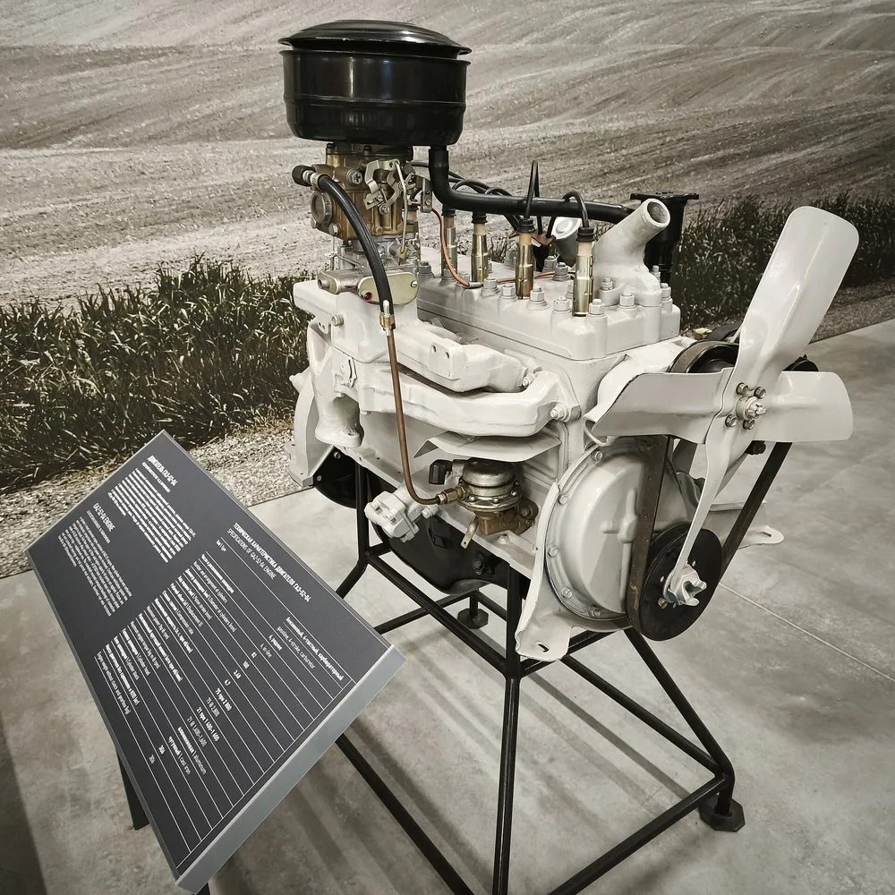
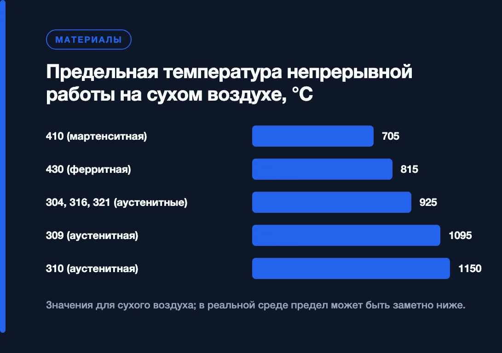

Жаропрочная сталь держит нагрузку при нагреве, жаростойкая только не сгорает в окалину. Для детали под нагрузкой это разные свойства, и путать их дорого. Начните с трёх данных: температура, нагрузка, среда. К инконелю переходят, когда сталь уже не закрывает нагрузку, ресурс или среду. Платить за это придётся обработкой.

## Жаропрочность и жаростойкость: два разных свойства

Заказчик видит нагретую деталь и просит «жаропрочную нержавейку». Сначала нужно уточнить, что должна выдержать деталь. Жаропрочность описывает сопротивление деформации и разрушению под нагрузкой. Жаростойкость показывает, как металл сопротивляется окислению и образованию окалины в горячей газовой среде.

Ползучесть — медленная остаточная деформация под постоянной нагрузкой и температурой. Она ограничивает ресурс жаропрочной стали: деталь может сохранить поверхность, но постепенно вытянуться, прогнуться или потерять размер. Хром повышает жаростойкость, поскольку помогает образовать защитную оксидную плёнку. Эта плёнка сама по себе не гарантирует несущую способность. Табличный предел температуры нужно воспринимать вместе с нагрузкой, длительностью нагрева и средой.

> Жаростойкая сталь может не покрываться окалиной и одновременно терять форму под нагрузкой. Температура из таблицы для сухого воздуха не равна допустимой температуре в конкретной печи.

<!-- inline-cta -->

## Какие стали работают в горячей зоне и до какой температуры

*Двигатель автомобиля с жаропрочными сталями в цилиндрах и клапанах, работающими в условиях горячей зоны. Фото: [U51N433](https://commons.wikimedia.org/wiki/File:%D0%94%D0%B2%D0%B8%D0%B3%D0%B0%D1%82%D0%B5%D0%BB%D1%8C_%D0%93%D0%90%D0%97-52-04_%D0%B2_%D0%BC%D1%83%D0%B7%D0%B5%D0%B5_%D0%B8%D1%81%D1%82%D0%BE%D1%80%D0%B8%D0%B8_%D0%93%D0%90%D0%97,_%D0%B2%D0%B8%D0%B4_%D1%81%D0%B1%D0%BE%D0%BA%D1%83.jpg) · [CC BY 4.0](https://creativecommons.org/licenses/by/4.0)*

Температурная граница зависит от марки, среды и характера нагрева. Никель стабилизирует аустенитную структуру и помогает сохранить пластичность.

Ориентиры непрерывной работы в сухом воздухе:

| Позиция | Значение |
|---|---|
| 410, мартенситная | 705 °C |
| 430, ферритная | 815 °C |
| 304 / 316 / 321 | 925 °C |
| 309, аустенитная | 1095 °C |
| 310, аустенитная | 1150 °C |

Ферритная 446 с содержанием хрома около 24 % сопротивляется окалине до 1100 °C. Хромистые сплавы с содержанием никеля до 7 % обычно ограничивают температурами ниже 750 °C и применяют в серосодержащих средах.

> **Факт.** Значения на схеме относятся к сопротивлению окислению в сухом воздухе. Реальная газовая среда может вызвать разрушительную окалину при меньшей температуре.

## Таблица выбора: условия, класс стали, марка, момент перехода на никель

Материал выбирают по сочетанию температуры, нагрузки, ресурса и среды. Марка из таблицы служит отправной точкой для расчёта, а не готовой заменой конструкторского решения.

| Условия работы | Класс материала | Ориентир по маркам | Когда нужен никелевый сплав |
|---|---|---|---|
| Умеренный нагрев без постоянной нагрузки | Коррозионно-стойкая аустенитная сталь | 304, 316, 321 | Если среда вызывает науглероживание либо сталь теряет стойкость |
| Окислительный нагрев | Высокохромистая ферритная или аустенитная сталь | 446, 309, 310 | При одновременной нагрузке, термоциклах и требовании длительного ресурса |
| Длительная нагрузка при нагреве | Жаропрочная аустенитная сталь | Марка по расчёту ползучести и длительной прочности; 304L и 316L обычно не подходят | Когда допускаемое напряжение стали не закрывает ресурс |
| Частые циклы нагрева и охлаждения | Пластичная аустенитная сталь | Марка после проверки режима | При больших температурных градиентах и риске термоусталости |
| Науглероживающая атмосфера | Высоконикелевая аустенитная система | Марка по составу печной среды | Никель повышает сопротивление науглероживанию |
| Среда с высоким содержанием серы | Хромистый сплав с никелем до 7 % | Марка после проверки среды | Только после проверки: такие сплавы применяют именно в серосодержащих средах |

Для первичного отбора пригодится материал о том, [как выбрать марку стали под условия работы](/blog/kakuyu-stal-vybrat-dlya-detalej-spravochnik-marok). Точное соответствие российских и международных марок подтверждают нормативом и сертификатом.

## Где ошибаются при подборе: охрупчивание и потеря прочности

Высокое содержание легирующих элементов не защищает от любого режима. Длительная выдержка способна изменить структуру: сталь сохранит внешний вид, но потеряет вязкость, коррозионную стойкость или прочность. В заявке поэтому указывают рабочий диапазон, время нахождения под нагревом и число циклов.

### σ-фаза и карбиды по границам зёрен

Сигма-фаза охрупчивает аустенитные стали при длительной выдержке примерно в диапазоне 590–870 °C. Риску подвержены марки 310, 316, 317 и 314.

При длительном нагреве по границам зёрен могут выпадать карбиды, и коррозионная стойкость снижается. Низкоуглеродистые 304L и 316L уменьшают этот риск, но имеют меньшую прочность при нагреве и обычно не подходят для нагруженных горячих конструкций.

### Охрупчивание дуплекса и разупрочнение термоупрочнённых сталей

Дуплексные стали могут охрупчиваться после выдержки выше примерно 350 °C. Выше этого порога их для длительной работы не рассматривают.

Мартенситные и дисперсионно-твердеющие стали получают прочность после термообработки. Нагрев выше температуры отпуска или старения необратимо разупрочняет деталь.

> Дорогая высокохромистая марка может уступить более простой стали, если деталь долго работает в диапазоне структурной нестабильности.

## Углерод, кремний и литьё: что нельзя менять в марке молча

Похожий химический состав ещё не означает одинаковый ресурс. Углерод образует карбиды, повышает жаропрочность и сопротивление ползучести. Одновременно он усиливает склонность к сенсибилизации и межкристаллитной коррозии. Поэтому замена обычной или H-версии на низкоуглеродистую L-марку меняет расчёт нагруженной детали.

Кремний в описанных жаропрочных сплавах держат ниже 1,5 %: избыток ухудшает ползучесть и длительную прочность.

Литая деталь и деталь из проката тоже неравноценны. При замене литой корзины, опоры или направляющей на фрезерованную деталь из проката нужно заново проверить ползучесть, толщину сечения и ресурс.

> **Мнение.** Если чертёж допускает другую технологию получения заготовки, согласуйте замену с конструктором: совпадения марки недостаточно для переноса расчётного ресурса.

## Когда стали мало: инконель и никелевые сплавы

Слово «инконель» объединяет несколько никелевых сплавов с разным составом и способом упрочнения. Название без номера сплава не задаёт материал, а точный российский аналог нельзя назначать только по близкому набору элементов.

Пять признаков, что пора рассматривать никелевый сплав:

- аустенитная сталь не держит расчётную нагрузку в течение заданного ресурса;
- деталь проходит частые циклы нагрева и охлаждения;
- среда науглероживает или агрессивно воздействует на сталь;
- отказ горячей детали опаснее удорожания заготовки и обработки;
- расчёт требует дисперсионно-твердеющего сплава с заданным режимом старения.

Никель стабилизирует аустенит, даёт матрице прочность и пластичность, повышает сопротивление науглероживанию. Если сплав упрочняется старением, режим старения входит в технологический маршрут заказа, а состояние поставки нужно указать заранее.

Если условия закрывает аустенитная сталь, переход на никелевый сплав только увеличит стоимость. Рабочие пределы берут из документации на конкретную марку и сертификата партии.

## Как жаропрочные материалы обрабатываются: наклёп, инструмент, припуски

Никелевые сплавы усложняют обработку резанием из-за наклёпа, низкой теплопроводности и высокой нагрузки на режущую кромку. Аустенитные стали тоже наклёпываются. Остановка подачи или повторный проход по упрочнённой поверхности ускоряют износ инструмента и повышают риск ухода размера.

Состояние материала меняет режим обработки. Отожжённая заготовка и состаренный никелевый сплав требуют разных скоростей, подачи и геометрии пластины. Универсальную скорость без марки инструмента, жёсткости станка и состояния заготовки назначать нельзя.

Типовой маршрут выглядит так:

1. Проверить сертификат заготовки и состояние поставки.
2. Выполнить черновую обработку со стабильной подачей.
3. Оставить припуск под деформации после термообработки.
4. Провести закалку, отпуск или старение по заданному режиму.
5. Выполнить чистовую обработку и контроль размеров.

СОЖ должна стабильно попадать в зону резания. Прерывистая подача охлаждения создаёт температурные удары по кромке. При заказе [фрезерных работ по металлу](/frezerovka.html) передайте технологу требования к термообработке и окончательным допускам.

## Во что обходится выбор: заготовка, трудоёмкость, брак

Стоимость детали складывается из заготовки, машинного времени, инструмента и риска брака. У никелевого сплава растут все четыре составляющие. Материал дороже стали, припуск снимается медленнее, режущие кромки меняют чаще, а ошибка после термообработки списывает дорогую заготовку.

Сравнивать только цену килограмма некорректно. Нужно запросить стоимость полуфабриката требуемого размера, проверить минимальную партию и включить в расчёт черновую обработку, термообработку, финиш и контроль. Ориентир без даты и предложения поставщика не помогает принять решение.

Переплата оправдана, если отказ детали остановит печь, повредит соседний узел или потребует сложной замены. Если аустенитная сталь закрывает температуру, нагрузку, среду и ресурс с расчётным запасом, никелевый сплав добавит расходы без пользы.

## Что указать в чертеже и заявке, чтобы получить нужный материал

Фраза «жаропрочная нержавейка» не задаёт материал. Укажите марку и стандарт либо передайте условия, по которым технолог сможет предложить варианты. Сертификат на материал подтверждает марку и состав конкретной партии, но не заменяет расчёт детали.

В заявку включите:

- рабочую и максимальную температуру;
- постоянную, переменную или ударную нагрузку;
- требуемый ресурс и длительность одного нагрева;
- число термоциклов;
- состав среды: воздух, сера, продукты сгорания, науглероживание;
- состояние поставки и режим термообработки;
- требования к сертификату, химическому анализу, PMI и контролю твёрдости.

Допуски после старения или закалки отмечают отдельно. Если марка пока не определена, подбор начинают с геометрии, температуры, нагрузки и среды.

> Марка без температуры, нагрузки и ресурса — недописанное задание. Производство сможет посчитать форму детали, но материал придётся выбирать на глаз.

Проверить комплектность помогает инструкция о том, [как составить заявку на расчёт изготовления деталей](/blog/kak-podgotovit-zapros-na-raschet-izgotovleniya-detaley).

## Итог: порядок выбора за пять вопросов

Выбор между сталью и инконелем начинается с пяти вопросов:

1. До какой температуры нагревается металл?
2. Какую нагрузку держит деталь при нагреве?
3. Какая среда соприкасается с поверхностью?
4. Какой ресурс и сколько термоциклов нужны?
5. Как материал будут обрабатывать и термообрабатывать?

Сначала проверяют аустенитную жаропрочную сталь. Затем рассматривают высокохромистую марку, если главная задача связана с окислением. К никелевому сплаву переходят, когда сталь не закрывает нагрузку, ресурс, цикличность или среду.

Температуру из справочной таблицы сверяют со стандартом, технической документацией и сертификатом партии. [Пришлите чертёж](/kontakty.html), и мы рассчитаем деталь: вместе с файлом укажите температуру, нагрузку, среду и ресурс.

## Частые вопросы

### Чем жаропрочная сталь отличается от жаростойкой?

Жаропрочная сохраняет несущую способность под нагрузкой при нагреве. Жаростойкая сопротивляется окислению и окалине, но может деформироваться под нагрузкой. Для нагруженной горячей детали проверяют оба свойства.

### Чем никелевые сплавы отличаются от жаропрочной стали?

Никелевые сплавы применяют там, где стали не хватает по длительной прочности, термоциклам или стойкости к среде. Они дороже и сложнее в обработке. Пределы проверяют для конкретной марки и состояния материала.

### Как выбрать сталь под конкретное изделие и что запросить у поставщика?

Передайте температуру, нагрузку, ресурс, среду и чертёж. У поставщика запросите стандарт поставки и сертификат завода-изготовителя. При необходимости добавьте химический анализ, входной контроль и PMI.

## Источники

- [Stainless Steel — High Temperature Resistance](https://www.azom.com/article.aspx?ArticleID=1175) — AZoM
- [Heat-resistant alloys used in heat treating](https://gearsolutions.com/departments/hot-seat/heat-resistant-alloys-used-in-heat-treating/) — Gear Solutions
- [Росстандарт](https://www.rst.gov.ru/) — ведомство, регулирующее стандартизацию в России
- [Special Metals Corporation](https://www.specialmetals.com/) — производитель никелевых сплавов
