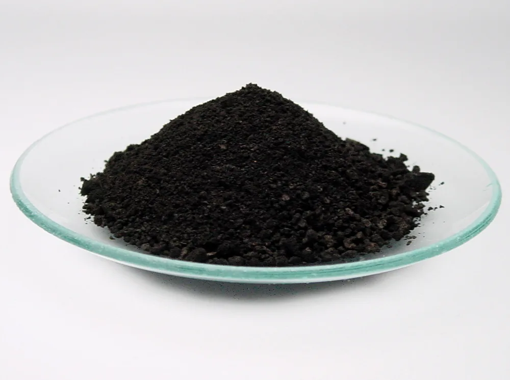

Железо — металл, точнее переходный металл с символом Fe. Металлическое железо проводит электрический ток и тепло, блестит на свежей поверхности и способно пластически деформироваться. В ржавчине железо входит в состав химических соединений. Сталь и чугун — сплавы на его основе, свойства которых зависят от состава и обработки.

## Железо — металл: какие свойства это подтверждают

Железо относят к металлам по его строению и свойствам простого вещества. Оно проводит электрический ток и тепло, имеет металлический блеск, поддаётся ковке и пластической деформации. В картотеке MeSH Национальной медицинской библиотеки США железо прямо названо металлическим элементом. WebElements описывает его как блестящий, ковкий и пластичный серебристо-серый металл.

Магнит для такого вывода не нужен.

Железо притягивается магнитом при комнатной температуре, но магнитность не служит общим признаком металлов. Например, медь и алюминий не дают такого же отклика. При этом оба материала проводят ток и относятся к металлам.

| Признак | Как он проявляется | Что учитывать |
| --- | --- | --- |
| Электропроводность | Металлическое железо проводит ток | Сопротивление зависит от состава и температуры |
| Теплопроводность | Через металл передаётся тепло | У сплавов значения отличаются |
| Блеск | Свежая поверхность отражает свет | Ржавчина и загрязнения скрывают поверхность |
| Пластичность | Материал меняет форму без разрушения | Поведение сплава зависит от состава и состояния |

Эти признаки помогают понять природу материала, но не определяют марку заготовки. Для этого нужны документы на поставку и, при необходимости, испытания.

<!-- inline-cta -->

## Где находится Fe в периодической таблице

*Оксид железа(II), FeO — соединение железа с кислородом. Фото: [http://en.wikipedia.org/w/index.php?title=User:Fuzic&action=edit](https://commons.wikimedia.org/wiki/File:Iron%28II%29_oxide.jpg) · [Public domain](https://creativecommons.org/publicdomain/mark/1.0/)*

В периодической таблице железо обозначено символом Fe и имеет атомный номер 26. Этот номер означает число протонов в ядре атома. Железо относится к переходным металлам. Его положение в таблице описывает химический элемент, но не задаёт прочность, твёрдость или коррозионную стойкость детали из сплава на его основе.

В карточке MeSH приведена формулировка: «A metallic element with atomic symbol Fe, atomic number 26, and atomic weight 55.845». Она подтверждает символ, номер и указанный атомный вес.

Атомный номер и атомный вес — разные величины.

Значение 55,845 относится к атомному весу, а не к номеру элемента. Для расчёта массы заготовки важнее плотность материала и его геометрия. Для выбора режима обработки — марка и состояние поставки.

## Элемент, металлическое железо и соединения — в чём разница

Химический элемент железо — это атомы с определённым зарядом ядра. Простое вещество железо состоит из атомов этого элемента, связанных металлической связью. В соединениях атомы железа связаны с другими элементами. Поэтому обнаружить Fe в образце и определить образец как металлическое железо — разные задачи. Одного химического обозначения для вывода о свойствах недостаточно.

Разница заметна на бытовых примерах. Стальной гвоздь — изделие из сплава на основе железа. Бурый налёт на нём — продукты коррозии. Железо присутствует и в гвозде, и в налёте, но свойства этих материалов различаются.

Ржавчина не становится металлом из-за наличия Fe.

То же относится к железной руде: присутствие элемента ещё не означает, что перед нами готовая металлическая заготовка. Свойства нужно связывать с конкретным веществом или сплавом. Такой же подход помогает разобраться в [свойствах меди и её применении в деталях](/blog/med-eto-metall-svoystva-primenenie).

## Физические свойства железа и условия их измерения

Чистое железо на свежей поверхности серебристо-серое и блестящее. Для него справочники приводят плотность, температуры плавления и кипения. Эти значения описывают элемент и не заменяют характеристики стали или чугуна. Для расчёта детали нужны данные выбранной марки, а для оценки прочности — ещё и сведения о состоянии материала.

В карточке элемента Jefferson Lab указаны следующие значения:

| Характеристика | Значение из карточки |
| --- | --- |
| Плотность | 7,874 г/см³ |
| Температура плавления | 1538 °C, или 1811 К |
| Температура кипения | 2861 °C, или 3134 К |

Источник подтверждает эти числа, но в приведённых фрагментах не раскрыты все условия измерения. Таблица подходит для знакомства с элементом. Она не задаёт режим нагрева стальной заготовки и не служит паспортом материала.

У стали нет единой температуры плавления для всех марок.

Состав сплава влияет на его свойства. Поэтому справочное число для чистого Fe нельзя автоматически переносить на материал, обозначенный в чертеже как сталь или чугун.

## Почему магнитность и структура железа зависят от температуры

При комнатной температуре железо ферромагнитно: в материале существуют области с упорядоченными магнитными моментами. При нагреве выше точки Кюри ферромагнитный порядок исчезает. При этом железо сохраняет металлическую природу. Изменение магнитных свойств и перестройка кристаллической решётки — разные процессы, поэтому потеря притяжения к магниту сама по себе не доказывает смену структуры.

У сплавов поведение зависит от состава и состояния. Стали могут заметно различаться по магнитному отклику, хотя их основа — железо.

Магнит не определяет марку стали.

Для входного контроля его можно использовать только как вспомогательный инструмент. По одному притяжению нельзя установить химический состав, подтвердить термообработку или решить, пригоден ли материал для детали.

## Почему железо ржавеет и что меняет защитное покрытие

Ржавление железа во влажном воздухе связано с коррозией при участии воды и кислорода. Металл переходит в соединения железа, которые образуют поверхностный слой. Ржавчина — смесь продуктов коррозии, а не одно вещество с неизменным составом. Условия эксплуатации влияют на то, как развивается повреждение и какие участки детали страдают сильнее.

Для выбора защиты важно знать, будет ли деталь стоять в помещении, контактировать с водой или работать на улице. Имеют значение соли, загрязнения, щели и возможность просушки поверхности.

Покрытие и легирование решают задачу по-разному.

Краска создаёт барьер между металлом и средой. Цинковое покрытие может также защищать сталь электрохимически. Легирование меняет сам состав сплава: у коррозионностойких сталей защитную роль играет пассивная поверхностная плёнка.

Ни один из этих способов нельзя оценивать без условий работы. Для заказа нужны требования к покрытию и среде, а не обещание, что деталь «никогда не заржавеет».

## Чистое железо, сталь и чугун: какой материал перед вами

В быту железом называют гвозди, листовой прокат и чугунные отливки. В производственном задании такого обозначения недостаточно. Чистое железо — простое вещество с примесями. Сталь и чугун — группы сплавов на основе железа. Их свойства зависят от углерода, других элементов, структуры и обработки, поэтому выбирать материал только по бытовому названию нельзя.

| Критерий | Чистое железо | Сталь | Чугун |
| --- | --- | --- | --- |
| Основа состава | Fe с примесями | Fe, углерод и другие элементы | Fe, углерод и другие элементы |
| Что уточнять | Чистоту, марку и состояние | Марку, состояние поставки, термообработку | Марку, структуру и требования к отливке |
| Примеры применения | Специальные технические задачи | Детали машин, крепёж, конструкции, инструмент | Корпуса, станины и другие отливки |
| Запись в заказе | Обозначение материала | Обозначение марки стали | Обозначение марки чугуна |

Содержание углерода важно, но не объясняет свойства в одиночку. Одна марка стали после разных видов обработки может иметь разную твёрдость и пластичность. У чугуна существенную роль играет форма, в которой находится углерод.

Чугун не следует описывать как железо, в котором углерод просто «сломал» пластичность.

При подборе заготовки важны [марка материала и её влияние на обработку](/razdel/materialy.html). Тот же принцип действует при [выборе алюминиевого сплава для детали](/blog/alyuminiy-eto-metall-i-ego-svoystva).

## От железной руды до промышленного материала

Железная руда содержит минералы, из которых получают железо. Для производства используют разные технологические маршруты: восстановление железа из соединений, переработку полученного металла и переплав металлического лома. Состав сырья и способ выплавки влияют на дальнейшие операции. Однако для заказчика детали отправной точкой служит готовый материал с известной маркой и состоянием поставки.

Путь от сырья до детали не сводится к одному плавлению. После получения металла состав корректируют, материал разливают и при необходимости обрабатывают давлением или термически.

Руда ещё не заготовка.

Лист, пруток и отливка могут иметь общую железную основу, но требуют разных способов изготовления детали. Возможность применить конкретную заготовку определяют её свойства, размеры и требования чертежа.

## Что указать вместо слова «железо» при заказе детали

В задании на изготовление детали вместо общего слова «железо» нужна марка материала. Она связывает требования конструктора с выбором заготовки и технологией обработки. Также важны состояние поставки, термообработка, покрытие и условия работы. Если материал ещё не выбран, назначение детали, нагрузки и среда помогут сформулировать требования для согласования.

Для проверки задания подходит такой список:

- Марка материала и документ, по которому его заказывают.
- Состояние поставки заготовки.
- Требования к термообработке и твёрдости, если они заданы.
- Тип покрытия и требования к нему.
- Размеры, допуски и требования к поверхности.
- Условия работы: нагрузки, температура, влага и контактные среды.

Не все сведения должны повторяться в нескольких документах. Важно, чтобы чертёж и техническое задание не противоречили друг другу.

Передайте чертёж и требования через страницу [изготовления деталей по чертежам](/), указав, согласована ли марка материала.

## Частые вопросы

### Железо — это металл или неметалл?

Железо — металл, относящийся к переходным металлам. Его символ — Fe, атомный номер — 26. Металлическое железо проводит ток и тепло, блестит на свежей поверхности и поддаётся пластической деформации. В ржавчине и руде железо входит в состав других веществ. Сталь и чугун — сплавы на его основе.

## Источники

- [Iron — Medical Subject Headings, U.S. National Library of Medicine](https://id.nlm.nih.gov/mesh/D007501.html). Определение содержит слова «A metallic element», символ Fe, атомный номер 26 и атомный вес 55.845.
- [Iron — WebElements](https://www.webelements.com/iron/). Описание «lustrous, ductile, malleable, silver-grey metal» подтверждает блеск, пластичность, ковкость и серебристо-серый цвет металлического железа.
- [The Element Iron — Thomas Jefferson National Accelerator Facility](https://education.jlab.org/itselemental/ele026.html). Поля плотности, температуры плавления и температуры кипения содержат значения 7,874 г/см³, 1811 К (1538 °C) и 3134 К (2861 °C).
