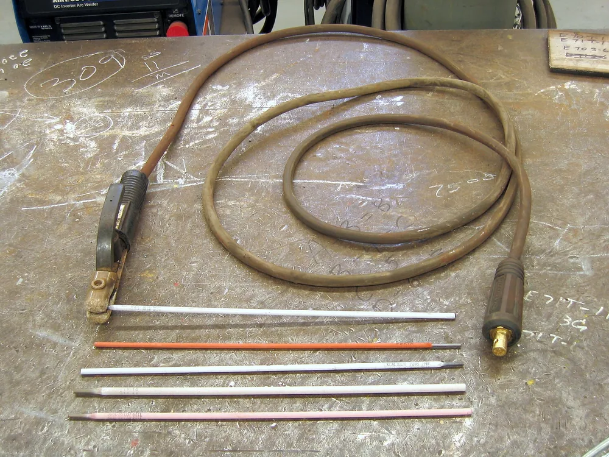
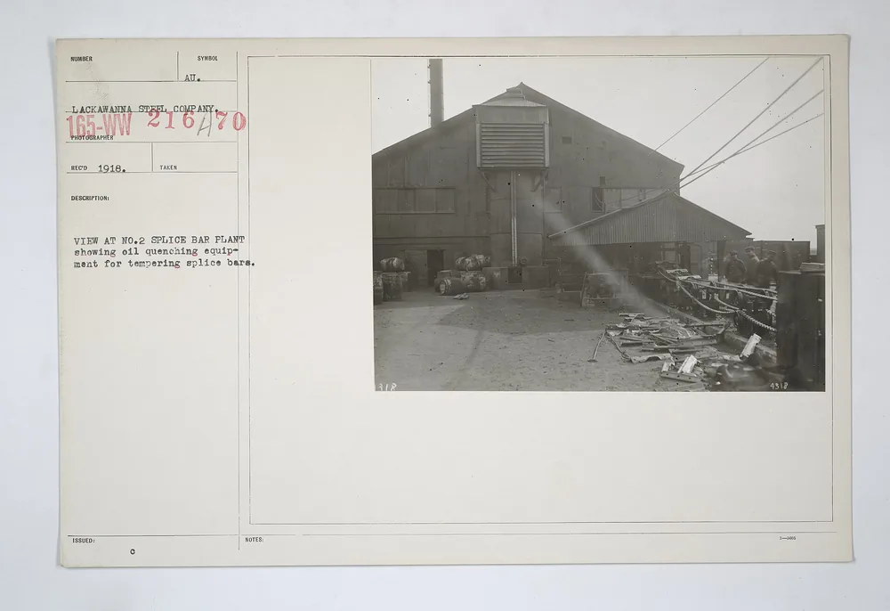

Зона термического влияния (ЗТВ) — участок основного металла рядом с резом или швом: он не плавился, но нагрелся настолько, что изменил структуру и свойства. В ЗТВ растут твёрдость и хрупкость, возникает риск трещин, а у нержавейки падает коррозионная стойкость. Шире всего зона при газовой резке, уже всего при лазерной, а гильотина и гидроабразив её не создают.

## Что такое зона термического влияния и почему она важнее самого шва

После термической резки рядом с кромкой часто остаются цвета побежалости. Видимая полоса показывает нагрев поверхности, но граница изменённого металла может проходить иначе. ЗТВ находится между расплавленным или выгоревшим участком и основным металлом, который сохранил исходную структуру.

У сварного соединения можно выделить металл шва, ЗТВ и неизменённый основной металл. При резке вместо шва остаётся кромка, однако принцип тот же: источник тепла проходит вдоль детали, а соседний слой нагревается и остывает. Он не переходит в жидкое состояние, но переживает структурные превращения.

Слабым местом иногда становится именно ЗТВ. Шов может соответствовать требованиям, тогда как соседний металл получает закалочную структуру или остаточные напряжения. Это влияет на хрупкость, стойкость к трещинам, коррозию и последующую обработку.

Ширина зоны сама по себе не описывает весь риск. Для детали важны марка стали, максимальная температура, скорость охлаждения и место приложения нагрузки. Поэтому ЗТВ оценивают вместе с режимом резки или сварки и требованиями чертежа.

> ЗТВ не плавилась, но после нагрева это уже не тот металл, который поступил на производство.

<!-- inline-cta -->

## Как формируется ЗТВ: нагрев, остывание и время t8/5

*Сварочные электроды и держатель электрода — основной инструмент дуговой сварки. Фото: [участник Wikimedia Commons](https://commons.wikimedia.org/wiki/File:Arc_welding_electrodes_and_electrode_holder.triddle.jpg) · [Public domain](https://creativecommons.org/publicdomain/mark/1.0/)*

Каждая точка рядом с резом или швом проходит свой термический цикл. Ближе к источнику тепла температура выше, дальше — ниже. Поэтому внутри ЗТВ соседствуют участки с разной историей нагрева. Точные границы зависят от состава стали и режима обработки.

Процесс похож на закалку ножа: результат задаёт не один нагрев, а сочетание пиковой температуры и скорости остывания. Для сварных сталей скорость охлаждения описывают временем t8/5 — периодом, за который металл остывает с 800 до 500 °C и проходит диапазон основных структурных превращений.

> Структуру ЗТВ определяют два параметра: до какой температуры нагрелась точка и как долго она остывала с 800 до 500 °C.

На ширину зоны влияет температуропроводность — способность материала распределять тепло. У нержавеющей стали типа AISI 304 показатель составляет 4,2 мм²/с, у конструкционной стали — 11,72 мм²/с. При одинаковом режиме тепло в нержавейке уходит медленнее, поэтому ЗТВ может оказаться шире.

Толщина листа, скорость движения источника и отвод тепла оснасткой тоже меняют картину. Универсальную ширину ЗТВ в миллиметрах назначить нельзя: её подтверждают на конкретном материале и режиме.

> **Факт.** Время t8/5 измеряет охлаждение металла с 800 до 500 °C — в диапазоне структурных превращений.

## Что происходит с металлом: твёрдость, закалка и отпуск

Максимальную твёрдость в углеродисто-марганцевых и низколегированных сталях ожидают там, где основной металл один раз нагрелся выше приблизительно 800 °C. В такой точке может образоваться мартенсит — твёрдая и хрупкая структура, возникающая при быстром охлаждении стали.

Чем меньше t8/5, тем быстрее охлаждается металл и тем выше может быть доля мартенсита. При увеличении t8/5 охлаждение замедляется, а твёрдость ЗТВ снижается. Связь зависит от химического состава: одна и та же скорость даст разный результат для малоуглеродистой и легированной стали.

Поэтому твёрдость измеряют не в любой точке, а в участке, который прошёл один цикл нагрева выше 800 °C. Замер в другом месте способен пропустить максимум.

Повышенная твёрдость уменьшает запас пластичности. Вместе с водородом она повышает риск холодных трещин. После газовой резки это особенно важно учитывать: зона широкая, а значит, изменённого металла у кромки больше.

> Самая твёрдая точка ЗТВ ожидается там, где металл один раз нагрелся выше 800 °C, а затем быстро остыл.

## ЗТВ при резке: лазер, плазма, газ и методы без зоны

*Закалочная ванна с маслом контролирует охлаждение стали, определяя её твёрдость и структуру при термической обработке. Фото: [Unknown author Unknown author or not provided](https://commons.wikimedia.org/wiki/File:Industries_of_War_-_Metals_-_Steel_-_Lackawanna_Steel_Company_-_View_at_No.2_Splice_Bar_Plant_showing_oil_quenching_equipment_for_tempering_splice_bars_-_NARA_-_45487704.jpg) · [Public domain](https://creativecommons.org/publicdomain/mark/1.0/)*

Способ резки определяет площадь подвода тепла и время его воздействия. Лазерная резка даёт наименьшую ЗТВ среди термических методов, плазменная занимает промежуточное положение, газовая создаёт самую широкую. Гидроабразив и гильотина не перегревают металл, поэтому ЗТВ у кромки не возникает.

| Способ резки | Подвод тепла | ЗТВ | Когда подходит |
|---|---|---|---|
| Лазер | Сфокусирован на малой площади | Наименьшая среди термических способов | Когда важны точная кромка и малое тепловое воздействие |
| Плазма | Дуга шире лазерного луча | Промежуточная | Когда нужен баланс скорости, толщины и стоимости |
| Газ | Широкое пламя и длительный нагрев | Наибольшая среди термических способов | Для подходящих сталей и толщин с последующей обработкой кромки |
| Гидроабразив | Холодная струя с абразивом | Нет | Когда нельзя менять структуру и твёрдость кромки |
| Гильотина | Механический сдвиг | Нет | Для прямолинейного раскроя без сложного контура |

### Лазер и плазма

Лазер концентрирует энергию на небольшом пятне и быстро проходит контур. Плазменная дуга шире, поэтому прогревает больший участок. Режим плазмы выбирают вместе с толщиной, качеством кромки и возможностями оборудования.

### Газовая резка

Газокислородная резка сочетает интенсивный нагрев, широкое пламя и сравнительно медленное движение. Поэтому она формирует самую широкую ЗТВ среди термических способов. Если кромку предстоит сваривать или обрабатывать начисто, в чертеже нужен припуск на удаление изменённого слоя. Его величину назначает технолог для материала и толщины.

### Резка без ЗТВ

Гидроабразивная резка не перегревает металл и подходит для сложного контура. Гильотина также не создаёт ЗТВ, но ограничивает геометрию реза. При выборе полезно сопоставить эти варианты с другими способами: [как выбрать между гибкой, штамповкой и лазерной резкой](/blog/gibka-shtampovka-lazernaya-rezka-vybor-metoda).

## Чем опасна ЗТВ: хром и водород

ЗТВ повреждает разные стали по разным механизмам. Для нержавеющей стали критична коррозионная стойкость, для закаливающихся сталей — твёрдость и холодные трещины.

В нержавеющей стали у границ зёрен содержание хрома может упасть ниже 10,5 %. В этих местах металл теряет способность образовывать пассивную плёнку и перестаёт быть нержавеющим. Для детали, работающей в агрессивной среде, одного внешнего осмотра недостаточно: метод испытания задают в технических требованиях.

Водород, оставшийся в металле, может вызвать трещину спустя 24 часа после нагрева. Поэтому немедленный контроль не всегда показывает окончательное состояние соединения. Выдержку перед проверкой назначают по применимой технологии и нормативной документации.

Перед сваркой кромку после термической резки зачищают от окалины и загрязнений. Требование к глубине зачистки задаёт технолог для конкретного материала.

> ЗТВ может проявить себя позже: водородная трещина — после выдержки, потеря стойкости нержавейки — во время эксплуатации.

## Как держать ЗТВ под контролем при сварке: t8/5, подогрев, погонная энергия

Технолог управляет ЗТВ через тепловой цикл. Подогрев и увеличение погонной энергии замедляют охлаждение, увеличивают t8/5 и могут снизить твёрдость закаливающейся стали. Режим нельзя выбирать по одному показателю: он зависит от марки, толщины и конструкции соединения.

Последовательность решения выглядит так:

1. Уточнить марку, толщину, состояние поставки металла и конструкцию соединения.
2. Рассчитать ориентировочное t8/5 для выбранного процесса и геометрии.
3. Подобрать подогрев, погонную энергию и порядок проходов.
4. Выполнить пробное соединение при критичных требованиях.
5. Измерить твёрдость в участке вероятного максимума и проверить заданные свойства.

Расчёт t8/5 по уравнениям, переработанным для дуговой сварки, даёт среднее отклонение от измеренных значений в пределах 8 %. Это полезный ориентир для выбора режима, но не замена испытанию.

Неопределённость прогноза твёрдости ещё заметнее. Для модели прогноза максимальной твёрдости ЗТВ стандартное отклонение составляет 28 HV, а большинство значений лежит в пределах ±56 HV. При прогнозе 250 HV фактический результат может попасть в диапазон 194–306 HV. Если среда или норматив ограничивает твёрдость, решение принимают по замеру.

> **Мнение.** Если предельная твёрдость влияет на безопасность или стойкость детали, используйте расчёт для выбора режима, а соответствие подтверждайте испытанием образца.

## Что прописать в чертеже и заявке, чтобы ЗТВ не испортила деталь

В чертеже нужно задавать проверяемый результат: допустимый способ резки, необходимость удаления изменённого слоя и метод контроля. Фраза «не допускать перегрева» не даёт технологу критерия приёмки и не объясняет, какая кромка нужна для последующей операции.

Перед отправкой заявки проверьте пять строк:

- **Способ раскроя.** Укажите лазер, плазму, газ или требование «резка без ЗТВ», если структура кромки критична.
- **Припуск.** Назначьте припуск на снятие ЗТВ под чистовую обработку; после газовой резки он обычно нужен больше, чем после лазерной.
- **Подготовка к сварке.** Потребуйте удалить окалину, загрязнения и изменённый поверхностный слой с кромки.
- **Требования к нержавейке.** Задайте стойкость к межкристаллитной коррозии и согласованный метод проверки.
- **Контроль.** Укажите предельную твёрдость, точки замера и необходимость выдержки перед дефектоскопией.

Припуск на зачистку позволяет снять ЗТВ с функциональной поверхности. Конкретный размер нельзя переносить с другой детали: его связывают со способом резки, толщиной, маркой материала и глубиной последующей обработки.

[Марка металла и её влияние на обработку и цену](/razdel/materialy.html) нужны исполнителю до расчёта технологии. Если изменённую кромку требуется убрать начисто, заранее согласуйте [фрезерную обработку кромки после резки](/frezerovka.html). Это позволит учесть припуск, базирование и итоговый допуск в одной технологической цепочке.

## Как проверить ЗТВ и какие ошибки чаще всего приводят к браку

ЗТВ проверяют методами, которые отвечают конкретному риску. Твёрдость по Виккерсу показывает упрочнённые участки. Макро- и микрошлифы выявляют границы зоны и структуру. Ударные испытания оценивают сопротивление хрупкому разрушению. Визуальный, ультразвуковой, капиллярный и магнитопорошковый контроль ищут дефекты, но сами по себе не определяют структуру металла.

Контроль планируют после требуемой выдержки, поскольку водородные трещины появляются не сразу. Точки измерения твёрдости располагают в участке вероятного максимума — там, где основной металл прошёл один цикл нагрева выше 800 °C.

Чаще всего к браку приводят четыре решения: способ резки оставили на усмотрение производства; припуск не учитывает удаление ЗТВ; нержавейку обрабатывают по режиму конструкционной стали; твёрдость измеряют вдали от вероятного максимума. Разбор смежных причин собран в материале о том, [какие ошибки чаще всего ведут к браку при обработке металла](/blog/brak-pri-obrabotke-metalla-prichiny-oshibki).

> ЗТВ можно удержать в допустимых пределах: выбрать способ резки, задать припуск, согласовать тепловой цикл и проверить критичное свойство.

Чтобы оценить риск до запуска, передайте исполнителю чертёж, марку и толщину металла, требования к кромке, среде эксплуатации и контролю. По этим данным технолог подберёт маршрут и отметит параметры, которые нужно подтвердить образцом.

## Частые вопросы

### Какие стали сильнее всего страдают от зоны термического влияния?

Чувствительность зависит от механизма повреждения. Высокоуглеродистые и низколегированные стали могут закаливаться при быстром охлаждении, повышая твёрдость и риск холодных трещин. Нержавеющая сталь в ЗТВ может потерять коррозионную стойкость из-за обеднения границ зёрен хромом.

### Чем лазерная резка лучше плазменной и газовой по ЗТВ?

Лазер подводит тепло к малой площади и создаёт наименьшую ЗТВ среди термических способов. У плазмы зона промежуточная, у газовой резки — самая широкая. Это не делает лазер универсальным выбором: нужно учитывать толщину, допустимую кромку и стоимость операции.

### Что указать в чертеже, чтобы ограничить влияние ЗТВ?

Укажите способ резки либо требование сохранить исходную структуру кромки, припуск на удаление ЗТВ и подготовку к сварке. Для ответственной детали задайте предел твёрдости, точки контроля и выдержку. Для нержавейки добавьте требование по стойкости к межкристаллитной коррозии.

## Источники

- [All You Need to Know About the Heat-Affected Zone](https://www.thefabricator.com/thefabricator/article/shopmanagement/all-you-need-to-know-about-the-heat-affected-zone) — The Fabricator
- [The Prediction of Maximum HAZ Hardness in C-Mn and Low Alloy Steel Arc Welds](https://www.twi-global.com/technical-knowledge/published-papers/the-prediction-of-maximum-haz-hardness-in-c-mn-and-low-alloy-steel-arc-welds-june-2008) — TWI Global
